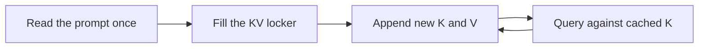
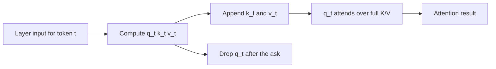
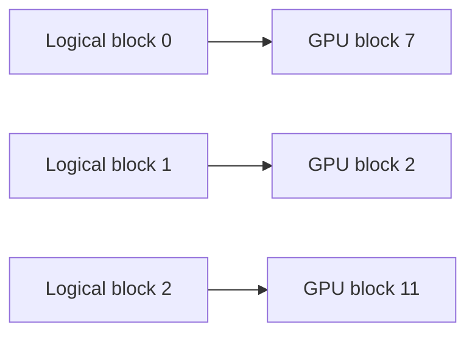
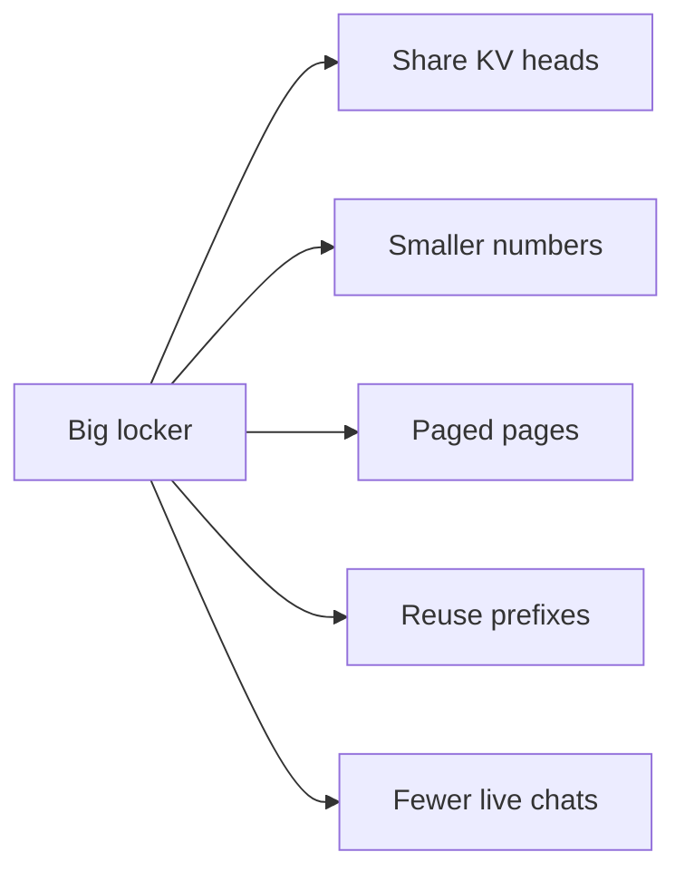

<div class="callout">
<p><strong>TL;DR</strong></p>
<ul>
<li>A chatbot answers one token at a time. Prefill writes prompt Keys and Values into a locker. Decode computes a fresh Query, appends one new K/V pair, and asks the whole locker. Old Queries are not stored.</li>
<li>Raw KV size is <code>2 × L × T × Hkv × d × b</code>. A teaching example (32 layers, 8 KV heads, 128, BF16) is <strong>128 KiB per position</strong>, <strong>1 GiB at 8,192 tokens</strong>, and <strong>32 GiB for 32 unshared chats</strong>. That is formula math, not a stopwatch on our GPUs.</li>
<li>GQA/MQA shrink the locker because they cut KV heads. Paging cuts reserved empty space. It does not compress K/V and does not mean CPU offload.</li>
<li>Shared prefixes can skip repeated prefill. Generation still runs. Hits need exact tokens and a live cache identity.</li>
<li>KV pressure can queue or preempt <em>without</em> a GPU OOM. Measure free blocks, prefix hits, TTFT, and ITL separately from total VRAM.</li>
</ul>
</div>

---

The ticket said the GPU was fine. Users said the chat was stuck.

I opened the usual graph. Memory sat around sixty percent. No OOM. No red bar. Still the queue grew, a few in-flight replies hiccuped, and one request started its prompt again.

I have seen this shape more than once. The model weights were not the leaking bucket. The **KV cache** was. That locker can fill, evict, and stall a batch while `nvidia-smi` still looks polite.

This page is the diary I wish I had on that afternoon. The stall is a **teaching scene**, not a log from our cluster. The locker picture is still the right first picture. The nine desks after it are what I actually check now.




---

<a id="locker"></a>
## The locker I already knew

A chatbot answers **one token at a time**.

You type a long question. It starts typing back. Token. Token. Token.

The model should **not** rebuild your whole chat from scratch for every new token. That would redo every old attention step just to add one word.

The fix is a locker of past **Keys** and **Values**. That store is the **KV cache**. I still think of stickies on a locker door, because the jobs are that simple.

| Vector | Name | Job |
| --- | --- | --- |
| **Q** | Query | What am I looking for? |
| **K** | Key | What label do I wear? |
| **V** | Value | What info do I carry? |

Attention is a matching step:

1. The new token’s **Q** looks at every earlier token’s **K**.
2. Good matches get higher scores.
3. Those scores mix the matching tokens’ **V** vectors into one result for “what should I say next?”

Q asks. K labels. V carries.


Generation has two phases.

**Prefill** reads the whole prompt once. For every prompt token it makes K and V and **stores** them. Then it predicts the first output token. That wait is usually **time to first token (TTFT)**.

**Decode** emits one token at a time. For each new token you make **q, k, v** for *that* token only, put the new **k** and **v** in the locker, and use the new **q** against **all** cached keys.

Why not cache old Q as well? To pick the **next** token you only need a fresh Query for the newest token. You still need **every past K and V**, because that new Q must match the whole history. Old Q already did its job. Past K and V for a finished position **do not change**.

We cache Keys and Values. Not a QKV cache.


Without the locker, adding `on` after `The cat sat` remakes K and V for the whole string. Then `the` remakes them again. The redo grows with the chat.

| Path | Cost |
| --- | --- |
| **RECOMPUTE** | Remake every old K and V. Lots of redo. |
| **CACHE** | Keep old K and V. Pay GPU memory (VRAM) instead. |

Cache trades locker space for less recompute. It is not free, and it is not magic zero-work. Decode still **reads** the growing locker. It just does not **rebuild** every old sticky.

That is the beginner picture. It is still true. The rest of this diary is what I wrote once the locker started hurting production.

---

<a id="desk-1"></a>
## Desk 1 — What a decode step reads and writes

I drew one step on paper before I touched metrics.

Prefill has already built prompt K/V. Decode takes the latest token, not the whole prompt again.

For the current token at one layer:

1. Take that layer’s hidden state.
2. Compute **q_t**, **k_t**, **v_t**.
3. **q_t** is transient. It is used and then gone.
4. **Append** k_t and v_t to that layer’s K and V lockers.
5. Attention is **q_t against the full cached K/V**.
6. Move to the next layer. **Each layer has its own locker.**

Past queries are not in the locker. Dark cells on a diagram are the new pair. Everything older is reread, not remade.




Toy walkthrough. No customer data.

```text
["The", "cat", "sat"]   # already in the locker after prefill
q_on, k_on, v_on = project("on")
K = concat(K_cache, k_on)
V = concat(V_cache, v_on)
scores = q_on · K
mix = softmax(scores) · V
next_token = pick_from(mix)
```

When the reply finishes, that chat’s locker can be **freed**. It is request memory, not a forever database.

If decode is slow, I first ask: is this step **writing** one pair, or **rereading** a huge locker?

---

<a id="desk-2"></a>
## Desk 2 — Memory accounting

The locker lives in fast GPU memory (**VRAM** / HBM) while the answer is being written.

I used to say “it grows with tokens.” That is true and not enough. The raw payload is a product:

$$
\text{raw KV} = 2 \times L \times T \times H_{\mathrm{kv}} \times d \times b
$$

| Symbol | Meaning |
| --- | --- |
| **2** | Key + Value |
| **L** | Attention layers |
| **T** | Cached positions for this sequence |
| **Hkv** | KV heads per layer |
| **d** | Head dimension |
| **b** | Bytes per element (2 for BF16/FP16) |

Query heads do **not** sit in this product. Only KV heads do.

If many chats do **not** share a prefix, T becomes the **sum** of their lengths. Thirty short chats can cost as much as one long one.

This is the **raw tensor**. Padding, block tables, replication, weights, and runtime buffers sit on top. Windowed or hybrid attention changes what you count as live state. I still start with the raw product so I know the floor.

---

<a id="desk-3"></a>
## Desk 3 — A worked GiB example

I wanted a number I could hold in my head. Same product as above. **Teaching math from the formula**, not a measurement on Intelliwise GPUs.

Assume:

- 32 layers
- 8 KV heads
- 128 elements per head
- BF16 / FP16 → 2 bytes

Per cached position, across all layers:

$$
2 \times 32 \times 8 \times 128 \times 2 = 131{,}072\ \text{bytes} = 128\ \text{KiB}
$$

Then:

| What you cache | Raw KV |
| --- | --- |
| 1 position | **128 KiB** |
| 8,192 positions | 128 KiB × 8,192 = **1 GiB** |
| 32 unshared sequences of 8,192 | **32 GiB** |


That is why a “small” context jump shows up as gigabytes. Batch those chats and the locker can rival the weights.

I write this on the ticket now: *raw payload only*. Metadata, padding, and a second replica are extra. Do not treat 1 GiB as a promise for your laptop.

---

<a id="desk-4"></a>
## Desk 4 — Heads decide locker size

The next wrong turn is treating GQA like a runtime switch.

At a fixed L, T, d, and byte width, **KV payload follows KV head count**.

| Layout | Query heads | KV heads | Locker |
| --- | --- | --- | --- |
| **MHA** | Same as KV | One K/V per query head | Largest |
| **GQA** | Many | Fewer KV heads, shared by groups | Smaller |
| **MQA** | Many | One KV head | Smallest |

A four-query-head sketch: MHA stores four K/V pairs, GQA two, MQA one. The Queries still fan out. The locker does not.


<a href="https://arxiv.org/abs/2305.13245" target="_blank" rel="noopener">Grouped-query attention (Ainslie et al., 2023)</a> sits between multi-head and multi-query. Sharing is baked into the checkpoint. You do not “turn on GQA” in the serving config the way you turn on a prefix cache. If you need a smaller locker, you pick a GQA/MQA model, or you cut T, bytes, or live sequences.

---

<a id="desk-5"></a>
## Desk 5 — Pages are not compression

The stall that looks like “we reserved too much empty space” is a paging story.

Older serving stacks pre-allocate a **contiguous** slab for the worst-case length. Most chats never use the tail. That reserved air still blocks other requests.

<a href="https://arxiv.org/abs/2309.06180" target="_blank" rel="noopener">PagedAttention (Kwon et al., 2023)</a> treats the locker like virtual memory. Logical blocks stay in token order. Physical GPU blocks can sit anywhere. vLLM’s <a href="https://docs.vllm.ai/en/latest/design/paged_attention/" target="_blank" rel="noopener">paged attention notes</a> are the serving write-up of that idea.

Toy picture from the usual teaching sketch: 10 cached positions, 4 slots per block. That is three logical blocks. They might map to GPU blocks 7, 2, and 11. Three blocks × 4 slots = 12 slots, so **two slots sit empty**. You wasted a little tail, not a whole 8k reservation.




Two things paging does **not** do by itself:

- It does **not** compress K/V. The numbers are the same size.
- It does **not** mean CPU offload. Offload is a separate lever.

Paging reduces **waste**. If the raw product is already 32 GiB, pages will not turn it into 8 GiB.

---

<a id="desk-6"></a>
## Desk 6 — Prefix reuse

The next graph I opened was TTFT. Prefill was doing the same system prompt and the same document again and again.

If request A and request B share an exact prefix — system tokens, then the same document tokens — the serving engine can keep that prefix K/V and skip that part of prefill. The questions differ. Generation still runs.


vLLM’s <a href="https://docs.vllm.ai/en/latest/design/prefix_caching/" target="_blank" rel="noopener">automatic prefix caching</a> hashes a block by its tokens plus the prefix before it. A hit needs:

- the **same token IDs**, in the same order
- the **same prior context** (parent blocks)
- a matching **cache identity** (model, LoRA, multimodal extras, isolation salt)

One extra space can miss. A block that lined up on a page boundary yesterday may need a little recompute today. Retained prefixes can also be **evicted** when the pool is tight. Honor tenant isolation. Do not treat a shared locker as a shared secret.

Prefix reuse cuts **prefill work**. It does not make decode free.

---

<a id="desk-7"></a>
## Desk 7 — Capacity levers

Once I knew the locker size, I wrote the knobs I actually have. Each one buys something and spends something.

| Lever | Main gain | Trade-off to check |
| --- | --- | --- |
| **Shorter context** | Less KV payload | Input / output budget |
| **Fewer live sequences** | Less live KV | Queue time may rise |
| **KV quantization** | Fewer bytes in the locker | Quality, scales, kernels |
| **Prefix reuse** | Less prefill | Exact hits; eviction |
| **CPU offload** | Less KV on the GPU | Transfer bandwidth |
| **Model sharding** | Split state across devices | KV layout; network cost |



Less live KV may **not** shrink a reserved pool if you still allocate for max length. Measure latency and quality on **real** workloads. I did not invent a bake-off here.

---

<a id="desk-8"></a>
## Desk 8 — What I would measure

This is the list I now want on the dashboard before I say “the GPU is fine.”

| Signal | What it tells you |
| --- | --- |
| **KV usage + free blocks** | Per-worker cache pressure |
| **Lengths + concurrency** | What is driving live KV demand |
| **Prefix hit rate** | Reused tokens / queried tokens |
| **Preemptions** | Evicted, inspected, recomputed |
| **Queue time + TTFT** | Waiting vs time to first token |
| **ITL + transfer time** | Gap between tokens, plus any offload copy |

Free blocks can still hold **evictable prefixes**. A pool that looks “used” may still have reuse in it. A pool that looks “free” may still refuse a new 8k prompt.

Track p50 / p95 / p99 by workload. A RAG batch and a long-chat batch lie to you if you average them.

---

<a id="desk-9"></a>
## Desk 9 — Troubleshooting the stall

I used this table on the afternoon the graph looked healthy.

| Symptom | Inspect first | Next test |
| --- | --- | --- |
| **Preemptions / stalls** | Live KV length, free blocks, active requests | Admission, prompt/output limits, KV budget |
| **High TTFT** | Queue time, uncached prompt, prefix hits | Split queue wait from prefill before you tune the cache |
| **Slow ITL** | Context length, batch size, attention / transfer time | Memory traffic vs compute |
| **Unexpected prefix misses** | Token IDs, prior context, adapter / cache identity | Exact prefix; check eviction |
| **GPU OOM** | Weights + KV pool + activations + workspace | Cut allocation; leave headroom; re-profile |
| **Quantization quality loss** | Cache dtype, scales, long-context quality | Compare BF16/FP16; calibrate or restore precision |

The line I wrote at the bottom of the page:

**A KV shortage can queue or preempt without a GPU OOM. Inspect cache pressure and total GPU memory separately.**

That was the ticket. The card was not full. The locker was.

---

<a id="lesson"></a>
## What I wrote on the last page

The sticky-notes story is still the one I teach first. Q asks. K labels. V carries. Prefill fills the locker. Decode appends one pair. We do not keep old Queries.

The production story is the product, the pages, and the queue.

If the locker is 128 KiB per position in the teaching example, 8k tokens is already a gigabyte before you batch. If those chats do not share a prefix, you pay again. Paging stops you wasting empty reserved slabs. GQA shrinks the payload only if the model was built that way. Prefix hits save prefill, not decode.

And if users wait while the GPU graph stays green, I no longer start with “buy more VRAM.” I start with **who is holding blocks, how long they are, and whether we are recomputing a prefix we already paid for**.

---

## Honest caveats

- KV cache is an **inference** trick. Training has a different story.
- Caching K/V does **not** remove attention over history. It removes **recomputing** old K/V.
- Longer context still costs more memory and more cache reads.
- Prefix hits need **exact** matching token prefixes. One space change can miss.
- The GiB figures above are the formula on a made-up 32-layer / 8-KV-head shape. They are not a promise for your laptop or our serving boxes.
- Paging is not quantization. Offload is not paging. Head sharing is not a flag you flip at lunch.

---

## Terms used in this post

| Term | Meaning |
| --- | --- |
| **token** | Word piece the model reads or writes |
| **query (Q)** | “What am I looking for?” |
| **key (K)** | “What label do I wear?” |
| **value (V)** | “What info do I carry?” |
| **KV cache** | Stored past K and V |
| **VRAM** / **HBM** | Fast GPU memory |
| **prefill** | Read the prompt once and fill the cache |
| **decode** | Emit one output token at a time |
| **TTFT** | Time to first token |
| **ITL** | Inter-token latency — gap between tokens |
| **MHA / GQA / MQA** | How many KV heads you store per query heads |
| **PagedAttention** | Allocate cache pages on demand, not one contiguous slab |
| **prefix caching** | Reuse a shared prompt prefix’s K/V |
| **preemption** | Kick a live request out of the locker so another can run |

---

## Sources and further reading

Mechanics, not our measurements:

- <a href="https://arxiv.org/abs/2309.06180" target="_blank" rel="noopener">Efficient Memory Management for Large Language Model Serving with PagedAttention (arXiv:2309.06180)</a>
- <a href="https://docs.vllm.ai/en/latest/design/paged_attention/" target="_blank" rel="noopener">vLLM — Paged attention design notes</a>
- <a href="https://docs.vllm.ai/en/latest/design/prefix_caching/" target="_blank" rel="noopener">vLLM — Automatic prefix caching</a>
- <a href="https://arxiv.org/abs/2305.13245" target="_blank" rel="noopener">GQA: Training Generalized Multi-Query Transformer Models (arXiv:2305.13245)</a>

---

## In short

**A chatbot keeps past Keys and Values so it does not rebuild every old sticky for every new token. Fresh Queries still ask the whole locker. That makes streaming possible — and makes long, concurrent chats a memory and scheduling problem. If the GPU looks fine and chats still stall, walk the locker: the formula, the pages, the prefix hits, and the queue. A full locker does not have to look like an OOM.**
