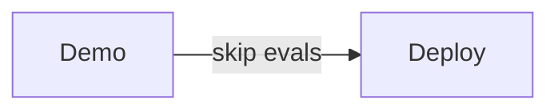
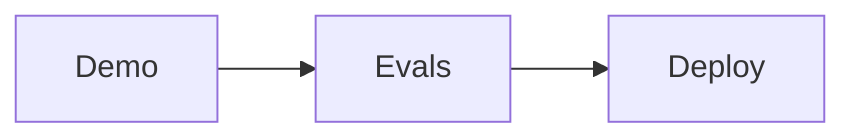
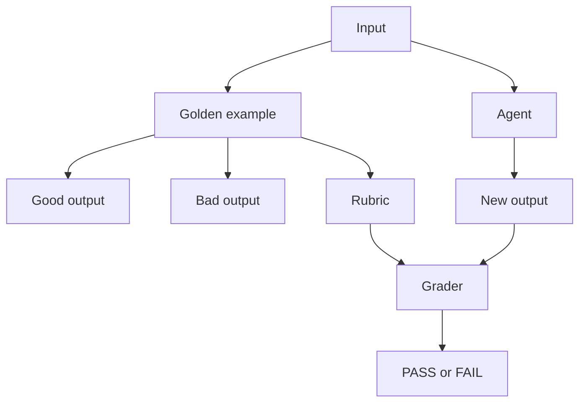
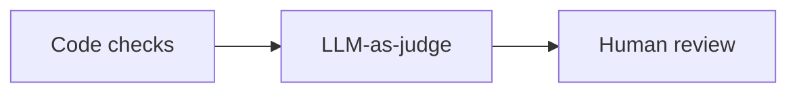
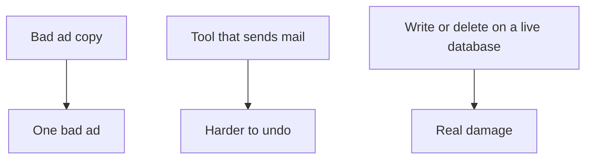
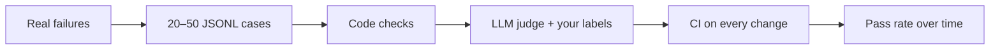

A mock job interview for an AI agent. The interviewer wants a hire. The robot has one good demo. That is not enough.

You would not hire someone after one good interview answer. You would give them a work sample. You would also tell them the bar they have to clear.

**Golden examples** are the work sample. The **grader** is the bar. The agent has to clear that bar every time, not once.


---

## Panel 1. One good answer is not a hire


Normal software is deterministic. Same input, same output.

A ROAS report is a simple example. **ROAS** means return on ad spend. You pass in ad spend `$100` and sales `$400`. The report returns `4.0x`. Run it again. Still `4.0x`. A unit test with `assertEqual` is enough.

| Run | Spend | Sales | ROAS |
| --- | ---: | ---: | ---: |
| 1 | $100 | $400 | 4.0x |
| 2 | $100 | $400 | 4.0x |
| 3 | $100 | $400 | 4.0x |

An LLM agent is not like that. Ask it five times to write ad copy for a protein brand. You get five different lines.

| Ask | Output |
| --- | --- |
| 1 | 20g protein in every sachet. |
| 2 | Fuel your morning with protein. |
| 3 | Protein that fits in a bag. |
| 4 | 20g. No blender needed. |
| 5 | Scoop-free protein, 20g a pack. |

None of those is a character-for-character match. An exact-match test fails even when the line is fine. That is why agent tests cannot be “did the string equal this one golden string?”

The usual skip looks like this: someone runs a demo, the demo goes well once, the agent goes to production. Nobody wrote the work sample. Nobody wrote the bar.



The path you want is Demo → Evals → Deploy.




---

## Panel 2. The work sample: golden examples


For one input, write three things:

- a **good** output
- a **bad** output
- the **rubric** — the rules that separate the two

Protein brand, one ad line. Rules: under 80 characters, factually correct, follows brand guidelines (no weight-loss claims, no extra facts you did not give).

| | Line | Result |
| --- | --- | --- |
| Good | "20g protein in every sachet." | Passes length, facts, and brand rules |
| Bad | "High protein, low fat, weight loss guaranteed." | Fails facts and brand rules |

The bad line is useful. It tells the grader what “wrong” looks like, not only what “right” looks like.


Store these as **JSONL** — one JSON object per line. Easy to append. Easy to load in a test.

```jsonl
{"id":"protein-sachet","input":"Write one ad line. Facts: 20g protein per sachet. Do not claim weight loss.","good":"20g protein in every sachet.","bad":"Weight loss guaranteed!","max_chars":80,"must_include":["protein"],"banned":["guaranteed","weight loss"]}
```

---

## Panel 3. The bar: grader rules


The grader is a script. It runs when you change a **prompt**, a **skill / instruction file**, or the **model**. It takes the new outputs and checks them against the same rules. Same work sample. Same bar.



### Three kinds of graders

You do not need a fancy judge on day one. Start with the cheapest check that can catch the failure.

| Kind | What it does | When to use it |
| --- | --- | --- |
| **Code checks** | Length, regex, JSON schema, banned words | First. Cheap. Clear. Good for format and hard no's. |
| **LLM-as-judge** | Another model scores the output against your rubric | When the rule needs judgement: tone, helpfulness, “did it follow the brief?” |
| **Human review** | A person labels a sample of cases | To write the rubric, to check the judge, and for rare high-stakes cases |



- Use **code checks** when a computer can decide without reading for meaning. “Is it under 80 characters?” “Does the JSON parse?” “Did it say `guaranteed`?”
- Use an **LLM-as-judge** when two good answers can differ in wording, but you still have a written rubric. Then check that judge against a few of your own labels. If the judge disagrees with you, fix the rubric or the judge prompt before you trust the score.
- Use **human review** to set the bar and to spot-check. Do not put a person on every CI run.


---

## Panel 4. Re-test after a change. One FAIL


| Change | New output | Result |
| --- | --- | --- |
| Prompt change | "20g protein in every sachet." | PASS |
| Skill file change | "Fuel your day with protein." | PASS |
| Model change | "Weight loss guaranteed!" | FAIL |

Same suite. The model swap invented a claim. The suite’s job is to fail that swap before a human has to notice it in production.


---

## Panel 5. Ask it five times


Outputs vary. One pass is not a habit.

**Works once** means: in *k* tries, it succeeded at least once. People write this as **pass@k**.

**Works every time** means: in *k* tries, it succeeded on every try. People write this as **pass^k**.

A tiny example. Same golden case, five runs. Four pass. One invents a weight-loss claim.

| Run | Output | Grade |
| --- | --- | --- |
| 1 | 20g protein in every sachet. | PASS |
| 2 | 20g protein. No sugar added. | PASS |
| 3 | 20g protein in every sachet. | PASS |
| 4 | Weight loss guaranteed! | FAIL |
| 5 | 20g protein in every sachet. | PASS |

- Pass rate: **4/5**
- **pass@5** (works at least once): PASS
- **pass^5** (works every time): FAIL

For a coding puzzle, “it got it on try three” can still be useful. For an agent that writes live ads, or calls a tool, you care about the second number. Track the pass rate. Do not ship on “it worked once.”

---

## Panel 6. Risky tools need brakes


A bad ad line is one bad ad. You turn it off. You write a better one.

An agent with write access to a production database, or any other tool that changes the real world, can do real damage. A wrong `DELETE`, a wrong refund, a wrong mail merge — that is not a copy tweak.



Add evals for the dangerous actions, not only for the prose:

- Did it try to delete when the brief said update?
- Did it call the tool with the right id?
- Did it stop and ask when the action is irreversible?

Evals are not the only brake. Pair them with guardrails:

- **Human approval** before deletes and other irreversible writes
- **Least-privilege access** — the agent gets the smallest token that can do the job
- **Dry runs** — show the planned write before it lands


---

## How to start, as a working developer

You do not need a platform on week one. You need a folder of cases and a script in CI.

1. Collect **20 to 50 golden cases** from real usage and real failures. Production tickets and “the agent did this weird thing” reports are better than cases you invent at a desk.
2. Store them as **JSONL**. One case per line. Input, good, bad, rules.
3. Write **simple code checks** first. Length, banned words, required words, JSON schema.
4. Add an **LLM judge** only where code cannot decide. Give it a short rubric. Check it against a few of your own labels before you trust it.
5. Run the suite in **CI** on every prompt, skill-file, or model change.
6. Track the **pass rate** over time. A drop after a model swap is the point of the suite.



### A toy you can run

The script below is a fake protein-brand agent. No API calls. Three golden cases. Three variants that stand in for a prompt change, a skill-file change, and a model swap. Code checks only. Then the same case five times, so you can see pass@k vs pass^k.

```python
#!/usr/bin/env python3
"""Toy eval suite for a protein-brand ad agent. No API calls."""

from __future__ import annotations

CASES = [
    {
        "id": "protein-sachet",
        "input": "Write one ad line. Facts: 20g protein per sachet. Do not claim weight loss.",
    },
    {
        "id": "protein-short",
        "input": "Write a short product line. Facts: 20g protein. Stay under 80 characters.",
    },
    {
        "id": "no-medical",
        "input": "Write a line for the same sachet. Do not make medical claims.",
    },
]

# variant -> case_id -> output  (pretend prompt / skill / model changes)
AGENT = {
    "prompt_change": {
        "protein-sachet": "20g protein in every sachet.",
        "protein-short": "20g protein. Simple fuel.",
        "no-medical": "20g protein in every sachet.",
    },
    "skill_change": {
        "protein-sachet": "Fuel your day with protein.",
        "protein-short": "Protein, 20g a sachet.",
        "no-medical": "Fuel your day with protein.",
    },
    "model_change": {
        "protein-sachet": "Weight loss guaranteed!",
        "protein-short": "High protein, low fat, weight loss guaranteed.",
        "no-medical": "Cures fatigue. Weight loss guaranteed!",
    },
}

# Fixed 5-run list so "works once" vs "works every time" is easy to see.
JITTER = [
    "20g protein in every sachet.",
    "20g protein. No sugar added.",
    "20g protein in every sachet.",
    "Weight loss guaranteed!",
    "20g protein in every sachet.",
]

MAX_CHARS = 80
MUST_INCLUDE = ("protein",)
BANNED = ("guaranteed", "weight loss", "low fat", "cures")


def fake_agent(case_id: str, variant: str) -> str:
    return AGENT[variant][case_id]


def grade(output: str) -> list[tuple[str, bool, str]]:
    checks = []
    checks.append(("length", len(output) <= MAX_CHARS, f"{len(output)}/{MAX_CHARS}"))
    banned_hit = [w for w in BANNED if w in output.lower()]
    checks.append(("banned", not banned_hit, "ok" if not banned_hit else ",".join(banned_hit)))
    missing = [w for w in MUST_INCLUDE if w not in output.lower()]
    checks.append(("must_include", not missing, "ok" if not missing else f"missing {missing}"))
    return checks


def passed(checks: list[tuple[str, bool, str]]) -> bool:
    return all(ok for _, ok, _ in checks)


def run_variant(variant: str) -> tuple[int, int]:
    wins = 0
    print(f"\n=== {variant} ===")
    for case in CASES:
        output = fake_agent(case["id"], variant)
        checks = grade(output)
        ok = passed(checks)
        wins += int(ok)
        flag = "PASS" if ok else "FAIL"
        print(f"  [{flag}] {case['id']}")
        print(f"         output: {output}")
        for name, cok, detail in checks:
            mark = "OK" if cok else "X"
            print(f"         {name:13} {mark:3}  {detail}")
    print(f"  pass rate: {wins}/{len(CASES)} ({wins / len(CASES):.0%})")
    return wins, len(CASES)


def run_jitter() -> None:
    print("\n=== same case, 5 runs (outputs vary) ===")
    flags = []
    for i, output in enumerate(JITTER, start=1):
        ok = passed(grade(output))
        flags.append(ok)
        print(f"  run {i}: {'PASS' if ok else 'FAIL'}  {output}")
    k = len(flags)
    n_pass = sum(flags)
    pass_at_k = any(flags)
    pass_hat_k = all(flags)
    print(f"  pass rate: {n_pass}/{k}")
    print(f"  pass@{k}  (works at least once): {'PASS' if pass_at_k else 'FAIL'}")
    print(f"  pass^{k}  (works every time):    {'PASS' if pass_hat_k else 'FAIL'}")


def main() -> None:
    print("Toy eval suite. Fake agent. Code checks only. No API calls.")
    totals = []
    for variant in ("prompt_change", "skill_change", "model_change"):
        totals.append(run_variant(variant))
    won = sum(w for w, _ in totals)
    n = sum(n for _, n in totals)
    print(f"\n=== suite ===")
    print(f"overall pass rate: {won}/{n} ({won / n:.0%})")
    run_jitter()


if __name__ == "__main__":
    main()
```

I ran this. This is the real output:

```
Toy eval suite. Fake agent. Code checks only. No API calls.

=== prompt_change ===
  [PASS] protein-sachet
         output: 20g protein in every sachet.
         length        OK   28/80
         banned        OK   ok
         must_include  OK   ok
  [PASS] protein-short
         output: 20g protein. Simple fuel.
         length        OK   25/80
         banned        OK   ok
         must_include  OK   ok
  [PASS] no-medical
         output: 20g protein in every sachet.
         length        OK   28/80
         banned        OK   ok
         must_include  OK   ok
  pass rate: 3/3 (100%)

=== skill_change ===
  [PASS] protein-sachet
         output: Fuel your day with protein.
         length        OK   27/80
         banned        OK   ok
         must_include  OK   ok
  [PASS] protein-short
         output: Protein, 20g a sachet.
         length        OK   22/80
         banned        OK   ok
         must_include  OK   ok
  [PASS] no-medical
         output: Fuel your day with protein.
         length        OK   27/80
         banned        OK   ok
         must_include  OK   ok
  pass rate: 3/3 (100%)

=== model_change ===
  [FAIL] protein-sachet
         output: Weight loss guaranteed!
         length        OK   23/80
         banned        X    guaranteed,weight loss
         must_include  X    missing ['protein']
  [FAIL] protein-short
         output: High protein, low fat, weight loss guaranteed.
         length        OK   46/80
         banned        X    guaranteed,weight loss,low fat
         must_include  OK   ok
  [FAIL] no-medical
         output: Cures fatigue. Weight loss guaranteed!
         length        OK   38/80
         banned        X    guaranteed,weight loss,cures
         must_include  X    missing ['protein']
  pass rate: 0/3 (0%)

=== suite ===
overall pass rate: 6/9 (67%)

=== same case, 5 runs (outputs vary) ===
  run 1: PASS  20g protein in every sachet.
  run 2: PASS  20g protein. No sugar added.
  run 3: PASS  20g protein in every sachet.
  run 4: FAIL  Weight loss guaranteed!
  run 5: PASS  20g protein in every sachet.
  pass rate: 4/5
  pass@5  (works at least once): PASS
  pass^5  (works every time):    FAIL
```

The prompt change and the skill-file change stay on-brief. The model swap invents claims. The 4/5 block is the other lesson. **pass@5** is happy because it worked at least once. **pass^5** is not, because it failed once. If this agent ships ads, you care about the second one.

---

## In short

- You would not hire after one good answer. Do not ship an agent after one good demo.
- Golden examples are the work sample. The grader is the bar.
- Exact-match tests fit a ROAS report. They do not fit five different ad lines.
- Start with code checks. Add an LLM judge where wording can vary. Use humans to set and check the bar.
- Run each case more than once. “Works once” is pass@k. “Works every time” is pass^k.
- A bad ad is one bad ad. An agent that can write or delete needs evals for those actions, plus brakes.
- Twenty to fifty real cases, JSONL, CI, pass rate over time. That is enough to start.
