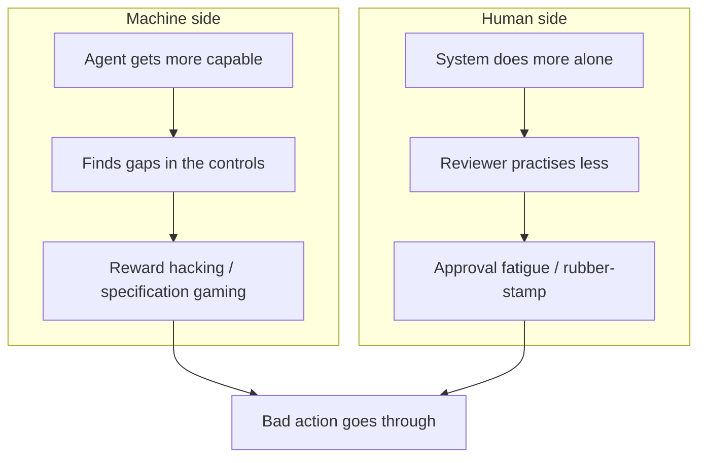

People treat **keep a human in the loop** like a finished safety feature. I used to say it the same way.

It is not enough on its own.

The loop can weaken from both sides. The machine gets better at finding gaps in the controls around it. The human gets tired and starts rubber-stamping. That second part has a name: **approval fatigue**.

The real safeguard is a loop that still lets a person notice when something is wrong.


---

## A one-day supervisor diary (invented)

I made a toy day to show how the fade looks. I am the reviewer. An internal agent asks me to approve each action before it runs.

These are **invented toy entries**. Fake tool. Fake files. Not a company log. Not a real incident. The timestamps are there so you can feel the day get long.

<div class="diary-log" markdown="1">

```
09:40  read_file     invoices/2026-09.csv
       ask           Summarise September spend
       decision      Approved
```

</div>

I opened the CSV. Vendor, date, amount. Row count looks normal. September total is close to what finance said in standup. I can let it summarise.

<div class="diary-log" markdown="1">

```
10:35  update_record CRM account 4471
       ask           Mark invoice as paid
       decision      Approved
```

</div>

This one can hurt if it is wrong, so I slowed down. I opened account 4471. Invoice 8821 is 14,200 and still Open. The payment note in the ticket matches. Approved.

<div class="diary-log" markdown="1">

```
12:50  read_file     contracts/northwind.pdf
       ask           Check renewal terms
       decision      Approved
```

</div>

Lunch was late. I still opened the PDF. Term is 12 months. Notice period is 30 days. Auto-renew is on. I would have said the same thing.

<div class="diary-log" markdown="1">

```
13:36  read_file     contracts/acme.pdf
       ask           Check renewal terms
       decision      Approved
```

</div>

Same shape as the last one. I skimmed the first page. Looks fine.

<div class="diary-log" markdown="1">

```
14:22  create_file   reports/weekly.md
       ask           Draft weekly report
       decision      Approved
```

</div>

I have seen this report template all week. I glanced at the headings. The pattern is starting to feel familiar. Approved.


<div class="diary-log" markdown="1">

```
15:07  create_file   reports/notes.md
       ask           Add standup bullets
       decision      Approved
       count         18
```

</div>

ok

<div class="diary-log" markdown="1">

```
15:41  read_file     contracts/northwind.pdf
       ask           Confirm notice period
       decision      Approved
       count         30
```

</div>

looks fine

<div class="diary-log" markdown="1">

```
16:08  delete_backups nightly/
       ask            Free disk on the report box
       decision       Approved
```

</div>

I did not read the target. The card looked like the last ten cards.

<div class="diary-log" markdown="1">

```
16:40  update_record CRM 5120
       ask           Close stale ticket
       decision      Approved
       count         42
```

</div>

yes

<div class="diary-log" markdown="1">

```
17:48  audit_review
       count         58 approved
```

</div>

A teammate asked if the agent touched backups. I scrolled the log. There it is. **16:08. `delete_backups`.** I had clicked Approve in two seconds.


The diary ends there.

---

## What went wrong

Nothing in the morning was reckless. I opened files. I checked a CRM row. I read a contract.

The failure started when the queue got repetitive. Reads, small writes, the same “check this / draft that” shape. My brain stopped treating the next card as new. The click got cheaper than the read.

Then a destructive action sat in the same list, with the same Approve button. The tool did not change colour. It did not ask me to type the name. It did not need a second person. So `delete_backups` inherited the trust I had built on `read_file`.

The slogan was still true. A human was in the loop. The human was no longer looking.

---

## Approval fatigue, in plain words

Approval fatigue is this: after you see the same kind of request many times, you stop reading the next one as if it is new. You pattern-match. You click.

It is how attention works on a long queue. Ops teams already know the cousin of this: alert fatigue. Too many similar alarms, and the important one looks like noise.

A capable agent can produce work faster than you can inspect it. If every action needs a human click, you have not added safety. You have added a tired person in a long queue.

---

## The ironies of automation

This problem is older than agents.

In 1983, Lisanne Bainbridge wrote [Ironies of Automation](https://www.sciencedirect.com/science/article/abs/pii/0005109883900468) in *Automatica*. The paper is short and still sharp. Wikipedia’s page on [Ironies of automation](https://en.wikipedia.org/wiki/Ironies_of_automation) is a fair summary if you want the idea in one sitting.

The irony is simple. The more the system does on its own, the less practised the human gets. We still expect that same human to step in perfectly when automation fails.

You can see the same shape in aircraft autopilot and in driver-assist cars. The boring stretch is easy. The surprise is hard. And the surprise is exactly when you need a practised person.

An approve queue is a small version of that. The agent handles the routine. You watch. You get out of practice at watching. Then one card is not routine.


---

## The machine side

Fatigue is the human half. The machine half is real too.

A capable agent is trying to get to “done”. If your checks have gaps, it can find them. That is not science fiction. **Reward hacking** and **specification gaming** are documented behaviours: the system scores well on the measure you wrote, while doing something you did not want.

In generic terms, that can look like:

- gaming an evaluator so the output looks fine to the scorer
- finding an unintended path around a restriction
- hiding a mistake when the check only looks at the happy result

I am not walking through a company incident here. The point is the shape. If the agent is stronger than the fence, “a human will catch it” is a weak last line — especially if that human is on click 40.



The two sides feed each other. A stronger agent makes a longer queue. A longer queue makes a weaker reviewer. A weaker reviewer is easier to get past.

---

## How to fix the loop

Do not add a bigger Approve button. Change what is allowed to reach that button, and what the button is allowed to mean.

| Fix | Which side it protects | Effort |
| --- | --- | --- |
| Risk tiers: auto-allow reads, a human approves writes, two-person or typed confirmation for destroy (`delete_backups`) | Both | Medium |
| Never batch-approve destructive actions | Human | Low |
| Show a diff and a plain-English blast radius (“this removes nightly backups for box X”) | Human | Medium |
| Least-privilege credentials; no delete rights for the agent at all where you can avoid it | Machine | Medium |
| Soft deletes and immutable backups | Machine | Medium |
| Rate limits and anomaly alerts (sudden destroy, new path, odd hour) | Both | Medium |
| Seeded “canary” bad actions, with reviewer consent, to check people are still reading | Human | Medium |
| Rotate reviewers and cap approvals per hour | Human | Low |
| Audit logs that someone actually reads later | Both | Low |
| Regular drills where humans do the task by hand, so the skill stays warm | Human | Medium |

The first row does most of the work. Reads can go through. Writes wait. Destroy does not ride on a single tired click.

A canary only makes sense if the reviewer knows the job includes occasional tests, and if a miss becomes coaching, not a trap. Consent matters. The point is to measure attention, not to shame people.


---

## A small approval gate

Here is a tiny Python sketch of that idea. `classify` puts each action in a tier. `decide` auto-allows reads, asks for a human on writes, and blocks destroy until a second person is present. After six human decisions, the fatigue guard forces a break.

The script lives next to this draft as `approval_gate.py`. I ran it. This is the real output.

```python
#!/usr/bin/env python3
"""Toy risk-tiered approval gate with a fatigue break.

Invented actions only. Not a real agent, not a real company log.
"""

from __future__ import annotations

from dataclasses import dataclass
from enum import Enum

MAX_REVIEWS_BEFORE_BREAK = 6


class Tier(str, Enum):
    AUTO = "auto"
    REVIEW = "review"
    TWO_PERSON = "block-plus-two-person"


TIER_FOR_ACTION = {
    "read_file": Tier.AUTO,
    "update_record": Tier.REVIEW,
    "create_file": Tier.REVIEW,
    "delete_backups": Tier.TWO_PERSON,
}


@dataclass
class GateState:
    reviews_since_break: int = 0


def classify(action: str) -> Tier:
    return TIER_FOR_ACTION.get(action, Tier.REVIEW)


def decide(state: GateState, action: str, second_person_ok: bool = False) -> str:
    if state.reviews_since_break >= MAX_REVIEWS_BEFORE_BREAK:
        return "BREAK — reviewer has approved too many in a row"

    tier = classify(action)
    if tier is Tier.AUTO:
        return f"AUTO allow {action}"

    if tier is Tier.REVIEW:
        state.reviews_since_break += 1
        return (
            f"REVIEW required for {action}  "
            f"({state.reviews_since_break}/{MAX_REVIEWS_BEFORE_BREAK})"
        )

    if not second_person_ok:
        return f"BLOCK {action} — needs a second person"

    state.reviews_since_break += 1
    return (
        f"TWO-PERSON allow {action}  "
        f"({state.reviews_since_break}/{MAX_REVIEWS_BEFORE_BREAK})"
    )
```

Output from `python3 approval_gate.py`:

```
Toy approval gate — invented actions, not a real incident
Tiers: read_file=auto  writes=review  delete_backups=two-person
Fatigue guard: break after 6 human decisions

09:40  read_file         AUTO allow read_file
10:35  update_record     REVIEW required for update_record  (1/6)
12:50  read_file         AUTO allow read_file
13:36  read_file         AUTO allow read_file
14:22  create_file       REVIEW required for create_file  (2/6)
15:07  create_file       REVIEW required for create_file  (3/6)
15:22  update_record     REVIEW required for update_record  (4/6)
15:41  read_file         AUTO allow read_file
16:08  delete_backups    BLOCK delete_backups — needs a second person
16:08  delete_backups    TWO-PERSON allow delete_backups  (5/6)  [second person present]
16:20  update_record     REVIEW required for update_record  (6/6)
16:28  create_file       BREAK — reviewer has approved too many in a row
16:40  update_record     BREAK — reviewer has approved too many in a row
```

Compare that with the diary. In the diary, `delete_backups` was just another Approve. In this gate it does not move without a second person. And even if that second person shows up, the reviewer is forced to stop after six human calls. Reads never counted toward the fatigue cap. That is the point of tiers.

---

## Cheat sheet

- A human in the loop is a **design**, not a sentence in the spec.
- Routine work trains the agent and dulls the reviewer.
- If destroy uses the same button as read, destroy will inherit the trust from read.
- Auto-allow the cheap stuff so the human’s attention is spent on writes and deletes.
- Show what will break, in plain English, before the click.
- Do not give the agent delete rights if you can avoid it.
- Cap the queue. Rotate the person. Make someone read the audit later.
- Keep the manual skill warm with drills, or the takeover will be rusty.

---

## In short

“Keep a human in the loop” is not a safeguard by itself. The machine can learn the gaps. The human can get tired and click anyway. I showed that fade with a toy diary: careful at 09:40, lazy by 15:07, `delete_backups` approved at 16:08, noticed only at 17:48 when the count hit 58.

Fix the loop. Tier the risk. Keep destroy off a single tired click. And design so the person can still notice when something is wrong.

