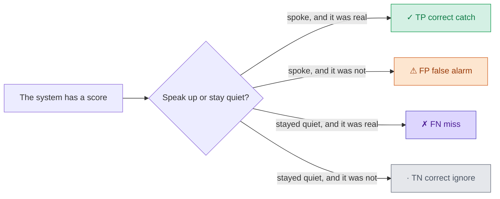
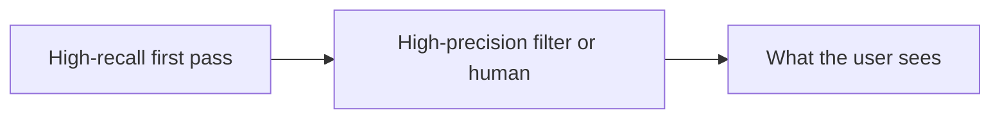

Precision and recall show up on every model card. They also decide what the product does when the score is in the middle.

The definitions, the matrix, and the colours are in [Precision and Recall, in Colours You Will Remember]({{ '/posts/precision-recall-color-coded/' | relative_url }}). This post is the product half: which side you favour, and who pays when you get it wrong.

**Colour legend** (same chips as that post):

✓ TP
correct catch &nbsp;
⚠ FP
false alarm &nbsp;
✗ FN
miss &nbsp;
· TN
correct ignore

False alarms stay orange, not red, so you are not asked to tell red from green. Each cell also has a mark. The colour is a helper, not the only signal.

Two one-line definitions:

- **Precision:** when the system speaks up, how often is it right.
- **Recall:** out of all the real events, how many did it catch.

Seven myths I hear in reviews. Each one has a cost attached.

---

## 1. Higher accuracy means a better model

⚠ Myth

Higher accuracy means a better model. Ship the 99% one.

· Why people believe it

Accuracy is one number. Dashboards love one number. A 99% score looks like the job is done.

✓ Fact

Accuracy can look great when the thing you care about is rare. A spam filter that never flags anything is right on almost every mail. Recall is 0. Precision and recall split the story into two questions. See the <a href="{{ '/posts/precision-recall-color-coded/' | relative_url }}">colour-coded post</a> for the inbox arithmetic.

---

## 2. You can max both precision and recall

⚠ Myth

We can max both. Just train a bit more.

· Why people believe it

The two names sit next to each other on the model card. It feels like two scores you can push up together.

✓ Fact

The same score, two knobs that pull against each other. Lower the threshold and you catch more real events. Recall goes up. Users drown in ⚠ false alarms. Raise the threshold and you only speak when you are almost sure. Precision goes up. Real problems slip by as ✗ misses.

Picking that cut is the product decision. The model gives you a score. The product picks who gets bothered.

---

## 3. 0.5 is the right threshold

⚠ Myth

Leave the threshold at 0.5. That is the default. Defaults are safe.

· Why people believe it

The library defaulted there. Half sounds fair. Nobody has to defend a number they picked.

✓ Fact

Set the threshold from the costs, not from 0.5. Write the two costs down before you argue about 0.87 vs 0.91.

1. **What does a ⚠ false alarm cost?** Time, trust, a hidden invoice, a wasted page, a user who leaves.
2. **What does a ✗ miss cost?** Fraud that already left, a fire, a sick person sent home, a chunk the LLM never saw.
3. **Who pays?** The user, the business, or safety. Those three are not the same budget.
4. **Does a human review the output?** If yes, you can raise recall and let a person throw away the extra flags. If no, a false alarm goes straight to the user.

Favour the side whose mistake you cannot afford.

---

## 4. Precision always matters more

⚠ Myth

Precision always matters more. Users hate false alarms. Tune for that.

· Why people believe it

A music feed full of junk songs is what people remember. False alarms are visible. Misses are quiet.

✓ Fact

A music app shows you ten songs. If eight or nine of them are good, you keep listening. That is high precision: when the feed speaks, it is usually right. A good track that never appeared is a quiet loss. For discovery, being selective beats being exhaustive. That is one product. It is not every product.

---

## 5. False alarms are harmless

⚠ Myth

False alarms are harmless. Misses are the only expensive ones.

· Why people believe it

A kitchen smoke detector that goes off on burnt toast is the picture people keep. People wave a towel and put up with it. So every ⚠ FP looks cheap.

✓ Fact

For the detector, that is the right bias. A real fire at night that the detector misses is ✗ fatal. The detector accepts false alarms so it never misses the real event. That is high recall.

False alarms are not always cheap. A spam filter that hides an invoice is a ⚠ false alarm the user pays for. A code review bot that nags on every PR gets muted. Write the cost for <em>your</em> screen.

---

## 6. This is just a data science decision

⚠ Myth

This is a data science decision. Product can wait for the notebook.

· Why people believe it

The numbers live in a notebook. Threshold, F1, a PR curve. It looks like model work.

✓ Fact

The model gives you a score. The product picks who gets bothered. Same product, different user, different cost. A recruiter search wants recall. A candidate feed wants precision. That sentence belongs in the spec, not only in a notebook.

| Product | Favour | Why |
| --- | --- | --- |
| Spam filter | Precision | A false alarm hides an invoice. One extra junk mail is cheap. |
| Fraud alerts | Recall | Missed fraud is money gone. A clean payment can wait for an analyst. |
| Cancer screening | Recall | A miss sends a sick person home. An extra test is recoverable. |
| Search ranking (page one) | Precision | Junk in the first five results, people bounce. A good page on page three is often fine. |
| Content moderation | Recall, then a human | Harm that stays live is the expensive miss. A reviewer can undo a false take-down. |
| RAG retrieval | Recall on the first fetch | If the chunk never enters the prompt, the model cannot use it. Precision comes at rerank. |
| Code review bot | Precision | Too many false nits and the team mutes the bot. A human still reads the PR. |
| On-call alerting | Recall, then a second filter | A silent pager during an outage is worse than a burnt-toast page. Do not page on every blip, or people stop trusting the pager. |
| Recommendations | Precision | Ten songs, eight or nine should be good. A long junk feed and the user leaves. |
| Job matching | Precision on the candidate feed | A bad match wastes a click. Recruiter search can lean the other way, so a good hire is not skipped. |

The table is a starting bias, not a law. Write the two costs for *your* screen.

---

## 7. One metric is enough

⚠ Myth

Pick one metric. Track that. The other one will follow.

· Why people believe it

One KPI is easy to put on a slide. A precision win looks like progress.

✓ Fact

A precision win that quietly drops recall is a product change, not a free upgrade. Track both numbers over time. Agree a floor on one metric, then push the other. Example: recall at least 95%, then maximise precision.

Use two stages when you can. A high-recall first pass gathers candidates. A high-precision filter, or a human, decides what the user sees.

---

## Practical tips

- **Set the threshold from the costs**, not from 0.5 because the library defaulted there.
- **Use two stages** when you can. Wide first pass, picky second pass.
- **Track both numbers over time.** A precision win that quietly drops recall is a product change.
- **Agree a floor on one metric, then push the other.** That sentence belongs in the spec.

| If this is true | Favour |
| --- | --- |
| A miss is expensive, a false alarm is cheap | Recall |
| A false alarm drives people away, a miss is quiet | Precision |
| A human reviews every flag | You can raise recall |
| No human in the loop | You need more precision |
| You can run two stages | Wide first pass, picky second pass |

| Cell | Colour | Mark | Hook |
| --- | --- | --- | --- |
| True Positive | green `#1a9e55` | ✓ | correct catch |
| False Positive | orange `#d46a2e` | ⚠ | false alarm |
| False Negative | purple `#5b4cc4` | ✗ | miss |
| True Negative | grey `#6b7280` | · | correct ignore |

Precision = when it speaks, how often is it right. Recall = of the real events, how many did it catch. Formulas and a worked inbox are in the [colour-coded post]({{ '/posts/precision-recall-color-coded/' | relative_url }}).
