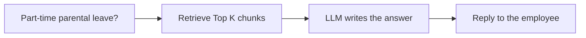
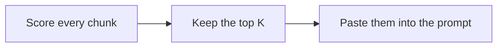
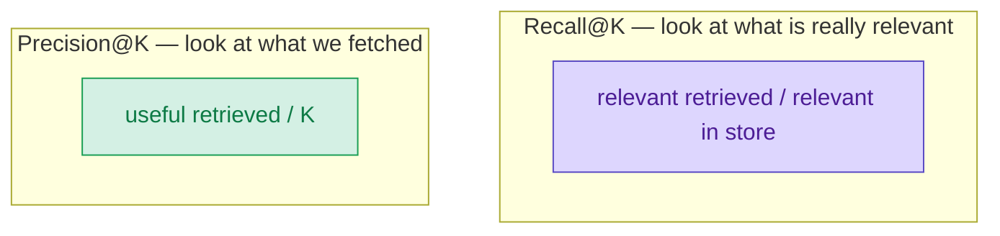
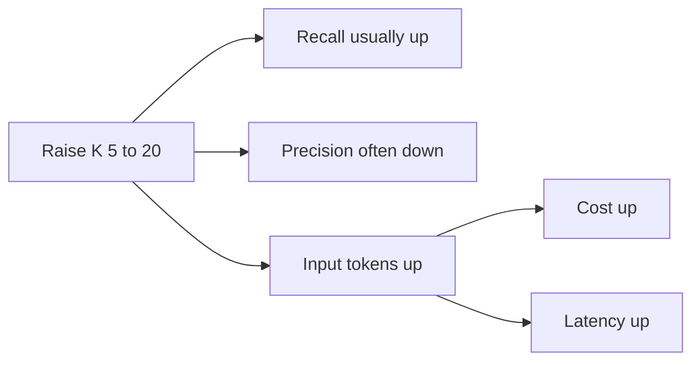
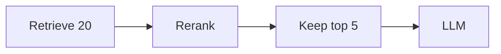

A short working session. Riya is wiring an internal HR chatbot. Arjun has shipped this kind of retrieve-then-generate setup before. Same parental-leave question the whole way.

<div class="chat">
<div class="chat-a">
<p class="chat-who">Riya</p>
<p>I built an HR bot. Someone types: <strong>Can I take part-time parental leave?</strong> It should look up the policy, then answer. That is RAG, right? Retrieve first. Generate second.</p>
</div>
<div class="chat-b">
<p class="chat-who">Arjun</p>
<p>Yes. Five numbers show up on every serious RAG project. Two are settings you tune. Three are scores you measure after a run. People mix them. That is how the bot starts quoting vacation pages.</p>
</div>
</div>

| You tune | You measure |
| --- | --- |
| **Top K** — how many chunks to fetch | **Recall@K** — how many of the relevant chunks came back |
| **Top P** — how freely the model picks the next word | **Precision@K** — how many of the fetched chunks were useful |
| Temperature sits next to Top P | **Cost per request** — search compute + LLM tokens |

<div class="chat">
<div class="chat-a">
<p class="chat-who">Riya</p>
<p>So Top K is not a quality score.</p>
</div>
<div class="chat-b">
<p class="chat-who">Arjun</p>
<p>Correct. Top K is how many paragraphs you send. Recall@K is whether the right ones came back. Top P is not a retrieval metric. It only changes how the model writes. Same four colours as <a href="{{ '/posts/precision-recall-color-coded/' | relative_url }}">Precision and Recall, in Colours You Will Remember</a>. Green, orange, purple, grey. Same marks.</p>
</div>
</div>

**Colour legend** (retrieved chunks):

<span style="background:#d4f0e4;color:#0d7a45;font-weight:600;padding:2px 8px;border-radius:4px">✓ relevant retrieved</span>
useful hit &nbsp;
<span style="background:#fde6d0;color:#9a3b0a;font-weight:600;padding:2px 8px;border-radius:4px">⚠ retrieved noise</span>
false alarm &nbsp;
<span style="background:#ddd6fe;color:#4c1d95;font-weight:600;padding:2px 8px;border-radius:4px">✗ relevant missed</span>
miss &nbsp;
<span style="background:#e5e7eb;color:#4b5563;font-weight:600;padding:2px 8px;border-radius:4px">· irrelevant not retrieved</span>
correct ignore

False alarms stay orange, not red, so you are not asked to tell red from green. Each cell also has a mark. The colour is a helper, not the only signal.



---

## The policy store

<div class="chat">
<div class="chat-b">
<p class="chat-who">Arjun</p>
<p>The HR wiki is split into chunks. For this question I treat <strong>10</strong> of them as relevant. Eligibility, how to apply, how pay is calculated, notice, manager steps, benefits, duration, return-to-work, partner leave, and how it mixes with annual leave.</p>
</div>
<div class="chat-a">
<p class="chat-who">Riya</p>
<p>And vacation days sit right next to them in the ranking. Sick leave. Public holidays. Those are the usual false friends.</p>
</div>
<div class="chat-b">
<p class="chat-who">Arjun</p>
<p>Two teaching snapshots. Same store. Different retrieval quality.</p>
<p>Recall picture: K = 5 pulls <strong>4</strong> of those 10 relevant paragraphs. Recall@5 = 4/10 = <strong>40%</strong>.</p>
<p>Precision picture: of the 5 chunks in the prompt, <strong>2</strong> are vacation / sick leave. Precision@5 = 3/5 = <strong>60%</strong>.</p>
<p>Those two pictures do not have to be the same run. A better ranker can keep recall at 40% and lift precision to 4/5 = 80%. I use that cleaner run when I compare K = 5 with K = 20.</p>
</div>
</div>

---

## 1. Top K — how many chunks go to the LLM

<div class="chat">
<div class="chat-a">
<p class="chat-who">Riya</p>
<p>Where do I start with K?</p>
</div>
<div class="chat-b">
<p class="chat-who">Arjun</p>
<p>You pick it before search runs. The retriever scores every chunk against the question. Then it keeps the <strong>K</strong> nearest ones and pastes them into the prompt.</p>
<p>K = 1: only the single closest paragraph. K = 5: a common starting point. K = 20: a wide net. More chance you caught the rule. More tokens for the model to read.</p>
</div>
</div>


<div class="chat">
<div class="chat-b">
<p class="chat-who">Arjun</p>
<p>K does not tell you if those chunks are good. It only tells you how many you sent.</p>
</div>
</div>



---

## 2. Recall@K — did we miss a fact?

<div class="chat">
<div class="chat-b">
<p class="chat-who">Arjun</p>
<p>Recall@K is a measurement. You need labels. You cannot read it from the retriever score alone.</p>
</div>
</div>

<p style="font-size:1.2em;line-height:1.8">
  <strong>Recall@K</strong> =
  <span style="background:#d4f0e4;color:#0d7a45;font-weight:600;padding:2px 8px;border-radius:4px">relevant retrieved</span>
  /
  <span style="background:#ddd6fe;color:#4c1d95;font-weight:600;padding:2px 8px;border-radius:4px">relevant in the store</span>
</p>

- **Sentence:** of the paragraphs that actually answer this question, how many did search bring back?
- **This picture:** 10 relevant paragraphs exist. K = 5 pulls 4 of them. 4 / 10 = **40%**.
- **What the other 6 are:** <span style="background:#ddd6fe;color:#4c1d95;font-weight:600;padding:1px 7px;border-radius:4px">✗ misses</span>. The duration cap, the return-to-work plan, partner leave. Still in the store. Not in the prompt.

<div class="chat">
<div class="chat-a">
<p class="chat-who">Riya</p>
<p>If the model never sees “you must apply 8 weeks ahead”, it cannot tell the employee that.</p>
</div>
<div class="chat-b">
<p class="chat-who">Arjun</p>
<p>That is the scary one for HR. High recall means fewer missed facts. Same idea as recall in the <a href="{{ '/posts/precision-recall-color-coded/' | relative_url }}">colour-coded precision and recall post</a>. There it was the actually-positive row. Here the “positives” are the relevant chunks.</p>
</div>
</div>


---

## 3. Precision@K — how much of the prompt is noise?

<div class="chat">
<div class="chat-b">
<p class="chat-who">Arjun</p>
<p>Precision@K is also a measurement. Of the chunks we actually sent, how many were useful for this question?</p>
</div>
</div>

<p style="font-size:1.2em;line-height:1.8">
  <strong>Precision@K</strong> =
  <span style="background:#d4f0e4;color:#0d7a45;font-weight:600;padding:2px 8px;border-radius:4px">useful retrieved</span>
  /
  <span style="background:#d4f0e4;color:#0d7a45;font-weight:600;padding:2px 8px;border-radius:4px">K chunks retrieved</span>
</p>

- **This picture:** of 5, 2 are about normal vacation days or sick leave. 3 / 5 = **60%**.
- **What the 2 are:** <span style="background:#fde6d0;color:#9a3b0a;font-weight:600;padding:1px 7px;border-radius:4px">⚠ retrieved noise</span>. Close in wording ("leave", "days", "apply"). Wrong policy.

<div class="chat">
<div class="chat-a">
<p class="chat-who">Riya</p>
<p>So the right answer is sitting next to the wrong one. The model has to ignore the vacation paragraph. Sometimes it does not.</p>
</div>
<div class="chat-b">
<p class="chat-who">Arjun</p>
<p>Same idea as precision in the earlier post. There it was the flagged column. Here the “flags” are the K chunks in the prompt.</p>
</div>
</div>




<div class="chat">
<div class="chat-b">
<p class="chat-who">Arjun</p>
<p>A memory trick that stays accurate. <strong>R</strong>ecall looks at what is <strong>R</strong>eally in the store. <strong>P</strong>recision looks at what you <strong>P</strong>asted into the prompt. Both start with <span style="background:#d4f0e4;color:#0d7a45;font-weight:600;padding:1px 7px;border-radius:4px">✓ relevant retrieved</span>. They divide by a different partner.</p>
</div>
</div>

---

## 4. Top P — how freely the model picks the next word

<div class="chat">
<div class="chat-a">
<p class="chat-who">Riya</p>
<p>Retrieval is done. The K chunks are in the prompt. Now the model writes. What is Top P doing here?</p>
</div>
<div class="chat-b">
<p class="chat-who">Arjun</p>
<p>Nucleus sampling. It is a generation setting. Not a retrieval metric. At each next-word step the model has a list of possible tokens with probabilities. Top P keeps the <strong>smallest set</strong> whose probabilities add up to P. Then it samples from that set.</p>
<p>Low top_p, 0.1 to 0.3: only the most likely next words stay in. Answers stay focused and closer to the retrieved policy. High top_p, 0.9 to 1.0: weaker tokens join the nucleus. More variety. More chance of a confident wrong sentence.</p>
<p>Temperature sits next to it. It stretches or sharpens the same probability list before Top P cuts it. For a factual HR answer I keep both low. I do not want the bot inventing “full pay, always” because that phrase sounded natural.</p>
</div>
</div>


<div class="chat">
<div class="chat-b">
<p class="chat-who">Arjun</p>
<p>Top P does not fix a bad retriever. If the vacation chunk is in the prompt, a low top_p can still quote it. It only reduces how often the model wanders off the tokens that are already likely. Official note on the sampling idea: <a href="https://huggingface.co/docs/transformers/generation_strategies">Hugging Face generation strategies</a> (nucleus / top-p).</p>
</div>
</div>

---

## 5. Cost per request

<div class="chat">
<div class="chat-b">
<p class="chat-who">Arjun</p>
<p>Cost is a measurement. You add two bills. Retrieval / search compute: embedding the question, scanning the index, maybe reranking. LLM token price: input tokens the model reads (system prompt + question + K chunks) plus output tokens it writes. Raising K mostly hits the input-token line.</p>
<p>The prices below are <strong>made-up teaching numbers</strong>. They are not a vendor quote. Round figures so the arithmetic stays in your head.</p>
</div>
</div>

| Line | Example price (made up) | What I count on this question |
| --- | --- | --- |
| Search | **$0.002** per request | One embedding + one index lookup |
| LLM input | **$0.50** per 1 million tokens | Prompt wrapper 400 + (K × 200) chunk tokens |
| LLM output | **$1.50** per 1 million tokens | A 250-token answer |

**K = 5** (example):

- Input tokens = 400 + 5 × 200 = **1,400**
- Input cost = 1,400 / 1,000,000 × $0.50 = **$0.00070**
- Output cost = 250 / 1,000,000 × $1.50 = **$0.000375**
- Search = **$0.002**
- **Total ≈ $0.0031** per request

**K = 20**, same question, search a bit heavier because more candidates are scored:

- Input tokens = 400 + 20 × 200 = **4,400**
- Input cost = 4,400 / 1,000,000 × $0.50 = **$0.00220**
- Output cost = **$0.000375** (same length answer)
- Search = **$0.004**
- **Total ≈ $0.0066** per request, about **2.1×** the K = 5 bill


<div class="chat">
<div class="chat-a">
<p class="chat-who">Riya</p>
<p>On a quiet team this looks like nothing.</p>
</div>
<div class="chat-b">
<p class="chat-who">Arjun</p>
<p>At 20,000 questions a week, the K = 20 setting is the one you feel.</p>
</div>
</div>

---

## The trade-off: raising K from 5 to 20

<div class="chat">
<div class="chat-b">
<p class="chat-who">Arjun</p>
<p>This is the decision I see most often. Same parental-leave question. Cleaner ranking this time: at K = 5 the top five are 4 relevant + 1 vacation chunk.</p>
</div>
</div>

| | K = 5 | K = 20 |
| --- | --- | --- |
| <span style="background:#d4f0e4;color:#0d7a45;font-weight:600;padding:1px 7px;border-radius:4px">✓ relevant retrieved</span> | 4 | 8 |
| <span style="background:#fde6d0;color:#9a3b0a;font-weight:600;padding:1px 7px;border-radius:4px">⚠ retrieved noise</span> | 1 | 12 |
| Recall@K | 4/10 = **40%** | 8/10 = **80%** |
| Precision@K | 4/5 = **80%** | 8/20 = **40%** |
| Input tokens (example) | 1,400 | 4,400 |
| Cost / request (example) | ~$0.0031 | ~$0.0066 |
| p95 latency | **1.0×** | about **1.8×** |

<div class="chat">
<div class="chat-a">
<p class="chat-who">Riya</p>
<p>So I lift recall, and I pay with tokens, cost, latency, and more vacation pages in the prompt.</p>
</div>
<div class="chat-b">
<p class="chat-who">Arjun</p>
<p>Raising K from 5 to 20 usually lifts recall. The duration cap and the return-to-work plan can finally enter the prompt. It also adds input tokens. That raises cost and latency. And it often hurts precision, because the extra 15 chunks are not all about part-time parental leave.</p>
</div>
</div>




<div class="chat">
<div class="chat-b">
<p class="chat-who">Arjun</p>
<p>There is no universal winner. If a missed rule can send someone on the wrong leave, pay for a higher K or, better, retrieve wide and then cut.</p>
</div>
</div>

---

## What I actually do

<div class="chat">
<div class="chat-b">
<p class="chat-who">Arjun</p>
<p>Habits on a working RAG service. Not a research checklist.</p>
</div>
</div>

- **Build a small labelled eval set.** 30 to 50 real questions is enough to start. For each question, mark the chunk ids that should come back. Use the parental-leave style: one clear ask, a known gold set.
- **Measure Recall@K and Precision@K across K.** I usually try 1, 3, 5, 10, 20 on the same set. Plot both. Pick the K where recall is high enough and precision has not fallen off.
- **Use a reranker.** Retrieve 20 (cheap, wide). Keep the top 5 after a rerank model. You borrow the recall of K = 20 and aim for the precision of K = 5. The extra cost is the rerank pass, not 15 extra chunks in the LLM prompt.
- **Keep chunk sizes sensible.** I aim for about 200 to 500 tokens, with a little overlap. Tiny chunks lose the rule that sat in the next sentence. Huge chunks waste tokens and mix two policies in one blob.
- **Keep top_p and temperature low for factual answers.** HR, policy, finance. I do not want variety. I want the sentence that is already in the chunk.
- **Track cost and p95 latency per request.** Average latency hides the slow question. Cost per request tells you if last week's K change actually moved the bill.



---

## A tiny check on the toy numbers

<div class="chat">
<div class="chat-b">
<p class="chat-who">Arjun</p>
<p>Same idea as a unit test. Two labelled runs. I ran this. The printout below is the real output.</p>
</div>
</div>

```python
def recall_precision_at_k(relevant, retrieved):
    hits = sum(1 for chunk in retrieved if chunk in relevant)
    k = len(retrieved)
    recall = hits / len(relevant)
    precision = hits / k
    return hits, k, recall, precision


relevant = {
    "leave-pt-1",
    "leave-pt-2",
    "leave-pt-3",
    "leave-pt-4",
    "leave-pt-5",
    "leave-pt-6",
    "leave-pt-7",
    "leave-pt-8",
    "leave-pt-9",
    "leave-pt-10",
}

# Recall picture: 4 of 10 relevant, 1 vacation chunk.
hits, k, rec, prec = recall_precision_at_k(
    relevant,
    ["leave-pt-1", "leave-pt-2", "leave-pt-3", "leave-pt-4", "vacation-1"],
)
print(f"clean  Recall@{k} = {hits}/{len(relevant)} = {rec:.0%}")
print(f"clean  Precision@{k} = {hits}/{k} = {prec:.0%}")

# Precision picture: 3 useful, 2 noise.
hits, k, rec, prec = recall_precision_at_k(
    relevant,
    ["leave-pt-1", "vacation-1", "leave-pt-3", "sick-1", "leave-pt-7"],
)
print(f"noisy  Recall@{k} = {hits}/{len(relevant)} = {rec:.0%}")
print(f"noisy  Precision@{k} = {hits}/{k} = {prec:.0%}")
```

```
clean  Recall@5 = 4/10 = 40%
clean  Precision@5 = 4/5 = 80%
noisy  Recall@5 = 3/10 = 30%
noisy  Precision@5 = 3/5 = 60%
```

<div class="chat">
<div class="chat-b">
<p class="chat-who">Arjun</p>
<p>The clean run is the K = 5 column in the trade-off table. The noisy run is the precision GIF.</p>
</div>
</div>

---

<div class="show-notes">
<strong>Show notes</strong>
<p>RAG is retrieve, then generate. Top K and Top P are settings you turn. Recall@K, Precision@K, and cost per request are what you measure after the run. One HR question: part-time parental leave. 10 relevant chunks. Clean K = 5: Recall 40%, Precision 80%. Noisy K = 5: Recall 30%, Precision 60%. K = 20: Recall 80%, Precision 40%, about 2.1× the example bill, p95 about 1.8×. A reranker (retrieve 20, keep 5) is the usual way out. For a factual answer, keep top_p and temperature low. Label 30 to 50 questions, sweep K at 1, 3, 5, 10, 20, and watch cost and p95 per request. Colours match the <a href="{{ '/posts/precision-recall-color-coded/' | relative_url }}">precision and recall post</a>.</p>
</div>

## Cheat sheet

| Name | Tune or measure? | Formula / setting | Question it answers |
| --- | --- | --- | --- |
| Top K | **Tune** | Keep the K nearest chunks | How many paragraphs does the LLM read? |
| Recall@K | **Measure** | <span style="background:#d4f0e4;color:#0d7a45;font-weight:600;padding:1px 6px;border-radius:4px">✓</span> / ( <span style="background:#d4f0e4;color:#0d7a45;font-weight:600;padding:1px 6px;border-radius:4px">✓</span> + <span style="background:#ddd6fe;color:#4c1d95;font-weight:600;padding:1px 6px;border-radius:4px">✗</span> ) | Of the relevant chunks, how many came back? |
| Precision@K | **Measure** | <span style="background:#d4f0e4;color:#0d7a45;font-weight:600;padding:1px 6px;border-radius:4px">✓</span> / ( <span style="background:#d4f0e4;color:#0d7a45;font-weight:600;padding:1px 6px;border-radius:4px">✓</span> + <span style="background:#fde6d0;color:#9a3b0a;font-weight:600;padding:1px 6px;border-radius:4px">⚠</span> ) | Of the chunks we sent, how many were useful? |
| Top P | **Tune** | Nucleus mass for the next word | How wide is the next-word net? |
| Temperature | **Tune** | Sharpen or flatten the same list | How peaked are those probabilities? |
| Cost / request | **Measure** | Search + input tokens + output tokens | What did this question cost? |

| Cell | Colour | Mark | In this RAG picture |
| --- | --- | --- | --- |
| Relevant retrieved | green `#1a9e55` | ✓ | Parental-leave chunk that made the prompt |
| Retrieved noise | orange `#d46a2e` | ⚠ | Vacation / sick-leave chunk that also made the prompt |
| Relevant missed | purple `#5b4cc4` | ✗ | Parental-leave chunk still sitting in the store |
| Irrelevant not retrieved | grey `#6b7280` | · | A payroll chunk nobody asked for |
