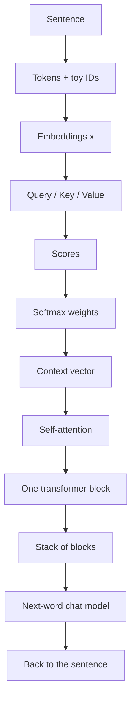

ChatGPT answers in full sentences. The machine does not start there.

It starts with pieces of text, lists of numbers, a compare-and-mix step called attention, a stack of the same block, and a lot of "guess the next word" training.

This post is that ladder. One chain of **If you do X, you get Y**. Same sentence the whole way: **The bus is late.**

The IDs below are toy numbers I made up. They are not from GPT-2, tiktoken, or any real vocab. The matrices are tiny on purpose. You can type the NumPy as you read, or run `code/build_along.py` (seed `7`) and get the same prints.

If you want the bigger-picture story — a small GPT trained on Shakespeare characters — read [How a Tiny GPT Learns]({{ '/posts/build-gpt-from-scratch-character-level/' | relative_url }}). This page is the same idea, one checkpoint at a time.




Shared setup for every snippet:

```python
import numpy as np

np.random.seed(7)
np.set_printoptions(precision=2, suppress=True)

def softmax(x, axis=-1):
    e = np.exp(x - np.max(x, axis=axis, keepdims=True))
    return e / e.sum(axis=axis, keepdims=True)

SENTENCE = "The bus is late"
TOKENS = ["The", "bus", "is", "late"]
IDS = np.array([11, 42, 7, 88])  # toy IDs, not a real vocab
D = 4
SCALE = np.sqrt(D)
```

---

## 1. Break a sentence into pieces

<div style="background:#fff6e8;border:1px solid #f0d2a8;border-left:6px solid #d46a2e;padding:12px 16px;border-radius:8px;margin:1.2em 0">
<strong>If you break a sentence into pieces, you get tokens (with IDs).</strong>
</div>

A model does not read English. It reads integers.

A tokenizer cuts text into pieces and maps each piece to an ID. Real systems use tens of thousands of IDs. Here I pick four fake ones so the table stays on one screen.

$$
\text{The bus is late} \;\rightarrow\;
[(\text{The}, 11),\;(\text{bus}, 42),\;(\text{is}, 7),\;(\text{late}, 88)]
$$

```python
print("sentence:", SENTENCE)
print("tokens:  ", TOKENS)
print("toy ids: ", IDS)
```

```
sentence: The bus is late
tokens:   ['The', 'bus', 'is', 'late']
toy ids:  [11 42  7 88]
```

Those four IDs are invented. Do not look them up in a real vocab.

---

## 2. Turn each token into a list of numbers

<div style="background:#fff6e8;border:1px solid #f0d2a8;border-left:6px solid #d46a2e;padding:12px 16px;border-radius:8px;margin:1.2em 0">
<strong>If you turn each token into a list of numbers, you get embeddings.</strong>
</div>

An embedding is a short list of numbers that stands in for a token. Similar tokens sit near each other in that space.

In a real model this list is hundreds of numbers long. Here each token gets **4** numbers. I wrote the table by hand so later dots stay small.

$$
x_i \in \mathbb{R}^{4}
$$

```python
X = np.array(
    [
        [1.0, 0.1, 0.0, 0.2],  # The
        [0.2, 1.0, 0.1, 0.3],  # bus
        [0.0, 0.2, 1.0, 0.1],  # is
        [0.1, 0.8, 0.0, 1.0],  # late
    ]
)
print(X)
print("shape", X.shape)
```

```
[[1.  0.1 0.  0.2]
 [0.2 1.  0.1 0.3]
 [0.  0.2 1.  0.1]
 [0.1 0.8 0.  1. ]]
shape (4, 4)
```

Four tokens. Four numbers each. Shape `(4, 4)`.

The picture below plots only the first two numbers, so you can see the arrows. `bus` and `late` point a similar way. That will matter in a few steps.


---

## 3. Let every token ask a question

<div style="background:#fff6e8;border:1px solid #f0d2a8;border-left:6px solid #d46a2e;padding:12px 16px;border-radius:8px;margin:1.2em 0">
<strong>If you let every token ask a question, you get a query.</strong>
</div>

The query is "what am I looking for, right now?"

You do not invent that question by hand. You multiply the embedding by a learned matrix \(W_Q\). Same matrix for every token.

In NumPy the tokens are rows, so the line is `Q = X @ W_Q`. Same multiply, just a row layout.

$$
q = W_Q x
$$

```python
W_Q = np.array(
    [
        [0.9, 0.1, 0.0, 0.0],
        [0.0, 0.9, 0.1, 0.0],
        [0.0, 0.0, 0.9, 0.1],
        [0.1, 0.0, 0.0, 0.9],
    ]
)
Q = X @ W_Q
print(Q)
```

```
[[0.92 0.19 0.01 0.18]
 [0.21 0.92 0.19 0.28]
 [0.01 0.18 0.92 0.19]
 [0.19 0.73 0.08 0.9 ]]
```

Row 3 is the query for `late`: `[0.19  0.73  0.08  0.90]`. We will use that row next.

---

## 4. Give every token a way to answer

<div style="background:#fff6e8;border:1px solid #f0d2a8;border-left:6px solid #d46a2e;padding:12px 16px;border-radius:8px;margin:1.2em 0">
<strong>If you give every token a way to answer, you get a key and a value.</strong>
</div>

The key is the label on the token. The value is the payload you actually mix in if that token gets picked.

Two more matrices. Same idea as the query.

$$
k = W_K x,\qquad v = W_V x
$$

```python
W_K = np.array(
    [
        [0.8, 0.0, 0.1, 0.1],
        [0.1, 0.8, 0.0, 0.1],
        [0.0, 0.1, 0.8, 0.1],
        [0.1, 0.0, 0.1, 0.8],
    ]
)
W_V = np.diag([0.6, 0.6, 0.6, 0.6])
K = X @ W_K
V = X @ W_V
print("K")
print(K)
print("V")
print(V)
```

```
K
[[0.83 0.08 0.12 0.27]
 [0.29 0.81 0.13 0.37]
 [0.03 0.26 0.81 0.2 ]
 [0.26 0.64 0.11 0.89]]
V
[[0.6  0.06 0.   0.12]
 [0.12 0.6  0.06 0.18]
 [0.   0.12 0.6  0.06]
 [0.06 0.48 0.   0.6 ]]
```

Three jobs, three lists: \(q\), \(k\), \(v\). Still shape `(4, 4)`.

---

## 5. Compare one token's query with every key

<div style="background:#fff6e8;border:1px solid #f0d2a8;border-left:6px solid #d46a2e;padding:12px 16px;border-radius:8px;margin:1.2em 0">
<strong>If you compare one token's query with every key, you get attention scores.</strong>
</div>

Take the query for `late`. Dot it with each key. Divide by \(\sqrt{d}\) so the numbers do not grow with the width of the list.

A bigger score means a better match.

$$
s_j = \frac{q \cdot k_j}{\sqrt{d}}
$$

```python
q_late = Q[3]
scores = q_late @ K.T / SCALE
print("q_late:", q_late)
print("scores:", scores)
```

```
q_late: [0.19 0.73 0.08 0.9 ]
scores: [0.23 0.49 0.22 0.66]
```

`late` matches itself most (`0.66`), then `bus` (`0.49`). That fits the embeddings: those two arrows already pointed a similar way.

---

## 6. Turn scores into percentages

<div style="background:#fff6e8;border:1px solid #f0d2a8;border-left:6px solid #d46a2e;padding:12px 16px;border-radius:8px;margin:1.2em 0">
<strong>If you turn scores into percentages, you get attention weights.</strong>
</div>

Softmax makes the four scores positive and forces them to add up to 1.

You can read each weight as "how much of my mix should come from this token?"

$$
a_j = \frac{e^{s_j}}{\sum_m e^{s_m}}
$$

```python
weights = softmax(scores)
print("a = softmax(s):", weights)
print("sum:", weights.sum())
```

```
a = softmax(s): [0.21 0.27 0.2  0.32]
sum: 1.0
```

So `late` takes 32% from itself, 27% from `bus`, 21% from `The`, 20% from `is`.


---

## 7. Mix the values using those weights

<div style="background:#fff6e8;border:1px solid #f0d2a8;border-left:6px solid #d46a2e;padding:12px 16px;border-radius:8px;margin:1.2em 0">
<strong>If you mix the values using those weights, you get a context vector.</strong>
</div>

The scores only decide *who* matters. The values are *what* you actually add in.

One weighted sum. One new list of four numbers for `late`.

$$
c = \sum_j a_j v_j
$$

```python
c = weights @ V
print("c = sum a_j v_j:", c)
```

```
c = sum a_j v_j: [0.18 0.35 0.14 0.28]
```

That is the view `late` now has of the whole sentence.


---

## 8. Do it for every token at once

<div style="background:#fff6e8;border:1px solid #f0d2a8;border-left:6px solid #d46a2e;padding:12px 16px;border-radius:8px;margin:1.2em 0">
<strong>If you do it for every token at once, you get self-attention.</strong>
</div>

The last three steps were for one query. The model does the same for every token, in one matrix multiply.

GPT also puts a **causal mask** on the scores. A token may look at itself and the past. It may not look at a word that has not been written yet. That is how next-word training stays honest.

$$
\mathrm{Attention}(Q,K,V)
= \mathrm{softmax}\!\left(\frac{QK^{\top}}{\sqrt{d}} + M\right)V
$$

\(M\) is \(0\) on and below the diagonal, and \(-\infty\) above it. After softmax, the future weights become \(0\).

```python
raw = Q @ K.T / SCALE
causal = np.tril(np.ones((4, 4)))
masked = np.where(causal == 1.0, raw, -1e9)
A = softmax(masked, axis=1)
C = A @ V
print("raw scores")
print(raw)
print("causal weights")
print(A)
print("context matrix")
print(C)
```

```
raw scores
[[0.41 0.24 0.06 0.26]
 [0.17 0.47 0.23 0.46]
 [0.09 0.17 0.42 0.19]
 [0.23 0.49 0.22 0.66]]
causal weights
[[1.   0.   0.   0.  ]
 [0.43 0.57 0.   0.  ]
 [0.29 0.31 0.4  0.  ]
 [0.21 0.27 0.2  0.32]]
context matrix
[[0.6  0.06 0.   0.12]
 [0.32 0.37 0.03 0.15]
 [0.21 0.25 0.26 0.11]
 [0.18 0.35 0.14 0.28]]
```

Row 0 is `The`. It can only see itself, so its weights are `[1, 0, 0, 0]`. Row 3 is `late`. It can see everyone. That last row is the same mix we built by hand.


---

## 9. Add a small neural network and residual connections

<div style="background:#fff6e8;border:1px solid #f0d2a8;border-left:6px solid #d46a2e;padding:12px 16px;border-radius:8px;margin:1.2em 0">
<strong>If you add a small neural network and residual connections, you get a transformer block.</strong>
</div>

Attention is the talk step. Each token still needs a private think step. That is a tiny MLP, applied at every position with the same weights.

A residual connection adds the input back: \(x + \text{layer}(x)\). The original signal still has a path through the stack. Layer norm rescales each token's numbers so they do not blow up as you go deeper.

$$
h = x + \mathrm{Attn}(x),\qquad
y = h + \mathrm{MLP}(h)
$$

```python
H = X + C
W1 = np.array(
    [
        [0.4, 0.1, 0.0, 0.0],
        [0.0, 0.4, 0.1, 0.0],
        [0.0, 0.0, 0.4, 0.1],
        [0.1, 0.0, 0.0, 0.4],
    ]
)
W2 = np.array(
    [
        [0.3, 0.0, 0.1, 0.0],
        [0.0, 0.3, 0.0, 0.1],
        [0.1, 0.0, 0.3, 0.0],
        [0.0, 0.1, 0.0, 0.3],
    ]
)
mlp = np.maximum(H @ W1, 0.0) @ W2
Y = H + mlp
print("h = X + C")
print(H)
print("y = h + MLP(h)")
print(Y)
```

```
h = X + C
[[1.6  0.16 0.   0.32]
 [0.52 1.37 0.13 0.45]
 [0.21 0.45 1.26 0.21]
 [0.28 1.15 0.14 1.28]]
y = h + MLP(h)
[[1.8  0.24 0.07 0.38]
 [0.62 1.57 0.22 0.57]
 [0.3  0.53 1.43 0.3 ]
 [0.36 1.35 0.21 1.48]]
```

Still shape `(4, 4)`. Same four tokens, richer lists.

---

## 10. Stack the blocks

<div style="background:#fff6e8;border:1px solid #f0d2a8;border-left:6px solid #d46a2e;padding:12px 16px;border-radius:8px;margin:1.2em 0">
<strong>If you stack the blocks, you get a transformer.</strong>
</div>

One block is one talk-then-think cycle. A transformer is that cycle repeated.

GPT-2 small does this **12** times. Each block has its own weights. The data shape stays the same as it goes up the stack. In this toy that shape is still `(4, 4)`.

$$
x^{(0)} \;\rightarrow\; \mathrm{Block}_1 \;\rightarrow\; \cdots \;\rightarrow\; \mathrm{Block}_{12} \;\rightarrow\; x^{(12)}
$$

```python
print("GPT-2 small repeats this block 12 times.")
print("toy stack depth: 12")
```

```
GPT-2 small repeats this block 12 times.
toy stack depth: 12
```

We do not run 12 toy blocks here. The idea is the repeat, not a new formula.


---

## 11. Train it to predict the next word

<div style="background:#fff6e8;border:1px solid #f0d2a8;border-left:6px solid #d46a2e;padding:12px 16px;border-radius:8px;margin:1.2em 0">
<strong>If you train it to predict the next word, then fine-tune with instructions and human feedback, you get a chat assistant like ChatGPT.</strong>
</div>

After the last block, a linear head turns the last token's vector into a score per word. Softmax turns those scores into a probability bar.

Three training stages, in plain words:

1. **Pretraining.** Read a huge pile of text. Guess the next token. That is the transformer learning language.
2. **SFT (supervised fine-tune).** Show instruction and answer pairs. Same next-token loss, but now the text looks like a helpful reply.
3. **RLHF / preference tuning.** People pick the better of two answers. The model moves toward the preferred one.

We skip the training loop. We only do the last multiply, with a four-word toy vocab.

$$
p(\text{next}) = \mathrm{softmax}(y_{\text{late}}\, W_{\text{head}})
$$

```python
vocab = ["early", "again", "today", "."]
W_head = np.array(
    [
        [0.2, 0.1, 0.4, 0.8],
        [-0.3, 0.2, 0.6, 0.1],
        [0.1, 0.4, 0.2, 0.3],
        [0.8, 0.1, 1.2, 0.4],
    ]
)
logits = Y[3] @ W_head
probs = softmax(logits)
print("logits:", logits)
for word, p in zip(vocab, probs):
    bar = "#" * int(round(float(p) * 20))
    print(f"  {word:6s}  {p:4.2f}  {bar}")
```

```
logits: [0.88 0.54 2.78 1.08]
  early   0.10  ##
  again   0.07  #
  today   0.69  ##############
  .       0.13  ###
```

| Next word | Probability |
| --- | ---: |
| early | 10% |
| again | 7% |
| **today** | **69%** |
| . | 13% |

On this toy head, the next word after **The bus is late** is most likely **today**. Sample from that bar, append the word, run the ladder again. That is how a chat reply gets written: one token at a time.

These percentages are from the tiny matrices above. They are not a real ChatGPT sample.

---

## 12. Rewind everything

<div style="background:#fff6e8;border:1px solid #f0d2a8;border-left:6px solid #d46a2e;padding:12px 16px;border-radius:8px;margin:1.2em 0">
<strong>If you rewind everything, you are back to a plain sentence.</strong>
</div>

Take the stack off. Take the block off. Take attention off. You are left with four IDs, then four words.

```python
print("back to the sentence:", SENTENCE)
```

```
back to the sentence: The bus is late
```

That is the whole machine, seen from one short line of English.

---

## Checkpoint recap

| Step | You get | Shape of the data |
| --- | --- | --- |
| 1. Tokens | pieces + toy IDs | 4 ids |
| 2. Embeddings | \(x_i \in \mathbb{R}^{4}\) | `(4, 4)` |
| 3. Query | \(q = W_Q x\) | `(4, 4)` |
| 4. Key and value | \(k = W_K x\), \(v = W_V x\) | `(4, 4)` each |
| 5. Scores | \(s_j = q \cdot k_j / \sqrt{d}\) | `(4,)` for one query |
| 6. Weights | softmax of the scores | `(4,)`, sums to 1 |
| 7. Context | \(c = \sum a_j v_j\) | `(4,)` |
| 8. Self-attention | \(\mathrm{softmax}(QK^{\top}/\sqrt{d}+M)V\) | `(4, 4)` |
| 9. Transformer block | \(h = x + \mathrm{Attn}(x)\), \(y = h + \mathrm{MLP}(h)\) | `(4, 4)` |
| 10. Transformer | 12 stacked blocks (GPT-2 small) | still `(4, 4)` in this toy |
| 11. Chat assistant | next-word bar, then SFT + preference | `(4,)` over the toy vocab |
| 12. Rewind | the original sentence | text |

---

## In short

**The bus is late** becomes four toy IDs, then four short lists of numbers. Those lists ask questions (query), wear labels (key), and carry a payload (value). One token's query is scored against every key, squashed into percentages, and used to mix the values. Do that for every token, hide the future with a causal mask, and you have self-attention. Add a small MLP and residual links and you have one transformer block. Stack twelve of those and you have a GPT-shaped model. Train it to guess the next word, then fine-tune with instructions and human preference, and you have the same idea that sits under ChatGPT. Undo the steps and you are back at the sentence.
