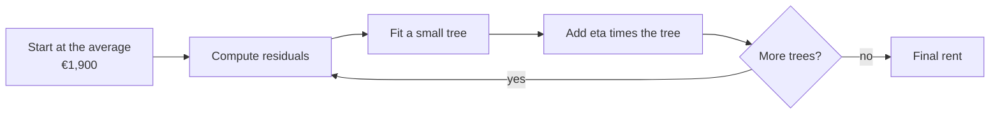

This is a mock ML interview. The task is monthly rent for Dublin flats. We start with floor area. Location and age come in later.

I use one running example the whole way. The average rent in the pocket data is **€1,900**. One 80 m² city flat actually rents for **€2,500**. Those six-flat numbers are toy numbers I made up so the first rounds fit on one screen. The script at the end is a larger synthetic set. Not real listing data.



---

## 1. What is XGBoost, in one line?

<div style="background:#fff6e8;border:1px solid #f0d2a8;border-left:6px solid #d46a2e;padding:12px 16px;border-radius:8px;margin:1.4em 0 0.8em">
<strong>Interviewer:</strong> What is XGBoost, in one line?
</div>

**Me:** A supervised model that adds small decision trees one after another. Each new tree tries to fix the errors so far.

XGBoost stands for Extreme Gradient Boosting. Supervised means we have a target — here, monthly rent. You give it rows (floor area, later location and age) and a number to hit.

It does not build 200 independent trees and average them. It starts with a simple guess, usually the mean rent, then grows a shallow tree that predicts the leftover error. Add that tree. Repeat. That stacked model is the booster.

For the 80 m² city flat, the first guess is €1,900. The leftover error is +€600. Later trees chip away at that +€600 until the prediction sits closer to €2,500.

<em>Follow-up they may ask:</em> Is it only for regression? No. Same idea for classification. The loss changes. The “add a tree to cut the loss” loop does not.

---

## 2. How is it different from a random forest?

<div style="background:#fff6e8;border:1px solid #f0d2a8;border-left:6px solid #d46a2e;padding:12px 16px;border-radius:8px;margin:1.4em 0 0.8em">
<strong>Interviewer:</strong> How is XGBoost different from a random forest?
</div>

**Me:** A random forest trains trees independently and averages the votes. XGBoost adds trees in sequence so each one cuts the loss that is still left.

| | Random forest | XGBoost |
| --- | --- | --- |
| How trees are built | Independent, then averaged | One after another |
| What a new tree does | Another vote | A correction |
| Order of trees | Does not matter | Matters |
| Typical depth | Often deep | Often shallow, depth 3–6 |
| What it is trying to do | Cut variance by averaging | Cut loss by adding |

If five forest trees guess €2,100, €2,400, €1,750, €2,300, €1,950 for the city flat, the answer is the mean of those five. If five boosting trees run, the answer is €1,900 plus the five corrections, in order.


<em>Follow-up they may ask:</em> Can I bag XGBoost trees anyway? Yes. `subsample` and `colsample_bytree` already do a light version of that, on top of boosting.

---

## 3. Walk me through the first round.

<div style="background:#fff6e8;border:1px solid #f0d2a8;border-left:6px solid #d46a2e;padding:12px 16px;border-radius:8px;margin:1.4em 0 0.8em">
<strong>Interviewer:</strong> Walk me through the first round, with numbers.
</div>

**Me:** Start from the average. Compute residuals. Tree 1 learns a correction for each group. Most flats get better, a couple get worse, and the total error still drops.

Pocket data. Six flats. Mean rent €1,900. I set eta to 1.0 in this round so the leaf values are easy to see. Later we put eta back to 0.1.

| Flat | Area | Actual rent | Pred (round 0) | Residual |
| --- | ---: | ---: | ---: | ---: |
| A | 42 m² | €1,400 | €1,900 | −€500 |
| B | 50 m² | €1,600 | €1,900 | −€300 |
| C | 58 m² | €1,800 | €1,900 | −€100 |
| D | 65 m² | €1,900 | €1,900 | €0 |
| E (city) | 80 m² | €2,500 | €1,900 | **+€600** |
| F | 95 m² | €2,200 | €1,900 | +€300 |

Round-0 RMSE is **365**.

Tree 1 splits at 60 m².

- Small group A, B, C. Mean residual = (−500 − 300 − 100) / 3 = **−300**. New pred = €1,600.
- Large group D, E, F. Mean residual = (0 + 600 + 300) / 3 = **+300**. New pred = €2,200.

| Flat | New pred | New residual | vs round 0 |
| --- | ---: | ---: | --- |
| A | €1,600 | −€200 | better |
| B | €1,600 | €0 | better |
| C | €1,600 | +€200 | **worse** |
| D | €2,200 | −€300 | **worse** |
| E | €2,200 | +€300 | better |
| F | €2,200 | €0 | better |

C and D got worse. E, the €2,500 flat, moved from €1,900 to €2,200. Round-1 RMSE is **208**. Total error fell even though two rows got worse. That is normal. The tree optimises the sum, not every row.

A second split on the large group takes RMSE to **144**. E is now at €2,350.


With eta 0.1, the same city flat climbs in small steps instead of taking the full leaf jump:


<em>Follow-up they may ask:</em> Why not one deep tree instead of many shallow ones? One deep tree memorizes the six rows. Shallow trees plus a small eta usually travel better to flats the model has not seen.

---

## 4. Why is it called gradient boosting?

<div style="background:#fff6e8;border:1px solid #f0d2a8;border-left:6px solid #d46a2e;padding:12px 16px;border-radius:8px;margin:1.4em 0 0.8em">
<strong>Interviewer:</strong> Why is it called gradient boosting?
</div>

**Me:** Each tree is fit on the negative gradient of the loss. For squared error, that gradient is the residual.

Loss here is squared error: how far the predicted rent is from the actual rent. The gradient of that loss, with respect to the current prediction, points toward “make this prediction worse.” The opposite direction — the **negative gradient** — points toward “make this prediction better.”

For squared error, that negative gradient **is** `actual − prediction`. That is the residual column in the table above. Tree 1 is not magically “learning rent.” It is learning those residuals.

If the loss were log loss for a classification problem, the gradient would not be a raw residual. The loop is the same: compute the gradient of the loss, grow a tree that follows it, add the tree, repeat. “Gradient boosting” is that loop. “XGBoost” is a fast, regularised way to run it.

---

## 5. What does XGBoost add over plain gradient boosting?

<div style="background:#fff6e8;border:1px solid #f0d2a8;border-left:6px solid #d46a2e;padding:12px 16px;border-radius:8px;margin:1.4em 0 0.8em">
<strong>Interviewer:</strong> What does XGBoost add over plain gradient boosting?
</div>

**Me:** It uses the first and second derivatives of the loss — gradient and hessian — to score splits and set leaf values. It also regularises tree complexity, finds splits with a fast histogram pass, and has a default direction for missing values.

Plain gradient boosting, in the Friedman sense, often uses only the gradient. XGBoost takes a second-order look. For each row you have:

- **g** — gradient. How much the loss would move if this prediction moved.
- **h** — hessian. How curved that loss is at this prediction.

For squared error, g is `prediction − actual` and h is 1. So the hessian is basically a row count. For logistic loss, h is `p(1 − p)`, so a confident row counts for less than a row sitting at 0.5. That is why `min_child_weight` is a sum of hessians, not “minimum rows,” even if people treat it as a row count in regression.

A split is scored by **gain**. A leaf gets a **weight**. From the [XGBoost model page](https://xgboost.readthedocs.io/en/stable/tutorials/model.html):

$$
\mathrm{Gain} = \frac{1}{2}\left[\frac{G_L^{2}}{H_L+\lambda}+\frac{G_R^{2}}{H_R+\lambda}-\frac{(G_L+G_R)^{2}}{H_L+H_R+\lambda}\right]-\gamma
$$

$$
w_j^{*} = -\frac{G_j}{H_j+\lambda}
$$

G is the sum of gradients in that node. H is the sum of hessians. λ (`reg_lambda`) pulls leaf values toward zero. γ (`gamma`) is a tax for making a new leaf.

In plain words: gain asks “if I split here, how much extra loss do I remove, after paying for a new leaf?” If that number is not positive, skip the split. The leaf weight is a shrunk version of “average residual in this leaf.” For our large-flat leaf, G is the sum of those +€600 and +€300 style residuals (with a sign flip from how g is defined), H is roughly 3, and λ stops one noisy leaf from swinging rent by a huge amount.

The rest of the “extreme” in the name is engineering:

- **Histogram split finding.** Bucket each feature, scan the buckets. Parallel across features.
- **Regularisation.** Depth, λ, α, γ, min child weight. The tree is not allowed to grow just because it can.
- **Sparsity-aware missing values.** At each split the algorithm learns whether NaN should go left or right.

<em>Follow-up they may ask:</em> Do I need to derive gain on a whiteboard? Know what G, H, λ, and γ do. Write the leaf-weight formula. Explain it with the €1,900 / €2,500 flat. That is enough for most interviews.

---

## 6. What is the learning rate (eta) and why keep it small?

<div style="background:#fff6e8;border:1px solid #f0d2a8;border-left:6px solid #d46a2e;padding:12px 16px;border-radius:8px;margin:1.4em 0 0.8em">
<strong>Interviewer:</strong> What is the learning rate — eta — and why do people keep it small?
</div>

**Me:** Eta scales each tree’s correction before it is added. Keep it small so no single tree can swing the rent too far.

The 80 m² city flat still has a +€600 residual after round 0. If eta is 1.0, tree 1 is allowed to add the whole +€600 (or the leaf mean, +€300 in the six-flat split). If eta is **0.1**:

**+€600 × 0.1 = +€60**

New prediction = €1,960, not €2,500. The next tree sees a leftover of +€540 and takes another small step.

Small eta means you need more trees. That sounds wasteful. In practice those quieter steps generalise better. A tree that is a bit wrong does less damage. Early stopping then picks how many steps you actually keep.


A start I actually use: `learning_rate=0.05` or `0.1`, then let early stopping choose `n_estimators`. If the model wants 20 trees and still looks noisy, I drop eta and allow more trees. If it wants 800 trees and the job is slow, I raise eta a bit.

---

## 7. Which hyperparameters do you tune first?

<div style="background:#fff6e8;border:1px solid #f0d2a8;border-left:6px solid #d46a2e;padding:12px 16px;border-radius:8px;margin:1.4em 0 0.8em">
<strong>Interviewer:</strong> Which hyperparameters do you tune first?
</div>

**Me:** Depth and min child weight, then the two sample rates, then the regularisers, and I never pick `n_estimators` by hand if I can use early stopping.

| Param | What it controls | Sign of too high | Sign of too low | A sensible start |
| --- | --- | --- | --- | --- |
| `max_depth` | How bushy each tree is | Train error near zero, val error worse | Both errors stay high | 3–6 |
| `min_child_weight` | Min **sum of hessians** in a leaf, not always a row count | Leaves too coarse, underfit | Tiny noisy leaves | 1–10; higher if rent is noisy |
| `subsample` | Fraction of rows per tree | 1.0, no row bagging | Each tree sees too little | 0.8 |
| `colsample_bytree` | Fraction of columns per tree | Always uses every column | Useful columns get skipped | 0.8 |
| `lambda` (`reg_lambda`) | L2 penalty on leaf weights | Leaves shrunk too hard | Wild leaf values | 1 |
| `alpha` (`reg_alpha`) | L1 penalty on leaf weights | Many leaves go to zero | No extra sparsity | 0, then try 0.1–1 |
| `gamma` | Min gain to allow a split | Trees stay as stumps | Splits on noise | 0, then try 0.1–1 |
| `n_estimators` | Number of trees | Overfit, if you skip early stopping | Stops while val is still falling | 200–500, with early stopping |

On this rent problem I would start with `max_depth=3`, `min_child_weight=5`, `subsample=0.8`, `colsample_bytree=0.8`, `reg_lambda=1`, `learning_rate=0.1`, `n_estimators=400`, `early_stopping_rounds=30`. That is also what `code/xgb_rent_demo.py` uses.

I do not start with a 40-point grid. I get a decent depth and eta first. Then I poke λ and subsample. The gain formula in Q5 is the reason γ and λ change the trees: they are the tax and the shrink, not magic knobs.

<em>Follow-up they may ask:</em> Why is min_child_weight not “minimum rows”? Because it is the sum of hessians. In this squared-error rent model, h = 1, so it happens to match a row count. In logistic loss, a row with p = 0.99 contributes about 0.01, so you need many such rows to pass the same threshold.

---

## 8. How do you stop it overfitting?

<div style="background:#fff6e8;border:1px solid #f0d2a8;border-left:6px solid #d46a2e;padding:12px 16px;border-radius:8px;margin:1.4em 0 0.8em">
<strong>Interviewer:</strong> How do you stop XGBoost overfitting?
</div>

**Me:** Train / validation / test. Early stopping on the validation set. Keep the best iteration. Touch the test set once, at the end.

The split:

1. **Train** — trees are grown here.
2. **Validation** — after each tree, score this set. If it has not improved for `early_stopping_rounds` trees, stop. Keep the iteration with the best validation score.
3. **Test** — one number, after you have frozen the model. No tuning against it.

If you keep adding trees, train error will keep falling. Validation error falls, then rises. That rise is the model starting to memorize train flats. The marker in the GIF is the model I would ship.


The other regularisers from Q7 still matter. Early stopping is the brake. Depth, min child weight, subsample, λ are the speed limit. I use both.

Do not report the best validation score as the final score. It has been peeked at on every round. The test MAE is the one I would write in a design doc.

---

## 9. Which metric would you report?

<div style="background:#fff6e8;border:1px solid #f0d2a8;border-left:6px solid #d46a2e;padding:12px 16px;border-radius:8px;margin:1.4em 0 0.8em">
<strong>Interviewer:</strong> Which metric would you report for this rent model?
</div>

**Me:** MAE in euro, and RMSE next to it. For classification I would pick log loss or AUC, depending on whether we care about probabilities or ranking.

Rent is in euro per month. **MAE** is the average absolute miss. “We are off by about €84 on a held-out flat” is a sentence a letting-ops person can use. **RMSE** punishes the big misses harder. If one penthouse is off by €800, RMSE will show that more than MAE.

I would train with a squared-error objective (that is what the gradients in Q4 assume) and still **report MAE**, because that is the unit of the product. In the script, early stopping watches MAE on the validation set.

For a yes/no target — say “will this listing go stale?” — I would not use MAE.

- **Log loss** if we need a probability we can trust, for example expected value in a bidding tool.
- **AUC** if we only need to rank listings, and the threshold can move later.
- **F1 / precision / recall** only after someone names the cost of a false let vs a missed let.

Do not report train MAE. Do not report the early-stopping validation MAE as the headline. Test MAE, once.

---

## 10. How do you explain a prediction to a stakeholder?

<div style="background:#fff6e8;border:1px solid #f0d2a8;border-left:6px solid #d46a2e;padding:12px 16px;border-radius:8px;margin:1.4em 0 0.8em">
<strong>Interviewer:</strong> A product manager asks why this one flat came out at €2,365. What do you show them?
</div>

**Me:** Global feature importance for “what the model uses in general.” Per-flat contributions (SHAP / `pred_contribs`) for “why this flat.” Neither is causation.

**Global gain importance** answers: across all splits, which column reduced loss the most? In the synthetic run, floor area is 0.54, location 0.40, age 0.06. I can say “area and city vs suburb do most of the work. Age is a small adjustment.”

That does **not** explain one listing. Age could still move this 6-year-old city flat by €90.

For one row I use XGBoost’s own `pred_contribs=True`. That is the tree SHAP breakdown: bias plus each feature, summing to the prediction.

On the 80 m² city flat, 6 years old, the script printed:

| Piece | Euro |
| --- | ---: |
| Bias (roughly the mean) | +1,989 |
| Floor area | +124 |
| City location | +159 |
| Age | +93 |
| **Prediction** | **€2,365** |

I would say: “The model starts near the average rent. This flat is larger than average, in the city, and fairly new, so each of those pushes the rent up. Together they land at €2,365.”

I would also say what I will not say: “If you add 10 m² you will get €X more in the market.” That is a causal claim. The model saw correlations in the training rows. It did not run an experiment. A 10 m² extension in a suburb is not the same as 10 m² in the city centre.

---

## 11. When would you *not* use XGBoost?

<div style="background:#fff6e8;border:1px solid #f0d2a8;border-left:6px solid #d46a2e;padding:12px 16px;border-radius:8px;margin:1.4em 0 0.8em">
<strong>Interviewer:</strong> When would you not use XGBoost?
</div>

**Me:** When I need a model a person can read as one tree, when the data is tiny, when I must extrapolate past the largest flat I have seen, or when the input is images, text, or audio.

Concrete cases:

- **Need to show the rule.** One CART tree, or even a linear model with three coefficients, is easier in a credit meeting than 84 trees.
- **Very small data.** Tens of rows. Boosting will memorize. A mean, a linear model, or a single small tree is more honest.
- **Cannot extrapolate.** Trees predict a constant in each leaf. Anything bigger than the largest training area lands in the same right-hand leaf. In the script, a city flat at 107.7 m², 140 m², 160 m², and 180 m² all get **€2,742**. A linear model keeps climbing to €3,792 at 180 m². If the business needs a sensible rent for a 180 m² penthouse and the train set stops at 108 m², I would not ship XGBoost alone.
- **Images, text, audio.** Neural nets. XGBoost wants a table.
- **No time to tune, and AutoGluon / a strong CatBoost default is already in the repo.** XGBoost is not free. Someone has to watch early stopping and the knobs in Q7.


<em>Follow-up they may ask:</em> So when *do* you use it? Tabular data, a few thousand rows or more, mixed numeric and missing values, and a metric you can early-stop on. Rent, churn, fraud scores, remaining-useful-life. That is the job it was built for.

---

## 12. Quick-fire round

<div style="background:#fff6e8;border:1px solid #f0d2a8;border-left:6px solid #d46a2e;padding:12px 16px;border-radius:8px;margin:1.4em 0 0.8em">
<strong>Interviewer:</strong> One-line answers. Go.
</div>

**Interviewer:** Missing values?

**Me:** Yes. At each split it learns a default direction for NaN. I still check whether “missing” means “not recorded” or “does not apply.”

**Interviewer:** Categorical features?

**Me:** Recent XGBoost can take pandas `category` dtypes with `enable_categorical=True`. Otherwise I encode them. High-cardinality IDs I would not one-hot blindly.

**Interviewer:** Class imbalance?

**Me:** `scale_pos_weight ≈ count(negative) / count(positive)` for binary. Then I still pick the threshold from precision and recall, not from 0.5.

**Interviewer:** XGBoost vs LightGBM, one line?

**Me:** LightGBM grows leaf-wise and is often faster on large tables. XGBoost grows level-wise by default and is the one I have seen in more production stacks.

**Interviewer:** Vs CatBoost?

**Me:** CatBoost’s ordered target encoding is why I reach for it when I have many categorical columns. For this numeric rent table I am fine with XGBoost.

**Interviewer:** GPU training?

**Me:** Yes. Histogram split finding on GPU (`device="cuda"` in current XGBoost). Worth it when the table is wide or long. This 800-row demo is not that table.

**Interviewer:** Can you parallelize the boosting loop?

**Me:** Split finding, yes. Adding tree 4 before tree 3 is done, no. The next tree needs the current residuals.

**Interviewer:** Two features are collinear, say area and number of rooms?

**Me:** Gain will pick one of them most of the time. Importance will look unstable. I would not read 0.54 vs 0.40 as a physics result.

---

## A small model you can run

`code/xgb_rent_demo.py` builds 800 synthetic Dublin-style rows (seed 12), splits them train / val / test, fits `xgboost.XGBRegressor` with early stopping, prints MAE and gain importance, breaks down one 80 m² city flat with `pred_contribs`, and compares XGBoost vs a linear model past the largest training area.

The data is **synthetic**. Mean rent in this draw is €1,995, not the €1,900 from the six-flat pocket table. It is not real listing data.

```python
model = xgb.XGBRegressor(
    n_estimators=400,
    max_depth=3,
    learning_rate=0.1,
    subsample=0.8,
    colsample_bytree=0.8,
    min_child_weight=5,
    reg_lambda=1.0,
    objective="reg:squarederror",
    eval_metric="mae",
    early_stopping_rounds=30,
    tree_method="hist",
    random_state=12,
    n_jobs=1,
)
model.fit(x_train, y_train, eval_set=[(x_val, y_val)], verbose=False)
```

Output from `python3 xgb_rent_demo.py` (xgboost 3.4.1):

```
=== synthetic Dublin rent (not real listings) ===
xgboost 3.4.1  seed 12  n=800
features: floor_area_m2, location_city, age_years

mean rent: EUR 1995
area range in data: 38.1 to 107.7 m2

split  train=559  val=121  test=120

=== fit ===
best iteration (0-based): 83
trees kept: 84 of 400
validation MAE: EUR 69.5
test MAE:       EUR 84.0

=== feature importance (gain) ===
floor_area_m2     0.543
location_city     0.395
age_years         0.062

=== one flat (80 m2, city, 6 years) ===
model prediction: EUR 2365
pred_contribs (bias + each feature = prediction):
  bias                    +1989.1
  floor_area_m2        +123.7
  location_city        +158.8
  age_years            +93.0
  sum                     +2364.6

=== extrapolation check ===
largest floor area in training: 107.7 m2
flat                            xgboost     linear
at max train (107.7 m2)            2742       2736
just above max                     2742       2738
140 m2 (unseen)                    2742       3208
160 m2 (unseen)                    2742       3500
180 m2 (unseen)                    2742       3792

XGBoost stays almost flat past the largest training area. The linear model keeps climbing.
```

84 trees kept. Test MAE €84. The 80 m² city flat lands at €2,365 — closer to €2,500 than the €1,900 start, and not a memorised bullseye. From 107.7 m² upward, XGBoost repeats **€2,742**. That is the flattening from Q11, in the actual printout.

---

## Interview cheat sheet

| If they ask | Say this |
| --- | --- |
| What is XGBoost? | Supervised. Adds small trees in sequence. Each tree fixes leftover error. |
| vs random forest | Forest averages independent trees. Boosting adds corrections in order. |
| First round | Start at the mean. Residuals. Split groups. RMSE falls even if a couple of rows get worse. |
| Why “gradient”? | Each tree fits the negative gradient of the loss. For squared error that is the residual. |
| What is extra vs GBM? | Gradient + hessian, λ/γ regularisation, histogram splits, missing-value default direction. |
| Gain / leaf weight | Gain = leftover-loss drop minus γ. Leaf = −G / (H + λ). |
| Eta | Scales the correction. +€600 × 0.1 = +€60. Small eta, more trees, usually better val. |
| Tune first | `max_depth`, `min_child_weight`, subsample / colsample, then λ, α, γ. Early-stop n_estimators. |
| Overfit | Train / val / test. `early_stopping_rounds`. Keep best iteration. Test once. |
| Metric | MAE (and RMSE) for rent. Log loss or AUC for classification. |
| Explain one row | Gain importance is global. `pred_contribs` / SHAP is per flat. Not causation. |
| When not | Tiny data, must extrapolate, need one readable tree, images / text / audio. |
| Missing / cats / imbalance | Default direction for NaN. Native cats or encode. `scale_pos_weight` for binary. |
| LightGBM / CatBoost / GPU | Leaf-wise and fast; categoricals; `device="cuda"` when the table is big. |

---

## In short

XGBoost is supervised gradient boosting with extra care: second-order split scoring, regularised leaves, fast histogram cuts, and a learned path for missing values. You start at the average rent, €1,900 in the pocket example. Each shallow tree fits the leftover error. A small eta turns a +€600 miss into a +€60 step. Most rows improve, a few get worse, and RMSE still falls. You tune depth and child weight first, stop on a validation set, and quote test MAE. For one Dublin flat, bias plus area plus city plus age is the explanation — not a causal “if you add 10 m²” story. And the model will not invent a penthouse price for 180 m² if it only saw flats up to 108 m². That prediction goes flat.

---

## Sources

- [XGBoost documentation](https://xgboost.readthedocs.io/en/stable/)
- [Introduction to boosted trees](https://xgboost.readthedocs.io/en/stable/tutorials/model.html) (gain and leaf-weight formulae)
- Tianqi Chen and Carlos Guestrin, [XGBoost: A Scalable Tree Boosting System](https://arxiv.org/abs/1603.02754), KDD 2016
