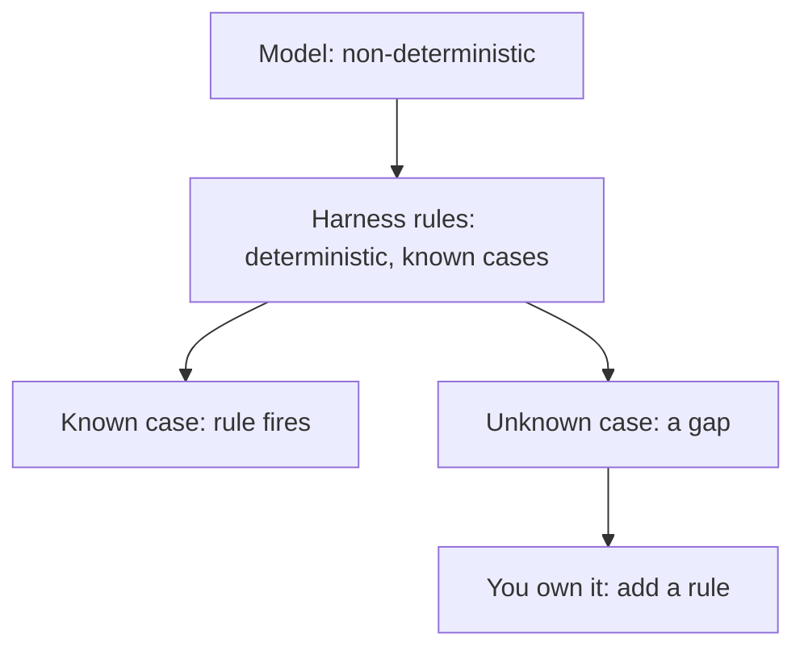
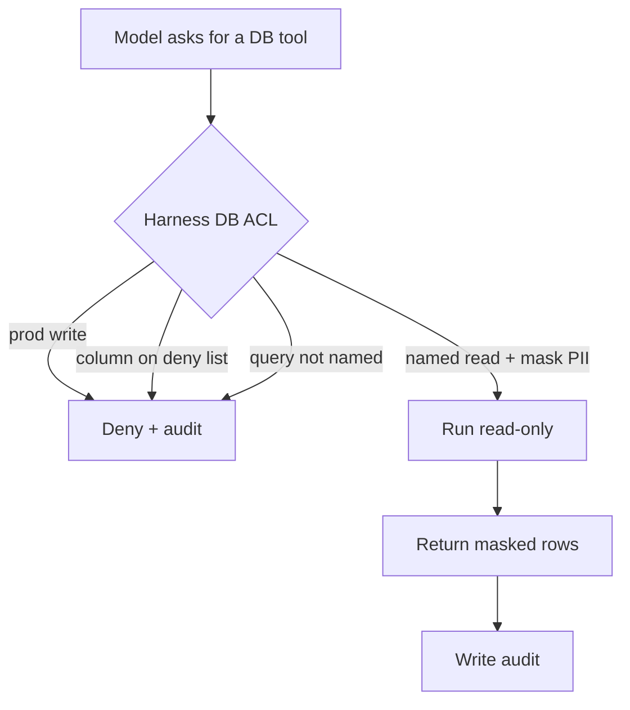
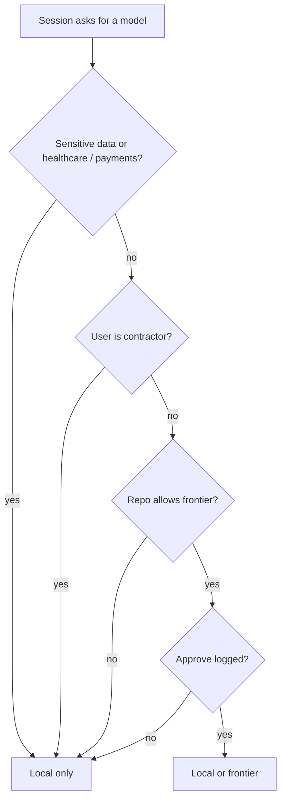
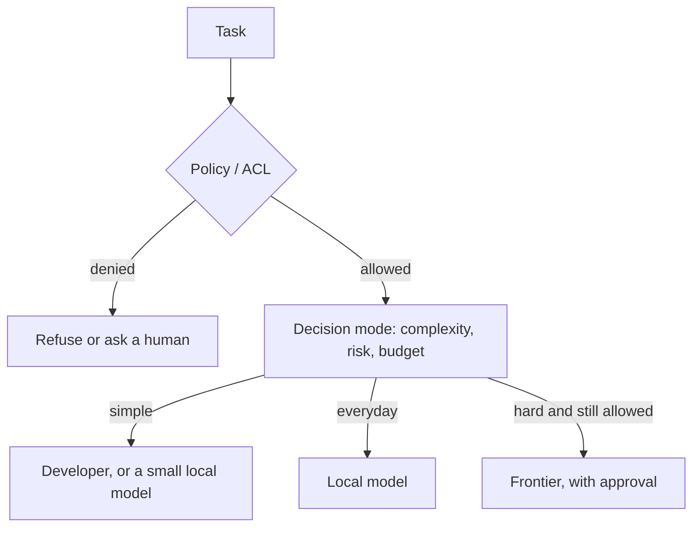

<div class="callout">
<p><strong>TL;DR</strong></p>
<ul>
<li>The harness builds, the model fills. Code, data, and even database access flow through it. Own that path.</li>
<li>We control a non-deterministic model with a deterministic harness. The harness only covers the cases it knows about, so it can still miss things. Own it, and you can add a rule the day you find a gap.</li>
<li>Hosted tools offer Privacy Mode, ZDR, and no-training promises. I am not saying they misuse data. You still cannot independently verify what happens after a prompt leaves your machine.</li>
<li>A harness you run can keep work local, mask PII, refuse prod writes, and decide which model a person may call.</li>
<li>This is not a lonely bet. Stripe, Block, Spotify, Ramp, Shopify, Amazon, Airbnb, and Coinbase have published in-house coding agents or harnesses. The model is often a vendor model. The harness is theirs.</li>
<li>Cost (about 3× to 40× tokens) and a roughly four-month open-model gap make this practical now. They are not why I started. Keep a balance: simple work stays with you or a small local model. Frontier is for hard tasks.</li>
<li><a href="https://github.com/vijayliebe/Code-Harness" target="_blank" rel="noopener">Code-Harness</a> is my retrieval-harness head start, not a finished privacy platform. <a href="#try-code-harness">Try it</a>.</li>
</ul>
</div>

---

<a id="why"></a>
## Why I care

The model race gets the headlines. I think that is the wrong thing to own.

That is an **opinion**. I am not announcing a product, and I am not saying the model becomes optional. My main bet: **every business should own the harness its team uses**, because **code, data, and even database access flow through it**.

The **model** is the engine. The **harness** is context, tools, the loop, checks, and rules. In one line: **the harness builds, the model fills.** Swap the engine and most of that story stays the same.

| Part | In a car | Around a model |
| --- | --- | --- |
| Engine | Makes power | The model writes tokens |
| Steering | Points the wheels | Context it may read |
| Brakes | Stop it | Guardrails and a stop rule |
| Dashboard | Speed, fuel, warnings | Logs, tokens, timings |
| Logbook | Last trip | Memory and an audit trail |


We are controlling something **non-deterministic** (the AI model) with something **deterministic** (the harness). Same prompt, two runs, the model can pick a different answer or a different tool. The harness is the part that repeats: if this user, this repo, this tool, then allow or block.

That harness is only as complete as the use cases it knows about. A new path, a new tool, a <a href="https://theintelliwise.com/posts/prompt-injection-guide/" target="_blank" rel="noopener">prompt injection</a> you did not write a rule for — it can miss that. That is exactly why you want to own it. The day you find a gap, you add a rule. You do not open a ticket and wait.



If you want how a real hosted harness is put together, I already walked through Cursor from the outside: <a href="https://theintelliwise.com/posts/reverse-engineering-cursor-ai-agent/" target="_blank" rel="noopener">Reverse Engineering the Cursor AI Agent</a>. This page is the other half: **who should own that harness, and why privacy is the reason.** Working example: <a href="https://github.com/vijayliebe/Code-Harness" target="_blank" rel="noopener">Code-Harness</a> (Apache-2.0). Retrieval for code, not a finished privacy platform.

---

<a id="problem"></a>
## The problem: you cannot verify a vendor’s promise

When a developer asks an agent a question, the harness is already in the middle. It reads the repo. It may open a ticket. It may run a query on a database. It packs that into a prompt. Then a model sees it.

So the first question is not “which model?” The first question is **who runs the path that your source and your records travel on.**

I use hosted coding tools. I am not saying <a href="https://cursor.com/help/security-and-privacy/privacy" target="_blank" rel="noopener">Cursor</a>, <a href="https://openai.com/business-data/" target="_blank" rel="noopener">OpenAI Codex</a>, or <a href="https://code.claude.com/docs/en/zero-data-retention" target="_blank" rel="noopener">Claude Code</a> misuse customer data. Their public docs offer real privacy modes:

- Cursor **Privacy Mode**: no training, plus **zero-data-retention (ZDR)** agreements with the providers it routes to. Prompts and code still go to Cursor and those providers. Some models and “bring your own key” sit outside ZDR.
- OpenAI: API and business products **do not train on your organisation’s data by default**. **ZDR** exists for qualifying organisations, with approval.
- Claude Code: on commercial Team / Enterprise / API terms, **no training** unless you opt in. **ZDR** is a separate Enterprise offering, enabled by Anthropic, not in the standard plan.

Those are real features. I would still buy them for a lot of everyday work. The honest limit is still the same: **the guarantee is a contract and a policy page.** You cannot independently verify what happens to a prompt once it leaves your machine. You cannot inspect the provider’s disk. You trust the vendor and the audit they show you. That is fine for many teams. It is not the same as **control**.

---

<a id="answer"></a>
## My answer: own the harness

With a harness you run, on a model you run (or a model that never sees the sensitive slice), the default can be: **this prompt does not go to an outside API.** Local embeddings. Local LLM. Localhost serve. If something must leave, the harness is where you say no — before the bytes move.

What it can control:

| Layer | What owning it lets you do |
| --- | --- |
| **Data / files** | Keep the pack on your machine. Deny `**/.env`, `secrets/**`, `patients/**`. Prod infra read-only. |
| **Database** | Read-only prod. Named queries only. Mask PII. No prod writes. |
| **Models** | Who may call local vs frontier, by user, repo, and data tags. |
| **Memory / context** | What past chat and repo facts go into the next pack. See <a href="https://theintelliwise.com/posts/why-llms-forget-memory/" target="_blank" rel="noopener">Why LLMs Forget Everything</a> and <a href="https://theintelliwise.com/posts/ai-agent-memory-guide/" target="_blank" rel="noopener">agent memory</a>. |

Governments are already building that picture.

- Japan’s Digital Agency is building <a href="https://www.digital.go.jp/assets/contents/node/information/field_ref_resources/e525db0b-eac1-49e2-9ef4-6d2e24208498/2ecbeb20/20260918_news_gennai_outline_02.pdf" target="_blank" rel="noopener">Gennai Kobo</a>, a Claude-Code-equivalent environment they can run themselves.
- <a href="https://www.pib.gov.in/PressReleasePage.aspx?PRID=2295477" target="_blank" rel="noopener">IndiaAI</a> is funding sovereign models and compute.
- The <a href="https://digital-strategy.ec.europa.eu/en/news/eu-launches-ai-gigafactories-call-boost-europes-computing-capacity-and-unlock-more-eu30-billion" target="_blank" rel="noopener">EU</a> is funding AI gigafactories so work can sit on European infrastructure.

**The honest caveat.** Most enterprises still **buy hosted tools**. A 2025 US survey put purchased AI use cases at **76%** (<a href="https://menlovc.com/perspective/2025-the-state-of-generative-ai-in-the-enterprise/" target="_blank" rel="noopener">Menlo Ventures</a>; investor in a hosted vendor, so a market snapshot, not gospel). Hosted vendors also sell regional, VPC, and HIPAA-style setups. I expect a mixed world. Who already built that path: [Companies already building their own harness](#companies). [Fair objections](#objections) covers the Docs comparison, vendor self-hosting, and the cost of owning it.

### Trust at the database, not only at the chat box

Code is only one pipe. The scary one is a tool that can talk to production data.

| Rule | What it means | What gets blocked |
| --- | --- | --- |
| Prod is read-only | `SELECT` / `EXPLAIN` only | `UPDATE`, `DELETE`, `DROP` |
| Named queries only | `order_count_by_day`, not free SQL | `SELECT * FROM patients` |
| Mask PII | `email` becomes `j***@…` before the prompt | Raw mailboxes in the context |
| Deny raw notes | `note_raw` never leaves the DB driver | A clinical note in the LLM pack |
| Staging writes stay in `scratch.*` | Experiment tables only | Writes to `orders` |

The model can still *ask* for `SELECT * FROM patients`. The harness does not run it. That is the whole point of owning the path.

The YAML below is an **example I made up**. It is not a file from Code-Harness or from any vendor.

<details markdown="1">
<summary>Example database ACL (made up)</summary>

```yaml
# Example only. Not a product file.
database:
  default: deny
  prod:
    mode: read_only
    writes: deny
    tools_allow: ["db_explain", "db_select_named"]
    queries_allow:
      - order_count_by_day
      - open_tickets_for_repo
    columns:
      mask: ["email", "phone", "card_last4", "patient_id"]
      deny: ["ssn", "full_card", "note_raw"]
  staging:
    mode: read_write_scratch
    writes: ["scratch.*"]
```



</details>

**In Code-Harness today.** Serve binds **127.0.0.1 only** by default. Outbound text goes through <a href="https://github.com/vijayliebe/Code-Harness/blob/main/harness/redact.py" target="_blank" rel="noopener">redact</a>. Events land in an append-only <a href="https://github.com/vijayliebe/Code-Harness/blob/main/harness/audit.py" target="_blank" rel="noopener">audit</a> log. That is not a database ACL and not a sovereignty platform. It is the smallest honest slice: stay on localhost, strip keys, write down what left. The DB example above is a [plan](#roadmap).

---

<a id="acl"></a>
## Rules and ACLs in practice

A paragraph in the system prompt is not a rule. The model can ignore it. A prompt injection can override it — see <a href="https://theintelliwise.com/posts/prompt-injection-guide/" target="_blank" rel="noopener">Prompt Injection: A Simple Guide</a>. An **access control list (ACL)** at the harness layer is a hard deny. The call does not run.

Principle I would ship: **deny by default**, **allow explicitly**, **deny always wins**.


The same gate covers files, tools, and network: deny `**/.env`, deny `rm -rf`, named hosts only. The piece I care about most is **which models a session may call**. Not a dropdown the user picks. A check on **user type**, **repo type**, and **data sensitivity**.

| User | Repo / data | Models I would allow |
| --- | --- | --- |
| Contractor | any | Local only |
| Anyone | healthcare / PHI | Local only. No frontier. |
| Anyone | payments / PAN | Local only |
| Junior | internal | Local. Frontier needs a senior approve. |
| Senior | open-source | Local, or frontier with a logged approve |
| Admin | internal, no PHI | Local, or frontier if the pack is clean |



Frontier calls should not be a tired “yes” click. I kept a one-day toy diary of that failure in <a href="https://theintelliwise.com/posts/human-in-the-loop-approval-fatigue/" target="_blank" rel="noopener">The Human in the Loop Can Get Tired</a>.

<details markdown="1">
<summary>Example model ACL and <code>allowed_models(user, repo)</code> (made up)</summary>

```yaml
# Example only. Not a product file.
# Deny by default. An explicit deny always wins.
models:
  default: local
  catalog:
    local: ["local-qwen", "local-gemma"]
    frontier: ["frontier-a", "frontier-b"]
  users:
    contractor: { allow: ["local"], deny: ["frontier"] }
    junior: { allow: ["local"], frontier: "needs_senior_approve" }
    senior: { allow: ["local"], frontier: "needs_approve_if_repo_allows" }
    admin: { allow: ["local", "frontier"], if: "repo_allows" }
  repos:
    healthcare: { allow: ["local"], deny: ["frontier"] }
    payments: { allow: ["local"], deny: ["frontier"] }
    internal: { allow: ["local"], frontier: "needs_approve" }
    open_source: { allow: ["local", "frontier"], frontier: "needs_approve" }
  data:
    phi: { deny: ["frontier"] }
    pan: { deny: ["frontier"] }
    public: { allow: ["local", "frontier"] }
```

```python
def allowed_models(user, repo):
    """Example only. Not production code.

    User type, repo type, and data tags. Deny wins.
    Returns (ok, models, reason).
    """
    tags = repo.data_tags  # e.g. ["phi"] or ["public"]
    allow = set(acl.users[user.role].allow)
    if "phi" in tags or "pan" in tags or repo.kind in ("healthcare", "payments"):
        allow = {"local"}
        return True, sorted(allow), "sensitive repo: local only"
    if user.role == "contractor":
        return True, ["local"], "contractor: local only"
    if "frontier" in acl.users[user.role].allow and repo.kind == "open_source":
        if user.approved_frontier:
            return True, ["local", "frontier"], "approved"
        return True, ["local"], "frontier needs approve"
    audit(user, repo, "model-acl")
    return True, sorted(allow), "default"
```

</details>

**The honest caveat.** Rules need **upkeep**. Too many “please approve” clicks cause approval fatigue. The ACL lives **outside** the model. Pair it with an **OS sandbox**. Too-strict rules get bypassed with a personal key — a privacy hole. **Log every denial.**

**In Code-Harness today.** A small real slice: outbound redact, append-only audit, default-fail <a href="https://github.com/vijayliebe/Code-Harness/blob/main/harness/verify.py" target="_blank" rel="noopener">verify</a>. Not a model ACL. An optional [decision client](#decision-mode) can sit on verify and the loop. It does not pick the model. That is a [plan](#roadmap).

---

<a id="practical"></a>
## Why this is practical now

These are **supporting** reasons. They are not the thesis.

**Cost sits in the harness.** Same model, different bill. <a href="https://arxiv.org/abs/2607.22585" target="_blank" rel="noopener">Vats & Golev</a> (preprint): up to about **40×** more tokens per solved task when the harness changed, pass rates only a few points. <a href="https://arxiv.org/html/2610.04433" target="_blank" rel="noopener">Liu & Han</a> (preprint): up to about **3×** cost, score often inside rerun noise. On <a href="https://labs.scale.com/blog/swe-bench-pro-v2" target="_blank" rel="noopener">SWE-Bench Pro v2</a>: **pick the harness for the bill, not the score.** More loops also means more of your repo in more prompts.

- **Caveat.** Accuracy often barely moves. Liu & Han found harness swaps flip about **13%** of tasks — same rate as a rerun. Labs are absorbing old harness tricks into the model (<a href="https://claude.com/resources/articles/harnessing-claudes-intelligence" target="_blank" rel="noopener">Anthropic</a>). I am not betting that “the harness beats the model.”

**Everyday coding can sit on a local model.** <a href="https://epoch.ai/data-insights/open-closed-eci-gap" target="_blank" rel="noopener">Epoch AI</a> puts the open-vs-closed gap at about **four months**. On the clean SWE-Bench Pro v2 *private* set (solved out of 272): Claude Opus 5 **222** (closed), Kimi K3 **214** (open), GLM-5.3 **211** (open).

- Open-weight families, with the right maker: **Gemma**, **Qwen**, **GLM** (Z.ai / Zhipu — not Google), **gpt-oss**, **Nemotron**, **Muse Spark Open** (Meta, Oct 2026).
- **Caveat.** The frontier still wins the hardest tasks. “Local” for a near-frontier open model often means a **server** — Muse Spark Open is aimed at a pair of high-end Mac Studios (<a href="https://research.meta.ai/blog/muse-spark-open" target="_blank" rel="noopener">Meta</a>). Licences are mixed. Scale’s public-vs-private gap for Opus 5 was about **17.8%**. Everyday retrieve can still sit on a machine you own.

**A small tuned model plus your harness.** <a href="https://arxiv.org/abs/2601.21649" target="_blank" rel="noopener">SWE-Spot</a> (preprint): a 4B matching models up to 8× larger on one repo. <a href="https://arxiv.org/abs/2602.05780" target="_blank" rel="noopener">IBM</a>: 8B fine-tunes beating 10×-larger models on two private codebases. <a href="https://arxiv.org/abs/2610.02858" target="_blank" rel="noopener">HAD</a> (Choi, Moon, Nam, Lee — **not peer reviewed**): contrast plus a validity filter moved ALFWorld unseen to **63.43%** vs **47.01%**; the 1.7B student sat above the 8B teacher. Stuffing harness text only raised usage **65.7% → 73.1%** and left success ~**43%**.

- **Caveat.** Most of the proven gain is **fine-tuning the weights**, not extra retrieve (<a href="https://arxiv.org/abs/2604.23801" target="_blank" rel="noopener">4B medical test</a>: fine-tune helped, RAG did not). HAD was text environments. Recipe: a **domain-tuned small model plus a custom harness**. <a href="https://theintelliwise.com/posts/peft-lora-qlora-guide/" target="_blank" rel="noopener">PEFT / LoRA</a>.

**Route only after policy says the data may leave.** Everyday work on a cheap local model. Frontier only when the task is hard **and** the [model ACL](#acl) says this user, this repo, and this pack may go out. <a href="https://arxiv.org/abs/2406.18665" target="_blank" rel="noopener">RouteLLM</a> and <a href="https://arxiv.org/abs/2305.05176" target="_blank" rel="noopener">FrugalGPT</a> are the known patterns.

- **Caveat.** The router **will misroute**. Escalation **sends data to an outside API**. Routing without the ACL is just a cheaper leak.

<a id="decision-mode"></a>
### Let the harness decide: decision mode

A chat model writes a paragraph. A **decision model** fills labeled fields — yes/no, one choice, a score. Background: <a href="https://theintelliwise.com/posts/jev-system-one-model/" target="_blank" rel="noopener">Jev: Stamp the Answer, Don't Write It</a>. The harness can ask three cheap questions — how hard, how sensitive, what will it cost — then pick among the models the ACL already allowed. **Policy first. Decision second.**



**In Code-Harness today.** <a href="https://github.com/vijayliebe/Code-Harness/blob/main/harness/decision.py" target="_blank" rel="noopener"><code>harness/decision.py</code></a> is an optional typed client. **Off by default.** It can grade a loop step and help the verify gate. It does **not** pick local vs frontier. Fail-soft on missing key or timeout. Picking a model after the ACL is a [plan](#roadmap).


---

<a id="grey-matter"></a>
## Keep your grey matter: balance AI and your own thinking

There should be a **balance** between using AI and using our own intelligence. If every rename goes to a frontier model, grey matter rusts — and the bill goes with it. A harness can enforce this. Modes I would ship: **try it yourself first**, **explain before you accept**, and a per-team frontier budget.

| Task | Who / what handles it |
| --- | --- |
| Rename, a test you already know | You. Or a small local model. |
| “Where is this function?” | Local retrieve. No frontier. |
| Learning a new library | You write first. AI may explain, not dump the file. |
| Hard / unfamiliar / high-stakes | Frontier only with a logged approve. |

I am not saying never use AI. I am saying **do not outsource the easy reps**.

- <a href="https://doi.org/10.1145/3706598.3713778" target="_blank" rel="noopener">Lee, Sarkar et al., CHI 2025</a> (Microsoft Research + CMU): **319** knowledge workers, **936** examples. Higher confidence in GenAI went with **less** critical thinking and **less** reported effort. Self-report, not a skill test.
- <a href="https://www.anthropic.com/research/AI-assistance-coding-skills" target="_blank" rel="noopener">Shen & Tamkin, Anthropic, Jan 2026</a>: RCT, **52** mostly junior developers on Trio. AI group scored **17%** lower on a quiz minutes later (**50%** vs **67%**; worst on debugging). Asking “why” kept scores up. Speed-up was not significant.
- <a href="https://metr.org/blog/2025-07-10-early-2025-ai-experienced-os-dev-study/" target="_blank" rel="noopener">METR, 2025</a>: RCT, **16** experienced open-source developers, **246** issues. Early-2025 tools (Cursor Pro + Claude 3.5 / 3.7): **19% slower**. They forecast **24%** faster, and afterwards still thought they had been **20%** faster.

**Caveat.** Evidence is **early and mixed**. One survey, one short quiz, one early-2025 setting. Other work finds AI can speed *familiar* tasks. If every rename hits the frontier, you pay twice — the bill, and the skills you stop practising. These modes are a [plan](#roadmap), not in Code-Harness today.

---

<a id="code-harness"></a>
## Code-Harness: my head start

**It is a retrieval harness for code**, not a general agent. Public, <a href="https://github.com/vijayliebe/Code-Harness/blob/main/LICENSE" target="_blank" rel="noopener">Apache-2.0</a>.

| Piece | Files | What it does |
| --- | --- | --- |
| Retrieve | `harness/retriever.py` | Dense + BM25 + graph, RRF (**0.3 / 0.25 / 0.2**), rerank, MMR. |
| Pack | `context_builder.py`, `ccr.py` | Fit a token budget. Signatures plus first and last lines. |
| Loop | `loop.py` | Optional corrective retrieve. **Off by default**. |
| Verify | `verify.py` | Citation check. Default-fail “done” gate. |
| Decision | `decision.py` | Optional typed client. **Off by default.** Loop / verify only. |
| Safety | `redact.py`, `audit.py` | Keys stripped outbound. Append-only log. |
| Eval | `eval.py` | Golden suite. Misses tagged by stage. |
| Serve | `serve.py` | Localhost HTTP + MCP. |


Four design stories. No extra numbers.

1. **Config, not the model.** An uncommented `LLM_PROVIDER=gemini` in `.env.example` silently changed behaviour.
2. **Exact names beat clever embeddings.** Dense search misses `auth_login`. BM25 is there for that.
3. **“Done” is checked, not claimed.** The verify gate starts false.
4. **Swapping embeddings is a harness problem.** MiniLM is 384-d. Jina-code is 768-d. Isolated indexes.

<a id="what-i-measured"></a>
### What I measured

This is a **smoke test**, not a benchmark. Eight questions, one run, on the Code-Harness repo itself (4,289 chunks). One question flipping moves Recall by **0.125**. Full harness: Recall@10 **0.3125**, nDCG@10 **0.2629**, citation-path **0.625**. Dense embeddings were the piece that mattered on this set. Full table and caveats below.

<details markdown="1">
<summary>Full smoke-test table and how to read it</summary>

| Variant | Recall@10 | nDCG@10 | Citation-path hit | Packed tokens |
| --- | ---: | ---: | ---: | ---: |
| Full harness | 0.3125 | 0.2629 | 0.625 | 1269 |
| No dense (embeddings) | 0.1875 | 0.1916 | 0.375 | 1177 |
| No BM25 | 0.5000 | 0.4152 | 0.750 | 1579 |
| No graph | 0.3125 | 0.2629 | 0.625 | 1340 |
| No rerank | 0.4375 | 0.3769 | 0.750 | 1480 |
| No MMR | 0.3125 | 0.2629 | 0.625 | 1269 |
| HyDE on | 0.3750 | 0.2851 | 0.625 | 1269 |
| CCR-lite on | 0.3125 | 0.2629 | 0.625 | 1269 |
| No retrieval | 0 | 0 | 0 | 5 |

A separate `--loop` pass: Recall@10 **0.4375**, nDCG@10 **0.3879**, citation-path **0.75**, one stall in eight queries. Loop stays off by default.


<div class="callout">
<p><strong>How to read this (all the caveats).</strong></p>
<ul>
<li>No retrieval is zero <em>by construction</em>. Without the harness the model has nothing grounded to cite.</li>
<li>Dense embeddings were the most useful single piece on this set. Citation hits fell from 0.625 to 0.375 when I removed them.</li>
<li>Removing BM25 or the reranker scored <em>higher</em> here. Grow the eval and retune later. Do not change the defaults on this.</li>
<li>Graph, MMR, and CCR-lite did not move the numbers on this set. That does not prove they are useless.</li>
<li>I did not run an answer-level comparison. I am not claiming the answers got better. I am not quoting latency.</li>
</ul>
</div>

</details>

<a id="roadmap"></a>
### What’s next (plans, not promises)

None of this is shipped.

| Plan | What it is for |
| --- | --- |
| Model ACL: `allowed_models(user, repo)` | Thesis + rules |
| Database tools: read-only, named queries, masked columns | Thesis |
| Path/tool ACL + decision mode among **allowed** models | Rules / routing |
| Domain layers, fine-tune path, harness-on vs off eval | Practical |
| Skill-balance modes: try-it-first, explain-before-accept, frontier budget | Grey matter |

<a id="try-code-harness"></a>
### Try it yourself: Code-Harness

Commands below are from the public <a href="https://github.com/vijayliebe/Code-Harness/blob/main/README.md" target="_blank" rel="noopener">README</a>. I am not adding flags. <a href="https://github.com/vijayliebe/Code-Harness/blob/main/LICENSE" target="_blank" rel="noopener">Apache-2.0</a>. Retrieval needs no API key. A generated answer does. Python **3.9+** (CI uses 3.12). On Debian/Ubuntu, `python3 -m venv` needs `python3-venv`.

```bash
git clone https://github.com/vijayliebe/Code-Harness.git
cd Code-Harness

python3 -m venv .venv
source .venv/bin/activate          # Windows: .venv\Scripts\activate

pip install -r requirements.txt

# Index this repo. First run downloads all-MiniLM-L6-v2 from Hugging Face.
# No LLM key. Defaults: local MiniLM, Chroma, decision model off,
# max_loops 0, verify off, HyDE is a free template (not an LLM call).
python3 main.py index .

# Retrieval only — prints packed context. First query also downloads
# cross-encoder/ms-marco-MiniLM-L-6-v2. A query *without* --no-llm calls
# OpenAI gpt-4o and exits if OPENAI_API_KEY is unset.
python3 main.py query . --no-llm -q "how does the chunker work?"
```

No LLM key: `index`, `query --no-llm`, `eval`, `doctor`, `wiki generate`, and `make test` work. For a generated answer, copy <a href="https://github.com/vijayliebe/Code-Harness/blob/main/.env.example" target="_blank" rel="noopener">`.env.example`</a> to `.env` and set a provider key, then drop `--no-llm`. Canonical eval (same recipe CI uses):

```bash
python3 main.py index .
python3 main.py eval . --suite .docs/research/eval/code-harness.fixture.yaml
```

Localhost retrieve plus MCP:

```bash
python3 main.py serve .
```

For an IDE over stdin/stdout, after you have indexed: `python main.py mcp stdio .`

Start with `loop.py`, `verify.py`, and `retriever.py` in that repo. If something is wrong, or you want a change, open an issue or a PR. I read them.

---

<a id="companies"></a>
## Companies already building their own harness

Rows I could check on a company blog or official docs. No invented numbers.

| Company | What they built | Why (from the source) | Source |
| --- | --- | --- | --- |
| **Stripe** | **Minions**: unattended agents on a Goose fork, Stripe LLM infra, isolated “devboxes”, MCP Toolshed. **1,300** minion PRs a week, human-reviewed, no human-written code. Cursor and Claude Code stay for supervised work. | Internal tools, unusual stack, unattended scale. | <a href="https://stripe.dev/blog/minions-stripes-one-shot-end-to-end-coding-agents-part-2" target="_blank" rel="noopener">Stripe</a> |
| **Block** | **Goose**: Apache-2.0 agent framework. Block engineers use it. You pick the LLM. | Own the agent loop; any model + MCP. | <a href="https://block.xyz/inside/block-open-source-introduces-codename-goose" target="_blank" rel="noopener">Block</a> |
| **Spotify** | **Honk**: Claude Agent SDK “wrapped inside our own harness”, Kubernetes, CI. Latest Java backend migration: **three days**. | Fleet-wide migrations scripts could not cover. | <a href="https://engineering.atspotify.com/2026/6/code-with-claude-coding-is-no-longer-the-constraint" target="_blank" rel="noopener">Spotify</a> |
| **Ramp** | **Inspect**: background agent in sandboxed VMs with Ramp’s tests, telemetry, flags, frontend screenshots. About **30%** of merged frontend/backend PRs. Not mandated. | “Owning the tooling lets you build something significantly more powerful than an off-the-shelf tool.” | <a href="https://engineering.ramp.com/post/why-we-built-our-background-agent" target="_blank" rel="noopener">Ramp</a> |
| **Shopify** | **River** on **Aquifer**. They name the **harness** as the disposable agent loop. **One in eight** merged PRs coauthored by River. | Internal tools, monorepo, skills, CI. | <a href="https://shopify.engineering/under-the-river" target="_blank" rel="noopener">Shopify</a> |
| **Amazon** | **Q Developer** code-transformation agent, used internally for Java 8/11 → 17 in company-wide campaigns. AWS, citing Andy Jassy: tens of thousands of production apps; over **4,500** developer-years vs manual; **$260 million** annual savings. More than **50%** of production apps in six months; **79%** of auto-generated code reviews applied with no extra change. | Scale and cost of upgrades. Campaigns, not “Q for every line.” | <a href="https://aws.amazon.com/blogs/devops/amazon-q-developer-just-reached-a-260-million-dollar-milestone/" target="_blank" rel="noopener">AWS</a>, <a href="https://aws.amazon.com/blogs/devops/accelerate-application-upgrades-with-amazon-q-developer-agent-for-code-transformation/" target="_blank" rel="noopener">campaigns</a> |
| **Airbnb** | LLM pipeline: nearly **3.5K** Enzyme tests → RTL in **6 weeks** vs **1.5 years** by hand. | Scale of a one-off migration. | <a href="https://airbnb.tech/infrastructure/accelerating-large-scale-test-migration-with-llms/" target="_blank" rel="noopener">Airbnb</a> |
| **Coinbase** | **Mux**: internal multi-agent tool. April 2026: **600+** users, **5,068** merged PRs. Still uses Cursor / Copilot / Claude Code. Built for their LLM Gateway, Codeflow, and repo sensitivity controls. | Internal infra and security controls. | <a href="https://www.coinbase.com/blog/coding-had-a-concurrency-problem-how-mux-helped-solve-it" target="_blank" rel="noopener">Coinbase</a> |

Common pattern:

- They plug a model into **their** tools, rules, CI, and data. The model is often a vendor frontier model (Spotify: Claude; Stripe still hands out Cursor and Claude Code).
- The harness is what they wrote: sandboxes, MCP, linters, blueprints, campaigns.
- Scale and internal context show up more often than privacy as the published reason.

Amazon also ships <a href="https://kiro.dev/blog/introducing-kiro/" target="_blank" rel="noopener">Kiro</a>, an agentic IDE (specs, hooks, MCP). That is a public product, not a private-only tool. Japan’s Gennai Kobo, already linked under governments, is the sovereignty-shaped version of the same idea.

<div class="callout">
<p><strong>Honest caveat.</strong> Many of these still use frontier models from vendors. Amazon’s Q is also a product they sell. The point is they own the harness layer: rules, tools, CI, and how a change gets to a PR. I am not claiming they built this for privacy unless they said so.</p>
</div>

---

<a id="objections"></a>
## Fair objections, and my answers

Two I hear a lot. Both are fair, and neither is the same as owning the path.

<div class="callout">
<p><strong>Q:</strong> We already trust SaaS like Google Docs with our documents. Why not trust a vendor harness?</p>
</div>

With Docs-style SaaS, you still decide what you put in and what you share. The tool does what you click. An AI agent acts on its own. It reads files and runs tools, sometimes in ways no human saw. Data can leave without anyone noticing. I wrote how that happens in <a href="https://theintelliwise.com/posts/prompt-injection-guide/" target="_blank" rel="noopener">Prompt Injection: A Simple Guide</a>. A strict harness you own, plus a local LLM, reduces that risk. The default can be: this prompt does not go out.

<div class="callout">
<p><strong>Q:</strong> The vendor offers self-hosting / bring-your-own infra. Isn't that enough?</p>
</div>

It helps. Data can still leave through logs, telemetry, analytics, or crash reports. Even if those are strict, you are still trusting the vendor's harness quality — the rules, the tool allow-list, what happens on a weird prompt.

A harness you own is more trustworthy for that, and you can change it when you need to. No feature-request queue. No waiting on the vendor's roadmap. No extra invoice for each add-on.

**Honest caveat.** Owning it means you carry the build, the security, and the maintenance. That cost is real. For a lot of teams, a hosted tool is still the right buy. I am arguing for the teams that cannot accept "trust the policy page."

---

<a id="prove-me-wrong"></a>
## What would prove me wrong

A short list I would own in a review. How I would measure a claim like this: <a href="https://theintelliwise.com/posts/ai-agent-evals-golden-examples-grader/" target="_blank" rel="noopener">AI Agent Evals: Golden Examples and the Grader</a>.

- **Self-hosting costs more than the privacy is worth.** You now run models, GPUs, patching, and an ACL. Most teams already buy hosted tools (**76%** in that 2025 survey). If that stays true, this is a regulated-industry niche, not a default.
- **Hosted privacy modes become independently auditable.** If you can run the model in *your* VPC, with *your* keys, and a third party can prove no extra copy — logs and telemetry included — the trust gap shrinks. I still want the ACL.
- **Frontier models absorb the harness.** Labs already talk this way: extra scaffolding is coping, not scaling (<a href="https://claude.com/resources/articles/harnessing-claudes-intelligence" target="_blank" rel="noopener">Anthropic</a>). Then my bet shrinks to redact, audit, and model ACL.
- **Open models stall.** If the four-month gap opens again, everyday local coding is a server-room story.
- **Harness upkeep costs more than it saves.** Rules rot. People bypass the ACL with a personal key — which is also how the data leaves.
- **Using frontier for every simple task makes juniors better, not worse.** If a year of “always-on frontier” still raises debugging skill, the grey-matter bet shrinks. I have not seen that study yet.

---

<a id="takeaway"></a>
## What to take away

- The harness builds, the model fills. Own the path your code and your records travel on.
- We control a non-deterministic model with a deterministic harness. The harness only knows the cases you wrote. Own it so you can add a rule the day you find a gap.
- Hosted privacy is a real contract. It is not independent verify. Vendor self-hosting still leaves logs, telemetry, and harness quality with the vendor.
- A prompt is not an ACL. Deny by default. Decide which model a person may call.
- Cost and open models are why this is practical, not why I started. Keep a balance: simple work is yours, frontier is for hard tasks.
- Code-Harness is a *retrieval* harness for code. Try the [quickstart](#try-code-harness).

If you change one thing after this page: stop asking “which model?” first. Ask who owns the path.

---

## Related reads on Intelliwise

- <a href="https://theintelliwise.com/posts/reverse-engineering-cursor-ai-agent/" target="_blank" rel="noopener">Reverse Engineering the Cursor AI Agent</a> — how a real hosted harness is put together.
- <a href="https://theintelliwise.com/posts/prompt-injection-guide/" target="_blank" rel="noopener">Prompt Injection: A Simple Guide</a> — why a prompt is not an ACL.
- <a href="https://theintelliwise.com/posts/human-in-the-loop-approval-fatigue/" target="_blank" rel="noopener">The Human in the Loop Can Get Tired</a> — permission clicks before a frontier call.
- <a href="https://theintelliwise.com/posts/why-llms-forget-memory/" target="_blank" rel="noopener">Why LLMs Forget Everything</a> and <a href="https://theintelliwise.com/posts/ai-agent-memory-guide/" target="_blank" rel="noopener">Different Types of Memory in AI Agents</a> — the context / memory layer.
- <a href="https://theintelliwise.com/posts/rag-five-knobs-recall-precision-topk-topp-cost/" target="_blank" rel="noopener">Five Things to Measure and Tune in a RAG System</a> and <a href="https://theintelliwise.com/posts/rag-semantic-caching/" target="_blank" rel="noopener">Semantic Caching for RAG & LLMs</a> — retrieve cost.
- <a href="https://theintelliwise.com/posts/kv-cache-sticky-notes/" target="_blank" rel="noopener">KV Cache: Why Chatbots Keep Past Keys and Values</a> — local inference memory.
- <a href="https://theintelliwise.com/posts/peft-lora-qlora-guide/" target="_blank" rel="noopener">PEFT, LoRA, and QLoRA</a> — domain-tuning a small model.
- <a href="https://theintelliwise.com/posts/ai-agent-evals-golden-examples-grader/" target="_blank" rel="noopener">AI Agent Evals: Golden Examples and the Grader</a> — how I would measure this bet.
- <a href="https://theintelliwise.com/posts/jev-system-one-model/" target="_blank" rel="noopener">Jev: Stamp the Answer, Don't Write It</a> — typed decision fields, not a chat paragraph.

---

## Sources

- <a href="https://github.com/vijayliebe/Code-Harness" target="_blank" rel="noopener">Code-Harness</a> — retrieval harness for code, Apache-2.0. Smoke-test numbers are from one 8-question run on that repo.
- Cursor, <a href="https://cursor.com/help/security-and-privacy/privacy" target="_blank" rel="noopener">Privacy and data</a> and <a href="https://cursor.com/data-use" target="_blank" rel="noopener">Data use</a>. Privacy Mode, ZDR, and the note that prompts still go to providers.
- OpenAI, <a href="https://openai.com/business-data/" target="_blank" rel="noopener">Business data privacy</a> and <a href="https://developers.openai.com/api/docs/guides/your-data" target="_blank" rel="noopener">API data controls</a>. No training by default; ZDR for qualifying organisations.
- Anthropic, <a href="https://code.claude.com/docs/en/zero-data-retention" target="_blank" rel="noopener">Claude Code ZDR</a> and <a href="https://code.claude.com/docs/en/data-usage" target="_blank" rel="noopener">data usage</a>. Commercial no-training default; ZDR as a separate Enterprise offering.
- Japan Digital Agency, <a href="https://www.digital.go.jp/assets/contents/node/information/field_ref_resources/e525db0b-eac1-49e2-9ef4-6d2e24208498/2ecbeb20/20260918_news_gennai_outline_02.pdf" target="_blank" rel="noopener">Gennai OSS Ver 2.0 technical slides</a>, 25 Aug 2026.
- Press Information Bureau, <a href="https://www.pib.gov.in/PressReleasePage.aspx?PRID=2295477" target="_blank" rel="noopener">IndiaAI Mission update</a>, 6 Aug 2026.
- European Commission, <a href="https://digital-strategy.ec.europa.eu/en/news/eu-launches-ai-gigafactories-call-boost-europes-computing-capacity-and-unlock-more-eu30-billion" target="_blank" rel="noopener">AI Gigafactories call</a>, 30 Jul 2026.
- Menlo Ventures, <a href="https://menlovc.com/perspective/2025-the-state-of-generative-ai-in-the-enterprise/" target="_blank" rel="noopener">2025: The State of Generative AI in the Enterprise</a>, 9 Dec 2025. US survey.
- Stripe, <a href="https://stripe.dev/blog/minions-stripes-one-shot-end-to-end-coding-agents" target="_blank" rel="noopener">Minions, Part 1</a> and <a href="https://stripe.dev/blog/minions-stripes-one-shot-end-to-end-coding-agents-part-2" target="_blank" rel="noopener">Part 2</a>. Homegrown unattended agents; Goose fork; 1,300 minion PRs a week.
- Block, <a href="https://block.xyz/inside/block-open-source-introduces-codename-goose" target="_blank" rel="noopener">codename goose</a>, 28 Jan 2025. Apache-2.0 agent framework.
- Spotify Engineering, <a href="https://engineering.atspotify.com/2026/6/code-with-claude-coding-is-no-longer-the-constraint" target="_blank" rel="noopener">Coding Is No Longer the Constraint</a>, 2026. Honk: own harness around Claude Agent SDK.
- Ramp Engineering, <a href="https://engineering.ramp.com/post/why-we-built-our-background-agent" target="_blank" rel="noopener">Why we built our background agent</a>. Inspect; ~30% of merged frontend/backend PRs.
- Shopify Engineering, <a href="https://shopify.engineering/under-the-river" target="_blank" rel="noopener">Under the River</a>, 28 May 2026. River on Aquifer; harness named as the agent loop.
- AWS, <a href="https://aws.amazon.com/blogs/devops/amazon-q-developer-just-reached-a-260-million-dollar-milestone/" target="_blank" rel="noopener">Amazon Q Developer $260 million milestone</a>, 1 Aug 2024 (citing Andy Jassy). Also <a href="https://aws.amazon.com/blogs/devops/accelerate-application-upgrades-with-amazon-q-developer-agent-for-code-transformation/" target="_blank" rel="noopener">internal Java-upgrade campaigns</a>, 3 Oct 2024. Kiro: <a href="https://kiro.dev/blog/introducing-kiro/" target="_blank" rel="noopener">Introducing Kiro</a>, 14 Jul 2025.
- Airbnb Engineering, <a href="https://airbnb.tech/infrastructure/accelerating-large-scale-test-migration-with-llms/" target="_blank" rel="noopener">Accelerating Large-Scale Test Migration with LLMs</a>. Nearly 3.5K files; 6 weeks vs 1.5 years.
- Coinbase Engineering, <a href="https://www.coinbase.com/blog/coding-had-a-concurrency-problem-how-mux-helped-solve-it" target="_blank" rel="noopener">How Mux Helped Solve It</a>, 11 May 2026. In-house multi-agent tool.
- Naman Vats and Oleg Golev, <a href="https://arxiv.org/abs/2607.22585" target="_blank" rel="noopener">The Scaffold Effect in Coding Agents</a>, arXiv 2607.22585. Preprint.
- Yangze Liu and Zhongyi Han, <a href="https://arxiv.org/html/2610.04433" target="_blank" rel="noopener">What Does a Harness Buy? Tokens, Mostly.</a>, arXiv 2610.04433. Preprint.
- Scale / Reflection, <a href="https://labs.scale.com/blog/swe-bench-pro-v2" target="_blank" rel="noopener">SWE-Bench Pro V2</a>, Sep 2026.
- Lance Martin / Anthropic, <a href="https://claude.com/resources/articles/harnessing-claudes-intelligence" target="_blank" rel="noopener">Harnessing Claude's intelligence</a>, 2026.
- Epoch AI, <a href="https://epoch.ai/data-insights/open-closed-eci-gap" target="_blank" rel="noopener">Open vs closed capability gap</a>, 29 May 2026.
- Meta Superintelligence Labs, <a href="https://research.meta.ai/blog/muse-spark-open" target="_blank" rel="noopener">Muse Spark Open</a>, 15 Oct 2026.
- Moonseok Choi, Taehong Moon, Giung Nam, Juho Lee, <a href="https://arxiv.org/abs/2610.02858" target="_blank" rel="noopener">Harness-Aware Distillation</a>, arXiv 2610.02858, 2 Oct 2026. Preprint.
- Columbia / UCLA, <a href="https://arxiv.org/abs/2601.21649" target="_blank" rel="noopener">SWE-Spot</a>, arXiv 2601.21649. Preprint.
- IBM Research, <a href="https://arxiv.org/abs/2602.05780" target="_blank" rel="noopener">enterprise-code fine-tune study</a>, arXiv 2602.05780.
- <a href="https://arxiv.org/abs/2604.23801" target="_blank" rel="noopener">Domain fine-tuning vs RAG at 4B</a>, arXiv 2604.23801.
- OpenAI, <a href="https://openai.com/index/harness-engineering/" target="_blank" rel="noopener">Harness engineering</a>, 11 Feb 2026.
- Isaac Ong et al., <a href="https://arxiv.org/abs/2406.18665" target="_blank" rel="noopener">RouteLLM</a>, arXiv 2406.18665.
- Lingjiao Chen, Matei Zaharia, and James Zou, <a href="https://arxiv.org/abs/2305.05176" target="_blank" rel="noopener">FrugalGPT</a>, arXiv 2305.05176.
- Hao-Ping (Hank) Lee, Advait Sarkar, Lev Tankelevitch, Ian Drosos, Sean Rintel, Richard Banks, and Nicholas Wilson, <a href="https://www.microsoft.com/en-us/research/publication/the-impact-of-generative-ai-on-critical-thinking-self-reported-reductions-in-cognitive-effort-and-confidence-effects-from-a-survey-of-knowledge-workers/" target="_blank" rel="noopener">The Impact of Generative AI on Critical Thinking</a>, CHI 2025. Microsoft Research + Carnegie Mellon. Survey.
- Judy Hanwen Shen and Alex Tamkin, <a href="https://www.anthropic.com/research/AI-assistance-coding-skills" target="_blank" rel="noopener">How AI assistance impacts the formation of coding skills</a>, Anthropic, 29 Jan 2026. Also <a href="https://arxiv.org/abs/2601.20245" target="_blank" rel="noopener">arXiv 2601.20245</a>. RCT.
- METR, <a href="https://metr.org/blog/2025-07-10-early-2025-ai-experienced-os-dev-study/" target="_blank" rel="noopener">Measuring the Impact of Early-2025 AI on Experienced Open-Source Developer Productivity</a>, 10 Jul 2025. Also <a href="https://arxiv.org/abs/2507.09089" target="_blank" rel="noopener">arXiv 2507.09089</a>. RCT.
- Intelliwise posts cited above are listed under Related reads.
