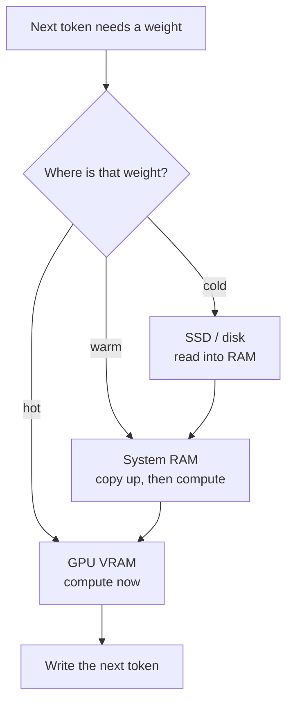

<strong>TL;DR</strong>

<ul>
<li>A “70B on 4GB GPU” headline means the card holds a <em>slice</em>. The rest of the weights still live on disk and RAM.</li>
<li>Low VRAM is not useful latency. Measure time-to-first-token (TTFT), tokens per second, whole-machine RAM + SSD, and answer quality.</li>
<li>Pick the <strong>model</strong> that solves the task. Then pick the <strong>engine</strong> that runs it well on your PC.</li>
<li><a href="https://github.com/ggml-org/llama.cpp" target="_blank" rel="noopener">llama.cpp</a>, Ollama, and LM Studio already do hybrid CPU–GPU. Colibri, Strata, AirLLM, and FreeToken are specialized designs. They did not invent “use the whole PC.”</li>
<li>Four paths below. Jump to the one that matches your machine and your job. I did not run these benches. Numbers are what the projects report in their own docs.</li>
</ul>

---

## The trap: “4GB GPU runs 70B”

The sentence is usually true in a narrow way.

The GPU never held the whole model. For a dense model, an engine like <a href="https://github.com/lyogavin/airllm" target="_blank" rel="noopener">AirLLM</a> keeps **one layer** on the card, then swaps the next layer in. For a mixture-of-experts (MoE) model, only a small set of experts fires for each token. The rest can sit in RAM or on the SSD until the router asks for them.

So the VRAM number answers one question: “Will this process start?” It does not answer “Will I get a useful reply before I go make tea?”

Weights still have to live somewhere.

Three shelves. Same books.

- **GPU VRAM** — the desk under your hands. Fast. Small.
- **System RAM** — the table next to the desk. Slower to reach. Bigger.
- **SSD** — the library stacks. Huge. You walk there on a miss.

If you have seen <a href="https://theintelliwise.com/posts/kv-cache-sticky-notes/" target="_blank" rel="noopener">KV cache sticky notes</a>, this is the same idea on the other side of memory. The KV cache is conversation state. The weight shelves are the model itself. Both grow. Both steal the same VRAM.

I treat the four engines in this post as **placement policies**, not as magic. llama.cpp already lets you put some layers on the GPU (`-ngl` / `--n-gpu-layers`), pin named tensors (`--override-tensor`), and leave MoE experts on the CPU. That is the baseline. Start there unless you have a reason not to.

---

## Pick a path

Do not start with a product name. Start with what you are actually doing.

<strong>Choose your situation</strong>

<ol>
<li><a href="#path-low-vram">Low VRAM experiment</a> — I want to see if a huge model even starts on a small card.</li>
<li><a href="#path-gaming-pc">Gaming PC chat</a> — I have a mid or high NVIDIA card, lots of RAM, and I want to talk to a large MoE.</li>
<li><a href="#path-agents">Agent sessions</a> — I run coding agents, tool calls, and long turns. Prefill keeps hurting.</li>
<li><a href="#path-llamacpp">Already happy with llama.cpp</a> — Ollama or LM Studio already works. Should I switch?</li>
</ol>

After the paths: a [comparison table](#compare), a [checklist](#checklist), and [when to stay](#stay).

---

## Path 1 — Low VRAM experiment

**You are here if:** the card is about 4–12 GB. You want to know whether Llama 3.x 70B, Qwen3.8-Flash-Next, or something larger will even load. You can wait. This is a weekend test, not a daily chat box.

**Start with:** <a href="https://github.com/lyogavin/airllm" target="_blank" rel="noopener">AirLLM</a>.

AirLLM streams **one transformer layer** onto the GPU (or the experts a MoE token actually routes to). The rest stays on disk as layer shards. That is why the VRAM headline can look tiny next to the parameter count.

AirLLM’s README reports these VRAM numbers (their measurements, not mine):

| Model | What they report |
| --- | --- |
| Llama 3.x 70B (full precision) | ~4 GB |
| Qwen3.8-Flash-Next (~125B MoE + n-gram table) | 5.95 GB on one RTX 4090; they also say ~6 GB |
| DeepSeek-V3 (671B) | ~12 GB |
| Kimi K3 (2.8T) | 3.72 GB on one RTX 6000 Ada; they also say under 4 GB |
| Qwen3-235B | ~3 GB |

The same README is honest about the other bill. The original checkpoint is **decomposed and saved layer-wise**. You need a lot of disk. For Qwen3.8-Flash-Next they say about **360 GB** of checkpoint disk, and a **64 GB** machine is enough because the n-gram table is file-mapped on the host. `delete_original=True` reclaims the originals after the split. If you run out of disk, you get `MetadataIncompleteBuffer`. That is a disk problem, not a “model does not fit” mystery.

**What I would do**

1. Pick one model you actually care about. Not the biggest name on the page.
2. Confirm disk first. Then VRAM.
3. Time the first token and the next twenty. If TTFT is minutes, the experiment succeeded as a load test and failed as a chat test.
4. If you only needed a smaller model plus retrieval, stop here and read <a href="https://theintelliwise.com/posts/rag-five-knobs-recall-precision-topk-topp-cost/" target="_blank" rel="noopener">the five RAG knobs</a>. A 70B that crawls is not automatically better than an 8B that answers.

AirLLM also reports a **3×** decode speed-up from block-wise weight compression, and about **10%** from prefetch. Those are their numbers, on their bottleneck (disk load, not GPU matmul). Useful if you stay on this path. Not a reason to skip the stopwatch.

**Jump off this path** when you want interactive chat on a gaming PC ([path 2](#path-gaming-pc)), or when llama.cpp already loads a quant you like ([path 4](#path-llamacpp)).

---

## Path 2 — Gaming PC chat

**You are here if:** you have a discrete GPU or a strong CPU, a fast SSD, enough RAM for the model you picked, and you want to *talk* to a large MoE. Not just prove it loads.

Two engines show up here. They are not interchangeable.

### If you want Qwen3.8-Flash-Next: look at Strata

<a href="https://www.stratat.com/en/models" target="_blank" rel="noopener">Strata</a> is built around that one model (~125B MoE). Hot experts sit on the GPU. The others sit in CPU RAM. Lookup traffic can come from the SSD. They also use multi-token prediction (MTP) speculative decoding.

Their official models table (RTX 5070 column, project-reported):

| Quant | System RAM they list | Download they list | RTX 5070 tok/s they list |
| --- | --- | --- | ---: |
| Q2_0 | 48 GB+ | ~70 GB | 94 |
| IQ2_XS | 64 GB+ | ~72 GB | 79 |
| IQ3_XXS | 64 GB+ | ~74 GB | 62 |
| IQ3_S | 64 GB+ | ~76 GB | 53 |

VRAM listed on that table is **12 GB+** for those four rows. So even here, the card is not holding the whole model. RAM and disk are doing the rest.

Their paper reports MTP at about **1.6–1.8×** versus plain decode on an RTX 5070 + Ryzen 5 7600 + 64 GB setup. Again: their bench, their machine.

Specialization is the trade. Great if you want that model. Weak if you need GLM, DeepSeek, or last month’s GGUF.

### If you want a wider catalog, or GLM-5.2: look at Colibri

<a href="https://github.com/JustVugg/colibri" target="_blank" rel="noopener">Colibri</a> is a set of small **pure C** engines. CPU is the required path. GPU is optional (Vulkan, or CUDA on NVIDIA).

The picture I use: the **desk** holds the dense part (attention, shared experts, embeddings) plus a cache of experts your chat actually uses. The **library** is the SSD, where the rest of the routed experts live. A GPU, when you have one, is a few extra books in your hands.

GLM-5.2 is their reference model. From the Colibri README (project-reported):

- **744B** MoE, about **40B** active per token
- Download about **429 GB**
- RAM tiers **16 / 24 GB** (below 16 GB it does not start; from 24 GB they treat it as the measured tier)
- Cold decode about **0.05–0.1 tok/s** on the 25 GB laptop where the project started
- Warm **1.83 tok/s** CPU-only on a 128 GB Ryzen AI Max+ 395
- **9.0–9.2 tok/s** on 6× RTX 5090 with experts resident
- GitHub issue <a href="https://github.com/JustVugg/colibri/issues/31" target="_blank" rel="noopener">#31</a> reports **0.28 tok/s** median on GLM-5.2 int4, CPU-only, on a Ryzen 9 9950X with 128 GB (two runs)

That last number is why I do not trust a VRAM headline. A 128 GB workstation that writes a token every few seconds is a library, not a chat app.

Colibri’s own rule is the one I agree with: **placement changes speed, not the weights and not the router.** Less fast memory may cost tokens per second. It should not quietly change the model.

Setup asks for **8 GB RAM** at the very least (16 GB or more is better) and **22 GB** free disk for the smallest model. GLM-5.2 is in another league on disk. Check the download column before you click.

**What I would do**

1. Name the model first. Qwen3.8-Flash-Next → Strata is in the conversation. GLM-5.2 or a mixed catalog → Colibri. A GGUF you already have → [path 4](#path-llamacpp) first.
2. Time TTFT and tok/s on *your* prompts. Cold and warm. The laptop floor and the 5090 rack are both “it runs.”
3. Watch RAM + SSD while it runs. If the page cache is the real GPU, you will see it.
4. Keep a quality check. A faster quant that garbles code is not a win.

**Jump off this path** when the job is a coding agent with tool calls ([path 3](#path-agents)), or when llama.cpp already feels fine ([path 4](#path-llamacpp)).

---

## Path 3 — Agent sessions

**You are here if:** the model is in a loop. It calls tools. It writes a thinking block, then deletes it. The next turn is not a fresh chat. Prefill keeps eating the first token.

Short chat and a long agent session are different workloads. I wrote about the harness side of that in <a href="https://theintelliwise.com/posts/ai-harness-engineering/" target="_blank" rel="noopener">Own Your Harness</a>. Here the question is the engine under the harness.

**Start with:** <a href="https://github.com/FlashML-org/FreeToken" target="_blank" rel="noopener">FreeToken</a>, and still keep llama.cpp as the control.

FreeToken is an edge MoE serving engine. The public README lists four design bets:

- **Bandwidth-adaptive CPU–GPU** — a `q*` policy that splits cache misses between filling the GPU and running the expert on the CPU, using the machine’s real bandwidth
- **Expert LRU cache** — keep the experts this session actually touches
- **Elastic VRAM** — move memory between the expert cache and the KV cache at runtime, no restart
- **Semantic-aware caching** — checkpoint recurrent state and KV at tool-call and thinking-block boundaries, so an edit does not recompute the whole prefix

That last one is the reason this path exists. An agent that strips a thinking block or replaces a tool result invalidates a naive KV prefix. If you only measure a single “hello” prompt, you will miss it. See also <a href="https://theintelliwise.com/posts/why-llms-forget-memory/" target="_blank" rel="noopener">why LLMs forget</a>: the model does not remember the session. The engine and the harness do.

The README is NVIDIA-centric. It lists native support for RTX 30, 40, and 50. The paper is written around CUDA graphs and PCIe. I would not assume an AMD box is a first-class path from those docs.

Their paper (<a href="https://arxiv.org/html/2608.16157" target="_blank" rel="noopener">arXiv 2608.16157</a>) reports, on their machines, not mine:

- RTX 5090: **77–83 tok/s** on Qwen3.6-35B-A3B; **22–25 tok/s** on DeepSeek-V4-Flash
- Decode stays within **12%** of the single-turn rate as the workload gets more agentic
- Worst-case TTFT **under 44 s** across their workloads; each baseline they name went **over 150 s** in at least one setting
- 8 GB RTX 4060 laptop: a 35B model at **39.3 tok/s**

Treat those as a sales-and-paper snapshot. Copy the *metrics*, not the scores.

**What I would do**

1. Same model, same quant, same machine. llama.cpp first, then FreeToken.
2. Measure a **session**, not a greeting. Tool call. Thinking block removed. Next turn.
3. Record TTFT on turn 1 and turn 5. Record tok/s. Record RAM and VRAM while KV grows.
4. Score the answers with a small golden set. I use the habit from <a href="https://theintelliwise.com/posts/ai-agent-evals-golden-examples-grader/" target="_blank" rel="noopener">golden examples and a grader</a>. Speed without quality is a demo.

Colibri also talks about parking a conversation so an agent’s next turn reads only what is new (`COLI_PARK`). Their README reports one Hermes Agent second turn on Qwen3.8-Flash-Next (14,810 tokens): **86 s → 4.9 s**. That is their number, on their engine. If you are already on Colibri for path 2, measure that before you install a second stack.

**Jump off this path** when you only needed a chat window ([path 2](#path-gaming-pc)), or when llama.cpp plus a smaller model already holds the eval ([path 4](#path-llamacpp)).

---

## Path 4 — Already happy with llama.cpp

**You are here if:** Ollama, LM Studio, or raw llama.cpp already answers you. Someone sent a “70B on 4GB” link and you wonder if you are missing out.

You are probably not missing the *idea*. You may be missing a **specialized placement** for one model or one agent loop.

llama.cpp hybrid, in the flags people already use:

- `-ngl` / `--n-gpu-layers` — put N layers on the GPU, leave the rest on CPU
- `--override-tensor` — pin or exclude named tensors (the usual way to keep huge MoE experts off the card)
- MoE CPU-offload flags in current builds — same job, fewer hand-written tensor names

That *is* “use the whole PC.” The four engines above tune the same shelves for a narrower job: layer streaming (AirLLM), SSD-resident experts with a tiny C runtime (Colibri), one MoE with MTP (Strata), agent-aware cache and elastic VRAM (FreeToken).

**Stay on llama.cpp when**

- The GGUF you want already runs at a speed you can live with
- You need a wide model catalog and a boring OpenAI-compatible port
- You do not want a second weight format, a 360–429 GB extra download, or a CUDA-only stack
- Your “slow” problem is the prompt and the KV cache, not the engine brand. Fix context first.

**Leave llama.cpp for a trial when**

- You cannot load the model at all, and AirLLM’s layer shards are the experiment ([path 1](#path-low-vram))
- You want Qwen3.8-Flash-Next specifically, and Strata’s table matches your RAM ([path 2](#path-gaming-pc))
- You want GLM-5.2-class MoE on a machine that will never hold it in VRAM ([path 2](#path-gaming-pc))
- Agent turns re-prefill so hard that TTFT blows the client timeout ([path 3](#path-agents))

A fair trial is boring on purpose:

1. Same model family, same quant if both sides can load it, same hardware, same prompts.
2. Record TTFT, tok/s, RAM, SSD read, VRAM, and a quality check.
3. Repeat on a long context and on an agent session. One “hi” is not a bench.

If the new engine wins on those four numbers, keep it. If it only wins on a VRAM screenshot, delete it.

---

## Comparison

All speed and VRAM cells below are **project-reported**. I did not reproduce them.

| Engine | Design | Model focus | What it optimizes | What to measure |
| --- | --- | --- | --- | --- |
| **AirLLM** | One layer (or the routed MoE experts) on GPU; rest on disk as shards | Many Hugging Face models; headlines are 70B / 125B / 671B / 2.8T on small VRAM | Peak VRAM | TTFT, tok/s, shard disk, quality |
| **Colibri** | Pure C; dense/shared in RAM; routed experts stream from SSD with a cache; GPU optional | Wide catalog; GLM-5.2 is the reference (429 GB, 16/24 GB RAM tiers) | Fit a huge MoE on a normal PC | Cold vs warm tok/s, RAM+SSD, quality |
| **Strata** | Hot experts on GPU; others on CPU/RAM; lookup on SSD; MTP | Qwen3.8-Flash-Next | Interactive decode for that model | tok/s vs quant, 48–64 GB+ RAM, quality |
| **FreeToken** | Bandwidth-adaptive CPU–GPU; expert LRU; elastic VRAM; semantic checkpoints | Frontier MoE + coding / tool agents | Agent-session TTFT and decode | TTFT after edits, tok/s, RAM+VRAM split, quality |
| **llama.cpp** (baseline) | Hybrid layers / tensors; MoE CPU offload | Broad GGUF catalog; also what Ollama and LM Studio sit on | Practical local serve you already know | The same four numbers. Do not skip this row. |

---

## How to pick

Work top to bottom. Stop when a line fails.

1. **What is the task?** Chat, code, long RAG, or an agent loop. The model comes from the task, not from a VRAM screenshot.
2. **Does a smaller model plus retrieval already pass a golden set?** If yes, stay small. See <a href="https://theintelliwise.com/posts/rag-five-knobs-recall-precision-topk-topp-cost/" target="_blank" rel="noopener">RAG knobs</a> and <a href="https://theintelliwise.com/posts/ai-agent-evals-golden-examples-grader/" target="_blank" rel="noopener">evals</a>.
3. **Can llama.cpp load a quant you trust?** If yes, measure it. That is the control.
4. **Disk and RAM, not only VRAM.** AirLLM shards, Colibri’s 429 GB GLM-5.2, Strata’s ~70–76 GB downloads, FreeToken host-resident experts — the SSD is part of the machine.
5. **Interactive, or patient?** Colibri’s own 25 GB laptop floor is 0.05–0.1 tok/s cold. Issue #31 is 0.28 tok/s on a 128 GB CPU box. Say “library, not chat” before you install a dashboard.
6. **One model family, or many?** Strata is a specialist. The others are broader. llama.cpp is the broadest everyday catalog.
7. **NVIDIA CUDA or not?** FreeToken’s public docs are RTX 30/40/50. Colibri has CPU + Vulkan. llama.cpp is the portable default.
8. **Measure four things:** TTFT, tok/s, RAM+SSD (+ VRAM), quality. Add a fifth for agents: TTFT after a tool edit.

---

## When to stay with llama.cpp / Ollama

Stay if the current stack is boring and good.

Hybrid offload is not new. A second engine is extra weights, extra flags, and extra ways to fool yourself with a vendor table.

Switch for a *measured* reason: the model you need will not load, the model you need is the one Strata is built for, you want Colibri’s C path and catalog, or agent re-prefill is the actual pain.

Do not switch because a card-memory number looked small on a README.

---

## Related reads on Intelliwise

- <a href="https://theintelliwise.com/posts/kv-cache-sticky-notes/" target="_blank" rel="noopener">KV Cache: Why Chatbots Keep Past Keys and Values</a> — conversation state vs model weights. Both sit on the same GPU.
- <a href="https://theintelliwise.com/posts/why-llms-forget-memory/" target="_blank" rel="noopener">Why LLMs Forget Everything</a> — the model does not keep the session. The engine and the harness do.
- <a href="https://theintelliwise.com/posts/ai-harness-engineering/" target="_blank" rel="noopener">Own Your Harness: Privacy First, Model Second</a> — the loop around the engine. This post is the engine under that loop.
- <a href="https://theintelliwise.com/posts/rag-five-knobs-recall-precision-topk-topp-cost/" target="_blank" rel="noopener">Five Things to Measure and Tune in a RAG System</a> — when a smaller model plus retrieval is the real fix.
- <a href="https://theintelliwise.com/posts/ai-agent-evals-golden-examples-grader/" target="_blank" rel="noopener">AI Agent Evals: Golden Examples and the Grader</a> — how I would score quality next to tok/s.

---

## Sources

Primary GitHub, docs, and papers only. Speed and VRAM figures in this post are **project-reported**.

- <a href="https://github.com/lyogavin/airllm" target="_blank" rel="noopener">AirLLM</a> — layer streaming, VRAM table, Flash-Next disk and host-RAM notes, compression and prefetch claims.
- <a href="https://github.com/JustVugg/colibri" target="_blank" rel="noopener">Colibri</a> and the <a href="https://justvugg.github.io/colibri/" target="_blank" rel="noopener">project site</a> — placement design, GLM-5.2 429 GB / 16/24 GB tiers, laptop and workstation decode numbers, `COLI_PARK` agent turn.
- <a href="https://github.com/JustVugg/colibri/issues/31" target="_blank" rel="noopener">Colibri issue #31</a> — GLM-5.2 int4, Ryzen 9 9950X, 128 GB, 0.28 tok/s median, CPU-only (project thread).
- <a href="https://www.stratat.com/en/models" target="_blank" rel="noopener">Strata models page</a> — Qwen3.8-Flash-Next quants, RAM, download size, RTX 5070 tok/s.
- <a href="https://raw.githubusercontent.com/Niko1221/Strata/master/docs/paper/Strata-Paper.pdf" target="_blank" rel="noopener">Strata paper (PDF)</a> — MTP about 1.6–1.8× on their RTX 5070 + Ryzen 5 7600 + 64 GB setup.
- <a href="https://github.com/FlashML-org/FreeToken" target="_blank" rel="noopener">FreeToken</a> — edge MoE runtime, `q*` policy, LRU experts, elastic VRAM, semantic-aware cache, RTX 30/40/50.
- Shuo Yang et al., <a href="https://arxiv.org/abs/2608.16157" target="_blank" rel="noopener">FreeToken: Efficient Edge-Native MoE Serving with Bandwidth-Adaptive Execution</a>, arXiv 2608.16157. Also <a href="https://arxiv.org/html/2608.16157" target="_blank" rel="noopener">HTML</a>.
- <a href="https://github.com/ggml-org/llama.cpp" target="_blank" rel="noopener">llama.cpp</a> — `-ngl` / `--n-gpu-layers`, `--override-tensor`, MoE CPU offload. Baseline hybrid, not a new invention of the four engines above.
