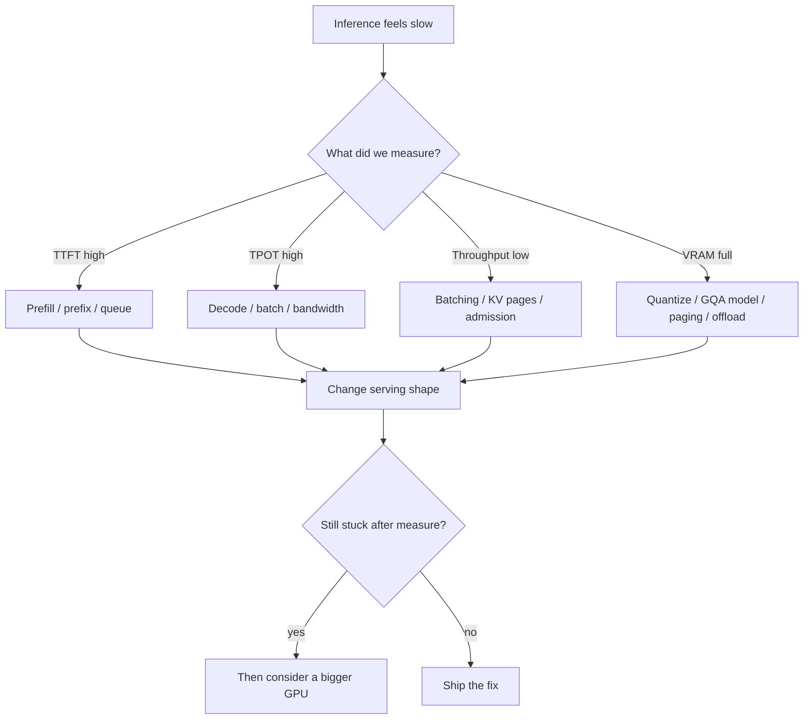
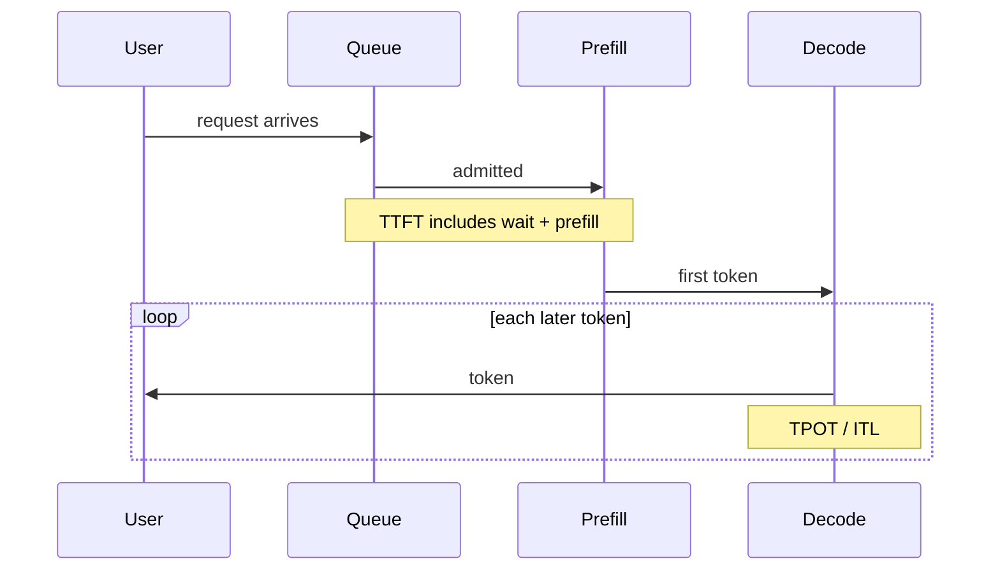

<strong>How to use this lab</strong>

<ul>
<li>Open the companion notebook in another tab: <a href="https://www.kaggle.com/code/vijaykr0701/llm-inference-starter-batching-prefix-quant" target="_blank" rel="noopener">LLM Inference Starter: Batching, Prefix, Quant</a> on Kaggle. Practice as you read, or read first and run it later.</li>
<li>Each station has the same rhythm: the wrong instinct, your guess (click to open), what we measured, why it happens, and one small thing to try.</li>
<li>Every measured table here comes from <strong>one run on one Kaggle Tesla T4 on 9 Nov 2026</strong>. It is not a benchmark. Your numbers will be different.</li>
<li>When I could not measure something, I label it <strong>example math</strong>.</li>
</ul>

---

## The story: our support chatbot feels slow

We have a support chatbot for NimbusDB, a made-up cloud database product. Users say it feels slow. In the review meeting, the first suggestion is the usual one.

> "Inference is slow. Let us get a bigger GPU."

Sometimes that is the right call. But many slow services are not using the card they already have. So in this lab we do not argue. We guess, we measure, and then we change one thing at a time.

First, the simple picture. An LLM answers in two phases.

- **Prefill**: the model reads the whole prompt in one go and fills the KV cache. This decides **TTFT** (time to first token).
- **Decode**: the model writes the answer one token at a time. This decides **TPOT** (time per output token).

Decode is usually **memory-bound**. For every new token, the GPU reads all the model weights and the KV cache, then does only a small amount of math. If you serve one chat at a time, the card looks busy, but most of that time goes into moving data for a single token.

This is the map we follow before anyone asks for new hardware:

---

## Lab setup

| Item | What we used |
| --- | --- |
| GPU | Kaggle Tesla T4, 14.6 GB VRAM, compute capability 7.5 |
| Software | Python 3.13, torch 2.11.0+cu130, transformers 5.20.2 |
| Model | Qwen2.5-1.5B in float16 (plus Qwen2.5-0.5B as a draft in station 5) |
| Settings | Seed 42, greedy decoding |

To run it yourself: open the notebook, click **Copy & Edit**, set the accelerator to a GPU (T4 is fine), and run the cells from the top. The model loads once and every station reuses it.

| Station | Question | Notebook section |
| --- | --- | --- |
| [1. Batching](#station-1) | Does a bigger batch make each user faster? | 3 |
| [2. Prefix reuse](#station-2) | Does a cached system prompt make the request free? | 4 |
| [3. Quantization](#station-3) | How much memory does 8-bit or 4-bit save? | 5 |
| [4. Attention memory](#station-4) | Does FlashAttention change the math? | 6 |
| [5. Speculative decoding](#station-5) | Is a draft model always a speed-up? | 7 |

---

## Station 1: Batching

**Wrong instinct:** "Serve each request alone. Batching is for training, and it will make every user wait longer."

Guess first: we go from batch 1 to batch 16. What happens to each user's latency?

<strong>Common guess:</strong> each user gets 16 times slower, or each user gets 16 times faster.

<strong>What the T4 showed:</strong> neither. Total throughput went up about 15×. Each user's latency stayed almost flat.

<table>
<thead><tr><th>batch</th><th>per-request latency (s)</th><th>throughput (tok/s)</th></tr></thead>
<tbody>
<tr><td>1</td><td>1.82</td><td>26.4</td></tr>
<tr><td>16</td><td>1.98</td><td>387.7</td></tr>
</tbody>
</table>

**Measured on the T4** (37-token prompt, 48 new tokens, static batch):

| batch | TTFT (s) | TPOT (ms) | per-request latency (s) | wall / batch (s, not latency) | throughput (tok/s) | peak memory (GB) |
| --- | --- | --- | --- | --- | --- | --- |
| 1 | 0.045 | 37.8 | 1.82 | 1.82 | 26.4 | 2.90 |
| 2 | 0.047 | 38.0 | 1.83 | 0.92 | 52.4 | 2.91 |
| 4 | 0.049 | 38.0 | 1.84 | 0.46 | 104.5 | 2.93 |
| 8 | 0.060 | 38.9 | 1.89 | 0.24 | 203.3 | 2.98 |
| 16 | 0.109 | 39.8 | 1.98 | 0.12 | 387.7 | 3.08 |

**Why.** During decode, the costly part is reading the same weights again for the next token. If 16 users are waiting, one step can move all 16 forward. The weights are read once per step for the whole batch. So throughput (tokens per second across everyone) goes up a lot. But each user still waits for 48 decode steps, so their own latency does not drop. It goes up a little, because each step does a bit more work.

Two columns need care:

- **wall / batch** is the number people misread as latency. No user waits 0.12 s. Every user in the batch waits for the full batch.
- **TTFT** grew from 0.045 s to 0.109 s at batch 16, because 16 prompts are prefilled together. Small here, but it grows with long prompts.

<strong>Example math (not a bench)</strong>

Suppose one decode step reads 14 GB of weights. One request uses that read for one token. Four requests in the same step still read the weights once, but get four tokens of useful work. The GPU did not become four times faster. It did four times more useful work for the same weight read. Real gains depend on kernels, attention cost, and memory pressure.

This is a **static** batch: all requests start together and the batch ends when the last one finishes. Real chat traffic does not arrive like that. For live services you want continuous batching, which I explain [below](#continuous-batching).

<strong>Your turn: notebook section 3</strong>

<ul>
<li>Run the batching cell and compare <code>throughput_tok_s</code> with <code>per_request_latency_s</code>.</li>
<li>Add 32 to <code>batch_sizes</code>. Watch peak memory and TTFT. Where does it stop being cheap?</li>
<li>Change <code>NEW_TOKENS</code> from 48 to 128. Which columns move?</li>
</ul>

---

## Station 2: Prefix reuse

**Wrong instinct:** "Once the system prompt is cached, the request is basically free."

Our NimbusDB bot sends a long system prompt with every question: 40 support policies, 1,484 tokens. Only the user question at the end changes.

Guess first: if we reuse the cached system prompt, which part of the request gets faster?

<strong>Common guess:</strong> the whole request gets close to free.

<strong>What the T4 showed:</strong> prefill got 7 to 11 times faster. Decode did not change at all.

<table>
<thead><tr><th>suffix</th><th>full prefill (s)</th><th>cached prefill (s)</th><th>decode (s)</th></tr></thead>
<tbody>
<tr><td>reset password</td><td>0.468</td><td>0.067</td><td>1.82</td></tr>
<tr><td>charged twice</td><td>0.471</td><td>0.042</td><td>1.82</td></tr>
</tbody>
</table>

**Measured on the T4** (shared prefix 1,484 tokens):

| suffix | full prefill (s) | cached prefill (s) | prefill speedup | 48-token decode (s) |
| --- | --- | --- | --- | --- |
| "How do I reset my password?" | 0.468 | 0.067 | 6.9× | 1.82 |
| "Why was I charged twice this month?" | 0.471 | 0.042 | 11.3× | 1.82 |

Building the prefix cache once took about 0.47 s. After that, each new question only prefilled its own short suffix.

**Why.** Prefill writes Keys and Values (the KV cache) for every prompt token. If the next request starts with the **same tokens**, those Keys and Values are the same, so we can reuse them and skip that work. That cuts TTFT. But the answer still has to be written one token at a time, so decode costs the same. In this run, decode (1.82 s) was much bigger than prefill anyway. A cached prefix helps TTFT. It does not make the request free.

**The one-word lesson.** In the notebook I changed one word in the system prompt. The token ids then differed from position 15 of 1,484, so the cache could not be reused for anything after that point. Reuse needs an **exact** token prefix from the very first token. A timestamp or user name at the top of the system prompt breaks it for every request.

Practical rule: put the **stable** text first (system instructions, shared docs). Put the **changing** text last (the user question).

Serving engines do this for you. vLLM, for example, hashes KV blocks and reuses them with <a href="https://docs.vllm.ai/en/stable/features/automatic_prefix_caching/" target="_blank" rel="noopener">automatic prefix caching</a>. For the memory side and the paging picture, see <a href="https://theintelliwise.com/posts/kv-cache-sticky-notes/" target="_blank" rel="noopener">KV cache sticky notes</a>.

<strong>Your turn: notebook section 4</strong>

<ul>
<li>Add your own question to <code>SUFFIXES</code> and run the cell again. Prefill should stay fast; decode should not change.</li>
<li>Put a fake timestamp at the start of <code>SYSTEM_TEXT</code>. Does the cache still match?</li>
</ul>

---

## Station 3: Quantization

**Wrong instinct:** "Quantization only shrinks the download, and quality always dies."

Guess first: how much GPU memory does the 1.5B model use in 8-bit and 4-bit?

<strong>Common guess:</strong> 8-bit is exactly half of FP16, and 4-bit is exactly a quarter.

<strong>What the T4 showed:</strong> a big saving, but not exactly half or a quarter. Some parts stay in higher precision, and there is some overhead.

<table>
<thead><tr><th>precision</th><th>GPU memory after load (GB)</th></tr></thead>
<tbody>
<tr><td>FP16</td><td>2.88</td></tr>
<tr><td>int8</td><td>1.71</td></tr>
<tr><td>nf4 4-bit</td><td>1.18</td></tr>
</tbody>
</table>

**Measured on the T4** (bitsandbytes, memory after load):

| precision | GPU memory (GB) | vs FP16 |
| --- | --- | --- |
| FP16 | 2.88 | 1.00 |
| int8 | 1.71 | 0.59 |
| nf4 4-bit | 1.18 | 0.41 |

**Why.** Quantization stores weights (and sometimes activations or the KV cache) in fewer bits. That cuts **memory**, and often cuts **memory traffic**, which is what decode cares about. Freed memory can hold more KV cache, so more chats fit. It is not always faster on its own: bitsandbytes kernels can be slower than FP16 on small batches and older GPUs.

| Family | Rough idea | Typical win |
| --- | --- | --- |
| **Weight-only** (GPTQ, AWQ, many GGUF) | Weights in low bits, activations in higher precision | Smaller VRAM, faster weight reads |
| **Weight + activation** (FP8, INT8 recipes) | Math is also cheaper on supporting hardware | Throughput on newer GPUs |
| **KV quantization** | Compress the growing cache | More chats at the same time |

<a href="https://arxiv.org/abs/2210.17323" target="_blank" rel="noopener">GPTQ</a> and <a href="https://arxiv.org/abs/2306.00978" target="_blank" rel="noopener">AWQ</a> are common weight-only methods. Serving stacks such as <a href="https://nvidia.github.io/TensorRT-LLM/features/quantization.html" target="_blank" rel="noopener">TensorRT-LLM</a> and vLLM document several recipes.

**The quality glance.** The notebook also asks each version one short question: "what is a KV cache?" Read the three answers. Even the FP16 answer was somewhat wrong. That is the real lesson. A small model can be vague in any precision, so "FP16 is correct and 4-bit is broken" is not a safe rule. Quality is not yes or no. Check it on your own task with your own eval set before you ship.

If the model barely fits on your machine, also read <a href="https://theintelliwise.com/posts/local-llm-beyond-vram/" target="_blank" rel="noopener">Local LLM beyond VRAM</a>. Quantization and CPU plus GPU placement solve different parts of the same problem.

<strong>Your turn: notebook section 5</strong>

<ul>
<li>Change <code>QUANT_PROMPT</code> to a question from your own work. Compare the three answers side by side.</li>
<li>Write down which answer you would trust. That is a tiny eval. Real evals need many questions.</li>
</ul>

---

## Station 4: Attention memory and FlashAttention

**Wrong instinct:** "FlashAttention is an approximation. It is fast because it skips some of the math."

Guess first: when the sequence length doubles, what happens to the math and to the extra memory?

<strong>Common guess:</strong> a memory-efficient kernel makes attention cost grow in a straight line.

<strong>What the T4 showed:</strong> the math still grows about 4× when the sequence doubles. Only the extra memory dropped.

<table>
<thead><tr><th>seq len</th><th>naive extra (MB)</th><th>SDPA extra (MB)</th><th>FLOPs (G)</th></tr></thead>
<tbody>
<tr><td>512</td><td>12.8</td><td>0.8</td><td>0.81</td></tr>
<tr><td>4096</td><td>774</td><td>6.0</td><td>51.5</td></tr>
</tbody>
</table>

**Measured on the T4** (synthetic tensors: 1 batch, 12 heads, head size 64):

| seq len | naive extra memory (MB) | SDPA extra memory (MB) | attention FLOPs (G) |
| --- | --- | --- | --- |
| 512 | 12.8 | 0.8 | 0.81 |
| 4096 | 774 | 6.0 | 51.5 |

Naive memory and FLOPs both grow about 4× each time the sequence doubles. The full table with 1024 and 2048 is in the notebook.

**Why.** Naive attention builds the full N × N score matrix in GPU memory. <a href="https://arxiv.org/abs/2205.14135" target="_blank" rel="noopener">FlashAttention</a> computes **exact** attention, but in tiles. The scores stay in fast on-chip memory and never get written out as one big matrix to HBM (the main GPU memory). So:

- The **math is still quadratic**. Same result, same order of FLOPs.
- What drops is the **extra memory** and the **HBM traffic**. Less data moving around is why it is faster.

**A T4 detail.** On the T4, PyTorch may report the flash backend as "allowed". Allowed is not the same as used. Flash kernels generally need compute capability 8.0 or newer, and the T4 is 7.5. So here SDPA most likely picked its memory-efficient kernel. The memory saving is real, but do not say "we ran FlashAttention on a T4".

Do not mix this up with PagedAttention. They solve different problems, and you often want both.

| Technique | Problem it solves |
| --- | --- |
| **FlashAttention** | How attention is **computed** and how much data it moves |
| **PagedAttention** | How the **KV cache is stored** when many requests share one GPU |

<strong>Your turn: notebook section 6</strong>

<ul>
<li>Look at the printed line about the flash backend and compute capability on your GPU.</li>
<li>Add 8192 to the sequence list. Does the naive version still fit? Does SDPA?</li>
</ul>

---

## Station 5: Speculative decoding

**Wrong instinct:** "Speculative decoding is free speed. Turn it on and every request gets faster."

Guess first: with a 0.5B draft model helping a 1.5B model, is the answer faster?

<strong>Common guess:</strong> yes, around 2× faster.

<strong>What the T4 showed:</strong> it was slower. Same output, but 0.71× the speed.

<table>
<thead><tr><th>mode</th><th>time (s)</th><th>tok/s</th></tr></thead>
<tbody>
<tr><td>1.5B alone</td><td>1.86</td><td>24.7</td></tr>
<tr><td>1.5B + 0.5B draft</td><td>2.61</td><td>17.6</td></tr>
</tbody>
</table>

**Measured on the T4** (batch 1, greedy, Hugging Face assisted generation):

| mode | time (s) | tok/s | speed vs alone |
| --- | --- | --- | --- |
| Qwen2.5-1.5B alone | 1.86 | 24.7 | 1.00× |
| 1.5B target + 0.5B draft | 2.61 | 17.6 | 0.71× |

The output tokens matched the 1.5B model's own greedy output.

**How it works.** A small **draft** model guesses the next few tokens. The big **target** model checks all of them in one forward pass. It keeps the guesses that match what it would have picked. At the first wrong guess, the target model's own token is used and the rest of the draft is dropped. So the output stays the same as the target model's output. The classic write-up is <a href="https://arxiv.org/abs/2211.17192" target="_blank" rel="noopener">Fast Inference from Transformers via Speculative Decoding</a>.

**Why it was slower here.** The draft (0.5B) and the target (1.5B) are too close in size. Running the draft is not cheap enough compared with the target, so its cost ate the saving. Speculative decoding pays off when the target is much bigger than the draft and the draft guesses well.

It also helps most at **low batch**. At batch 1, the GPU is mostly waiting on memory during decode, so checking extra tokens is almost free. At high batch, the GPU is already busy, and drafting adds work. The <a href="https://nvidia.github.io/TensorRT-LLM/latest/features/speculative-decoding.html" target="_blank" rel="noopener">TensorRT-LLM speculative decoding docs</a> say the same. Other draft methods include extra heads like <a href="https://arxiv.org/abs/2401.10774" target="_blank" rel="noopener">Medusa</a> and trained drafters like <a href="https://arxiv.org/abs/2401.15077" target="_blank" rel="noopener">EAGLE</a>.

<strong>Your turn: notebook section 7</strong>

<ul>
<li>Change the prompt to something very predictable, like counting from 1 to 50. Does the draft do better?</li>
<li>If your GPU has room, try a bigger target with the same 0.5B draft. A wider size gap is where this method should start to help.</li>
</ul>

---

## Things a free notebook cannot show

The next parts need a real serving engine or more than one GPU. I am not giving fake Kaggle exercises for them. Short explanations only.

### Continuous batching vs static batch

In station 1, all 16 requests started together and the batch ended when the last one finished. In live chat, users arrive at different times and answers have different lengths. With a static batch, short answers finish early and leave empty seats until the longest one is done.

**Continuous batching** (iteration-level scheduling) lets finished requests leave and new ones join between decode steps. The idea came from systems like <a href="https://www.usenix.org/conference/osdi22/presentation/yu" target="_blank" rel="noopener">Orca</a> and is now normal in engines such as <a href="https://docs.vllm.ai/" target="_blank" rel="noopener">vLLM</a>.

| Style | What happens | Good for |
| --- | --- | --- |
| **No batching** | One sequence per step | Tiny demos |
| **Static batch** | Group is fixed until all finish | Offline jobs with similar lengths |
| **Continuous batch** | Requests join and leave between decode steps | Live chat and APIs |

### Request scheduling and admission

Continuous batching needs a scheduler that decides who runs in each step.

- **Order:** first come, first served (FCFS) by default, or priority if some users or tiers must go first.
- **Admission:** a new request joins only when there is enough free KV memory and room in the token budget for that step. If not, it waits in the queue. That queue time shows up in TTFT.
- **Mixing prefill with decode:** a new prompt needs prefill while other users are in decode. Good engines mix both in the same step, and often split a long prompt into chunks. That way one long prompt does not freeze everyone else's stream.

### PagedAttention and batch size

Old servers reserved KV memory for the maximum length of every chat, even if the chat used only a small part. That empty reserved space limits how many sequences fit. <a href="https://arxiv.org/abs/2309.06180" target="_blank" rel="noopener">PagedAttention</a> stores the KV cache in small fixed blocks and gives out blocks only when needed. Less reserved empty space means more sequences fit at once, so the batch can be bigger and throughput can rise. The paper reported 2 to 4× throughput over the systems it compared, on their workloads. For the locker picture and the math, see <a href="https://theintelliwise.com/posts/kv-cache-sticky-notes/" target="_blank" rel="noopener">KV cache sticky notes</a>.

### Tensor parallel vs pipeline parallel

"Add GPUs and latency drops in a straight line" is another common belief. Different kinds of parallelism do different jobs.

| Kind | What is split | Helps when | Cost |
| --- | --- | --- | --- |
| **Tensor parallel (TP)** | Each layer's weight matrices, split across GPUs | One layer is too big or too slow for one card | GPUs must sync results inside every layer |
| **Pipeline parallel (PP)** | Groups of whole layers, one group per GPU | Whole model does not fit on one card | Bubbles: some stages wait for others |
| **Replicas (data parallel)** | Whole copies of the model | Many users, need more throughput | Each copy needs enough memory |

TP can cut per-request latency for a large model, but the sync inside every layer is not free. Replicas raise total throughput more than they cut one user's TPOT. If one GPU sits idle because you never batched, eight GPUs will also sit idle, just at a higher cost. Tune one replica first, then scale out.

### Measure before you change anything

One average "latency" number hides the real problem. Split the timeline.

| Metric | Plain meaning | Usually points to |
| --- | --- | --- |
| **TTFT** | Time to first token | Queue, admission, prefill, cold prefix |
| **TPOT / ITL** | Time per output token / gap between tokens | Decode, batch size, bandwidth, speculation |
| **End-to-end latency** | Full answer time | All of the above plus output length |
| **Throughput** | Tokens per second across all live requests | How well the GPU is shared |

A long answer with healthy TPOT can still feel slow end to end. A short answer stuck in a queue can feel broken on TTFT while tokens per second look fine.

---

## Practice checklist

I run this before asking for new hardware.

1. **Define the pain.** Slow first token, slow streaming, low capacity, or out of memory?
2. **Split the metrics.** TTFT, TPOT, throughput, queue time, free KV blocks, prefix hit rate. (Station 1)
3. **Batch.** Move to continuous batching if you still serve one request at a time or use static batches.
4. **Stable prefix first.** System prompt and shared docs before the user question. Turn on prefix caching. (Station 2)
5. **Page the KV cache.** Do not reserve max-length memory for every chat.
6. **Quantize with an eval set.** Start with weight-only. Try KV quantization if concurrency is the limit. (Station 3)
7. **Use memory-efficient attention** for long prompts, and remember the math is still quadratic. (Station 4)
8. **Try speculative decoding** when the batch is small and the draft is much smaller than the target. (Station 5)
9. **Parallelism.** TP or PP only after one replica is tuned. Add replicas for throughput.
10. **Then** talk about a bigger GPU, with graphs that show what is still slow.

<strong>Run it yourself</strong>

The full lab is in the Kaggle notebook: <a href="https://www.kaggle.com/code/vijaykr0701/llm-inference-starter-batching-prefix-quant" target="_blank" rel="noopener">LLM Inference Starter: Batching, Prefix, Quant</a>. Run it on your GPU and compare your numbers with the tables above. If they differ, that is normal. That is why we measure.

---

## Honest caveats

- All measured numbers come from one Kaggle T4 run with a 1.5B model, using Hugging Face as a teaching stand-in. A real serving engine will give different numbers.
- I did not run vLLM, continuous batching, or multi-GPU in the notebook. Those sections are explanation only.
- Paper and vendor speed-ups are for **their** workloads. Copy the method, not the headline number.
- Quantization quality depends on the task. Legal, medical, and coding evals can disagree.
- Speculative decoding needs a good acceptance rate and a real size gap between draft and target.
- Prefix cache hits need exact tokens from the first token onward.

---

## Terms used in this post

| Term | Meaning |
| --- | --- |
| **prefill** | Read the prompt and fill the KV cache |
| **decode** | Write output tokens one by one |
| **TTFT** | Time to first token |
| **TPOT / ITL** | Time per output token / inter-token latency |
| **static batch** | A fixed group that runs until all requests finish |
| **continuous batching** | Requests join and leave between decode steps |
| **prefix caching** | Reuse KV for a shared prompt start |
| **PagedAttention** | Store KV in fixed blocks, given out when needed |
| **quantization** | Fewer bits for weights, activations, or KV |
| **speculative decoding** | A draft guesses tokens, the target model checks them |
| **TP / PP / replica** | Ways to split or copy a model across GPUs |

---

## Sources and further reading

Papers and docs for the mechanics. The measured tables come only from the companion notebook.

- <a href="https://www.kaggle.com/code/vijaykr0701/llm-inference-starter-batching-prefix-quant" target="_blank" rel="noopener">Companion notebook: LLM Inference Starter: Batching, Prefix, Quant (Kaggle)</a>
- <a href="https://www.usenix.org/conference/osdi22/presentation/yu" target="_blank" rel="noopener">Orca: A Distributed Serving System for Transformer-Based Generative Models (OSDI '22)</a>
- <a href="https://arxiv.org/abs/2309.06180" target="_blank" rel="noopener">Efficient Memory Management for LLM Serving with PagedAttention (arXiv:2309.06180)</a>
- <a href="https://docs.vllm.ai/en/stable/features/automatic_prefix_caching/" target="_blank" rel="noopener">vLLM: Automatic prefix caching</a>
- <a href="https://arxiv.org/abs/2205.14135" target="_blank" rel="noopener">FlashAttention (arXiv:2205.14135)</a>
- <a href="https://arxiv.org/abs/2210.17323" target="_blank" rel="noopener">GPTQ (arXiv:2210.17323)</a>
- <a href="https://arxiv.org/abs/2306.00978" target="_blank" rel="noopener">AWQ (arXiv:2306.00978)</a>
- <a href="https://arxiv.org/abs/2211.17192" target="_blank" rel="noopener">Speculative Decoding (arXiv:2211.17192)</a>
- <a href="https://arxiv.org/abs/2401.10774" target="_blank" rel="noopener">Medusa (arXiv:2401.10774)</a>
- <a href="https://arxiv.org/abs/2401.15077" target="_blank" rel="noopener">EAGLE (arXiv:2401.15077)</a>
- <a href="https://nvidia.github.io/TensorRT-LLM/features/quantization.html" target="_blank" rel="noopener">TensorRT-LLM: Quantization</a>
- <a href="https://nvidia.github.io/TensorRT-LLM/latest/features/speculative-decoding.html" target="_blank" rel="noopener">TensorRT-LLM: Speculative decoding</a>
- Related Intelliwise posts: <a href="https://theintelliwise.com/posts/kv-cache-sticky-notes/" target="_blank" rel="noopener">KV cache sticky notes</a> and <a href="https://theintelliwise.com/posts/local-llm-beyond-vram/" target="_blank" rel="noopener">Local LLM beyond VRAM</a>

---

## In short

**A bigger GPU is a tool, not a diagnosis. Measure TTFT, TPOT, and throughput separately. Batch to use the card you have. Keep stable text at the start of the prompt. Page the KV cache. Quantize with an eval set. Use speculative decoding when the batch is small and the draft is much smaller. Scale out when one tuned replica is really full. After that, if it is still slow, ask for new hardware with the graphs in hand.**
