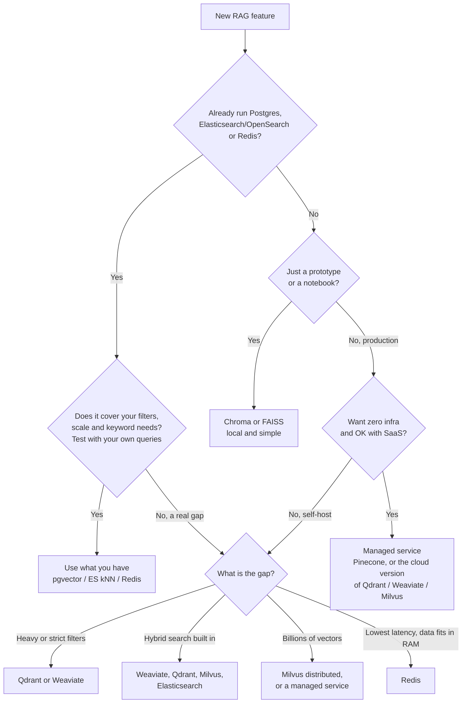

<strong>How to use this guide</strong>

<ul>
<li>This is a decision guide. Start with the five questions, follow the flowchart, then jump to the situation card that matches you.</li>
<li>Every card has the same shape: pick it when, what the docs say today, watch out, and my take.</li>
<li>Features change fast in this area. I checked every claim against the official docs in <strong>November 2026</strong>. Links are in the Sources section.</li>
<li>There are no benchmark numbers here. The only numbers are <strong>example math</strong> (like memory size) and defaults copied from the docs.</li>
</ul>

---

## The short answer first

There is a popular checklist that maps each vector database to one situation:

| Situation | Usual pick |
| --- | --- |
| You want zero infrastructure | Pinecone |
| You are already on Postgres | pgvector |
| You need heavy metadata filtering | Qdrant |
| You want built-in hybrid search | Weaviate |
| You have millions to billions of vectors | Milvus |
| Your keyword search already lives in Elasticsearch | Elasticsearch |
| Latency matters most | Redis |
| You are building your first prototype | Chroma |
| You need raw speed inside your own code | FAISS (a library, not a database) |

I like this list. It is a good starting point, and the main message behind it is correct:

> The usual mistake is adding a new database when the one you already run can store vectors.

But some of the one-liners are now out of date. Hybrid search is not special to Weaviate any more. Qdrant, Pinecone, Elasticsearch, Milvus, Redis, Chroma and even plain Postgres can do it. Good filtering is not only Qdrant. And pgvector goes further than many people think. So in this guide I keep the list, but I add what the docs say today and where I would push back.

---

## Step zero: what is a vector database doing for RAG?

Simple version first. In RAG, we cut documents into chunks. An **embedding model** turns each chunk into a list of numbers, called a **vector**. Chunks with similar meaning get vectors that are close to each other. At question time, we embed the question and ask the store: "give me the k closest chunks". Those chunks go into the prompt.

A vector database does four jobs:

1. **Store** the vectors along with the chunk text and metadata (tenant, product, date, access level).
2. **Search** fast. Comparing the question with every vector (exact kNN) is fine for a few thousand rows. For millions, we use an **ANN index** (approximate nearest neighbour). It checks only a small part of the data and accepts that it may miss a few true neighbours.
3. **Filter** by metadata, so tenant A never sees tenant B's chunks.
4. **Stay up**: backups, replicas, upserts and deletes, monitoring. This is the boring part, and it is where most of the cost is.

Job 4 is why the "one you already run" rule matters. Your team already knows how to back up, restore, secure and monitor your existing database. A new database means learning all of that again.

---

## Five questions before you choose

Answer these first. Write the answers in the design doc.

| # | Question | Why it matters |
| --- | --- | --- |
| 1 | What do we already run in production? | Postgres, Elasticsearch, OpenSearch and Redis can all store and search vectors now. |
| 2 | How many chunks, and how fast will it grow? | 100K, 10M and 1B chunks need very different setups. Do the memory math (below). |
| 3 | How strict are our filters? | "Only this tenant" or "only docs this user can read" can break a naive index. |
| 4 | Do users search for exact words? | Error codes, SKUs, names and IDs need keyword search (BM25) next to vectors. |
| 5 | Who will run it at 2 AM? | Managed service vs self-hosted is a team and budget decision, not a speed decision. |

---

## The decision flowchart

Two things to notice. First, the very first box is about your current stack, not about any product. Second, "hybrid search" points to many options now, not one.

---

## The situation cards

### 1. pgvector: you are already on Postgres

**Pick it when** your app data is already in Postgres, and you want vectors next to it. You get joins, transactions, row-level access rules and your existing backups for free.

**What the docs say today**

- Two index types: **HNSW** (better speed and recall, slower to build, more memory) and **IVFFlat** (faster to build, less memory, lower speed-recall trade-off).
- HNSW defaults: `m = 16`, `ef_construction = 64`, and `hnsw.ef_search = 40` at query time.
- IVFFlat: start with `lists = rows / 1000` up to 1M rows and `sqrt(rows)` above that. Start `probes` at `sqrt(lists)` (the default is 1).
- Types: `vector` (index up to 2,000 dimensions), `halfvec` (half precision, index up to 4,000), `bit` (binary, up to 64,000) and `sparsevec` (up to 1,000 non-zero values).
- **Filtering happens after the index scan.** The README gives a clear example: if a filter matches 10% of rows and `ef_search` is 40, you get about 4 rows back on average.
- Since **0.8.0**, **iterative index scans** fix this. Set `hnsw.iterative_scan = strict_order` (or `relaxed_order`) and Postgres keeps scanning the index until it has enough rows, up to `hnsw.max_scan_tuples` (20,000 by default).
- Hybrid search: use Postgres full-text search together with vectors, then combine with **RRF** or a cross-encoder. The pgvector project has an RRF example in SQL.
- Scaling: use `halfvec` and binary quantization with re-ranking to shrink the working set. Scale reads with replicas. Shard with Citus or a similar tool.
- Multi-tenancy: the README warns that a shared index across tenants can hurt recall for other tenants. Use list partitioning or separate tables when you need isolation.

**Watch out**

- An HNSW index is happiest when it fits in memory. Big index builds need `maintenance_work_mem`.
- Without iterative scans, a strict filter can quietly return too few rows. Your LLM then answers from thin context.

**My take**

People say "pgvector is for small projects". I do not agree. With `halfvec`, iterative scans, partial indexes, partitions and replicas, a single well-sized Postgres can carry a lot of RAG traffic. If you need a disk-based index, the separate **pgvectorscale** extension adds a StreamingDiskANN index. I would start here whenever Postgres is already in the stack, and only move when a measured gap shows up.

---

### 2. Pinecone: you want zero infrastructure

**Pick it when** you do not want to run any database servers, and you are fine with a SaaS bill.

**What the docs say today**

- Fully managed. For strict data rules there is also **BYOC** (bring your own cloud): the Pinecone data plane runs in your own AWS, GCP or Azure account, and Pinecone still handles upgrades and scaling.
- Metadata filters (`$eq`, `$in`, `$gt`, `$and` and so on) narrow the candidate pool **before** ranking.
- Hybrid search: either a **text-match filter plus dense search** in one request, or run keyword and dense searches separately and merge them with **RRF** on the client. Sparse vectors are also supported.
- Pinecone Local, the in-memory emulator, reached end of life on 7 October 2026. The docs now suggest a mock for request and error tests.

**Watch out**

- You cannot self-host the open-source way. Your data, your latency and your cost are tied to the vendor.
- With the emulator gone, plan how you will run integration tests that need real search results.

**My take**

"Zero infra" is true, and for a small team it is a big deal. But "Pinecone has no hybrid search" is an old idea. It does, just in a different shape than Weaviate. Compare the total monthly cost with what it would cost your team to run pgvector or Qdrant, including on-call time.

---

### 3. Qdrant: you need heavy metadata filtering

**Pick it when** most queries carry filters (tenant, category, price range, date, geo) and those filters are strict.

**What the docs say today**

- You create **payload indexes** on the fields you filter by (keyword, integer, float, geo, datetime, full-text and more).
- **Filterable HNSW**: Qdrant adds extra edges to the HNSW graph based on indexed payload values. This keeps the graph connected even when a strict filter removes most points.
- A **query planner** picks the plan. When the filter matches only a small amount of data (below `full_scan_threshold`, 10,000 KB by default), it does a full scan of those points instead of walking the graph.
- The docs say: create payload indexes **before** ingesting data. If you add one later, you need to rebuild HNSW to get the filter-aware edges.
- Hybrid search: the **Query API** (since v1.10) runs several "prefetch" searches (dense, sparse, or BM25 text on a payload field) and fuses them with **RRF** or **DBSF**. Note: Qdrant's RRF default constant `k` is **2**, not the 60 you see elsewhere. You can set `k` since v1.16 and add weights since v1.17.
- Self-host (open source) or Qdrant Cloud.

**Watch out**

- Forgetting the payload index is the most common mistake. Filters still work, but they get slow.
- Adding indexes after a big import means a rebuild.

**My take**

The one-liner is right that filtering is Qdrant's strong side. But it is not only a "filter database". It has a solid hybrid and multi-stage query API too. Also, Weaviate (ACORN), Elasticsearch (filter inside the kNN clause), Pinecone and pgvector 0.8+ all handle filtered search much better than a few years ago. So test with your real filters before you decide.

---

### 4. Weaviate: you want built-in hybrid search

**Pick it when** you want BM25 keyword search and vector search in one simple call, with the fusion done for you.

**What the docs say today**

- `hybrid` runs a vector search and a **BM25F** keyword search, then fuses the two result sets.
- `alpha` sets the balance: `1` is pure vector, `0` is pure keyword.
- **Relative score fusion** has been the default since v1.24. **Ranked fusion** (rank based, like RRF) is also available.
- Index types: **HNSW** (recommended for most cases), **flat** (good for many small tenants), **dynamic** (starts flat and switches to HNSW after 10,000 objects by default; marked experimental) and **HFresh**.
- Filtering is **pre-filtering**: an allow-list is built first, then the vector search only looks at allowed objects. The **ACORN** filter strategy is the default since v1.34.
- Self-host or Weaviate Cloud.

**Watch out**

- The fusion default changed over versions. If you upgrade, check your ranking with a small eval set.
- Dynamic index is still experimental.

**My take**

Weaviate's hybrid search is easy to use, and that ease is a fair reason to pick it. But it is no longer the only database with "built-in hybrid". Qdrant, Milvus, Elasticsearch, Redis (with `FT.HYBRID`) and Pinecone all have their own way now. Pick Weaviate for its API and features as a whole, not only for hybrid.

---

### 5. Milvus: you have millions to billions of vectors

**Pick it when** your data is really large, or you need many index types, including GPU and disk-based indexes.

**What the docs say today**

- Many index types, including **FLAT, IVF_FLAT, IVF_SQ8, IVF_PQ, HNSW, DISKANN, GPU_IVF_FLAT and GPU_IVF_PQ**. There is also `AUTOINDEX`.
- Three ways to run it: **Milvus Lite** for local prototyping, **Standalone**, and **Distributed** on Kubernetes. The docs describe Distributed as built for billion-scale and say Milvus users run tens of billions of vectors.
- **Full text search** with BM25: Milvus turns raw text into sparse vectors for you. Combine it with dense search using `RRFRanker` or `WeightedRanker`.
- Default limits: up to 32,768 dimensions and 16 shards per collection. Both are configurable.
- Managed option: Zilliz Cloud (from the team behind Milvus).

**Watch out**

- Distributed Milvus has many moving parts: several node types, plus a metadata store (etcd) and object storage. That is a real ops cost.
- Most RAG apps are nowhere near a billion chunks.

**My take**

"Milvus is for billions" is true but incomplete. It also has Milvus Lite for small work and good hybrid search. At the same time, you do not need Milvus just because you have "millions". A few million chunks fit fine in pgvector, Qdrant or Weaviate on one decent machine. Do the memory math first.

---

### 6. Elasticsearch: your keyword search already lives there

**Pick it when** you already run Elasticsearch for search or logs, and your team knows it well.

**What the docs say today**

- `dense_vector` fields with HNSW indexes. For float vectors the default index type is **`bbq_hnsw`** (binary quantization) for 384 dimensions or more, and **`int8_hnsw`** below 384. (In 9.0, float vectors always used `int8_hnsw`.)
- Other options: `int4`, `bbq_flat`, and **`bbq_disk`** (disk-based binary quantization). Raw floats stay on disk for rescoring.
- **Filtering**: a filter inside the kNN clause is a pre-filter and makes sure k matching docs come back. A filter outside it is a post-filter and can return fewer than k.
- **Hybrid**: the `rrf` retriever combines a BM25 query and a kNN query (or a `sparse_vector` query). You can set `rank_constant` and `rank_window_size`.
- `semantic_text` fields can create embeddings for you.
- Self-managed or Elastic Cloud.

**Watch out**

- Put the filter in the right place. This mistake is easy to make and hard to notice.
- Check licence and subscription rules for the features you plan to use in your version.

**My take**

This one-liner holds up well. If BM25 search already lives in Elasticsearch, adding vectors there is usually the cheapest path to hybrid search. You get one index, one query and RRF on the server. OpenSearch users are in a similar spot with its k-NN plugin.

---

### 7. Redis: latency matters most

**Pick it when** you already run Redis, the vectors fit in memory, and you want very low latency, for example for semantic caching.

**What the docs say today**

- Three vector index types: **FLAT** (docs suggest it for small datasets, under 1M vectors, or when you need exact results), **HNSW** (larger datasets) and **SVS-VAMANA** (added in Redis 8.2; a graph index built for compression and Intel hardware).
- Filtered vector search: Redis picks a filter mode for you (`BATCHES` or `ADHOC_BF`), and you can override it with `HYBRID_POLICY`.
- **`FT.HYBRID`**, introduced with Redis 8.4, runs a full-text search and a vector search and fuses them with **RRF** (default) or **LINEAR**. RRF defaults are a window of 20 and a constant of 60.
- Managed option: Redis Cloud.

**Watch out**

- RAM is the cost. Large collections in memory get expensive fast.
- Check your Redis version before you plan on `FT.HYBRID`. One Redis tutorial page lists a newer minimum version than the 8.4 release blog, so confirm it for your deployment.

**My take**

"Redis for latency" is fair, but every option here can be fast at small scale. In a RAG request, the LLM call usually takes far longer than the vector lookup. So I pick Redis when it is already in the stack or when I am building a cache. I wrote about that in <a href="https://blogs.theintelliwise.com/posts/rag-semantic-caching/" target="_blank" rel="noopener">Semantic Caching for RAG &amp; LLMs</a>.

---

### 8. Chroma: your first prototype

**Pick it when** you want to go from zero to a working RAG demo in a notebook in a few minutes.

**What the docs say today**

- **Ephemeral (in-memory) client** for quick experiments. Data is gone when the process stops.
- **`PersistentClient`** saves the database to a local folder and loads it on start.
- **Client-server mode** to run it as a separate service, and **Chroma Cloud** as a managed option.
- Full-text search and regex filtering on documents. The Search API docs cover hybrid search with **RRF** over dense and sparse rankings; that part is documented under Chroma Cloud and needs a sparse vector index in the schema.

**Watch out**

- A notebook prototype is not a production plan. Decide early where the real data will live.
- Check which features are local and which are Cloud only.

**My take**

Chroma is a great first step, and it is more than "toy only" now because of its Cloud and server mode. Still, if production will be Postgres, I would prototype with pgvector from day one. It saves a migration later.

---

### 9. FAISS: a library, not a database

**Pick it when** you need fast similarity search inside your own Python or C++ code, for research, offline batch jobs, or as the engine inside your own service.

**What the docs say today**

- FAISS is a **library** for similarity search and clustering of dense vectors. It is written in C++ with Python wrappers.
- Index types include **Flat** (exact), **IVF**, **HNSW**, **PQ** and combinations like **IVFPQ**.
- Some of the most useful algorithms run on the **GPU** (`faiss-gpu`, and `faiss-gpu-cuvs` builds). Compressed methods can scale to billions of vectors.

**Watch out**

- No server, no metadata store, no replication, no access control. You write those yourself.
- Deletes and updates depend on the index type, and filtering is limited to ID selectors.

**My take**

This one-liner is exactly right, and it is the most useful line in the whole list. Many teams pick FAISS for a demo and later find they have to build a database around it. Use FAISS when you want a library. Use a database when you want a database.

---

## Comparison table

A quick view. "Hybrid" means keyword (BM25 or sparse) plus dense in the engine itself. Check the version you run.

| Option | What it is | Run it as | Main ANN indexes | Filtering | Hybrid built in | Sweet spot |
| --- | --- | --- | --- | --- | --- | --- |
| **pgvector** | Postgres extension | Your Postgres (self or cloud) | HNSW, IVFFlat | After index scan; iterative scans since 0.8.0 | Via SQL (full-text + RRF) | Already on Postgres |
| **Pinecone** | Managed vector DB | SaaS, or BYOC | Managed (not exposed) | Narrows candidates before ranking | Text-match filter + dense; RRF in client | Zero infra |
| **Qdrant** | Vector DB | Self-host or Qdrant Cloud | HNSW (filterable) | Payload index + filterable HNSW + planner | Yes: RRF, DBSF | Strict filters |
| **Weaviate** | Vector DB | Self-host or Weaviate Cloud | HNSW, flat, dynamic, HFresh | Pre-filter, ACORN default | Yes: relative score, ranked | Easy hybrid API |
| **Milvus** | Vector DB | Lite, Standalone, Distributed, Zilliz Cloud | HNSW, IVF_*, DISKANN, GPU | Scalar filters | Yes: BM25 + RRFRanker | Very large scale |
| **Elasticsearch** | Search engine | Self-managed or Elastic Cloud | HNSW with int8 / BBQ, bbq_disk | Pre-filter inside kNN clause | Yes: rrf retriever | Keyword search already there |
| **Redis** | In-memory store | Self or Redis Cloud | FLAT, HNSW, SVS-VAMANA | Auto filter mode | Yes: FT.HYBRID (8.4+) | Low latency, caches |
| **Chroma** | Vector DB | In-memory, local, server, Chroma Cloud | HNSW-based (local) | Metadata `where` | RRF in Cloud Search API | Prototypes |
| **FAISS** | Library | Inside your code | Flat, IVF, HNSW, PQ, GPU | ID selectors only | No | Research, offline, custom engines |

---

## The concepts that decide most choices

### Filtering: post-filter vs filter during search

This is the issue I see most in real RAG systems.

- **Post-filter**: find the nearest k, then throw away the ones that do not match. If only 20% of the data matches, most of your k disappears.
- **Pre-filter / filter-aware search**: apply the filter while searching, so you still get k matching results. Qdrant's filterable HNSW, Weaviate's ACORN, a filter inside the Elasticsearch kNN clause, and pgvector iterative scans are all ways to get here.

Quick test: run your 20 most common filtered queries and count how many results come back. If you asked for 10 and got 3, you have a post-filter problem.

### Hybrid search and RRF

Vectors are good at meaning. They are weak at exact strings like `ERR_TLS_1042` or a product code. **BM25** (keyword search) is the opposite. Hybrid search runs both and merges the lists.

**RRF** (reciprocal rank fusion) is the most common way to merge. Each document gets `1 / (k + rank)` from each list, and we add them up. It only uses ranks, so you do not need to compare BM25 scores with cosine scores. The original paper used `k = 60`. Elasticsearch and Redis also default to 60. Qdrant defaults to 2. Small detail, but it changes how much the top ranks dominate.

If you want to tune top-k, recall and precision after this, my earlier post <a href="https://blogs.theintelliwise.com/posts/rag-five-knobs-recall-precision-topk-topp-cost/" target="_blank" rel="noopener">Five Things to Measure and Tune in a RAG System</a> walks through those knobs.

### Memory math (do this before any meeting)

Example math, not a benchmark:

- 1,000,000 chunks x 768 dimensions x 4 bytes (float32) = 3,072,000,000 bytes, about **3.07 GB** (about 2.86 GiB).
- Half precision (`halfvec`, float16): about **1.54 GB**.
- int8: about **0.77 GB**.
- Binary (1 bit per dimension): about **0.096 GB**, but you must rescore with the full vectors to keep quality.

This is only the raw vectors. The index adds more. For example, the FAISS docs list an HNSW-Flat index at `4*d + x * M * 2 * 4` bytes per vector, so the graph links add roughly `M * 8` bytes per vector on top of the floats. Then add metadata, chunk text and replicas.

So 1M chunks is a few GB. 10M chunks is tens of GB. That is still one big machine for many teams. 1B chunks is a different world, and that is where Milvus Distributed, DiskANN-style indexes or a managed service make sense.

### Index types in one minute

- **HNSW**: a layered graph. Search starts on a small top layer and walks down to closer points. `M` (links per node) and `ef_construction` affect build quality and memory. `ef_search` (or `ef`) at query time trades speed for recall.
- **IVF**: split vectors into `nlist` clusters. At query time, search only the `nprobe` closest clusters. More probes means better recall and slower search.
- **PQ** (product quantization): split each vector into small parts and store a short code for each part. It saves a lot of memory and costs some accuracy. Often used with IVF (IVFPQ).
- **DiskANN**: a graph index designed to keep most data on SSD instead of RAM. Milvus has `DISKANN`, and pgvectorscale has a StreamingDiskANN index for Postgres.

---

## Where the one-liners are too simple

| One-liner | What is true in November 2026 |
| --- | --- |
| "Weaviate for built-in hybrid search" | Weaviate is good at it, but Qdrant, Milvus, Elasticsearch, Redis 8.4+, Pinecone and Chroma Cloud all have hybrid search. Postgres can do it in SQL. |
| "Qdrant for heavy filtering" | Still a strong point. But Weaviate (ACORN), Elasticsearch (filter inside kNN), Pinecone and pgvector 0.8+ (iterative scans) also handle filtered search well. |
| "Milvus for millions to billions" | Billions, yes. "Millions" alone is not a reason. A few million chunks fit in pgvector, Qdrant or Weaviate on one machine. |
| "pgvector if you are already on Postgres" | True, and it goes further than people think: halfvec, binary quantization, iterative scans, partitions, replicas, Citus. |
| "Pinecone for zero infra" | True. Also now: BYOC for data residency, and the local emulator is retired. |
| "Redis when latency matters most" | Redis is fast, but in RAG the LLM call is usually the slow part. Pick Redis when it is already there or for caching. |
| "Chroma for your first prototype" | True, and it also has a server mode and Chroma Cloud now. If production is Postgres, prototype on pgvector instead. |
| "FAISS is a library, not a database" | Exactly right. |

---

## Before you sign off: a small checklist

- **Make a tiny eval set**: 50 to 100 real questions with the chunk that should come back. Measure **recall@k** (did the right chunk appear in the top k?) and **p95 latency** on each option you shortlist.
- **Test with your real filters**, not with an empty filter.
- **Plan re-embedding.** When you change the embedding model, every vector must be created again. Old and new vectors cannot be compared. Keep the source text and a model version per row, and plan a side-by-side index.
- **Check upserts and deletes.** Chunks change when documents change. Make sure stale chunks really go away.
- **Decide multi-tenancy early**: one shared index with a tenant filter, partitions, or one collection per tenant.
- **Count the full cost**: servers or SaaS bill, backups, on-call, and the data sync job that keeps a second database in line with the first.

A simple "RAG from zero" post that follows one document from ingestion to answer may come later. This guide assumes you already know that flow.

---

## Terms used in this post

| Term | Meaning |
| --- | --- |
| **embedding** | A list of numbers that represents the meaning of a text |
| **kNN / ANN** | Exact k nearest neighbours vs approximate (faster, may miss a few) |
| **HNSW** | Layered graph index; tuned with M, ef_construction and ef_search |
| **IVF** | Cluster-based index; tuned with nlist and nprobe |
| **PQ** | Product quantization; compresses vectors into short codes |
| **DiskANN** | Graph index designed to keep most data on SSD |
| **pre-filter / post-filter** | Filter during the search vs after it |
| **BM25** | Classic keyword ranking formula |
| **sparse vector** | A vector with mostly zeros, usually one slot per word or token |
| **RRF** | Reciprocal rank fusion: add up 1 / (k + rank) across lists |
| **recall@k** | Share of queries where the right chunk is in the top k |

---

## Sources and further reading

Official docs (checked November 2026):

- <a href="https://github.com/pgvector/pgvector" target="_blank" rel="noopener">pgvector README (HNSW, IVFFlat, halfvec, iterative index scans, filtering, scaling)</a>
- <a href="https://github.com/pgvector/pgvector/blob/master/CHANGELOG.md" target="_blank" rel="noopener">pgvector changelog</a>
- <a href="https://github.com/pgvector/pgvector-python/blob/master/examples/hybrid_search/rrf.py" target="_blank" rel="noopener">pgvector-python: hybrid search with RRF example</a>
- <a href="https://github.com/timescale/pgvectorscale" target="_blank" rel="noopener">pgvectorscale (StreamingDiskANN for Postgres)</a>
- <a href="https://docs.pinecone.io/guides/search/hybrid-search" target="_blank" rel="noopener">Pinecone: Hybrid search overview</a>
- <a href="https://docs.pinecone.io/guides/search/filter-by-metadata" target="_blank" rel="noopener">Pinecone: Filter by metadata</a>
- <a href="https://docs.pinecone.io/guides/production/bring-your-own-cloud" target="_blank" rel="noopener">Pinecone: Bring Your Own Cloud</a>
- <a href="https://docs.pinecone.io/guides/operations/local-development" target="_blank" rel="noopener">Pinecone: Local development (Pinecone Local end of life)</a>
- <a href="https://qdrant.tech/documentation/concepts/indexing/" target="_blank" rel="noopener">Qdrant: Indexing (payload index, filterable HNSW)</a>
- <a href="https://qdrant.tech/documentation/concepts/filtering/" target="_blank" rel="noopener">Qdrant: Filtering</a>
- <a href="https://qdrant.tech/documentation/concepts/hybrid-queries/" target="_blank" rel="noopener">Qdrant: Hybrid and multi-stage queries (RRF, DBSF)</a>
- <a href="https://docs.weaviate.io/weaviate/search/hybrid" target="_blank" rel="noopener">Weaviate: Hybrid search</a>
- <a href="https://docs.weaviate.io/weaviate/config-refs/indexing/vector-index" target="_blank" rel="noopener">Weaviate: Vector index (HNSW, flat, dynamic)</a>
- <a href="https://docs.weaviate.io/weaviate/concepts/filtering" target="_blank" rel="noopener">Weaviate: Filtering (pre-filtering, ACORN)</a>
- <a href="https://milvus.io/docs/overview.md" target="_blank" rel="noopener">Milvus: Overview (Lite, Standalone, Distributed)</a>
- <a href="https://milvus.io/docs/index-vector-fields.md" target="_blank" rel="noopener">Milvus: Index vector fields</a>
- <a href="https://milvus.io/docs/full-text-search.md" target="_blank" rel="noopener">Milvus: Full text search (BM25)</a>
- <a href="https://milvus.io/docs/limitations.md" target="_blank" rel="noopener">Milvus: Limits</a>
- <a href="https://www.elastic.co/docs/reference/elasticsearch/mapping-reference/dense-vector" target="_blank" rel="noopener">Elasticsearch: dense_vector field (int8, BBQ, bbq_disk)</a>
- <a href="https://www.elastic.co/docs/solutions/search/vector/knn/filtered-knn-search" target="_blank" rel="noopener">Elasticsearch: Filtered kNN search</a>
- <a href="https://www.elastic.co/docs/reference/elasticsearch/rest-apis/reciprocal-rank-fusion" target="_blank" rel="noopener">Elasticsearch: Reciprocal rank fusion</a>
- <a href="https://redis.io/docs/latest/develop/ai/search-and-query/vectors/" target="_blank" rel="noopener">Redis: Vectors (FLAT, HNSW, SVS-VAMANA)</a>
- <a href="https://redis.io/docs/latest/commands/ft.hybrid/" target="_blank" rel="noopener">Redis: FT.HYBRID command</a>
- <a href="https://redis.io/blog/revamping-context-oriented-retrieval-with-hybrid-search-in-redis-84/" target="_blank" rel="noopener">Redis: Hybrid search in Redis 8.4</a>
- <a href="https://docs.trychroma.com/docs/run-chroma/clients" target="_blank" rel="noopener">Chroma: Clients (in-memory, persistent, Cloud)</a>
- <a href="https://docs.trychroma.com/cloud/search-api/hybrid-search" target="_blank" rel="noopener">Chroma: Hybrid search with RRF</a>
- <a href="https://github.com/facebookresearch/faiss" target="_blank" rel="noopener">FAISS README</a>
- <a href="https://github.com/facebookresearch/faiss/wiki/Faiss-indexes" target="_blank" rel="noopener">FAISS wiki: Faiss indexes</a>

Papers:

- <a href="https://arxiv.org/abs/1603.09320" target="_blank" rel="noopener">Malkov and Yashunin: HNSW (arXiv:1603.09320)</a>
- <a href="https://ieeexplore.ieee.org/document/5432202" target="_blank" rel="noopener">Jégou, Douze and Schmid: Product Quantization for Nearest Neighbor Search (IEEE TPAMI 2011)</a>
- <a href="https://www.microsoft.com/en-us/research/publication/diskann-fast-accurate-billion-point-nearest-neighbor-search-on-a-single-node/" target="_blank" rel="noopener">DiskANN: Fast Accurate Billion-point Nearest Neighbor Search on a Single Node (NeurIPS 2019)</a>
- <a href="https://dl.acm.org/doi/10.1145/1571941.1572114" target="_blank" rel="noopener">Cormack, Clarke and Büttcher: Reciprocal Rank Fusion outperforms Condorcet and individual Rank Learning Methods (SIGIR 2009)</a>

Related Intelliwise posts: <a href="https://blogs.theintelliwise.com/posts/rag-five-knobs-recall-precision-topk-topp-cost/" target="_blank" rel="noopener">Five Things to Measure and Tune in a RAG System</a> and <a href="https://blogs.theintelliwise.com/posts/rag-semantic-caching/" target="_blank" rel="noopener">Semantic Caching for RAG &amp; LLMs</a>.

---

## In short

**Start with the database you already run. Do the memory math. Test your real filters and count the results. Add keyword search if users type exact codes or names, and merge with RRF. Move to a dedicated vector database only when a measured gap shows up, and write that gap in the design doc. FAISS is a library; everything else on this list is a database you have to run, or pay someone to run.**
