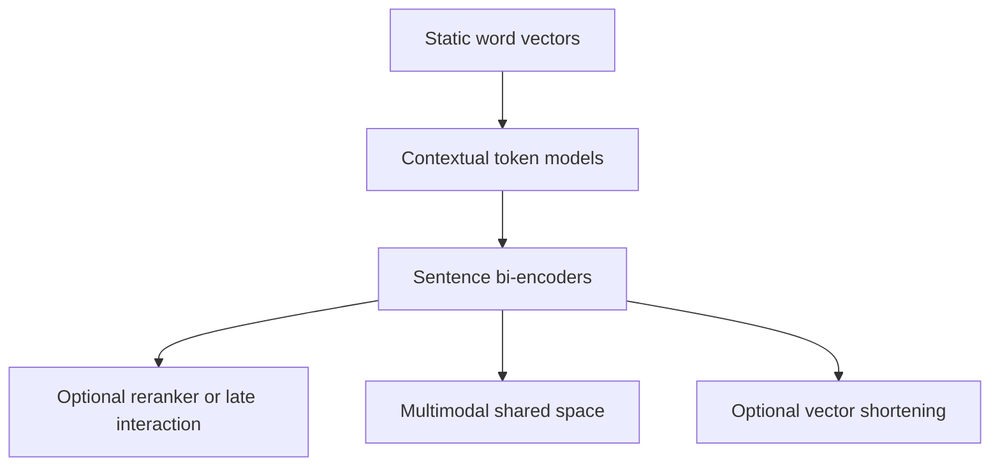
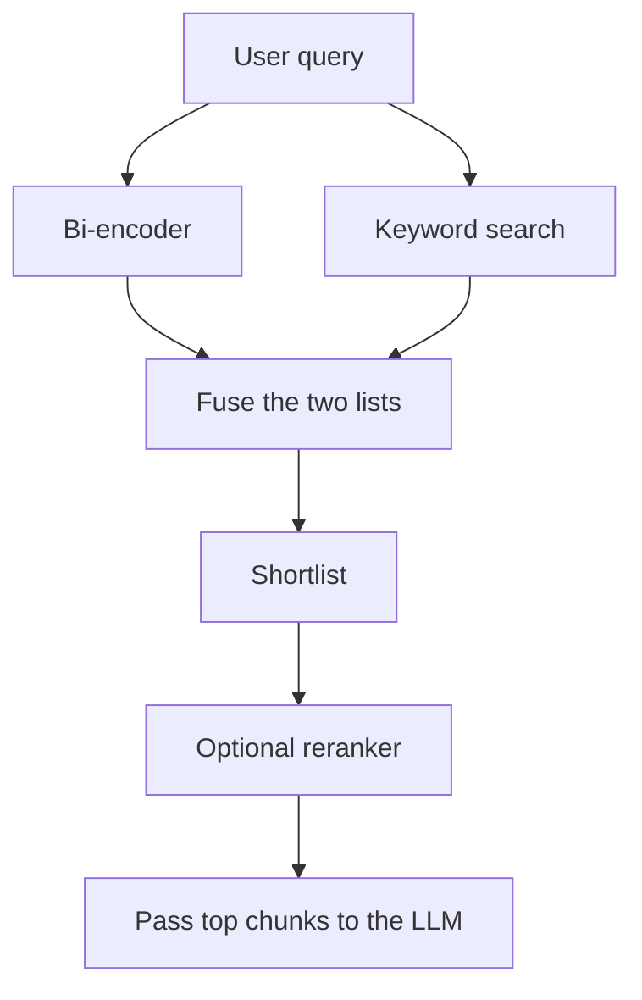

<strong>How to use this interview</strong>

<ul>
<li>This is a mock ML interview. I answer as I would in a room, then add the detail I would give if they say "go deeper."</li>
<li>The running example is a company assistant. A user types "How do I reset my password?" and we need the chunk that says "I forgot my password." Later we also have to search a photo of a red car, and explain the word "bank."</li>
<li>The questions follow the ideas that actually matter for search: static word vectors, contextual models, sentence bi-encoders, rerankers, late interaction, multimodal models, and shortening a vector. I keep the history in paper order. Doc2Vec is from 2014, four years before BERT.</li>
<li>The STS numbers and the 65 hours vs 5 seconds figure are from the Sentence-BERT paper (Reimers and Gurevych, 2019, Table 1 and the introduction). I did not rerun those tests. They were measured on a V100 in 2019.</li>
<li>I checked the other claims against the original papers and current official docs in <strong>November 2026</strong>. Links are in the Sources section.</li>
</ul>

Static word vectors came first: one point per word type. ELMo and BERT then made the vector depend on the rest of the sentence. Sentence-BERT is the step that made those vectors usable for search. After 2019, most production retrievers are still bi-encoders, but they are usually trained with contrastive loss, and many no longer start from BERT. A reranker or a late-interaction model is an optional second stage. CLIP-style models put images and text in the same space. Matryoshka is a training method that lets you shorten a vector and still keep most of the meaning. It is not a separate model family.

If you want the "list of numbers" picture first, I wrote a short post on that: <a href="https://blogs.theintelliwise.com/posts/coordinate-vector-matrix-tensor/" target="_blank" rel="noopener">Coordinate, Vector, Matrix, Tensor</a>. This interview is about how those lists are learned, and which one you actually use.

---

## 1. What is an embedding, in one line?

<strong>Interviewer:</strong> What is an embedding, in one line?

**Me:** A list of numbers that stands for a piece of content, so that similar meanings land close to each other.

"How do I reset my password?" and "I forgot my password" should be near each other. "Office Wi-Fi code" should be farther away. Once you have that, search becomes "embed the question, find the nearest stored vectors, return those chunks."

That is the retrieval step in RAG. The database that holds the vectors is a different decision. I wrote a <a href="https://blogs.theintelliwise.com/posts/choosing-vector-database-for-rag/" target="_blank" rel="noopener">decision guide on choosing a vector store</a>. This interview is about the vectors themselves.

<em>Follow-up they may ask:</em> Is an embedding only for words? No. You can embed a token, a sentence, a whole document, an image, or even audio. The idea is the same. The model that produces the list is not.

---

## 2. Why do "car" and "vehicle" land close?

<strong>Interviewer:</strong> Why do the vectors for "car" and "vehicle" end up close to each other?

**Me:** The model does not look up a dictionary meaning. It sees that the two words appear in similar neighbourhoods, and it places their vectors close.

If a sentence often looks like "the ___ is parked outside," both "car" and "vehicle" fit. A training rule that rewards this pattern will pull those two points together. "Password" almost never fits that slot, so it stays far away.

This is the old distributional idea: words used in similar contexts get similar vectors. Word2Vec, GloVe and FastText all build on it.

<em>Follow-up they may ask:</em> Is closeness cosine or Euclidean distance? Both show up. In RAG we usually use cosine similarity, or a dot product after the vectors are length-normalised. OpenAI's embedding docs recommend cosine, and say their vectors are already length 1, so a dot product is enough. Other models may need an explicit normalisation step. Always check the model card.

---

## 3. Word2Vec, GloVe and FastText: what is the difference?

<strong>Interviewer:</strong> People still mention Word2Vec, GloVe and FastText. How are they different, in plain words?

**Me:** All three give one fixed vector per word type. They differ in how they learn it, and in what happens to a word the model has never seen.

| Technique | Year | How it learns | What I remember in an interview |
| --- | --- | --- | --- |
| **Word2Vec** | 2013 | Predict a word from its neighbours (CBOW), or predict the neighbours from a word (Skip-gram) | Mikolov and colleagues. Local context window. Famous word-arithmetic demos such as king minus man plus woman came from this line of work. |
| **GloVe** | 2014 | Train on a global matrix of how often words appear together | Pennington, Socher and Manning. The name means Global Vectors. It uses corpus-wide co-occurrence counts, not only a sliding window. |
| **FastText** | 2016 paper, 2017 journal | Word2Vec-style training, but the word is also a bag of character n-grams | Bojanowski, Grave, Joulin and Mikolov. A typo or a rare form can still get a vector, because the pieces are known. |

For "password" and "passwords", FastText can share the character pieces. Word2Vec and GloVe need to have seen that exact word, or they have nothing to return.

I would not start a new RAG index with these three today. They are still worth knowing, because later models are answers to their limits.

<em>Follow-up they may ask:</em> Can I just average Word2Vec vectors to embed a sentence? You can, and people did. The Sentence-BERT paper used averaged GloVe as a baseline. It works better than raw BERT for sentence similarity, which surprises people. It is still a blunt tool. Word order is mostly lost, and "bank" is still one vector.

---

## 4. What was Doc2Vec trying to solve?

<strong>Interviewer:</strong> Then what is Doc2Vec? Is it just Word2Vec for a whole page?

**Me:** Yes, that is the idea. Le and Mikolov published it in 2014, the same year as GloVe and a year after Word2Vec. It learns one vector for a paragraph or document, trained to predict the words inside that document.

There are two setups in the paper: PV-DM (a document vector plus context words predict the next word) and PV-DBOW (the document vector predicts words from the document, like Skip-gram). Both give you a single vector for the whole text.

Two practical catches, if they push:

- This is 2014 work. If a timeline puts Doc2Vec after BERT, that is mixing history.
- For a document the model has not seen, you usually have to infer a new document vector, with the word vectors held still. That is slower and more awkward than a model that can encode a new sentence in one forward pass. Sentence-BERT later made that "encode and go" path the default.

I do not use Doc2Vec for a new RAG stack.

---

## 5. Why is "bank" still a problem? What did ELMo and BERT change?

<strong>Interviewer:</strong> In "I sat on the river bank" and "I went to the savings bank", is "bank" the same vector?

**Me:** In Word2Vec, GloVe and FastText, yes. One word type, one vector. That is the limit of a static embedding.

ELMo (Peters and colleagues, 2018) changed this. The vector for "bank" depends on the rest of the sentence. ELMo is a bidirectional language model built from LSTMs. The name means Embeddings from Language Models.

BERT (Devlin and colleagues, 2018 paper, 2019 conference) did the same job with a transformer. It looks at both sides of the sentence at once. It is trained mainly by hiding some tokens and asking the model to fill them in (masked language modelling), plus a next-sentence prediction task. Each token gets a context-aware vector. There is also a special [CLS] token, trained for classification, not as a ready-made sentence vector for cosine search.

This is a big deal for our assistant. "Reset the bank details on the account" and "the path along the river bank" should not retrieve the same chunk just because both say "bank."

<em>Follow-up they may ask:</em> So can I take the [CLS] vector from BERT and use it as a sentence embedding? That is the trap. It looks like a sentence vector. It was not trained to be compared with cosine. The next question is about that.

---

## 6. Why do we need Sentence-BERT if we already have BERT?

<strong>Interviewer:</strong> Why do we need Sentence-BERT if we already have BERT?

**Me:** Because raw BERT was not trained to compare two sentences by their vectors. If you use the [CLS] token or the average of the token vectors, and then take cosine, the result is poor. The Sentence-BERT paper found it was worse than averaging simple GloVe vectors.

That is the answer I would lead with. Then I would add two reasons, quality and cost.

**Quality.** Reimers and Gurevych (2019) reported Spearman's rank correlation, times 100, averaged over seven sentence-similarity tasks:

| Method | Average score |
| --- | ---: |
| BERT [CLS] vector | 29.19 |
| Average of BERT token vectors | 54.81 |
| Average of GloVe vectors | 61.32 |
| SBERT-NLI-base | 74.89 |

These are their Table 1 numbers, not a test I ran. Average GloVe beat both common ways of taking a BERT sentence vector. After they fine-tuned BERT with a siamese setup on natural language inference data (SNLI and MultiNLI), the same kind of cosine comparison jumped to 74.89 for the base model.

**Cost.** BERT as a cross-encoder wants both sentences in one pass. To find the closest pair in 10,000 sentences, you would run about 50 million BERT calls, `n(n-1)/2`. The paper says that took about 65 hours on a V100. Sentence-BERT encodes each sentence once, then compares the vectors with cosine. In that paper, encoding the 10,000 sentences took about 5 seconds, and the cosine step took about 0.01 seconds.

The 2019 training setup is worth stating carefully, because people often describe it as a cosine contrastive loss. Two copies of BERT share weights (a siamese network). A pooling step, usually the mean of the token vectors, turns each sentence into one vector. The main NLI model was trained with a 3-way softmax classifier on the pair of vectors and their absolute difference, not with a direct cosine loss. At search time you only keep the two vectors and the cosine. The later contrastive models I mention next train the cosine comparison more directly.

That "encode once, compare with cosine" pattern is still how most RAG retrievers work. I would not say every current embedding model is a copy of the 2019 recipe.

---

## 7. After Sentence-BERT, what do today's embedding models actually do?

<strong>Interviewer:</strong> If I ship a RAG assistant in 2026, do I still train or download the 2019 Sentence-BERT model?

**Me:** I keep the Sentence-BERT product idea: one vector per text, and a cheap score I can index. I do not start from the 2019 NLI softmax recipe, or treat SBERT-NLI-base as the default production model.

What changed is the training, and often the backbone.

Most later models use a contrastive loss, usually a form of InfoNCE. In one batch, the true query-passage pair should score higher than the other passages in that batch, and often higher than extra hard negatives that almost look relevant. E5 (Wang and colleagues, 2022) is a clear public example of this. It also uses different prefixes, `query:` and `passage:`, because a question and a document are not the same kind of text. If you skip those prefixes, retrieval quality can drop. Later open families such as BGE and GTE follow the same broad contrastive idea.

Some current models no longer start from BERT at all. They start from a decoder-only language model. Qwen3-Embedding (Zhang and colleagues, 2025) is one public example. The technical report describes a contrastive training pipeline, an optional instruction on the query, and Matryoshka-style flexible dimensions. The official model card, which I rechecked in November 2026, says that for many retrieval tasks, leaving the query instruction off can drop performance by about 1% to 5%. The same series also ships reranking models, which I will come back to.

On the hosted side, OpenAI's embeddings guide, rechecked in November 2026, still lists `text-embedding-3-small`, `text-embedding-3-large`, and the older `text-embedding-ada-002`. Google published Gemini Embedding in 2025 (Lee and colleagues). I would treat both as current API options, not as the only options.

I am not going to name a single "best" public model for 2026. Leaderboards move. Also, scores are easy to mix up. OpenAI's January 2024 blog reported 64.6 for `text-embedding-3-large` on the original MTEB average. The Qwen3-Embedding technical report, in June 2025, reported 75.22 mean task for Qwen3-Embedding-8B on MTEB English v2, and in the same table listed 73.30 for Gemini Embedding and 66.43 for `text-embedding-3-large`. Those are not the same benchmark snapshot as the 2024 blog number. I did not rerun MTEB. The useful interview answer is: pick two or three current sentence-embedding models, read how each one expects queries to be formatted, and test them on your own questions.

<em>Follow-up they may ask:</em> Do I embed the query and the document the same way? Not always. Some models want a prefix or an instruction on the query, and a plain document on the other side. The model card is the source of truth.

---

## 8. If the bi-encoder is already cheap, why do we still use a reranker?

<strong>Interviewer:</strong> You said a bi-encoder encodes each text once. When do I still need a model that looks at the query and the chunk together?

**Me:** When the first-stage retriever gets the right chunk into a shortlist, but not always at rank one. A bi-encoder never sees the query and the document in the same forward pass. That is why it is fast enough to index. It can also miss a fine distinction, such as "email password" versus "Wi-Fi password," once both texts have been squeezed into one vector.

The usual pattern is retrieve, then rerank. I fetch 50 or 100 chunks with a bi-encoder, often fused with keyword search, then I run a reranker only on that shortlist. The reranker looks at each remaining pair. A classic reranker is a BERT-style cross-encoder. Some later rerankers, including the Qwen3-Reranker models in the 2025 technical report, score a pair by asking an LLM-style model for a yes or no relevance decision. I would not treat the exact scoring head as the important part. The important part is the cost: you pay the expensive model only on the last shortlist, not on the whole corpus.

For a first version of the password-reset assistant, I would ship a strong bi-encoder plus keyword search, then add a reranker if the shortlist is right but the top hit is often wrong.

---

## 9. If Sentence-BERT already gives a vector, why does ColBERT exist?

<strong>Interviewer:</strong> ColBERT is also built on BERT. What problem is left after a sentence vector?

**Me:** A single-vector model collapses a passage into one vector. That is cheap to store and easy to index, but it can blur fine details. A chunk about "reset the email password, not the Wi-Fi password" may look too much like the wrong password paragraph once everything is averaged.

ColBERT (Khattab and Zaharia, SIGIR 2020) keeps one vector per token. The document is still encoded offline, so you are not running a full cross-encoder on every pair. At search time, each query token looks at all document tokens and keeps the best match. That operator is called MaxSim. The score is the sum of those maxima.

"Late" means the query and the document do not sit inside the same transformer. They meet only in this cheap matching step.

The cost moves to storage. You now store many short vectors per chunk, not one. In the ColBERT paper, the main token vector size is 128 dimensions. On the MS MARCO collection of 8.8 million passages, they report 286 GiB for 128-d vectors stored in 4-byte floats, and 27 GiB for 24-d vectors stored in 2-byte floats, with MRR@10 of 34.9 and 33.9 on the dev set in that re-rank setting. Those are their Table 4 numbers, not a cluster I ran.

ColBERTv2 (Santhanam, Khattab and colleagues, NAACL 2022) keeps the same late-interaction idea, adds stronger training, and uses residual compression. The paper reports a 6 to 10 times smaller index than the original ColBERT setup, with better retrieval quality. If I reach for late interaction today, I would start from a ColBERTv2-style system, not from the 2020 index sizes.

I would use this when a single-vector retriever keeps missing the exact phrase or the exact entity, and I have budget for a larger index. For a first RAG system, I still start with one vector per chunk, and I add a reranker before I jump to token-level vectors.

---

## 10. How would you search images with a text query?

<strong>Interviewer:</strong> The assistant also has inspection photos. How would you search those images with a text query?

**Me:** I would use a model trained to put images and text in the same vector space. CLIP (Radford and colleagues, 2021) is the paper that made this widely known.

CLIP has two encoders: one for images, one for text. They are trained with a contrastive loss on image-caption pairs. A photo of a red car and the text "a red car" are pulled together. A photo of a red car and the text "reset the password" are pushed apart. At search time I embed the photo with the image encoder, embed the query with the text encoder, and do a nearest-neighbour lookup in that shared space.

A text-only model such as Word2Vec, BERT or Sentence-BERT will not do this out of the box. It does not take a picture as input. You could caption the image with another model and then embed the caption, but that is a pipeline, not a shared space.

CLIP is not the last word. SigLIP (Zhai and colleagues, ICCV 2023) keeps the same shared-space idea, but replaces the softmax contrastive loss with a pairwise sigmoid loss. If I were building this tomorrow, I would pick a current CLIP-style model and test it on my own photos, not assume the 2021 checkpoint is the one to ship.

<em>Follow-up they may ask:</em> Does CLIP also do zero-shot classification? Yes. You embed the image once, embed label texts such as "a photo of a dog" and "a photo of a cat", and pick the closest label. That is the demo from the original work. For our assistant, the search use is the one I care about: "show me the red car from last week's inspection photos."

---

## 11. What is Matryoshka? Is it another embedding model?

<strong>Interviewer:</strong> People sometimes put Matryoshka next to BERT and CLIP. Is it another model?

**Me:** No. Matryoshka Representation Learning is a training method. Kusupati and colleagues published it in 2022. You train one vector so that its prefix, the first 256 dimensions, or the first 512, is still a useful embedding on its own. The name comes from the nested dolls: the small one is already a complete doll, not a broken piece of a large one.

If you cut a normal embedding down to a quarter of its size, quality often drops sharply, because later dimensions were not trained to stand alone. With Matryoshka training, you can store a short prefix when memory is tight, and keep the full vector when you need more detail.

This is not only a research idea. OpenAI's January 2024 announcement says, in a footnote, that `text-embedding-3-small` and `text-embedding-3-large` were trained with Matryoshka Representation Learning. The official embeddings guide, which I rechecked in November 2026, still lists those two models plus the older `text-embedding-ada-002`. Defaults are 1536 dimensions for small and 3072 for large. You can pass a `dimensions` parameter to shorten the vector. OpenAI reported that a `text-embedding-3-large` vector shortened to 256 dimensions still beat an unshortened `text-embedding-ada-002` vector of 1536 dimensions on MTEB. That is their January 2024 figure, repeated in the current guide. I did not rerun MTEB.

Qwen3-Embedding also supports this kind of shortening. The 2025 technical report marks all three sizes as MRL-aware. The 8B model card says the default size is 4096, and you can choose an output size from 32 to 4096.

One practical catch, from the OpenAI docs: if the API shortens the vector for you, it is already length-normalised. If you truncate a full vector yourself after you receive it, you need to normalise it again before you compare with cosine.

So I would not call Matryoshka a model in the same sense as Word2Vec or CLIP. I would call it a property you can train into an embedding model, and a knob you can turn when the vector is too wide for the index.

---

## 12. So for a RAG assistant today, what do I actually use?

<strong>Interviewer:</strong> I have to ship the password-reset assistant next month. What goes in the retrieval path?

**Me:** I do not put Word2Vec, GloVe, FastText, Doc2Vec, ELMo or raw BERT in the retrieval path. I use a current sentence-embedding model that was trained so cosine is meaningful. I store one vector per chunk, I keep keyword search next to it for exact codes and names, and I add a reranker if the first-stage shortlist is good but the top hit is often wrong.

A short map I would draw on the whiteboard:

| If the task is... | I would use... | I would not start with... |
| --- | --- | --- |
| Text RAG, first version | A modern bi-encoder, open or hosted, with the query format the model card asks for | Raw BERT [CLS], averaged GloVe, Doc2Vec, or the 2019 SBERT checkpoint as a default |
| Exact error codes, SKUs, names | Keyword search (BM25) fused with the vectors | Vectors alone |
| The shortlist is right, but rank 1 is often wrong | A cross-encoder or a later dedicated reranker on 50 to 100 hits | Jumping straight to a new database |
| The retriever keeps missing a key phrase | A late-interaction model such as ColBERTv2, or a reranker first | Starting with token-level vectors before I have measured the simple path |
| Search photos with a text query | A current CLIP-style model, such as CLIP or SigLIP | Any text-only model |
| The vectors are too wide for the index | A Matryoshka-trained model, and a shorter prefix | Cutting a normal vector and hoping |

I would also measure, not guess. Build a set of real questions with the chunk that should come back. Track recall@k and a latency percentile. When I change the embedding model, I have to re-embed every chunk. Old and new vectors cannot be mixed. I said the same thing in the <a href="https://blogs.theintelliwise.com/posts/choosing-vector-database-for-rag/" target="_blank" rel="noopener">vector database guide</a>, and in <a href="https://blogs.theintelliwise.com/posts/rag-five-knobs-recall-precision-topk-topp-cost/" target="_blank" rel="noopener">Five Things to Measure and Tune in a RAG System</a>.

If the same questions come in again and again, that is a cache problem, not an embedding problem. <a href="https://blogs.theintelliwise.com/posts/rag-semantic-caching/" target="_blank" rel="noopener">Semantic caching</a> is the post for that.

I am not going to name one "best" public model for 2026 in this interview. Leaderboards move. The right move is to pick two or three current sentence-embedding models, run them on your own questions, and keep the winner.

---

## A compact map of the ideas

| Idea | Year | What it gives you | One limit |
| --- | --- | --- | --- |
| Word2Vec | 2013 | One vector per word, from a local context window | One meaning per word type. No built-in sentence vector. |
| GloVe | 2014 | One vector per word, from global co-occurrence counts | Same static limit. Unseen words are a hole. |
| Doc2Vec | 2014 | One vector per document | New documents need an inference step. Pre-dates BERT. |
| FastText | 2016 | Word vectors built from character n-grams | Still a static word vector. Does not solve "bank." |
| ELMo | 2018 | Context-aware word vectors from a bidirectional LSTM | Heavier than static vectors. Not a sentence search model by itself. |
| BERT | 2018 | Context-aware token vectors from a transformer | Off-the-shelf [CLS] or average vectors are poor for cosine similarity. |
| Sentence-BERT | 2019 | One sentence vector trained so cosine is useful | The 2019 NLI recipe is not what most 2026 models train with. One vector can still blur token-level details. |
| Contrastive bi-encoders | 2022 onwards | Current RAG retrievers: contrastive loss, often prefixes or instructions | You must follow the model card. Leaderboard scores go stale. |
| ColBERT / ColBERTv2 | 2020 / 2022 | One vector per token, scored with late MaxSim | Larger index than a single-vector retriever, even after compression. |
| CLIP / SigLIP | 2021 / 2023 | Images and text in one vector space | Text-only RAG does not need it. Newer checkpoints should be tested, not assumed. |
| Matryoshka | 2022 | A training method: prefixes of the vector stay useful | Not a standalone embedding model. The model still has to be trained this way. |
| Reranker | used with the above | Looks at a query-chunk pair and reorders a shortlist | Too slow to run on the whole corpus. |

---

## Terms used in this post

| Term | Meaning |
| --- | --- |
| **embedding** | A list of numbers that represents a piece of content |
| **static embedding** | One vector per word type, the same in every sentence |
| **contextual embedding** | The vector changes with the rest of the sentence |
| **cosine similarity** | A score of how aligned two vectors are, from -1 to 1 |
| **cross-encoder** | A model that looks at a pair of texts in one pass |
| **bi-encoder** | A model that embeds each text on its own, then compares vectors |
| **siamese network** | Two copies of the same model, with shared weights, used in Sentence-BERT training |
| **contrastive loss** | A training rule that pulls a true pair together and pushes other pairs in the batch apart |
| **hard negative** | A near-miss example that looks relevant but is not |
| **reranker** | A second-stage model that rescores a short list of retrieved chunks |
| **MaxSim** | In ColBERT, the best match of one query token against all document tokens |
| **late interaction** | Query and document meet only at the matching step, not inside one transformer |
| **MTEB** | A public benchmark suite for embedding models. Later versions, such as English v2 and MMTEB, are not the same number as the original English average |
| **recall@k** | Share of questions where the right chunk is in the top k results |

---

## Sources and further reading

Papers:

- <a href="https://arxiv.org/abs/1301.3781" target="_blank" rel="noopener">Mikolov et al.: Efficient Estimation of Word Representations in Vector Space (Word2Vec, 2013)</a>
- <a href="https://arxiv.org/abs/1310.4546" target="_blank" rel="noopener">Mikolov et al.: Distributed Representations of Words and Phrases and their Compositionality (2013)</a>
- <a href="https://nlp.stanford.edu/pubs/glove.pdf" target="_blank" rel="noopener">Pennington, Socher and Manning: GloVe: Global Vectors for Word Representation (EMNLP 2014)</a>
- <a href="https://proceedings.mlr.press/v32/le14.html" target="_blank" rel="noopener">Le and Mikolov: Distributed Representations of Sentences and Documents (Doc2Vec, ICML 2014)</a>
- <a href="https://arxiv.org/abs/1607.04606" target="_blank" rel="noopener">Bojanowski, Grave, Joulin and Mikolov: Enriching Word Vectors with Subword Information (FastText, 2016/2017)</a>
- <a href="https://arxiv.org/abs/1802.05365" target="_blank" rel="noopener">Peters et al.: Deep contextualized word representations (ELMo, 2018)</a>
- <a href="https://arxiv.org/abs/1810.04805" target="_blank" rel="noopener">Devlin et al.: BERT: Pre-training of Deep Bidirectional Transformers for Language Understanding (2018/2019)</a>
- <a href="https://arxiv.org/abs/1908.10084" target="_blank" rel="noopener">Reimers and Gurevych: Sentence-BERT: Sentence Embeddings using Siamese BERT-Networks (EMNLP 2019)</a>
- <a href="https://arxiv.org/abs/2004.12832" target="_blank" rel="noopener">Khattab and Zaharia: ColBERT: Efficient and Effective Passage Search via Contextualized Late Interaction over BERT (SIGIR 2020)</a>
- <a href="https://arxiv.org/abs/2112.01488" target="_blank" rel="noopener">Santhanam, Khattab et al.: ColBERTv2: Effective and Efficient Retrieval via Lightweight Late Interaction (NAACL 2022)</a>
- <a href="https://arxiv.org/abs/2103.00020" target="_blank" rel="noopener">Radford et al.: Learning Transferable Visual Models From Natural Language Supervision (CLIP, 2021)</a>
- <a href="https://arxiv.org/abs/2205.13147" target="_blank" rel="noopener">Kusupati et al.: Matryoshka Representation Learning (NeurIPS 2022)</a>
- <a href="https://arxiv.org/abs/2212.03533" target="_blank" rel="noopener">Wang et al.: Text Embeddings by Weakly-Supervised Contrastive Pre-training (E5, 2022)</a>
- <a href="https://arxiv.org/abs/2210.07316" target="_blank" rel="noopener">Muennighoff et al.: MTEB: Massive Text Embedding Benchmark (2022/2023)</a>
- <a href="https://arxiv.org/abs/2502.13595" target="_blank" rel="noopener">Enevoldsen et al.: MMTEB: Massive Multilingual Text Embedding Benchmark (ICLR 2025)</a>
- <a href="https://arxiv.org/abs/2308.03281" target="_blank" rel="noopener">Li et al.: Towards General Text Embeddings with Multi-stage Contrastive Learning (GTE, 2023)</a>
- <a href="https://arxiv.org/abs/2309.07597" target="_blank" rel="noopener">Xiao et al.: C-Pack: Packed Resources for General Chinese Embeddings (BGE, 2023/2024)</a>
- <a href="https://arxiv.org/abs/2303.15343" target="_blank" rel="noopener">Zhai et al.: Sigmoid Loss for Language Image Pre-Training (SigLIP, ICCV 2023)</a>
- <a href="https://arxiv.org/abs/2503.07891" target="_blank" rel="noopener">Lee et al.: Gemini Embedding: Generalizable Embeddings from Gemini (2025)</a>
- <a href="https://arxiv.org/abs/2506.05176" target="_blank" rel="noopener">Zhang et al.: Qwen3 Embedding: Advancing Text Embedding and Reranking Through Foundation Models (2025)</a>

Official docs and project pages (checked November 2026):

- <a href="https://www.sbert.net/" target="_blank" rel="noopener">Sentence-Transformers documentation</a>
- <a href="https://platform.openai.com/docs/guides/embeddings" target="_blank" rel="noopener">OpenAI: Embeddings guide (models, dimensions, shortening, normalisation)</a>
- <a href="https://openai.com/index/new-embedding-models-and-api-updates/" target="_blank" rel="noopener">OpenAI: New embedding models and API updates (25 January 2024), including the MTEB shortening claim and the Matryoshka footnote</a>
- <a href="https://openai.com/index/clip/" target="_blank" rel="noopener">OpenAI: CLIP, Connecting text and images</a>
- <a href="https://huggingface.co/Qwen/Qwen3-Embedding-8B" target="_blank" rel="noopener">Qwen3-Embedding-8B model card (instructions, MRL dimensions)</a>
- <a href="https://huggingface.co/spaces/mteb/leaderboard" target="_blank" rel="noopener">MTEB leaderboard</a>
- <a href="https://github.com/stanford-futuredata/ColBERT/" target="_blank" rel="noopener">ColBERT official repository</a>
- <a href="https://nlp.stanford.edu/projects/glove/" target="_blank" rel="noopener">Stanford GloVe project page</a>

Related Intelliwise posts: <a href="https://blogs.theintelliwise.com/posts/choosing-vector-database-for-rag/" target="_blank" rel="noopener">Choosing a Vector Database for RAG</a>, <a href="https://blogs.theintelliwise.com/posts/rag-five-knobs-recall-precision-topk-topp-cost/" target="_blank" rel="noopener">Five Things to Measure and Tune in a RAG System</a>, <a href="https://blogs.theintelliwise.com/posts/rag-semantic-caching/" target="_blank" rel="noopener">Semantic Caching for RAG and LLMs</a>, and <a href="https://blogs.theintelliwise.com/posts/coordinate-vector-matrix-tensor/" target="_blank" rel="noopener">Coordinate, Vector, Matrix, Tensor</a>.

---

## In short

**An embedding is a list of numbers that puts similar meanings close together. Static word vectors (Word2Vec, GloVe, FastText) and Doc2Vec were the start, but they give one vector per word type, so "bank" is always the same point. ELMo and BERT made the vector depend on the sentence, but raw BERT is a poor sentence search model: the 2019 Sentence-BERT paper found its vectors scored below averaged GloVe on sentence similarity, and comparing 10,000 sentences with a BERT cross-encoder took about 65 hours on a V100. Sentence-BERT fine-tunes the model so you can encode once and use cosine. That product idea is still how RAG retrievers work. The models you pick in 2026 are usually newer contrastive bi-encoders, often with query prefixes or instructions, and a reranker is the usual way to rescore a shortlist. ColBERT keeps token-level vectors and matches them late, at the cost of a larger index; ColBERTv2 shrinks that index. For images with text, use a CLIP-style model, such as CLIP or a later shared-space model like SigLIP. Matryoshka is a training method that lets you shorten a vector and keep most of the meaning, not a standalone model. For a production assistant, pick a current sentence-embedding model, follow its query format, measure recall on your own questions, and keep keyword search beside it.**
