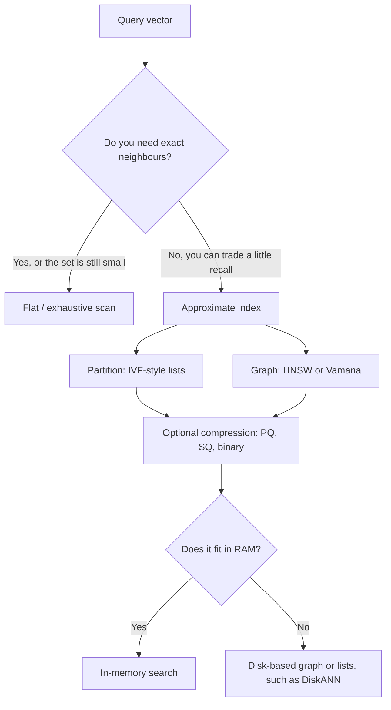

<strong>How to use this post</strong>

<ul>
<li>This is a myth versus fact post. Each myth is a claim I hear when people talk about speeding up vector search. The fact comes from papers and official docs, not from a checklist of seven names.</li>
<li>The running example is a company assistant. A user types "How do I reset my password?" and we need the chunk that says "I forgot my password." The vectors are already built. The question here is how the store finds nearby vectors quickly.</li>
<li>I do not rerun benchmarks in this post. The only numbers I use are <strong>example memory math</strong>, defaults or formulas copied from docs, and figures quoted from a named paper with its date and dataset.</li>
<li>I checked the claims against official docs and the original papers in <strong>November 2026</strong>. Links are in the Sources section.</li>
<li>This post is about the index inside the store. If you are still choosing the store itself, start with the <a href="https://theintelliwise.com/posts/choosing-vector-database-for-rag/" target="_blank" rel="noopener">vector database decision guide</a>.</li>
</ul>

---

## The short answer first

Once you have embeddings, search is a neighbour problem. You hold a query vector, and you want the stored vectors that sit closest to it. If the collection is small, you can compare the query with every vector. That is exact search, often called a flat index or a brute-force scan. It is simple, and it does not miss a neighbour.

When the collection grows, that scan gets expensive. An approximate nearest neighbour index, or ANN index, visits only a promising subset. It is faster, or it uses less memory, but it can miss a true neighbour. That trade is the whole subject. The usual measure is recall@k: the share of queries where the right chunk still appears in the top k.

A popular way to teach this is a list of seven types: Flat, IVF, HNSW, LSH, Annoy, ScaNN and DiskANN. The list is a useful set of names to recognise. It is a poor way to choose an index, because those names are not the same kind of thing. Some are algorithms. Some are libraries. Some are full systems. Compression, which often matters as much as the index family, is not a peer on that list at all.

A clearer picture is four building blocks you can combine:

- **Partition**: split vectors into lists, as IVF does, and search only some of the lists.
- **Graph**: link each vector to nearby vectors, as HNSW and Vamana do, and walk those links.
- **Compress**: store shorter codes, as product quantization or scalar quantization do, then optionally rerank with the full vector.
- **Place**: keep what you need in RAM, and put the rest on SSD when the data no longer fits.

The rest of the post walks through the myths that hide behind the seven-name list.

---

## Myth 1: There are seven types of vector index, and you should treat them as peers

**Why people believe it.** A short list is easy to memorise. Flat, IVF, HNSW and LSH sound like algorithms. Annoy, ScaNN and DiskANN get added because they show up in blog posts, and the list now looks complete.

**What is true.** Those seven names sit in different layers.

| Name | What it actually is | The idea |
| --- | --- | --- |
| Flat | An exact scan | Compare the query with every vector |
| IVF | A partition method | Search some clusters, not all |
| HNSW | A layered graph algorithm | Walk neighbour links, starting from a sparse top layer |
| LSH | A hashing family | Map similar vectors towards the same buckets or binary codes |
| Annoy | A library (random-projection trees) | Build a forest of trees and mmap the file |
| ScaNN | A library, and an index type in some databases | Partition plus a particular kind of quantization |
| DiskANN | A system, plus the Vamana graph | Keep compressed vectors in RAM; keep the graph and full vectors on SSD |

FAISS, which is the library many of these ideas are implemented in, does not present a list of seven types either. Its own guide, updated in October 2026, asks a few practical questions: will you run only a small number of searches, do you need exact results, is memory tight, and how large is the dataset? The answers point to combinations such as `Flat`, `HNSW`, `IVF` with a product quantizer, or a Vamana graph, not to a fixed menu of seven names.

ScaNN and DiskANN are important. They are not extra species that sit beside IVF and HNSW. ScaNN is a partition-and-quantize system with its own loss function. DiskANN is a graph system designed to live on SSD. You will meet both again later, in their own myths.

---

## Myth 2: Flat search is only for tiny demos

**Why people believe it.** The first thing many explainers say about a flat index is "slow for huge data." That is true at large scale. It is also the wrong first question for a lot of company RAG.

**What is true.** The only FAISS index that can guarantee exact results is a flat index (`IndexFlatL2` or `IndexFlatIP`). It stores vectors without compression, needs no training, and is the baseline that other indexes are measured against.

FAISS also says that if you will only run a small number of searches, say in the 1,000 to 10,000 range, the time spent building a fancy index may never be paid back. In that case a direct scan is the efficient option.

Database docs say the same in slightly different words:

- Weaviate recommends a **flat** index when the number of objects in the index is low, including many small tenants, and makes **HNSW** the default for most other cases. It also has a **dynamic** index that starts flat and later switches to HNSW once the object count crosses a threshold you set. That dynamic option is marked experimental.
- Redis documents **FLAT** for small datasets, including under 1 million vectors, or when you need exact results, and **HNSW** for larger sets. Redis 8.2 also added **SVS-VAMANA**, a graph index in the same family as DiskANN's graph.
- Milvus describes **FLAT** as exact search with no training, and suggests it for small datasets, under 1 million vectors in their API notes.

I would not treat "1 million" as a hard law. Latency depends on the dimension, the hardware, and the query rate. A useful memory check, with **example math only**, is this: 1 million vectors of 768 dimensions in float32 take

`1,000,000 × 768 × 4 bytes = 3,072,000,000 bytes`, which is about **3.07 GB**.

Three hundred thousand chunks, a size many internal assistants never leave, sit well under 1 GB of raw vectors at the same width. That often fits on one machine. Whether a flat scan is fast enough is a measurement, not a slogan. If you need exact neighbours, or you have not yet proved that an approximate index is worth the recall risk, start with flat and measure recall@k and latency on your own questions.

For the wider retrieval knobs around that measurement, I already wrote <a href="https://theintelliwise.com/posts/rag-five-knobs-recall-precision-topk-topp-cost/" target="_blank" rel="noopener">Five Things to Measure and Tune in a RAG System</a>. The index is one of those knobs. It is not the only one.

---

## Myth 3: If you want low latency, you should just pick HNSW

**Why people believe it.** HNSW is the default in a lot of products. It is fast in memory, it usually has high recall when tuned, and a two-box flowchart that says "low latency? evaluate HNSW" is easy to remember.

**What is true.** HNSW is a strong in-memory default, not a universal one.

The algorithm, from Malkov and Yashunin (the IEEE paper is 2018, the preprint is 2016), builds a layered graph. The top layer is sparse and lets the search jump a long way. Lower layers are denser. The bottom layer holds every vector. Search starts at the top and walks down. Three parameters matter:

- **M**: how many neighbour links each node keeps. More links usually mean better recall and more memory.
- **efConstruction**: how widely the graph is explored while you insert a point. Higher values make a better graph and a slower build.
- **efSearch** (sometimes just `ef`): how widely the graph is explored at query time. Higher values improve recall and add latency.

FAISS, as of the October 2026 guide, still says that if you have plenty of RAM, or the dataset is small, HNSW is the best option. It also gives a memory formula I will use as **example math**, not as a benchmark: `(d × 4 + M × 2 × 4)` bytes per vector. For 768 dimensions and `M = 16`, that is 3,072 bytes for the vector plus 128 bytes for the graph, or about **3.20 GB** for a million vectors. The extra graph cost is real, but the raw float32 vectors are still most of the bill unless you compress them.

The same FAISS page is clear about limits. HNSW does not require training, which is nice. The FAISS implementation does not support removing a vector, because that would break the graph. Databases that ship HNSW, such as pgvector, Qdrant and Weaviate, usually let you delete or update points, and then clean the graph later. The cleanup is extra work. It is not free.

HNSW can also be a poor first pick when:

- The data no longer fits in RAM. Then a disk-based graph, such as DiskANN, or a compressed IVF index, is the actual design.
- You filter hard on metadata. A graph that was built on all points can become weakly connected once a filter removes most of them. I walked through that, including pgvector iterative scans and Qdrant's filter-aware edges, in the <a href="https://theintelliwise.com/posts/choosing-vector-database-for-rag/" target="_blank" rel="noopener">vector database guide</a>.
- Build time or memory during index construction is the constraint, not query latency.
- You want more compression than a plain HNSW graph usually keeps. FAISS and Milvus both offer HNSW combined with scalar or product quantization.

So I do evaluate HNSW early when the data fits in memory and I can accept approximate results. I do not skip the measurement, and I do not assume it is the right answer for a filtered, frequently updated, or larger-than-RAM collection.

---

## Myth 4: IVF is only for billions of vectors

**Why people believe it.** A common flowchart puts HNSW under "low latency" and IVF, ScaNN and DiskANN under "very large data, billions of vectors." That hides how widely partitioning is used.

**What is true.** IVF, short for inverted file, is a partition method. You cluster the vectors into `nlist` lists, usually with k-means. At search time you visit `nprobe` lists, the ones whose centres sit closest to the query. As a first approximation, you compare the query with about `nprobe / nlist` of the data. If the true neighbour lives in a list you did not visit, you miss it.

FAISS still treats IVF as the standard way to scale a search once a flat scan is too slow. Its 2026 guide sets `nlist` from `4 × sqrt(N)` to `16 × sqrt(N)`, and it gives this method for collections well below 1 million, not only for a billion. At larger sizes it often uses an HNSW index only as the coarse quantizer, so the system can assign a query to the right list quickly. That combination, sometimes written `IVF65536_HNSW32`, is IVF at the top, with a graph used to find the lists. It is not "HNSW versus IVF."

pgvector ships the same idea as **IVFFlat**: faster to build and lighter than HNSW, with a weaker speed-recall trade-off. The docs tell you to start `lists` at `rows / 1000` up to 1 million rows, and at `sqrt(rows)` above that, and to start `probes` at `sqrt(lists)`. The default number of probes is 1, which is usually too low. I already recorded those defaults in the <a href="https://theintelliwise.com/posts/choosing-vector-database-for-rag/" target="_blank" rel="noopener">pgvector card</a>.

IVF is also the usual partner for compression. `IVFPQ` stores a short code in each list instead of the full vector. That is how a lot of large-scale search actually runs, in FAISS and in Milvus (`IVF_FLAT`, `IVF_SQ8`, `IVF_PQ`, and newer variants such as `IVF_RABITQ`).

So IVF is not "the billion-vector index." It is the partition block. You can use it at a few hundred thousand vectors, and you can still be using it, with a coarser graph and compressed codes, at much larger scales.

---

## Myth 5: LSH and Annoy belong on the same current shortlist as HNSW

**Why people believe it.** Both names are old, well known, and easy to draw. LSH sounds clever: similar items should hash into the same bucket. Annoy has a memorable name, Approximate Nearest Neighbors Oh Yeah, and a clear picture of random-projection trees.

**What is true about LSH.** Locality-sensitive hashing is a real family of algorithms, with a long theory literature. FAISS still ships `IndexLSH`, which hashes vectors into binary codes and compares them with Hamming distance. The FAISS authors are also blunt about why they do not lead with it. In their index notes, classic LSH needs many hash functions, so it uses a lot of memory, and the hash functions are not adapted to the data. In a separate comparison page they say that for most application cases, LSH performs worse than product quantization on the memory-vs-accuracy and speed-vs-accuracy trade-offs.

The current FAISS guide for choosing an index, updated October 2026, walks through Flat, HNSW, Vamana, IVF and several quantizers. LSH is not on that recommended path. Some databases still use an LSH variant for special cases, such as Milvus `MINHASH_LSH` for certain binary or fingerprint workloads. That is not the same as recommending LSH as a first dense-embedding index for RAG.

**What is true about Annoy.** Annoy is a library from Spotify, not an algorithm family on the same level as IVF or HNSW. It builds a forest of random-projection trees, writes them to a static file, and maps that file into memory so many processes can share it. That design is the point. You build once, you distribute a file, and lookups start quickly. The official README is also clear about the limits: after `build`, you cannot add more items, and the library "works better if you don't have too many dimensions (like <100)", though it can still surprise you at higher widths.

Those limits matter for RAG. Modern text embeddings are often 384, 768 or wider, and document collections change. Most of the stores I use for RAG in 2026 ship HNSW, IVF, or a disk-based graph. They do not ship Annoy as a first-party index. Annoy remains a reasonable tool for a static, memory-mapped, read-heavy index that you are happy to rebuild. It is not a current default I would put next to HNSW on a production shortlist.

---

## Myth 6: ScaNN is just "partitioning plus quantization," and that 3 KB figure is a ScaNN fact

**Why people believe it.** A short ScaNN slide often shows two steps, partition and vector quantization, and then a line like "768 floats, 3 KB." The second number looks like a ScaNN result. It is not.

**What is true.** 768 float32 values take `768 × 4 = 3,072` bytes, which is about 3 KB. That is the uncompressed size of one common embedding. It does not depend on ScaNN.

ScaNN, Scalable Nearest Neighbors, is Google's library. The idea that made it interesting is not that it partitions and quantizes. Plenty of IVF+PQ systems already do that. The ICML 2020 paper, "Accelerating Large-Scale Inference with Anisotropic Vector Quantization," argues that the usual quantization loss is the wrong one for inner-product search. Classic product quantization tries to reconstruct every vector as well as possible. For search, the vectors that matter are the ones with a large inner product with the query. The authors penalise quantization error that sits parallel to the vector more than error that sits orthogonal to it. They call this anisotropic vector quantization.

In 2023 they added SOAR, Spilling with Orthogonality-Amplified Residuals. A vector can be assigned to more than one cluster, and the extra assignment is trained so its residual is useful when the first assignment would miss. That is a specific improvement to partitioning, not a generic "search two clusters" slogan.

I am not going to crown ScaNN as the fastest library in 2026. The 2020 announcement reported a strong result on the glove-100-angular benchmark from ann-benchmarks.com. Those leaderboards move, and I did not rerun them. What I will say is this: ScaNN is a real system, it is also an index type in Milvus, and its contribution is the quantization loss and the later spilling method. If your store does not offer ScaNN, you are not missing a third fundamental algorithm. You are missing one well-engineered combination of partition plus compression.

---

## Myth 7: DiskANN means a fixed box with 64 GB of RAM and a 4 TB SSD

**Why people believe it.** Diagrams of DiskANN often show a small RAM box and a large SSD box, sometimes with round numbers attached. 64 GB is a real figure from the paper. A 4 TB SSD label is easy to invent for the picture. It is not a required spec.

**What is true.** DiskANN is a Microsoft Research system from a NeurIPS 2019 paper, "Fast Accurate Billion-point Nearest Neighbor Search on a Single Node." The authors' point was that, at the time, the best graph indexes wanted everything in RAM, which made a billion-point index expensive. DiskANN keeps **compressed vectors in RAM** and stores the **graph plus full-precision vectors on SSD**. Search uses the cheap in-memory codes to decide where to go, then reads from SSD when it needs the real vector or the next graph neighbours.

The headline experiment is specific, and I will quote it as the paper states it, not as a guarantee for your embeddings. On the billion-point SIFT1B dataset, DiskANN served more than 5,000 queries a second, with under 3 ms mean latency and 95%+ 1-recall@1, on a 16-core workstation with **64 GB of RAM** and an inexpensive SSD. In that setting, IVF-style methods with a similar memory footprint plateaued at around 50% 1-recall@1. The paper also says that, in the high-recall regime, DiskANN could index and serve 5 to 10 times more points per node than in-memory HNSW or NSG.

The graph DiskANN builds is called **Vamana**. It is useful even when everything stays in memory. That is why you now see Vamana-style indexes outside the original single-node SSD setup:

- FAISS offers `SVSVamana` as an in-memory graph option beside HNSW, and notes that it can get faster with SQ8 quantization.
- Redis 8.2 added **SVS-VAMANA**.
- Timescale's **pgvectorscale** extension adds a **StreamingDiskANN** index on top of Postgres.
- FreshDiskANN, a 2021 follow-up, focuses on inserts and deletes without rebuilding the whole SSD index.
- Milvus ships **DISKANN**, and also a disk-oriented variant called **AISAQ**. Weaviate's **HFresh** index is a different design, a cluster-based index that uses HNSW for the centroids and keeps most data on disk, but it is aimed at the same problem: memory efficiency at large size.

The 64 GB figure is the RAM of the paper's 1-billion-point workstation, not a number you must provision to "use DiskANN." The right question is: do the vectors and the graph still fit in memory at the recall you need? If they do, an in-memory graph is simpler. If they do not, a disk-based graph is the building block you want, and the RAM you need is mainly for the compressed codes and the working set of SSD reads.

---

## Myth 8: Once you have picked the index type, the job is done

**Why people believe it.** A flowchart that ends at "HNSW" or "IVF / ScaNN / DiskANN" feels like a decision. In a demo with no filters and a static file, it can even look fine.

**What is true.** The type is only the first switch. Most of the recall and cost live in the settings, the compression, and the way filters and updates interact with the index.

**Parameters.** For IVF, `nlist` and `nprobe` decide how many lists you build and how many you visit. For HNSW, `M`, `efConstruction` and `efSearch` decide the density of the graph and how far a query walks. Raising the search-time parameter, `nprobe` or `efSearch`, is the usual way to buy recall with latency. There is no single default that fits every collection.

**Compression.** Product quantization, from Jégou, Douze and Schmid (IEEE TPAMI, 2011), splits a vector into sub-vectors and replaces each piece with a short code. Scalar quantization stores fewer bits per dimension. Binary methods go further. You can attach these to a flat scan, to IVF, or to a graph. FAISS calls `IndexIVFPQ` "probably the most useful indexing structure for large-scale search." That sentence is the opposite of treating compression as an optional afterthought.

Using the same **example math** as before: one million 768-d float32 vectors take about 3.07 GB raw. A common IVFPQ setting stores a 16-byte code plus an 8-byte id, which is 24 bytes per vector, or about **24 MB** for the codes, plus the cluster centroids and inverted lists. That is a large saving. It is also an accuracy cut, which is why many systems search the compressed codes first and then rerank a shortlist with the full vectors.

**Filters and updates.** If almost every query has a metadata filter, an index that only knows about vectors will waste work, or it will drop recall. If documents change all day, a static tree that must be rebuilt, or a graph that cannot delete cleanly, will hurt you in operations, not in a microbenchmark.

**What the store actually ships.** This matters more than a generic shortlist.

| Store | What you can actually choose |
| --- | --- |
| pgvector | HNSW and IVFFlat; StreamingDiskANN via pgvectorscale |
| Qdrant | HNSW for dense vectors, with quantization configured separately, plus payload indexes for filters |
| Weaviate | HNSW (default), flat, dynamic, and HFresh |
| Milvus | A wide set: FLAT, IVF variants, HNSW and compressed HNSW, DISKANN, SCANN, GPU CAGRA, and others |
| Redis | FLAT, HNSW, and SVS-VAMANA from 8.2 |
| Elasticsearch / OpenSearch | HNSW-style indexes, often with built-in quantization |
| FAISS (a library, not a database) | The widest combination menu, including Flat, IVF, HNSW, Vamana, PQ, SQ and RaBitQ |
| Pinecone and similar managed stores | You usually pick a service and constraints, not a raw algorithm name |

NVIDIA's CAGRA, described in a 2023 paper and shipped as `GPU_CAGRA` in Milvus, is the GPU-shaped version of the graph idea. I mention it so the shortlist does not pretend that CPU HNSW is the only modern graph.

**Measure it on your questions.** Build a small eval set of real queries and the chunk that should come back. Record recall@k and a latency percentile, with your real filters on. If you later change the embedding model, you have to re-embed everything. I said the same thing in the vector database guide, and it is still the step that catches a confident but wrong index choice. For the embedding models themselves, the companion post is <a href="https://theintelliwise.com/posts/embeddings-interview-qa/" target="_blank" rel="noopener">Embeddings Interview Q&A</a>.

---

## How I actually choose, after the myths

I do not start from a list of seven names. I ask, in this order:

1. **Do I need exact neighbours, and is a scan still cheap?** If yes, I use flat. I measure it before I invent a scale problem.
2. **Does the collection fit in RAM at the recall I need?** If yes, I try an in-memory graph, usually HNSW, and I tune `efSearch`. I also try a simple IVF index when build time or memory during construction matters.
3. **Is memory the constraint?** I add compression, SQ or PQ, and I rerank a shortlist if the store supports it.
4. **Is the collection much larger than RAM?** I look at a disk-based graph, DiskANN or a relative, or at a well-compressed IVF index, instead of buying a huge RAM box by habit.
5. **What does the database I already run actually support?** I pick from that menu. A brilliant algorithm that my store does not ship is a research note, not a plan.

For most internal RAG assistants I see, the honest answer is still closer to step 1 or 2 than to step 4. Billions of vectors are a real problem, and DiskANN exists because of it. A company handbook with a few hundred thousand chunks is not that problem.

If the same questions come in again and again, that is also not an index problem. That is a cache problem, and I wrote about it in <a href="https://theintelliwise.com/posts/rag-semantic-caching/" target="_blank" rel="noopener">Semantic Caching for RAG and LLMs</a>.

---

## Terms used in this post

| Term | Meaning |
| --- | --- |
| **embedding** | A list of numbers that represents the meaning of a text |
| **flat / exact search** | Compare the query with every stored vector |
| **ANN** | Approximate nearest neighbours: faster or smaller, may miss a few |
| **recall@k** | Share of queries where the right chunk is in the top k |
| **IVF** | Inverted file: cluster the vectors and search `nprobe` of `nlist` lists |
| **HNSW** | Layered neighbour graph, tuned with M, efConstruction and efSearch |
| **Vamana** | The graph algorithm behind DiskANN, also used in memory |
| **LSH** | Hashing that tries to put similar items in the same bucket or code |
| **Annoy** | A library of memory-mapped random-projection trees |
| **PQ / SQ** | Product or scalar quantization: store a shorter code for each vector |
| **ScaNN** | Google's library: partitioning plus anisotropic quantization, later SOAR |
| **DiskANN** | A graph index that keeps compressed vectors in RAM and the rest on SSD |
| **CAGRA** | A GPU graph index, used for example as Milvus GPU_CAGRA |

---

## Sources and further reading

Papers:

- <a href="https://arxiv.org/abs/1603.09320" target="_blank" rel="noopener">Malkov and Yashunin: Efficient and robust approximate nearest neighbor search using Hierarchical Navigable Small World graphs (preprint 2016, IEEE TPAMI 2018)</a>
- <a href="https://inria.hal.science/inria-00514462v2/document" target="_blank" rel="noopener">Jégou, Douze and Schmid: Product Quantization for Nearest Neighbor Search (IEEE TPAMI, 2011)</a>
- <a href="https://proceedings.neurips.cc/paper_files/paper/2019/file/09853c7fb1d3f8ee67a61b6bf4a7f8e6-Paper.pdf" target="_blank" rel="noopener">Subramanya, Devvrit, Kadekodi, Krishnaswamy and Simhadri: DiskANN, Fast Accurate Billion-point Nearest Neighbor Search on a Single Node (NeurIPS 2019)</a>
- <a href="https://arxiv.org/abs/2105.09613" target="_blank" rel="noopener">Singh, Subramanya, Krishnaswamy, and Simhadri: FreshDiskANN (2021)</a>
- <a href="https://proceedings.mlr.press/v119/guo20h.html" target="_blank" rel="noopener">Guo, Sun, Lindgren, Geng, Simcha, Chern and Kumar: Accelerating Large-Scale Inference with Anisotropic Vector Quantization (ScaNN, ICML 2020)</a>
- <a href="https://research.google/blog/soar-new-algorithms-for-even-faster-vector-search-with-scann/" target="_blank" rel="noopener">Sun and Guo, Google Research: SOAR, new algorithms for even faster vector search with ScaNN (2024 blog for the NeurIPS 2023 paper)</a>
- <a href="https://arxiv.org/abs/2308.15136" target="_blank" rel="noopener">Ootomo, Naruse, Nolet, Wang, Feher and Wang: CAGRA, Highly Parallel Graph Construction and Approximate Nearest Neighbor Search for GPUs (2023)</a>

Official docs and library guides (checked November 2026):

- <a href="https://github.com/facebookresearch/faiss/wiki/Guidelines-to-choose-an-index" target="_blank" rel="noopener">FAISS: Guidelines to choose an index (updated October 2026)</a>
- <a href="https://github.com/facebookresearch/faiss/wiki/Faiss-indexes" target="_blank" rel="noopener">FAISS: Faiss indexes (Flat, IVF, HNSW, LSH, PQ and memory formulas)</a>
- <a href="https://github.com/facebookresearch/faiss/wiki/Comparison-with-LSH" target="_blank" rel="noopener">FAISS: Comparison with LSH</a>
- <a href="https://github.com/spotify/annoy" target="_blank" rel="noopener">Annoy README (Spotify): memory-mapped trees, no adds after build</a>
- <a href="https://github.com/pgvector/pgvector" target="_blank" rel="noopener">pgvector README (HNSW, IVFFlat, iterative scans)</a>
- <a href="https://github.com/timescale/pgvectorscale" target="_blank" rel="noopener">pgvectorscale (StreamingDiskANN for Postgres)</a>
- <a href="https://qdrant.tech/documentation/manage-data/indexing/" target="_blank" rel="noopener">Qdrant: Indexing (HNSW and payload indexes)</a>
- <a href="https://qdrant.tech/documentation/manage-data/quantization/" target="_blank" rel="noopener">Qdrant: Quantization</a>
- <a href="https://docs.weaviate.io/weaviate/config-refs/indexing/vector-index" target="_blank" rel="noopener">Weaviate: Vector index (HNSW, flat, dynamic, HFresh)</a>
- <a href="https://docs.weaviate.io/weaviate/concepts/vector-index" target="_blank" rel="noopener">Weaviate: Vector indexing concepts</a>
- <a href="https://milvus.io/docs/index-vector-fields.md" target="_blank" rel="noopener">Milvus: Index vector fields</a>
- <a href="https://milvus.io/docs/hnsw.md" target="_blank" rel="noopener">Milvus: HNSW</a>
- <a href="https://milvus.io/docs/diskann.md" target="_blank" rel="noopener">Milvus: DISKANN</a>
- <a href="https://milvus.io/docs/scann.md" target="_blank" rel="noopener">Milvus: SCANN</a>
- <a href="https://milvus.io/docs/gpu-cagra.md" target="_blank" rel="noopener">Milvus: GPU_CAGRA</a>
- <a href="https://redis.io/docs/latest/develop/ai/search-and-query/vectors/" target="_blank" rel="noopener">Redis: Vector search concepts (FLAT, HNSW, SVS-VAMANA)</a>
- <a href="https://github.com/microsoft/DiskANN" target="_blank" rel="noopener">Microsoft DiskANN library</a>

Related Intelliwise posts: <a href="https://theintelliwise.com/posts/choosing-vector-database-for-rag/" target="_blank" rel="noopener">Choosing a Vector Database for RAG</a>, <a href="https://theintelliwise.com/posts/embeddings-interview-qa/" target="_blank" rel="noopener">Embeddings Interview Q&A</a>, <a href="https://theintelliwise.com/posts/rag-five-knobs-recall-precision-topk-topp-cost/" target="_blank" rel="noopener">Five Things to Measure and Tune in a RAG System</a>, and <a href="https://theintelliwise.com/posts/rag-semantic-caching/" target="_blank" rel="noopener">Semantic Caching for RAG and LLMs</a>.
