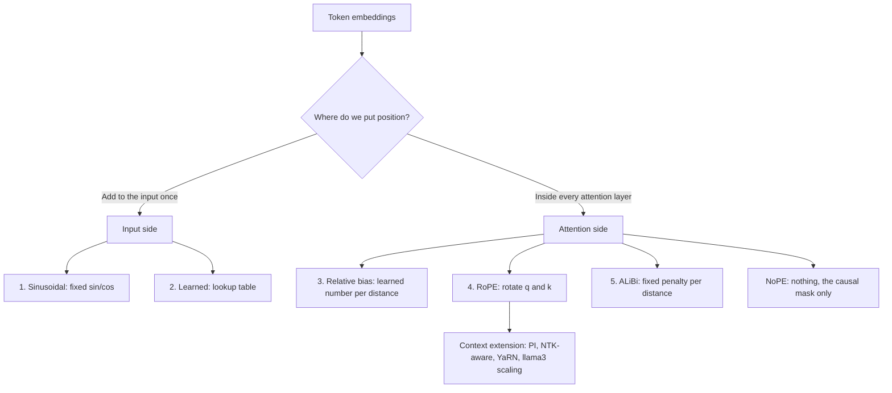

<div class="callout">
<p><strong>How to use this post</strong></p>
<ul>
<li>This is a <strong>side-by-side comparison and decision guide</strong>. One sentence, five ways to give the model its word order. Each way gets the same short card: where the position goes, what is learned, what it is good at, where it breaks, and who uses it today.</li>
<li>Each card has a tiny runnable check in NumPy or PyTorch. Every printed output here is copied from a real run (PyTorch 2.15 on CPU). One script holds all of it, so the blocks run top to bottom.</li>
<li>The "who uses it" rows come from the models' own <code>config.json</code> files on Hugging Face and from the Hugging Face Transformers source, checked in <strong>November 2026</strong>. Facts about each method come from the original papers. Links are in the Sources section.</li>
<li>This post is the deep dive on position. For the attention step itself, read <a href="{{ '/posts/self-attention-from-scratch/' | relative_url }}">Self-Attention by Hand, Then in Code</a>. For where position sits in a full tiny model, read <a href="{{ '/posts/build-gpt-from-scratch-character-level/' | relative_url }}">How a Tiny GPT Learns</a>. For a two-minute RoPE summary, see the <a href="{{ '/posts/14-ai-papers-lunch-box-map/' | relative_url }}">14 AI papers lunch-box map</a>.</li>
</ul>
</div>

---

## The short answer first

Self-attention compares every token with every other token. It does not care where a token sits. Swap two words and the comparisons are the same, just in a different row order. So a Transformer needs one extra piece: some way to say "this token is at position 5" or "this key is 3 tokens behind this query".

There are five main ways to do it, plus one surprising option of doing nothing:

| Way | Where position goes | Learned? | Absolute or relative | Longer than training? | Used by (checked in configs) |
|---|---|---|---|---|---|
| **1. Sinusoidal** | Added to the input embeddings, once | No, fixed formula | Absolute (but offsets are a simple linear map) | Formula works for any position; quality beyond training length is not guaranteed | Original Transformer (2017) |
| **2. Learned absolute** | Added to the input embeddings, once | Yes, one vector per position | Absolute | No, the table has a fixed size | GPT-2 (1,024), BERT (512) |
| **3. Relative bias** | Added to the attention scores, by distance | Yes, per distance or per bucket | Relative | Somewhat; far distances share one bucket | T5 (32 buckets, up to distance 128) |
| **4. RoPE** | Rotates q and k in every attention layer | No, fixed angles | Relative, inside the q.k score | Not by default; needs scaling tricks | Llama 3.x, Qwen, Mistral, DeepSeek-V3, Gemma 3, gpt-oss |
| **5. ALiBi** | Subtracts a penalty from the scores, by distance | No, fixed slopes | Relative | Yes, this is its main design goal | BLOOM, MPT |
| **NoPE** | Nowhere; only the causal mask | Nothing to learn | Implicit | Mixed results | Some layers of Llama 4 (iRoPE) |

If you remember one thing: **today's open LLMs almost all use RoPE**, and most of the long-context work you hear about is about stretching RoPE beyond the length it was trained on.



---

## The problem in one run

Take two sentences with the same three words: **user pays vendor** and **vendor pays user**. The money goes in opposite directions. The middle word `pays` is at position 1 in both, so we can compare its attention output directly.

```python
import math
import numpy as np
import torch
import torch.nn as nn

np.set_printoptions(precision=4, suppress=True)
torch.set_printoptions(precision=4, sci_mode=False)

def section(t): print(f"\n=== {t} ===")

torch.manual_seed(0)
d = 8
emb = {w: torch.randn(d) for w in ["user", "pays", "vendor"]}
W_q, W_k, W_v = (torch.randn(d, d) / math.sqrt(d) for _ in range(3))   # usual init scale

def attend(x, causal=False):
    q, k, v = x @ W_q, x @ W_k, x @ W_v
    s = q @ k.T / math.sqrt(d)
    if causal:
        n = s.size(0)
        s = s.masked_fill(~torch.ones(n, n, dtype=torch.bool).tril(), float("-inf"))
    return s.softmax(-1) @ v

a = torch.stack([emb[w] for w in ["user", "pays", "vendor"]])   # user pays vendor
b = torch.stack([emb[w] for w in ["vendor", "pays", "user"]])   # vendor pays user
pa, pb = attend(a)[1], attend(b)[1]                             # output for "pays"
print("'pays' in A:", pa[:4])
print("'pays' in B:", pb[:4])
print("same output for 'pays' (no positions):", torch.allclose(pa, pb, atol=1e-6))
ca, cb = attend(a, causal=True)[1], attend(b, causal=True)[1]
print("same output for 'pays' (causal mask, no positions):", torch.allclose(ca, cb, atol=1e-6))
```

```text
'pays' in A: tensor([ 0.1722, -0.2101, -0.7109, -0.1991])
'pays' in B: tensor([ 0.1722, -0.2101, -0.7109, -0.1991])
same output for 'pays' (no positions): True
same output for 'pays' (causal mask, no positions): False
```

How to read this:

- **No positions:** the output for `pays` is exactly the same in both sentences. The model literally cannot tell who paid whom. The set of tokens is the same, and attention only sees the set.
- **With a causal mask:** the outputs differ. In sentence A, `pays` can only see `user` and itself. In sentence B it sees `vendor` and itself. The mask leaks some order information on its own. Keep this in mind for the NoPE section.


The self-attention post shows the same thing with a shuffled sequence. Here the question is: what is the best way to fix it?

---

## Way 1: Sinusoidal encoding (the original Transformer)

**Idea in one line:** give each position a fixed pattern of sine and cosine values, and add it to the token embedding before the first layer.

The Transformer paper (section 3.5) uses:

$$
PE_{(pos,\,2i)} = \sin\!\left(\frac{pos}{10000^{2i/d_{model}}}\right), \qquad
PE_{(pos,\,2i+1)} = \cos\!\left(\frac{pos}{10000^{2i/d_{model}}}\right)
$$

Every pair of dimensions is one wave. The first pair turns fast (one full cycle about every 6 positions). Each next pair turns slower. The paper says the wavelengths form a geometric progression from 2π to 10000 · 2π. Fast waves tell nearby positions apart. Slow waves tell far positions apart. Together, every position gets its own pattern.


The paper picked sin/cos for a specific reason: "for any fixed offset k, PE(pos+k) can be represented as a linear function of PE(pos)". That linear function is just a small rotation for each (sin, cos) pair, and it is the same for every position. Let me check that, plus two more things:

```python
def sinusoidal(n_pos, d_model, base=10000.0):
    pos = np.arange(n_pos)[:, None]
    i = np.arange(0, d_model, 2)[None, :]
    angle = pos / base ** (i / d_model)
    pe = np.zeros((n_pos, d_model))
    pe[:, 0::2] = np.sin(angle)
    pe[:, 1::2] = np.cos(angle)
    return pe

PE = sinusoidal(64, 8)
print("PE for positions 0..3 (d_model = 8):\n", PE[:4])

pa2 = attend(a + torch.tensor(PE[:3], dtype=torch.float32))[1]
pb2 = attend(b + torch.tensor(PE[:3], dtype=torch.float32))[1]
print("'pays' in A + PE:", pa2[:4])
print("'pays' in B + PE:", pb2[:4])
print("same output for 'pays' after adding PE:", torch.allclose(pa2, pb2, atol=1e-6))

# PE[pos + k] is a fixed linear map of PE[pos]: a 2x2 rotation per (sin, cos) pair
k = 3
freqs = 1.0 / 10000 ** (np.arange(0, 8, 2) / 8)
M = np.zeros((8, 8))
for j, w in enumerate(freqs):
    c, s = np.cos(k * w), np.sin(k * w)
    M[2*j:2*j+2, 2*j:2*j+2] = [[c, s], [-s, c]]
err = max(np.abs(PE[p + k] - M @ PE[p]).max() for p in range(60))
print(f"max |PE[p+3] - M @ PE[p]| over p = 0..59: {err:.1e}")
for p in [0, 10, 40]:
    print(f"PE[{p}] . PE[{p + k}] = {PE[p] @ PE[p + k]:.4f}")
```

```text
PE for positions 0..3 (d_model = 8):
 [[ 0.      1.      0.      1.      0.      1.      0.      1.    ]
 [ 0.8415  0.5403  0.0998  0.995   0.01    1.      0.001   1.    ]
 [ 0.9093 -0.4161  0.1987  0.9801  0.02    0.9998  0.002   1.    ]
 [ 0.1411 -0.99    0.2955  0.9553  0.03    0.9996  0.003   1.    ]]
'pays' in A + PE: tensor([ 0.4461, -0.2256, -1.0118,  0.5991])
'pays' in B + PE: tensor([ 0.3932, -0.2540, -0.8763,  0.6253])
same output for 'pays' after adding PE: False
max |PE[p+3] - M @ PE[p]| over p = 0..59: 6.7e-16
PE[0] . PE[3] = 1.9649
PE[10] . PE[13] = 1.9649
PE[40] . PE[43] = 1.9649
```

What the output shows:

- Position 0 is `[0, 1, 0, 1, ...]` because sin(0) = 0 and cos(0) = 1. The slow dimensions on the right barely move between positions 0 and 3.
- After adding PE, `pays` gets a **different** output in the two sentences. The order problem is fixed.
- One fixed matrix `M` moves **any** position forward by 3. The error is at floating-point noise level (about 10^-16).
- The dot product of two position vectors depends only on how far apart they are: 1.9649 for offset 3, whether we start at 0, 10 or 40.

**Card**

| | |
|---|---|
| Good at | No parameters. Works for any position number. Easy to reason about. |
| Weak at | The position is mixed into the token vector at the input only. Deeper layers have to keep carrying it. The paper chose it because it "may" extrapolate to longer sequences, but that is a hope, not a guarantee. |
| What the paper measured | Learned position embeddings gave "nearly identical results" to sinusoidal (Table 3, row E). |
| Who uses it now | Mostly teaching code and older encoder-decoder models. Current open LLMs have moved on. |

---

## Way 2: Learned absolute embeddings (GPT-2, BERT)

**Idea in one line:** keep a table with one trainable vector per position, and add row `pos` to the token embedding.

This is the simplest option. GPT-2 calls the table `wpe` and has 1,024 rows (`n_positions = 1024` in its config). BERT has 512 rows (`max_position_embeddings = 512`, `position_embedding_type = "absolute"`). The tiny GPT in [How a Tiny GPT Learns]({{ '/posts/build-gpt-from-scratch-character-level/' | relative_url }}) uses the same idea with `block_size` rows.

The weak point is easy to show:

```python
wpe = nn.Embedding(1024, 8)          # GPT-2 style table, 1024 rows
print("position 1023 ok, shape:", tuple(wpe(torch.tensor([1023])).shape))
try:
    wpe(torch.tensor([1024]))
except IndexError as e:
    print("position 1024 ->", type(e).__name__ + ":", e)
```

```text
position 1023 ok, shape: (1, 8)
position 1024 -> IndexError: index out of range in self
```

There is simply no row for position 1024. You cannot "just run it longer". You would have to add rows and train them.

**Card**

| | |
|---|---|
| Good at | Simple, and the model can learn whatever position pattern helps. |
| Weak at | Hard limit at the table size. Positions near the end of the table get fewer training updates if most training texts are short. Each position is learned on its own, so "3 apart" is not shared knowledge between positions 10 and 500. |
| Who uses it | GPT-2, BERT, and many models from that era. |

---

## Way 3: Relative position bias (Shaw et al., T5)

**Idea in one line:** do not label tokens with positions at all. Instead, when query `i` looks at key `j`, add something to the score that depends on the distance `j - i`.

This moves position from the input into the attention step, in every layer. Two well-known versions:

- **Shaw, Uszkoreit and Vaswani (2018)** learned a vector for each relative distance and added it into the attention computation. Distances are clipped: anything beyond `k` is treated as `k`. They wrote that they "hypothesized that precise relative position information is not useful beyond a certain distance". They used `k = 16` and `k = 8` in their translation runs.
- **T5 (Raffel et al., 2020)** simplified it to **one learned number per distance bucket, per head**, added straight to the attention score. Buckets are exact for small distances and grow logarithmically for larger ones, up to 128. All distances past 128 share the last bucket. The bias table is shared across layers.

Here is the real bucket function (the same logic as Hugging Face's `T5Attention._relative_position_bucket`), with T5's defaults:

```python
def t5_bucket(rel, bidirectional=True, num_buckets=32, max_distance=128):
    # same logic as T5Attention._relative_position_bucket in Hugging Face transformers
    buckets = 0
    if bidirectional:
        num_buckets //= 2
        buckets += (rel > 0).long() * num_buckets
        rel = rel.abs()
    else:
        rel = -torch.min(rel, torch.zeros_like(rel))
    max_exact = num_buckets // 2
    is_small = rel < max_exact
    large = max_exact + (torch.log(rel.float() / max_exact) / math.log(max_distance / max_exact)
                         * (num_buckets - max_exact)).long()
    large = torch.min(large, torch.full_like(large, num_buckets - 1))
    return buckets + torch.where(is_small, rel, large)

rel = torch.tensor([-500, -128, -64, -20, -8, -3, -1, 0, 1, 3, 8, 20, 64, 128, 500])
print("key minus query:", rel.tolist())
print("bucket:         ", t5_bucket(rel).tolist())
```

```text
key minus query: [-500, -128, -64, -20, -8, -3, -1, 0, 1, 3, 8, 20, 64, 128, 500]
bucket:          [15, 15, 14, 10, 8, 3, 1, 0, 17, 19, 24, 26, 30, 31, 31]
```

How to read it:

- In the bidirectional (encoder) version, buckets 0 to 15 are for keys **before** the query (or the same token), and 16 to 31 are for keys **after** it.
- Distances 0 to 7 each get their own bucket. After that, buckets get wider: 8 and 20 tokens back land in buckets 8 and 10.
- Everything 128 or more tokens back lands in bucket 15. 128 and 500 look the same to one layer. The T5 paper notes that later layers can still build sensitivity to longer distances by combining local information.

**Card**

| | |
|---|---|
| Good at | Directly models "how far apart", which is what language usually cares about. Same distance, same bias, at any position. |
| Weak at | Needs an extra `(n x n)` bias added in every layer, which is awkward for some fast attention kernels. Far distances are blurred into one bucket. |
| Who uses it | T5 and its family (the config shows `relative_attention_num_buckets = 32`; Transformers defaults `relative_attention_max_distance` to 128). |

---

## Way 4: RoPE, rotary position embedding (Llama and most current LLMs)

**Idea in one line:** before computing `q . k`, rotate the query by an angle that depends on its position, and rotate the key by an angle that depends on its position. The score then depends only on the **difference** of the two positions.

RoPE comes from the RoFormer paper (Su et al., 2021). It splits each query and key vector into pairs of numbers. Each pair is treated as a point in 2D and rotated by `pos x θ_i`, with `θ_i = 10000^(-2i/d)`. Same frequency family as the sinusoidal encoding, but used to rotate instead of to add.

Why this works: rotating q by angle `a` and k by angle `b` changes their dot product only by the gap `a - b`. If both move forward by the same amount, the gap stays the same, so the score stays the same.

$$
\langle R_{m}\,q,\; R_{n}\,k \rangle = \langle q,\; R_{n-m}\,k \rangle
$$


Let me check it with real numbers:

```python
def rope(x, pos, base=10000.0):
    # rotate each (even, odd) pair of x by pos * theta_i, as in the RoFormer paper
    dim = x.shape[-1]
    theta = 1.0 / base ** (np.arange(0, dim, 2) / dim)
    ang = pos * theta
    c, s = np.cos(ang), np.sin(ang)
    out = np.empty_like(x)
    out[0::2] = x[0::2] * c - x[1::2] * s
    out[1::2] = x[0::2] * s + x[1::2] * c
    return out

rng = np.random.default_rng(1)
q, kk = rng.standard_normal(8), rng.standard_normal(8)
for m, n in [(2, 0), (12, 10), (102, 100), (1002, 1000), (5, 0)]:
    print(f"query at {m:>4}, key at {n:>4}, distance {m - n}: score = {rope(q, m) @ rope(kk, n):.4f}")
print(f"length before {np.linalg.norm(q):.4f}, after rotating to position 500: {np.linalg.norm(rope(q, 500)):.4f}")
```

```text
query at    2, key at    0, distance 2: score = -1.1076
query at   12, key at   10, distance 2: score = -1.1076
query at  102, key at  100, distance 2: score = -1.1076
query at 1002, key at 1000, distance 2: score = -1.1076
query at    5, key at    0, distance 5: score = -0.3414
length before 2.0608, after rotating to position 500: 2.0608
```

What this shows:

- Distance 2 gives the score **-1.1076** whether the pair is at positions (2, 0) or (1002, 1000). Absolute position is gone. Only the distance matters.
- A different distance (5) gives a different score.
- Rotation does not change the vector's length (2.0608 before and after). RoPE moves direction, not size.

Where RoPE sits in a model:

- It is applied to **q and k only**, not to v. Position should affect *who* you look at, not *what* you copy.
- It is applied in **every attention layer**, not once at the input.
- Nothing is added to the token embeddings.
- The RoFormer paper also shows a "long-term decay" property: with this choice of θ, the score tends to shrink as the distance grows.

**Card**

| | |
|---|---|
| Good at | Relative position with no extra parameters and no extra `(n x n)` bias, so it fits fast attention kernels and KV caches well. |
| Weak at | Positions beyond the training length produce rotation angles the model never saw. It needs a scaling method to go further (next section). |
| Who uses it (from `config.json`) | Llama 3.1 8B (`rope_theta = 500000`), Qwen2.5 and Qwen3 (`rope_theta = 1000000`), Mistral 7B v0.1 (`rope_theta = 10000`), DeepSeek-V3 (RoPE on a 64-dim part of each head, `qk_rope_head_dim = 64`), Gemma 3 (`rope_theta = 1000000` for global layers, 10000 for local ones), gpt-oss (`rope_theta = 150000`). |

`rope_theta` is the base of the frequencies (10000 in the paper). A bigger base makes the slowest pairs turn even slower, so they can tell apart positions that are much further away.

---

## Way 5: ALiBi, attention with linear biases (BLOOM, MPT)

**Idea in one line:** add no position vectors at all. Just subtract `slope x distance` from each attention score, with a different fixed slope per head.

From the ALiBi paper (Press, Smith and Lewis, ICLR 2022), "Train Short, Test Long". The score for query `i` becomes:

$$
\mathrm{softmax}\big(q_i K^\top + m \cdot [-(i-1), \dots, -2, -1, 0]\big)
$$

The slope `m` is fixed before training, not learned. For `n` heads, the slopes are a geometric sequence that starts at `2^(-8/n)` and uses that same value as the ratio. For 8 heads that gives 1/2, 1/4, ... 1/256.

```python
n_heads = 8
slopes = [2 ** (-8 * (h + 1) / n_heads) for h in range(n_heads)]
print("slopes:", [f"1/{round(1 / s)}" for s in slopes])
n = 5
dist = np.arange(n)[None, :] - np.arange(n)[:, None]     # key index minus query index
bias = slopes[0] * np.where(dist <= 0, dist, np.nan)      # future cells are masked anyway
print("head 1 bias (rows = query, cols = key, nan = masked future):\n", bias)
print("penalty for a key 100 tokens back, head 1 vs head 8:", -100 * slopes[0], -100 * slopes[-1])
```

```text
slopes: ['1/2', '1/4', '1/8', '1/16', '1/32', '1/64', '1/128', '1/256']
head 1 bias (rows = query, cols = key, nan = masked future):
 [[ 0.   nan  nan  nan  nan]
 [-0.5  0.   nan  nan  nan]
 [-1.  -0.5  0.   nan  nan]
 [-1.5 -1.  -0.5  0.   nan]
 [-2.  -1.5 -1.  -0.5  0. ]]
penalty for a key 100 tokens back, head 1 vs head 8: -50.0 -0.390625
```

What this shows:

- A key 1 token back loses 0.5 from its score in head 1, 2 tokens back loses 1.0, and so on. The penalty grows in a straight line.
- Head 1 (slope 1/2) takes 50 points off a key 100 tokens away, so it practically only looks nearby. Head 8 (slope 1/256) takes off only 0.39, so it can still look far back.


**Card**

| | |
|---|---|
| Good at | Running on longer inputs than it was trained on. The paper reports a 1.3B model trained on 1,024 tokens that reached the same perplexity on 2,048 tokens as a sinusoidal model trained on 2,048, while training 11% faster and using 11% less memory. |
| Weak at | Strong built-in preference for recent tokens. Like the T5 bias, it adds an `(n x n)` term to the scores. |
| Who uses it | BLOOM (its model card lists ALiBi) and MPT (the Transformers docs say it replaces position embeddings with ALiBi). Most newer open models chose RoPE instead. |

---

## Bonus: NoPE, no position encoding at all

This sounds wrong after the first demo, but it is a real research result. Look again at the causal-mask line in the first run: `pays` already got a different output in the two sentences, with no position encoding at all.

- **Haviv et al. (2022)** showed that causal language models trained with **no** position encoding are still competitive. The causal mask lets each token work out how many tokens come before it, which approximates its absolute position. The same paper found that bidirectional (BERT style) models fail to converge without position information, because there is no mask to leak order.
- **Kazemnejad et al. (NeurIPS 2023)** compared APE, T5 relative bias, ALiBi, RoPE and NoPE on reasoning and math tasks with small decoder-only models. NoPE generalized to longer inputs better than the others in their setup.
- **Llama 4** puts this into a production model. Meta describes "interleaved attention layers without positional embeddings" and calls the design iRoPE. In the Llama 4 Scout config, `no_rope_layers` marks 12 of the 48 layers as running without RoPE (every fourth layer), and `attn_temperature_tuning` is on. The Transformers code applies extra attention temperature scaling only on those no-RoPE layers.

My reading: NoPE alone is not the default for a big model today, but mixing NoPE layers with RoPE layers is now a real, shipped design.

---

## Stretching RoPE past the training length

Most "this model supports 128K context" stories are about RoPE scaling. The problem is simple: if a model only trained up to position 2,047, then position 8,191 gives rotation angles it has never seen.

```python
dim, base, L_train = 128, 10000.0, 2048
theta = 1.0 / base ** (np.arange(0, dim, 2) / dim)
slow = theta[-1]                                          # slowest rotating pair
print(f"slowest pair: angle at pos 2047 = {2047 * slow:.4f} rad, at pos 8191 = {8191 * slow:.4f} rad")
print(f"with Position Interpolation (scale 4): pos 8191 -> {8191 / 4:.2f}, angle = {8191 / 4 * slow:.4f} rad")

# Llama 3.1 'llama3' rope_type, same steps as transformers' _compute_llama3_parameters
head_dim, base = 128, 500000.0
factor, low_ff, high_ff, old_ctx = 8.0, 1.0, 4.0, 8192
inv = 1.0 / base ** (np.arange(0, head_dim, 2) / head_dim)
wavelen = 2 * math.pi / inv
low_wl, high_wl = old_ctx / low_ff, old_ctx / high_ff
kept = wavelen < high_wl
divided = wavelen > low_wl
smoothed = ~kept & ~divided
print(f"llama3 scaling on 64 frequency pairs: kept {kept.sum()}, divided by 8: {divided.sum()}, blended: {smoothed.sum()}")
print(f"wavelength range: {wavelen.min():.1f} to {wavelen.max():.0f} tokens; cut-offs {high_wl:.0f} and {low_wl:.0f}")
```

```text
slowest pair: angle at pos 2047 = 0.2364 rad, at pos 8191 = 0.9459 rad
with Position Interpolation (scale 4): pos 8191 -> 2047.75, angle = 0.2365 rad
llama3 scaling on 64 frequency pairs: kept 29, divided by 8: 29, blended: 6
wavelength range: 6.3 to 2559196 tokens; cut-offs 2048 and 8192
```

How to read this:

- The slowest pair never went past **0.2364** radians in training. At position 8,191 it would be at **0.9459**, four times further than anything the model saw.
- **Position Interpolation (PI, Chen et al., 2023)** divides every position by the stretch factor. Position 8,191 becomes 2,047.75, and the angle is back inside the trained range. The paper extended LLaMA models to 32,768 tokens "within 1000 steps" of fine-tuning. The cost: neighbouring tokens are now only 0.25 apart, so the fast pairs (which were already fine) get squeezed too.
- **"NTK-aware" scaling** changes the base (`rope_theta`) instead of the positions, so fast pairs barely change and slow pairs stretch more.
- **YaRN (Peng et al., 2023)** combines the "NTK-by-parts" idea (leave fast pairs alone, interpolate slow pairs, blend the ones in between) with a small attention temperature, `sqrt(1/t) = 0.1 ln(s) + 1`. The paper reports needing 10x fewer tokens and 2.5x fewer training steps than earlier methods.
- **Llama 3.1's `llama3` scaling** follows the same by-parts idea. With the real config values (head_dim 128, `rope_theta = 500000`, factor 8, original length 8,192), 29 of the 64 frequency pairs are left as they are, 29 are divided by 8, and 6 are blended. That is how its config reaches `max_position_embeddings = 131072`.


What the configs say today (from each model's `config.json` on Hugging Face):

| Model | Position method | Scaling in config | Context in config |
|---|---|---|---|
| Llama 3.1 8B | RoPE, `rope_theta = 500000` | `rope_type: llama3`, factor 8, original 8,192 | 131,072 |
| Llama 4 Scout | RoPE on 36 of 48 layers, NoPE on 12 | `rope_type: llama3`, original 8,192 | 10,485,760 |
| Qwen2.5 7B Instruct | RoPE, `rope_theta = 1000000` | None in the shipped config | 32,768 |
| DeepSeek-V3 | RoPE on 64 dims per head | `type: yarn`, factor 40, original 4,096 | 163,840 |
| gpt-oss-20b | RoPE, `rope_theta = 150000` | `rope_type: yarn`, factor 32, original 4,096 | 131,072 |
| Gemma 3 4B | RoPE, global `rope_theta = 1000000`, local 10000 | `rope_type: linear`, factor 8 | 131,072 |
| Phi-3 mini 128K | RoPE | `type: longrope` (per-dimension factors), original 4,096 | 131,072 |
| BLOOM 560M | ALiBi | Not needed | Not a fixed table |
| GPT-2 | Learned absolute | Not possible without retraining | 1,024 |

A config number is what the model is set up for. It is not proof that quality holds all the way to that length. Always test long-context quality on your own task.

---

## Which one should you pick?

Most of us will not design a position scheme. We pick a model, or we write a small Transformer for learning or for a niche task. Here is how I would think about it:

| Your situation | Pick | Why |
|---|---|---|
| Fine-tuning or serving an existing LLM | Whatever it was trained with (almost always RoPE) | Changing the scheme means retraining. Only change the RoPE **scaling** settings, and only with a long-context fine-tune or a method the model card supports. |
| Writing a small GPT to learn | Learned absolute first, then RoPE | Learned is one line of code. RoPE is the one you will meet in real models. |
| Training a new decoder from scratch | RoPE | It is the industry default, it works with fast attention kernels, and context extension methods are well studied. |
| Must handle much longer inputs than training, no fine-tune budget | ALiBi, or RoPE with YaRN | ALiBi was designed for "train short, test long". YaRN is the RoPE route. |
| Encoder for short inputs (classification, retrieval) | Learned absolute or relative bias | Inputs are short, so the hard limit does not hurt. |
| Research on length generalization | Try NoPE or mixed NoPE/RoPE layers | The evidence is promising but depends a lot on the task. |

---

## Mistakes I would watch for

| Mistake | What happens | Fix |
|---|---|---|
| Adding RoPE to the input embeddings | It is not an additive encoding. You get noise. | Apply it to q and k inside each attention layer. |
| Applying RoPE to v as well | Values get rotated, outputs get scrambled. | q and k only. |
| Mixing RoPE pair layouts | The paper pairs neighbouring dimensions (0,1), (2,3). Hugging Face Llama code pairs dimension i with i + d/2 (`rotate_half`). Both are fine on their own. Mixing them breaks pretrained weights. | Use the layout the checkpoint was trained with. |
| Wrong position ids with a KV cache | New tokens restart at position 0, attention looks at the wrong distances. | Position of a new token = number of tokens already in the cache. |
| Running past a learned table | IndexError, or silent clamping in some code. | Check `max_position_embeddings` before you send long inputs. |
| Raising `max_position_embeddings` in a config and calling it done | The model accepts long input but quality drops. | Use a supported scaling method plus a long-context fine-tune, and test on your task. |
| Changing `rope_theta` on a trained model | Every angle changes; the model sees "new" positions everywhere. | Only change it together with fine-tuning. |

---

## Glossary

| Term | Plain meaning |
|---|---|
| Absolute position | "This token is at position 5" |
| Relative position | "This key is 3 tokens before this query" |
| Sinusoidal encoding | Fixed sin/cos pattern added to each token vector |
| Learned position embedding | A trainable vector per position, from a fixed-size table |
| Relative bias | A number added to the attention score based on distance |
| RoPE | Rotating q and k by position, so their score depends on distance |
| `rope_theta` | The base of RoPE's frequencies. Bigger means slower rotation. |
| ALiBi | A fixed penalty on the score, growing linearly with distance |
| NoPE | No position encoding; only the causal mask gives order |
| Position Interpolation | Divide positions so a longer input fits the trained range |
| YaRN | A RoPE scaling method that treats fast and slow frequencies differently |

---

## Sources

Papers:

- <a href="https://arxiv.org/abs/1706.03762" target="_blank" rel="noopener">Vaswani et al.: Attention Is All You Need (2017)</a>. Section 3.5 for sinusoidal encoding, Table 3 row (E) for learned vs sinusoidal.
- <a href="https://arxiv.org/abs/1803.02155" target="_blank" rel="noopener">Shaw, Uszkoreit and Vaswani: Self-Attention with Relative Position Representations (NAACL 2018)</a>
- <a href="https://arxiv.org/abs/1910.10683" target="_blank" rel="noopener">Raffel et al.: Exploring the Limits of Transfer Learning with a Unified Text-to-Text Transformer (T5, JMLR 2020)</a>. Section 2.1 for the bucketed relative bias.
- <a href="https://arxiv.org/abs/2104.09864" target="_blank" rel="noopener">Su et al.: RoFormer, Enhanced Transformer with Rotary Position Embedding (2021)</a>
- <a href="https://arxiv.org/abs/2108.12409" target="_blank" rel="noopener">Press, Smith and Lewis: Train Short, Test Long, Attention with Linear Biases (ALiBi, ICLR 2022)</a>
- <a href="https://arxiv.org/abs/2203.16634" target="_blank" rel="noopener">Haviv et al.: Transformer Language Models without Positional Encodings Still Learn Positional Information (2022)</a>
- <a href="https://arxiv.org/abs/2305.19466" target="_blank" rel="noopener">Kazemnejad et al.: The Impact of Positional Encoding on Length Generalization in Transformers (NeurIPS 2023)</a>
- <a href="https://arxiv.org/abs/2306.15595" target="_blank" rel="noopener">Chen et al.: Extending Context Window of Large Language Models via Position Interpolation (2023)</a>
- <a href="https://arxiv.org/abs/2309.00071" target="_blank" rel="noopener">Peng et al.: YaRN, Efficient Context Window Extension of Large Language Models (2023)</a>

Model configs and code (checked November 2026):

- <a href="https://huggingface.co/openai-community/gpt2/blob/main/config.json" target="_blank" rel="noopener">GPT-2 config</a>, <a href="https://huggingface.co/google-bert/bert-base-uncased/blob/main/config.json" target="_blank" rel="noopener">BERT base config</a>, <a href="https://huggingface.co/google-t5/t5-base/blob/main/config.json" target="_blank" rel="noopener">T5 base config</a>, <a href="https://huggingface.co/bigscience/bloom-560m" target="_blank" rel="noopener">BLOOM 560M model card</a>, <a href="https://huggingface.co/docs/transformers/model_doc/mpt" target="_blank" rel="noopener">Transformers docs: MPT (ALiBi instead of position embeddings)</a>
- <a href="https://huggingface.co/unsloth/Meta-Llama-3.1-8B/blob/main/config.json" target="_blank" rel="noopener">Llama 3.1 8B config (public mirror of Meta's gated repo)</a>, <a href="https://huggingface.co/unsloth/Llama-4-Scout-17B-16E-Instruct/blob/main/config.json" target="_blank" rel="noopener">Llama 4 Scout config (public mirror)</a>
- <a href="https://huggingface.co/Qwen/Qwen2.5-7B-Instruct/blob/main/config.json" target="_blank" rel="noopener">Qwen2.5 7B Instruct config</a>, <a href="https://huggingface.co/Qwen/Qwen3-8B/blob/main/config.json" target="_blank" rel="noopener">Qwen3 8B config</a>, <a href="https://huggingface.co/mistralai/Mistral-7B-v0.1/blob/main/config.json" target="_blank" rel="noopener">Mistral 7B v0.1 config</a>
- <a href="https://huggingface.co/deepseek-ai/DeepSeek-V3/blob/main/config.json" target="_blank" rel="noopener">DeepSeek-V3 config</a>, <a href="https://huggingface.co/openai/gpt-oss-20b/blob/main/config.json" target="_blank" rel="noopener">gpt-oss-20b config</a>, <a href="https://huggingface.co/unsloth/gemma-3-4b-it/blob/main/config.json" target="_blank" rel="noopener">Gemma 3 4B config (public mirror)</a>, <a href="https://huggingface.co/microsoft/Phi-3-mini-128k-instruct/blob/main/config.json" target="_blank" rel="noopener">Phi-3 mini 128K config</a>
- <a href="https://ai.meta.com/blog/llama-4-multimodal-intelligence/" target="_blank" rel="noopener">Meta: The Llama 4 herd (April 2025), for iRoPE</a>
- <a href="https://github.com/huggingface/transformers/blob/main/src/transformers/modeling_rope_utils.py" target="_blank" rel="noopener">Hugging Face Transformers: modeling_rope_utils.py (llama3, yarn, linear, longrope scaling)</a>, <a href="https://github.com/huggingface/transformers/blob/main/src/transformers/models/t5/modeling_t5.py" target="_blank" rel="noopener">modeling_t5.py (relative position buckets)</a>, <a href="https://github.com/huggingface/transformers/blob/main/src/transformers/models/llama4/modeling_llama4.py" target="_blank" rel="noopener">modeling_llama4.py (no_rope_layers)</a>

Related Intelliwise posts: [Self-Attention by Hand, Then in Code]({{ '/posts/self-attention-from-scratch/' | relative_url }}), [How a Tiny GPT Learns]({{ '/posts/build-gpt-from-scratch-character-level/' | relative_url }}), [From a Sentence to ChatGPT]({{ '/posts/sentence-to-chatgpt-build-along/' | relative_url }}), [KV cache sticky notes]({{ '/posts/kv-cache-sticky-notes/' | relative_url }}) and the [14 AI papers lunch-box map]({{ '/posts/14-ai-papers-lunch-box-map/' | relative_url }}).

---

## In short

- Attention by itself sees a set of tokens, not a sequence. Something has to add order.
- Sinusoidal and learned embeddings add an absolute position to the input once. Learned tables have a hard length limit.
- Relative bias (T5), RoPE and ALiBi put distance into the attention score in every layer.
- RoPE rotates q and k so the score depends only on the distance. It is the default in today's open LLMs.
- ALiBi subtracts a fixed, per-head linear penalty and was built to run longer than its training length.
- NoPE works better than you would expect in causal models, and Llama 4 mixes NoPE layers with RoPE layers.
- Long context in RoPE models comes from scaling: Position Interpolation, NTK-aware, YaRN or Llama 3.1's by-parts scaling, plus fine-tuning and testing on your own task.
