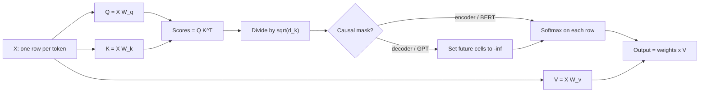

<div class="callout">
<p><strong>How to use this post</strong></p>
<ul>
<li>This is a <strong>work it out by hand, then code it</strong> post. First we compute self-attention on paper with very small numbers. Then we write code and check that the code prints the same numbers.</li>
<li>The example is tiny on purpose: 3 tokens, each with 4 numbers. All weights are small integers, so you can follow every multiplication with a pen.</li>
<li>Every printed output in this post is copied from a real run on PyTorch 2.15 (CPU) and NumPy. If you run the scripts, you should see the same numbers.</li>
<li>Facts come from the original Transformer paper and the PyTorch docs, checked in <strong>November 2026</strong>. Links are in the Sources section.</li>
<li>If you want the bigger picture first (tokens, embeddings, training), read <a href="{{ '/posts/sentence-to-chatgpt-build-along/' | relative_url }}">From a Sentence to ChatGPT</a>. If you want to see attention inside a full tiny GPT, read <a href="{{ '/posts/build-gpt-from-scratch-character-level/' | relative_url }}">How a Tiny GPT Learns</a>. This post stays on one thing only: the attention step itself.</li>
</ul>
</div>

---

## The short answer first

Self-attention is a way for each token to look at the other tokens in the same sequence and pull in information from them.

For every token, the model makes three vectors:

- **Query (q)**: what this token is looking for.
- **Key (k)**: a label that says what this token offers.
- **Value (v)**: the actual information this token passes on.

Then for each token we compare its query with every key, turn those scores into weights, and take a weighted average of the values. That is all. The whole thing fits in one line:

$$
\mathrm{Attention}(Q, K, V) = \mathrm{softmax}\left(\frac{QK^{\top}}{\sqrt{d_k}}\right)V
$$

It is called **self**-attention because Q, K and V all come from the same sequence. The rest of the post is about what each piece of this formula does, with real numbers.



---

## The setup: three tokens, four numbers each

Our sequence is `fix the bug`. In a real model each token gets a learned embedding with hundreds or thousands of numbers. Here each token gets just 4 numbers, so `d_model = 4`.

| Token | x (embedding) |
|---|---|
| fix | [1, 0, 1, 0] |
| the | [0, 1, 0, 1] |
| bug | [1, 1, 0, 0] |

Stack these rows and you get the input matrix `X` with shape `(3, 4)`.

We also need three weight matrices, each `4 x 4`. In a real model these are learned during training. Here I picked small integers so the hand math stays easy.

| | W_q | W_k | W_v |
|---|---|---|---|
| row 1 | [0, 0, 1, 0] | [1, 0, 0, 0] | [0, 1, 0, 0] |
| row 2 | [1, 0, 1, 0] | [1, 0, 0, 0] | [1, 0, 0, 0] |
| row 3 | [0, 1, 1, 0] | [0, 1, 1, 0] | [0, 0, 0, 1] |
| row 4 | [1, 0, 0, 0] | [0, 1, 0, 0] | [0, 0, 2, 0] |

Because each output column of `W_k` and `W_q` is also 4 wide, `d_k = 4` in this example. Keep that in mind. It matters when we scale.

---

## Step 1: project X into Q, K and V

Each token row is multiplied by each weight matrix. Row times matrix means: take a weighted sum of the matrix rows, using the token's numbers as the weights.

Take `fix = [1, 0, 1, 0]`. It has a 1 in position 1 and position 3. So:

- `q_fix` = row 1 of W_q + row 3 of W_q = [0, 0, 1, 0] + [0, 1, 1, 0] = **[0, 1, 2, 0]**
- `k_fix` = row 1 of W_k + row 3 of W_k = [1, 0, 0, 0] + [0, 1, 1, 0] = **[1, 1, 1, 0]**
- `v_fix` = row 1 of W_v + row 3 of W_v = [0, 1, 0, 0] + [0, 0, 0, 1] = **[0, 1, 0, 1]**

Do the same for `the` and `bug` and you get:

| Token | q | k | v |
|---|---|---|---|
| fix | [0, 1, 2, 0] | [1, 1, 1, 0] | [0, 1, 0, 1] |
| the | [2, 0, 1, 0] | [1, 1, 0, 0] | [1, 0, 2, 0] |
| bug | [1, 0, 2, 0] | [2, 0, 0, 0] | [1, 1, 0, 0] |


Why three different matrices and not just use `x` directly? Because "what I am looking for" and "what I offer" are different questions. A separate W_q and W_k let the model learn that, for example, a verb should look for its object, even though a verb and a noun do not look similar. W_v lets the model decide what to actually pass along once a match is found.

---

## Step 2: score every query against every key

The score between token i and token j is the dot product of `q_i` and `k_j`. Multiply position by position, then add.

For the `fix` row:

- q_fix . k_fix = 0x1 + 1x1 + 2x1 + 0x0 = **3**
- q_fix . k_the = 0x1 + 1x1 + 2x0 + 0x0 = **1**
- q_fix . k_bug = 0x2 + 1x0 + 2x0 + 0x0 = **0**

Do it for all 9 pairs and you get the score matrix `Q K^T`, with shape `(3, 3)`. Row = the token asking. Column = the token being looked at.

| QK^T | fix | the | bug |
|---|---|---|---|
| **fix** | 3 | 1 | 0 |
| **the** | 3 | 2 | 4 |
| **bug** | 3 | 1 | 2 |

Note that this matrix is not symmetric. `fix` scores `the` as 1, but `the` scores `fix` as 3. Queries and keys come from different matrices, so "how much I want you" and "how much you want me" are different numbers.

---

## Step 3: divide by sqrt(d_k)

Here `d_k = 4`, so we divide every score by `sqrt(4) = 2`.

| Scaled | fix | the | bug |
|---|---|---|---|
| **fix** | 1.5 | 0.5 | 0.0 |
| **the** | 1.5 | 1.0 | 2.0 |
| **bug** | 1.5 | 0.5 | 1.0 |

This one step is easy to skip and easy to get wrong, so let me explain why it is there.

### Why sqrt(d_k) and not something else

The Transformer paper gives the reason in one footnote. Assume the numbers in q and k are independent, with mean 0 and variance 1. Then the dot product `q . k` is a sum of `d_k` such products. It has mean 0 and **variance d_k**. So its typical size (standard deviation) is `sqrt(d_k)`.

That means:

- With `d_k = 4`, scores are usually around plus or minus 2.
- With `d_k = 64` (the per-head size in the original paper), scores are usually around plus or minus 8.
- With `d_k = 512`, scores are usually around plus or minus 22.

Big score gaps push softmax to put almost all the weight on one key. The paper says this pushes softmax "into regions where it has extremely small gradients". In plain words: the model becomes very confident too early and learns very slowly. Dividing by `sqrt(d_k)` brings the variance back to 1, whatever the head size is.

I checked this on the box with random vectors. For each `d_k`, 10,000 random queries, each scored against 8 random keys:

```python
import torch
torch.manual_seed(0)

print(f"{'d_k':>5} {'var(q.k)':>9} {'max weight raw':>15} {'max weight scaled':>18}")
for d_k in [4, 64, 512]:
    q = torch.randn(10_000, d_k)            # 10k queries, entries ~ N(0, 1)
    k = torch.randn(10_000, 8, d_k)         # 8 keys per query
    dots = torch.einsum("nd,nkd->nk", q, k)
    raw = dots.softmax(-1).max(-1).values.mean()
    scaled = (dots / d_k ** 0.5).softmax(-1).max(-1).values.mean()
    print(f"{d_k:>5} {dots.var().item():>9.1f} {raw.item():>15.3f} {scaled.item():>18.3f}")
```

Output:

```text
  d_k  var(q.k)  max weight raw  max weight scaled
    4       4.0           0.529              0.345
   64      63.5           0.874              0.360
  512     511.9           0.956              0.361
```

How to read this:

| What | Result |
|---|---|
| Variance of the raw dot product | Grows with d_k: about 4, 64, 512. Exactly what the footnote says. |
| Average top weight, no scaling | 0.53, then 0.87, then 0.96. Softmax becomes almost one-hot as d_k grows. |
| Average top weight, scaled | Stays near 0.35 for every d_k. Same behaviour at any head size. |


Two more facts from the paper that people often mix up:

- Plain dot-product attention (no scaling) and additive attention work about the same for small `d_k`. For larger `d_k`, additive attention did better than **unscaled** dot-product attention. Scaling is the fix that keeps dot-product attention, which is much faster because it is just matrix multiplication.
- The scale is `1/sqrt(d_k)`, where `d_k` is the size of **one head's** key, not the full model width. In PyTorch, `F.scaled_dot_product_attention` uses `1/sqrt(query.size(-1))` by default, and you can override it with the `scale` argument.

---

## Step 4: softmax on each row

Softmax turns a row of scores into positive weights that add up to 1:

$$
\mathrm{softmax}(s)_j = \frac{e^{s_j}}{\sum_m e^{s_m}}
$$

For the `fix` row, scaled scores are [1.5, 0.5, 0.0]:

| | fix | the | bug | Sum |
|---|---|---|---|---|
| e^s | e^1.5 = 4.4817 | e^0.5 = 1.6487 | e^0 = 1.0000 | 7.1304 |
| weight | 4.4817 / 7.1304 = **0.6285** | 1.6487 / 7.1304 = **0.2312** | 1.0000 / 7.1304 = **0.1402** | 1.0000 |

So `fix` will take about 63% of its new vector from itself, 23% from `the` and 14% from `bug`. The full weight matrix:

| Weights | fix | the | bug |
|---|---|---|---|
| **fix** | 0.6285 | 0.2312 | 0.1402 |
| **the** | 0.3072 | 0.1863 | 0.5065 |
| **bug** | 0.5065 | 0.1863 | 0.3072 |

The softmax runs along each **row** (over keys), never down a column. In code this is `softmax(dim=-1)`. Getting the axis wrong is one of the most common attention bugs, because the shapes still work and nothing crashes.


---

## Step 5: weighted sum of the values

Each token's output is its weights multiplied with the value rows, then added.

For `fix`:

```text
0.6285 x v_fix [0, 1, 0, 1]
0.2312 x v_the [1, 0, 2, 0]
0.1402 x v_bug [1, 1, 0, 0]
-------------------------------------------
  = [0.2312 + 0.1402, 0.6285 + 0.1402, 2 x 0.2312, 0.6285]
  = [0.3714, 0.7687, 0.4624, 0.6285]
```

The code below prints `[0.3715, 0.7688, 0.4624, 0.6285]`. The last digit differs only because I rounded the weights to 4 places before adding. The output has the same shape as the input, `(3, 4)`. One new vector per token, and each one is now mixed with context from the others.

---

## Now code it: NumPy

Here is the full hand calculation as a script. Nothing is hidden. The only extra is `z - z.max()` inside softmax, which does not change the result but avoids overflow when scores are large.

```python
import numpy as np
np.set_printoptions(precision=4, suppress=True)

tokens = ["fix", "the", "bug"]
X = np.array([[1, 0, 1, 0],    # fix
              [0, 1, 0, 1],    # the
              [1, 1, 0, 0]],   # bug
             dtype=np.float64)

W_q = np.array([[0, 0, 1, 0],
                [1, 0, 1, 0],
                [0, 1, 1, 0],
                [1, 0, 0, 0]], dtype=np.float64)
W_k = np.array([[1, 0, 0, 0],
                [1, 0, 0, 0],
                [0, 1, 1, 0],
                [0, 1, 0, 0]], dtype=np.float64)
W_v = np.array([[0, 1, 0, 0],
                [1, 0, 0, 0],
                [0, 0, 0, 1],
                [0, 0, 2, 0]], dtype=np.float64)

def softmax(z, axis=-1):
    z = z - z.max(axis=axis, keepdims=True)   # subtract max for numerical safety
    e = np.exp(z)
    return e / e.sum(axis=axis, keepdims=True)

def attention(X, W_q, W_k, W_v, causal=False):
    Q, K, V = X @ W_q, X @ W_k, X @ W_v
    d_k = K.shape[-1]
    scores = Q @ K.T / np.sqrt(d_k)
    if causal:
        n = scores.shape[0]
        future = np.triu(np.ones((n, n), dtype=bool), k=1)
        scores = np.where(future, -np.inf, scores)
    weights = softmax(scores)
    return weights @ V, weights, scores, Q, K, V

out, w, s, Q, K, V = attention(X, W_q, W_k, W_v)
print("Q =\n", Q); print("K =\n", K); print("V =\n", V)
print("raw Q K^T =\n", Q @ K.T)
print("scores (/sqrt(4)) =\n", s)
print("weights =\n", w)
print("row sums =", w.sum(axis=1))
print("output =\n", out)

out_c, w_c, s_c, *_ = attention(X, W_q, W_k, W_v, causal=True)
print("causal scores =\n", s_c)
print("causal weights =\n", w_c)
print("causal output =\n", out_c)
```

Output (the first part):

```text
Q =
 [[0. 1. 2. 0.]
 [2. 0. 1. 0.]
 [1. 0. 2. 0.]]
K =
 [[1. 1. 1. 0.]
 [1. 1. 0. 0.]
 [2. 0. 0. 0.]]
V =
 [[0. 1. 0. 1.]
 [1. 0. 2. 0.]
 [1. 1. 0. 0.]]
raw Q K^T =
 [[3. 1. 0.]
 [3. 2. 4.]
 [3. 1. 2.]]
scores (/sqrt(4)) =
 [[1.5 0.5 0. ]
 [1.5 1.  2. ]
 [1.5 0.5 1. ]]
weights =
 [[0.6285 0.2312 0.1402]
 [0.3072 0.1863 0.5065]
 [0.5065 0.1863 0.3072]]
row sums = [1. 1. 1.]
output =
 [[0.3715 0.7688 0.4624 0.6285]
 [0.6928 0.8137 0.3726 0.3072]
 [0.4935 0.8137 0.3726 0.5065]]
```

Every number matches the tables above. Q, K, V, the raw scores, the scaled scores, the weights and the output.

---

## The causal mask: do not look at the future

When a model generates text one token at a time (GPT style), token 2 must not use token 3 during training. At generation time token 3 does not exist yet. If training lets it peek, the model learns a shortcut it cannot use later.

The fix is simple. Before softmax, set every score above the diagonal to `-inf`:

| Masked scores | fix | the | bug |
|---|---|---|---|
| **fix** | 1.5 | -inf | -inf |
| **the** | 1.5 | 1.0 | -inf |
| **bug** | 1.5 | 0.5 | 1.0 |

`e^(-inf)` is exactly 0, so those cells get zero weight, and the rest of the row is renormalised to add up to 1:

| Causal weights | fix | the | bug |
|---|---|---|---|
| **fix** | 1.0000 | 0 | 0 |
| **the** | 0.6225 | 0.3775 | 0 |
| **bug** | 0.5065 | 0.1863 | 0.3072 |

Check the `the` row by hand: e^1.5 = 4.4817 and e^1.0 = 2.7183. The sum is 7.2000. So the weights are 0.6225 and 0.3775. The script printed exactly these:

```text
causal weights =
 [[1.     0.     0.    ]
 [0.6225 0.3775 0.    ]
 [0.5065 0.1863 0.3072]]
causal output =
 [[0.     1.     0.     1.    ]
 [0.3775 0.6225 0.7551 0.6225]
 [0.4935 0.8137 0.3726 0.5065]]
```


A few points that save time later:

- **Mask with -inf, not 0.** Setting a score to 0 does not hide that token. `e^0 = 1`, so it still gets a share. Masking happens before softmax, on the scores, using `-inf` (or a very large negative number).
- **The last row does not change.** `bug` is the last token, so nothing is in its future. Its row is the same with or without the mask.
- **The first token only sees itself.** Its output is exactly `v_fix = [0, 1, 0, 1]`.
- **Encoders like BERT do not use a causal mask.** They read the whole sentence at once. They still use a padding mask so real tokens do not attend to padding.

---

## Multi-head attention: several smaller attentions side by side

One attention head gives each token one set of weights. But a token may need to look at different things for different reasons: one for grammar, one for meaning, one for position. Multi-head attention runs several heads in parallel, each with its own smaller Q, K and V.

The paper defines it like this:

$$
\mathrm{head}_i = \mathrm{Attention}(QW_i^Q, KW_i^K, VW_i^V)
$$

$$
\mathrm{MultiHead}(Q, K, V) = \mathrm{Concat}(\mathrm{head}_1, \dots, \mathrm{head}_h)\,W^O
$$

In practice you do not create `h` separate matrices. You do one big projection to `d_model` columns and then cut the columns into `h` slices. With our numbers, `d_model = 4` and `h = 2`, so each head gets 2 columns:

| Head | Q columns | K columns | V columns | d_k for scaling |
|---|---|---|---|---|
| Head 1 | 1 and 2 | 1 and 2 | 1 and 2 | 2, so divide by sqrt(2) |
| Head 2 | 3 and 4 | 3 and 4 | 3 and 4 | 2, so divide by sqrt(2) |

The scale changes. Each head has `d_k = 2` now, so the divisor is `sqrt(2) = 1.4142`, not 2.

Hand check for head 1, row `fix`. q = [0, 1]. Keys are fix [1, 1], the [1, 1], bug [2, 0]. Raw scores are 1, 1, 0. Divided by 1.4142 they are 0.7071, 0.7071, 0. e^0.7071 = 2.0281, so the sum is 5.0562 and the weights are **0.4011, 0.4011, 0.1978**.

| Head 1 weights | fix | the | bug |
|---|---|---|---|
| **fix** | 0.4011 | 0.4011 | 0.1978 |
| **the** | 0.1636 | 0.1636 | 0.6728 |
| **bug** | 0.2483 | 0.2483 | 0.5035 |

| Head 2 weights | fix | the | bug |
|---|---|---|---|
| **fix** | 0.6728 | 0.1636 | 0.1636 |
| **the** | 0.5035 | 0.2483 | 0.2483 |
| **bug** | 0.6728 | 0.1636 | 0.1636 |

Look at head 1. In its 2 columns, `fix` and `the` have the same key [1, 1], so head 1 cannot tell them apart and gives them the same weight. Head 2 sees different columns and does tell them apart. That is the point of multiple heads: each head looks at a different slice of the information.


After the heads finish, their outputs (each 2 wide) are joined side by side to get 4 columns again, then multiplied by `W_o`. In my demo `W_o` is the identity matrix so the numbers are easy to check. In a real model `W_o` is learned, and it is what lets the heads mix their results.

In the original Transformer: `d_model = 512`, `h = 8`, and `d_k = d_v = 512 / 8 = 64`. The paper notes that because each head is smaller, the total cost is about the same as one full-size head.

---

## Check it against PyTorch

Hand math is good for understanding. But I want proof that this is the same thing PyTorch runs. So I compared my code with two PyTorch APIs:

- `torch.nn.functional.scaled_dot_product_attention` (SDPA): the low-level fused function. It takes Q, K and V that you already projected.
- `torch.nn.MultiheadAttention`: the full layer, with the input projections, the head split and the output projection built in.

```python
import math
import torch
import torch.nn as nn
import torch.nn.functional as F

torch.set_printoptions(precision=4, sci_mode=False)

X = torch.tensor([[1., 0., 1., 0.],   # fix
                  [0., 1., 0., 1.],   # the
                  [1., 1., 0., 0.]])  # bug
W_q = torch.tensor([[0., 0., 1., 0.], [1., 0., 1., 0.], [0., 1., 1., 0.], [1., 0., 0., 0.]])
W_k = torch.tensor([[1., 0., 0., 0.], [1., 0., 0., 0.], [0., 1., 1., 0.], [0., 1., 0., 0.]])
W_v = torch.tensor([[0., 1., 0., 0.], [1., 0., 0., 0.], [0., 0., 0., 1.], [0., 0., 2., 0.]])

def self_attention(x, causal=False):
    q, k, v = x @ W_q, x @ W_k, x @ W_v
    scores = q @ k.transpose(-2, -1) / math.sqrt(k.size(-1))
    if causal:
        n = scores.size(-1)
        allowed = torch.ones(n, n, dtype=torch.bool).tril()
        scores = scores.masked_fill(~allowed, float("-inf"))
    weights = scores.softmax(dim=-1)
    return weights @ v, weights

# 1) plain self-attention, same numbers as the hand calculation
out, w = self_attention(X)
print("weights:\n", w)
print("output:\n", out)

# 2) check against PyTorch's fused function
q, k, v = X @ W_q, X @ W_k, X @ W_v
ref = F.scaled_dot_product_attention(q, k, v)
print("matches SDPA:", torch.allclose(out, ref, atol=1e-6))

# 3) causal mask
out_c, w_c = self_attention(X, causal=True)
ref_c = F.scaled_dot_product_attention(q, k, v, is_causal=True)
print("causal weights:\n", w_c)
print("causal matches SDPA(is_causal=True):", torch.allclose(out_c, ref_c, atol=1e-6))

# 4) two heads, each head gets 2 of the 4 columns
def split_heads(t, h):            # (n, d) -> (h, n, d/h)
    n, d = t.shape
    return t.view(n, h, d // h).transpose(0, 1)

h = 2
qh, kh, vh = split_heads(q, h), split_heads(k, h), split_heads(v, h)
scores_h = qh @ kh.transpose(-2, -1) / math.sqrt(qh.size(-1))   # scale by sqrt(2) now
w_h = scores_h.softmax(dim=-1)
heads = w_h @ vh                                               # (h, n, 2)
concat = heads.transpose(0, 1).reshape(3, 4)                   # (n, 4)
W_o = torch.eye(4)                                             # learned in a real model
mha_out = concat @ W_o
print("head 1 weights:\n", w_h[0])
print("head 2 weights:\n", w_h[1])
print("multi-head output:\n", mha_out)
print("matches SDPA per head:",
      torch.allclose(heads, F.scaled_dot_product_attention(qh, kh, vh), atol=1e-6))

# 5) the same thing with nn.MultiheadAttention
mha = nn.MultiheadAttention(embed_dim=4, num_heads=2, bias=True, batch_first=True)
with torch.no_grad():
    # nn.Linear computes x @ weight.T, so we store the transposes
    mha.in_proj_weight.copy_(torch.cat([W_q.T, W_k.T, W_v.T], dim=0))
    mha.in_proj_bias.zero_()
    mha.out_proj.weight.copy_(W_o.T)
    mha.out_proj.bias.zero_()
xb = X.unsqueeze(0)                                            # (batch=1, n, d)
torch_out, torch_w = mha(xb, xb, xb, need_weights=True, average_attn_weights=False)
print("matches nn.MultiheadAttention:", torch.allclose(mha_out, torch_out[0], atol=1e-6))
print("same per-head weights:", torch.allclose(w_h, torch_w[0], atol=1e-6))
```

Output:

```text
weights:
 tensor([[0.6285, 0.2312, 0.1402],
        [0.3072, 0.1863, 0.5065],
        [0.5065, 0.1863, 0.3072]])
output:
 tensor([[0.3715, 0.7688, 0.4624, 0.6285],
        [0.6928, 0.8137, 0.3726, 0.3072],
        [0.4935, 0.8137, 0.3726, 0.5065]])
matches SDPA: True
causal weights:
 tensor([[1.0000, 0.0000, 0.0000],
        [0.6225, 0.3775, 0.0000],
        [0.5065, 0.1863, 0.3072]])
causal matches SDPA(is_causal=True): True
head 1 weights:
 tensor([[0.4011, 0.4011, 0.1978],
        [0.1636, 0.1636, 0.6728],
        [0.2483, 0.2483, 0.5035]])
head 2 weights:
 tensor([[0.6728, 0.1636, 0.1636],
        [0.5035, 0.2483, 0.2483],
        [0.6728, 0.1636, 0.1636]])
multi-head output:
 tensor([[0.5989, 0.5989, 0.3272, 0.6728],
        [0.8364, 0.8364, 0.4965, 0.5035],
        [0.7517, 0.7517, 0.3272, 0.6728]])
matches SDPA per head: True
matches nn.MultiheadAttention: True
same per-head weights: True
```

All checks print `True`. The hand numbers, the NumPy script, SDPA and `nn.MultiheadAttention` agree.

Things I learned from wiring up `nn.MultiheadAttention` that the docs do say, but people miss:

| Gotcha | What the docs say | What to do |
|---|---|---|
| Weight layout | `in_proj_weight` holds W_q, W_k and W_v stacked, shape `(3 x embed_dim, embed_dim)`. Like `nn.Linear`, it computes `x @ weight.T`. | Store the transpose if your math uses `x @ W`. |
| Batch dimension | `batch_first` is `False` by default, so the layer expects `(L, N, E)`. | Pass `batch_first=True` if your tensors are `(N, L, E)`. |
| Returned weights | `average_attn_weights=True` by default, so it averages the weights across heads. | Pass `average_attn_weights=False` to get one grid per head. |
| Speed | `need_weights=True` is the default. The docs say to set `need_weights=False` to use the optimised SDPA path. | Only ask for weights when you need to inspect them. |
| Bool mask meaning | In SDPA, `True` means "allowed to attend". In `nn.MultiheadAttention`, `True` in `attn_mask` or `key_padding_mask` means "masked out". | Invert the mask (`~mask`) when moving code between the two. |
| Dropout | SDPA always applies `dropout_p`, even in eval mode. | Pass `dropout_p=0.0` when not training. |

---

## Self-attention vs cross-attention

The formula does not change. Only the place where Q, K and V come from changes.

| | Q comes from | K and V come from | Used in |
|---|---|---|---|
| Self-attention (encoder) | the same sequence | the same sequence | BERT style encoders, the Transformer encoder |
| Masked self-attention (decoder) | the same sequence | the same sequence, past tokens only | GPT style models, the Transformer decoder |
| Cross-attention | the decoder (or the "asking" sequence) | the encoder output (or another sequence) | Translation, speech to text, image captioning, the Transformer decoder |

In the paper, cross-attention is called "encoder-decoder attention": the queries come from the previous decoder layer, and the keys and values come from the output of the encoder. So every position in the output can look at every position in the input.

The two sequences can have different lengths. The score matrix is `(L, S)`: L query tokens by S key tokens. Here I use two new tokens as queries and our three tokens as keys and values:

```python
# 6) cross-attention: queries from another sequence, keys and values from X
Y = torch.tensor([[0., 0., 1., 1.],    # two "decoder" tokens
                  [1., 0., 0., 1.]])
qc = Y @ W_q
cross = F.scaled_dot_product_attention(qc, k, v)
w_cross = (qc @ k.T / 2).softmax(-1)
print("cross-attention weights (2 queries x 3 keys):\n", w_cross)
print("cross-attention output shape:", tuple(cross.shape))
```

```text
cross-attention weights (2 queries x 3 keys):
 tensor([[0.4519, 0.2741, 0.2741],
        [0.3837, 0.2327, 0.3837]])
cross-attention output shape: (2, 4)
```

Two queries, three keys, so the weight grid is `2 x 3`. The output has one row per **query**, not per key.

One detail from the SDPA docs: with `is_causal=True`, the mask is built with `tril` on an `(L, S)` grid, so it is aligned to the top left. When L and S are different (for example, a few new query tokens against a longer KV cache), that is usually not the mask you want. In that case build the mask yourself and pass it as `attn_mask`.

---

## Attention alone does not know word order

This surprises many people. Shuffle the input tokens, and plain self-attention (no mask) returns the same output rows, just shuffled in the same way:

```python
# 7) attention alone has no sense of order
perm = torch.tensor([2, 0, 1])                 # bug, fix, the
out_perm, _ = self_attention(X[perm])
print("shuffled input gives shuffled output:", torch.allclose(out_perm, out[perm], atol=1e-6))
```

```text
shuffled input gives shuffled output: True
```

So for attention, "fix the bug" and "bug fix the" are the same bag of tokens. The paper says it directly: the model has no recurrence and no convolution, so position information has to be injected. The original Transformer adds sinusoidal positional encodings to the embeddings. Newer models often use other schemes (for example rotary embeddings), but the reason is the same.

---

## The cost: why long context is expensive

The score matrix is `n x n` for a sequence of `n` tokens. Every token is compared with every token. The paper's Table 1 lists self-attention as **O(n^2 · d)** work per layer, compared with O(n · d^2) for a recurrent layer. The upside is that every token reaches every other token in one step, and all of it can run in parallel.

The `n^2` part bites when context grows. Here is the size of **one** score matrix, for one head in one layer, if you store it in 16-bit floats (2 bytes per number):

| Tokens (n) | Cells (n^2) | Memory for one score matrix |
|---|---|---|
| 1,024 | about 1 million | 2 MiB |
| 8,192 | about 67 million | 128 MiB |
| 32,768 | about 1.07 billion | 2 GiB |
| 131,072 | about 17.2 billion | 32 GiB |

Each 4x more tokens means 16x more cells. Multiply by the number of heads, layers and batch size, and you can see why naive attention does not scale.

What modern kernels do about it:

- **FlashAttention** computes the same exact result in small tiles and never writes the full `n x n` matrix to GPU memory. Extra memory becomes linear in `n`, and it runs faster because it moves less data. The compute is still quadratic. It is the same math, done in a smarter order.
- **PyTorch SDPA** picks a backend for you. On CUDA it can use FlashAttention-2 or a memory-efficient kernel. On other backends, including the CPU run in this post, it uses the plain C++ implementation of the same formula.
- **At generation time**, models keep the old keys and values in a KV cache, so each new token only computes one new row of scores. I wrote about that in [KV cache sticky notes]({{ '/posts/kv-cache-sticky-notes/' | relative_url }}).

---

## Common bugs I would check first

| Symptom | Likely cause |
|---|---|
| Loss goes down very slowly, attention weights look almost one-hot from the start | Missing the `1/sqrt(d_k)` scale, or scaling by `d_model` instead of the per-head `d_k` |
| Shapes work but results look wrong | Softmax on the wrong axis. It must be over keys (`dim=-1`). |
| Training loss is very low, generation is poor | Causal mask missing or flipped, so the model peeks at future tokens |
| A masked token still gets weight | Masked with 0 instead of `-inf`, or masked after softmax instead of before |
| NaN in outputs of your own attention code | A row where every key is masked. A plain softmax of all `-inf` gives NaN. (In my CPU run, SDPA returned zeros for such a row instead, so the two can differ.) Check padding masks. |
| Mask works in one API but not the other | Bool meaning is inverted between SDPA and `nn.MultiheadAttention` |
| Different results in eval | `dropout_p` left on when calling SDPA directly |

---

## Glossary

| Term | Plain meaning |
|---|---|
| Query (q) | What this token is looking for |
| Key (k) | The label each token shows to others |
| Value (v) | The information a token passes on when picked |
| d_model | Width of each token vector in the model |
| d_k | Width of one head's query and key. The scale uses this. |
| Softmax | Turns a row of numbers into positive weights that add up to 1 |
| Causal mask | Blocks each token from seeing later tokens |
| Head | One independent attention computation on a slice of the columns |
| Cross-attention | Queries from one sequence, keys and values from another |
| SDPA | PyTorch's `scaled_dot_product_attention`, the fused attention function |

---

## Sources

Paper:

- <a href="https://arxiv.org/abs/1706.03762" target="_blank" rel="noopener">Vaswani et al.: Attention Is All You Need (NeurIPS 2017)</a>. Section 3.2.1 for the formula and the sqrt(d_k) reason (footnote 4), 3.2.2 for multi-head attention, 3.2.3 for encoder-decoder attention and the decoder mask, 3.5 for positional encoding, Table 1 for the O(n^2 · d) cost.
- <a href="https://arxiv.org/abs/2205.14135" target="_blank" rel="noopener">Dao et al.: FlashAttention, Fast and Memory-Efficient Exact Attention with IO-Awareness (2022)</a>
- <a href="https://arxiv.org/abs/2307.08691" target="_blank" rel="noopener">Dao: FlashAttention-2, Faster Attention with Better Parallelism and Work Partitioning (2023)</a>

PyTorch docs (version 2.15, checked November 2026):

- <a href="https://docs.pytorch.org/docs/stable/generated/torch.nn.functional.scaled_dot_product_attention.html" target="_blank" rel="noopener">torch.nn.functional.scaled_dot_product_attention</a>. Reference implementation, default scale, `is_causal` mask alignment, mask meaning, dropout warning, backends.
- <a href="https://docs.pytorch.org/docs/stable/generated/torch.nn.MultiheadAttention.html" target="_blank" rel="noopener">torch.nn.MultiheadAttention</a>. `batch_first`, `need_weights`, `average_attn_weights`, `attn_mask` and `key_padding_mask` meaning.

Related Intelliwise posts: [From a Sentence to ChatGPT]({{ '/posts/sentence-to-chatgpt-build-along/' | relative_url }}), [How a Tiny GPT Learns]({{ '/posts/build-gpt-from-scratch-character-level/' | relative_url }}) and [KV cache sticky notes]({{ '/posts/kv-cache-sticky-notes/' | relative_url }}).

---

## In short

- Self-attention: each token compares its query with every key, softmaxes the scores, and takes a weighted average of the values.
- Divide by `sqrt(d_k)` because a dot product of `d_k` unit-variance numbers has variance `d_k`. Without it, softmax saturates and learning slows down.
- The causal mask sets future scores to `-inf` before softmax, so they become exactly 0.
- Multi-head attention splits the columns into smaller heads, each with its own weights, then joins them and applies `W_o`.
- Cross-attention is the same formula with queries from one sequence and keys and values from another.
- The cost is quadratic in sequence length. FlashAttention saves memory and time, but not the quadratic compute.
- Our three-token example gave the same numbers by hand, in NumPy, in SDPA and in `nn.MultiheadAttention`.
