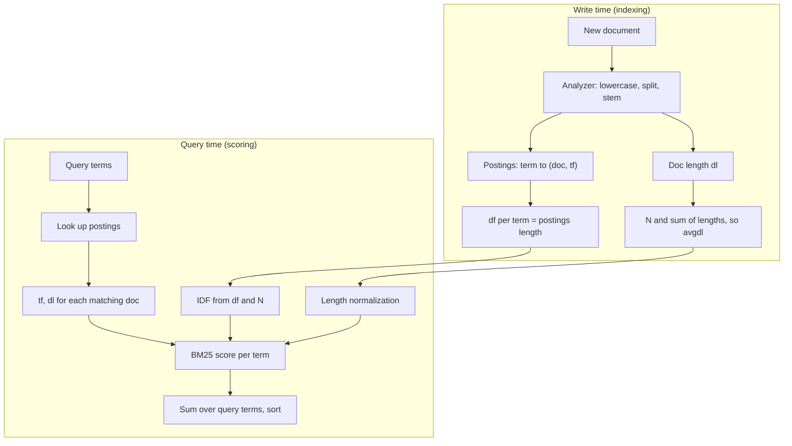
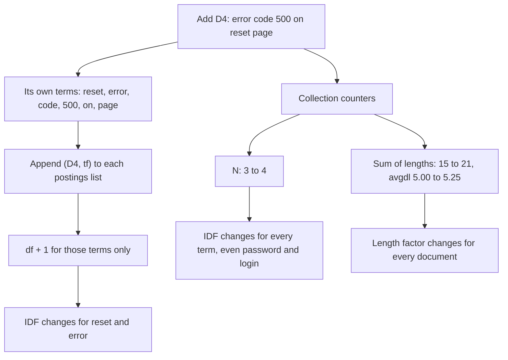

<div class="callout">
<p><strong>How to use this post</strong></p>
<ul>
<li>This is a <strong>structured explainer</strong> in six parts: what BM25 is, why it is used, where it is used, how it is built from TF and IDF, how the stored numbers change when a document is added, and how a query is scored.</li>
<li>One tiny example runs through the whole post: a help-desk search with four short tickets and the query <code>reset password error</code>. You can follow every number with a calculator.</li>
<li>All numbers come from a small pure-Python script (<code>bm25_demo.py</code>, shown in full below). I also cross-checked the scores against Tantivy, a real search engine library, and they match.</li>
<li>Formulas and defaults are checked against the Lucene source code, the Elasticsearch, OpenSearch, Solr and SQLite docs, and the original papers, in <strong>November 2026</strong>. Links are in the Sources section.</li>
<li>If you came here from RAG: the <a href="{{ '/posts/choosing-vector-database-for-rag/' | relative_url }}">vector database decision guide</a> covers how BM25 sits next to vectors in hybrid search. This post is about BM25 itself.</li>
</ul>
</div>

---

## 1. What is BM25

BM25 is a **ranking formula for keyword search**. You give it a query and a set of documents, and it gives each matching document a score. Higher score means a better match. The search engine sorts by that score.

It looks at only three things:

- **How often** the query word appears in the document (term frequency, **TF**).
- **How rare** the word is across all documents (inverse document frequency, **IDF**).
- **How long** the document is compared with the average document.

The name is short for "Best Matching 25". It came out of the Okapi search system at City University London. The weighting idea goes back to Robertson and Spärck Jones (1976), the saturation and length parts to Robertson and Walker (1994), and the formula was used under the BM25 name in the Okapi runs at TREC-3 (1994). It is about 30 years old and it is still the default in most search engines.

In one line:

$$
\text{score}(D, Q) = \sum_{t \in Q} \text{IDF}(t) \cdot \frac{tf_{t,D}}{tf_{t,D} + k_1 \left(1 - b + b \cdot \frac{|D|}{\text{avgdl}}\right)}
$$

Do not worry about the formula yet. Section 4 builds it one piece at a time.

---

## 2. Why BM25 is used

Before BM25, the usual approach was plain **TF-IDF**: multiply how often a word appears by how rare it is. That works, but it has two known problems:

- **Repeating a word keeps adding score forever.** A page that says "password" 50 times beats a page that says it twice, even if the second page is the better answer.
- **Long documents win just by being long.** More words means more chances to match.

BM25 fixes both with two knobs, and it is still cheap to compute. That is why it became the default.

| Reason | What it means in practice |
|---|---|
| Good ranking out of the box | Defaults `k1 = 1.2`, `b = 0.75` work well for most text without any tuning. |
| No training, no model | Nothing to train or host. It only needs counts that the index already keeps. |
| Fast | Scores come from the inverted index. Only documents that contain a query word are touched. |
| Exact words matter | Error codes like `ERR_TLS_1042`, product SKUs, function names and people's names match exactly. Vector search often misses these. |
| Explainable | You can see each word's contribution. Elasticsearch and OpenSearch show it with the `explain` option. |

What BM25 does **not** do: it does not understand meaning. "Forgot my password" and "cannot log in" share no words, so BM25 sees no match. That is why RAG systems often run BM25 **and** vector search together (hybrid search).

---

## 3. Where BM25 is used

| Where | How BM25 shows up (checked in the docs) |
|---|---|
| **Elasticsearch** | Default similarity for text fields. `k1 = 1.2`, `b = 0.75` by default, both configurable per field. |
| **OpenSearch** | "OpenSearch uses BM25 as the default similarity for all fields." |
| **Apache Lucene** | `BM25Similarity` is the scorer behind Elasticsearch, OpenSearch and Solr. Default `k1 = 1.2`, `b = 0.75`. |
| **Apache Solr** | Uses `BM25Similarity` for any field type without an explicit similarity. |
| **SQLite FTS5** | Built-in `bm25()` function, with `k1 = 1.2` and `b = 0.75` hard-coded. |
| **PostgreSQL** | The built-in `ts_rank` and `ts_rank_cd` are **not** BM25. The docs say they "do not use any global information", so there is no IDF. BM25 comes from extensions such as ParadeDB `pg_search` (built on Tantivy) and Timescale `pg_textsearch`. |
| **Tantivy** | Rust search library (Lucene-like). Uses BM25 with the same IDF as Lucene. |
| **Vector databases** | Weaviate (BM25F inside `hybrid`), Milvus (BM25 full-text search), Qdrant and Elasticsearch all offer BM25 next to vectors, usually fused with RRF. See the [vector database decision guide]({{ '/posts/choosing-vector-database-for-rag/' | relative_url }}). |
| **RAG pipelines** | The keyword half of hybrid retrieval. In the [AI harness engineering]({{ '/posts/ai-harness-engineering/' | relative_url }}) post, BM25 is the retriever that finds exact names like `auth_login` that dense search misses. |

---

## 4. How BM25 is used: what is stored, how IDF comes from DF, and how the formula is built

### 4.1 The running example

Four help-desk tickets. We index the first three now and add D4 later, in section 5.

| Doc | Text | Length (tokens) |
|---|---|---|
| D1 | reset password link expired | 4 |
| D2 | password reset email not received | 5 |
| D3 | login error after password change error | 6 |
| D4 (added later) | error code 500 on reset page | 6 |

The analyzer here is simple: lowercase and split on spaces. Real engines also strip punctuation and may stem words or drop stopwords. Whatever the analyzer outputs is what gets counted.

### 4.2 What the index stores

A search engine does not scan every document for every query. At write time it builds an **inverted index**: for every term, a list of the documents that contain it. That list is called a **postings list**.

For BM25, the index keeps these numbers:

| Stored number | Level | Meaning | Example after D1 to D3 |
|---|---|---|---|
| **tf** | per term, per document (inside the postings) | How many times the term appears in that document | `error` in D3: tf = 2 |
| **df** (n) | per term | How many documents contain the term. Same as the length of its postings list. | `password`: df = 3 |
| **dl** | per document | Document length in tokens (Lucene calls this the "norm") | D3: dl = 6 |
| **N** | per field | Number of documents that have this field | 3 |
| **sum of lengths** | per field | Total tokens in the field across all documents | 15 |
| **avgdl** | computed | sum of lengths / N | 15 / 3 = 5.0 |

Two notes from the Lucene source that are useful to know:

- Lucene computes `avgdl` as `sumTotalTermFreq / docCount`. It is not stored, it is derived from two stored counters.
- Lucene stores each document's length in **one byte**. Lengths up to 40 are exact. Longer lengths are rounded down to a nearby value. So in a real engine `dl` is a close approximation for long documents.



Notice the split. **TF and lengths are stored. IDF and avgdl are computed at query time** from stored counts. That is why IDF can change for every document when new documents arrive, without rewriting anything (section 5).

### 4.3 How IDF comes from DF

IDF answers: how much should a match on this term count? A term that appears in every document tells us nothing. A term in one document is a strong signal.

Lucene's BM25 uses:

$$
\text{IDF}(t) = \ln\left(1 + \frac{N - n + 0.5}{n + 0.5}\right)
$$

where `N` is the number of documents and `n` is the term's df. The `0.5` values are smoothing so that rare and very common terms do not produce infinities.

With our first three documents (N = 3):

| Term | df (n) | (N - n + 0.5) / (n + 0.5) | IDF |
|---|---|---|---|
| password | 3 | 0.5 / 3.5 = 0.1429 | ln(1.1429) = **0.1335** |
| reset | 2 | 1.5 / 2.5 = 0.6000 | ln(1.6000) = **0.4700** |
| error | 1 | 2.5 / 1.5 = 1.6667 | ln(2.6667) = **0.9808** |
| login | 1 | 2.5 / 1.5 = 1.6667 | ln(2.6667) = **0.9808** |

`password` is in every ticket, so it is worth very little. `error` is in only one ticket, so it is worth about 7 times more.

Where does this shape come from? Robertson and Spärck Jones (1976) derived a relevance weight from probabilities. When you have no relevance judgements, it reduces to `ln((N - n + 0.5) / (n + 0.5))`. That classic form has a problem: it goes **negative** once a term is in more than half the documents. Lucene adds `1` inside the log, which keeps it positive. More on the different variants in section 6.


### 4.4 Deriving BM25 step by step

Now we build the per-term score. Take one term `t` and one document `D`.

**Step 1: raw TF.** Count matches. `score = tf`. Problem: common words dominate.

**Step 2: TF-IDF.** Weight by rarity. `score = tf x IDF`. Better, but each repeat still adds the same amount, and long documents still win.

**Step 3: saturation with k1.** Replace `tf` with:

$$
\frac{tf}{tf + k_1}
$$

This grows fast at first, then flattens out. It can never go above 1. With `k1 = 1.2`:

| tf | Plain tf | tf / (tf + 1.2) |
|---|---|---|
| 1 | 1 | 0.4545 |
| 2 | 2 | 0.6250 |
| 3 | 3 | 0.7143 |
| 5 | 5 | 0.8065 |
| 10 | 10 | 0.8929 |
| 100 | 100 | 0.9881 |

The second mention adds a lot. The hundredth adds almost nothing. A small `k1` saturates quickly. A large `k1` behaves more like raw tf.


**Step 4: length normalization with b.** A word in a 4-token title means more than the same word once in a 400-token page. So we make `k1` bigger for long documents and smaller for short ones:

$$
k_1 \rightarrow k_1 \left(1 - b + b \cdot \frac{dl}{\text{avgdl}}\right)
$$

- `b = 0`: length is ignored.
- `b = 1`: full normalization by length.
- `b = 0.75` (default): mostly normalized.

With tf = 1 and avgdl = 5, the tf part becomes:

| Document length dl | tf part |
|---|---|
| 2 (short) | 0.6024 |
| 5 (average) | 0.4545 |
| 10 | 0.3226 |
| 20 (long) | 0.2041 |


**Step 5: put it together.** Multiply by IDF and add up over all query terms:

$$
\text{score}(D, Q) = \sum_{t \in Q} \text{IDF}(t) \cdot \frac{tf_{t,D}}{tf_{t,D} + k_1 \left(1 - b + b \cdot \frac{dl}{\text{avgdl}}\right)}
$$

That is BM25 as Lucene computes it. Many textbooks, including Robertson and Zaragoza's 2009 survey, show an extra `(k1 + 1)` in the numerator:

$$
\text{IDF}(t) \cdot \frac{tf \cdot (k_1 + 1)}{tf + k_1 \left(1 - b + b \cdot \frac{dl}{\text{avgdl}}\right)}
$$

The survey itself says this factor "is the same for all terms, and therefore does not affect the ranking". Lucene drops it. Tantivy keeps it. Same order of results, scores differ by a factor of 2.2.

---

## 5. How TF and DF get updated when each new document is stored

This is the part people often get wrong. Adding one document changes **only its own terms' postings and df**, but it changes **N and avgdl for everybody**. So IDF and length normalization shift for every document, even documents you never touched.


### 5.1 Before and after adding D4

D4 is `error code 500 on reset page` (6 tokens).

| | Before D4 | After D4 | What changed |
|---|---|---|---|
| N | 3 | 4 | +1 |
| Sum of lengths | 15 | 21 | +6 |
| avgdl | 5.00 | 5.25 | Changes the length factor for **every** doc |
| `reset` postings | D1:1, D2:1 | D1:1, D2:1, **D4:1** | New posting |
| `reset` df | 2 | 3 | +1 |
| `error` postings | D3:2 | D3:2, **D4:1** | New posting |
| `error` df | 1 | 2 | +1 |
| `password` postings | D1:1, D2:1, D3:1 | D1:1, D2:1, D3:1 | Nothing |
| `password` df | 3 | 3 | Nothing |
| `login` df | 1 | 1 | Nothing |

And the IDF, which is computed from these:

| Term | IDF before (N = 3) | IDF after (N = 4) | Why |
|---|---|---|---|
| reset | 0.4700 | 0.3567 | df went up, so it is more common now |
| password | 0.1335 | 0.3567 | df did **not** change, but N grew, so it is relatively rarer |
| error | 0.9808 | 0.6931 | df went from 1 to 2 |
| login | 0.9808 | 1.2040 | Not in D4, so it is now rarer |

Look at `password`. D4 does not contain it, yet its IDF almost tripled. That is the effect of N on every term.



The steps when a document is added:

1. Run the analyzer to get tokens.
2. For each distinct term, add `(doc_id, tf)` to its postings list. That term's df goes up by 1.
3. Store the document length.
4. Add 1 to N and the length to the field's sum of lengths.
5. Nothing else is rewritten. IDF and avgdl are recomputed from the counters at the next query.

### 5.2 What a real engine does differently

Our toy index updates in place. Lucene, and so Elasticsearch, OpenSearch and Solr, work in **segments**:

- New documents go into a new small segment. Segments are never edited after they are written. Background **merges** combine small segments into bigger ones.
- New documents become searchable after a **refresh** (Elasticsearch refreshes every second by default). Until then, they do not count in N or df either.
- A **delete** only marks the document as deleted. The Lucene docs say docFreq, totalTermFreq and sumTotalTermFreq "do not take deleted documents into account", which means **deleted documents still count** in df, N and the length sums until a merge removes them. An **update** is a delete plus an add, so frequently updated documents can skew stats for a while.
- In Elasticsearch, each **shard** has its own statistics. The default `query_then_fetch` scores "using local term and document frequencies for the shard". `dfs_query_then_fetch` first collects global frequencies across shards: "slower but more accurate". On small indexes with several shards, this is a common reason why the same query gives slightly different scores.

Our toy `delete` updates stats at once, for clarity. Deleting D2 from the four-document index gives:

```text
N = 3, total length = 16, avgdl = 5.3333
doc lengths: {'D1': 4, 'D3': 6, 'D4': 6}
  reset     postings = {'D1': 1, 'D4': 1}  df = 2  idf = 0.4700
  password  postings = {'D1': 1, 'D3': 1}  df = 2  idf = 0.4700
  error     postings = {'D3': 2, 'D4': 1}  df = 2  idf = 0.4700
  login     postings = {'D3': 1}  df = 1  idf = 0.9808
```

---

## 6. How IDF and BM25 are calculated and a query is scored

Query: **`reset password error`**, with `k1 = 1.2` and `b = 0.75`, on all four documents (N = 4, avgdl = 5.25).

### 6.1 Step 1: IDF for each query term

| Term | n | (N - n + 0.5) / (n + 0.5) | IDF |
|---|---|---|---|
| reset | 3 | 1.5 / 3.5 = 0.4286 | ln(1.4286) = **0.3567** |
| password | 3 | 1.5 / 3.5 = 0.4286 | ln(1.4286) = **0.3567** |
| error | 2 | 2.5 / 2.5 = 1.0000 | ln(2.0000) = **0.6931** |

### 6.2 Step 2: length factor for each document

`norm = k1 x (1 - b + b x dl / avgdl)`:

| Doc | dl | dl / avgdl | norm |
|---|---|---|---|
| D1 | 4 | 0.7619 | 1.2 x (0.25 + 0.5714) = **0.9857** |
| D2 | 5 | 0.9524 | 1.2 x (0.25 + 0.7143) = **1.1571** |
| D3 | 6 | 1.1429 | 1.2 x (0.25 + 0.8571) = **1.3286** |
| D4 | 6 | 1.1429 | **1.3286** |

### 6.3 Step 3: one term in full

`error` in D3 (tf = 2):

```text
n = 2, N = 4: (N - n + 0.5) / (n + 0.5) = 1.0000, idf = ln(1 + 1.0000) = 0.6931
tf = 2, dl = 6, avgdl = 5.25: k1 * (1 - b + b * dl / avgdl) = 1.3286
tf / (tf + norm) = 0.6009, score = 0.6931 x 0.6009 = 0.4165
classic form with (k1 + 1): 0.9163 (same ranking, every score x 2.2)
```

So `error` in D3 is worth 0.6931 x 0.6009 = **0.4165**.

### 6.4 Step 4: every term, every document, and the final ranking

Each cell is `IDF x tf / (tf + norm)`. A document only gets a cell for terms it contains.

```text
query: 'reset password error'
doc        reset  password     error     total
D3        0.0000    0.1532    0.4165    0.5697
D4        0.1532    0.0000    0.2977    0.4508
D1        0.1796    0.1796    0.0000    0.3592
D2        0.1653    0.1653    0.0000    0.3307
```

| Rank | Doc | reset | password | error | Total |
|---|---|---|---|---|---|
| 1 | D3: login error after password change error | 0 | 0.1532 | 0.4165 | **0.5697** |
| 2 | D4: error code 500 on reset page | 0.1532 | 0 | 0.2977 | **0.4508** |
| 3 | D1: reset password link expired | 0.1796 | 0.1796 | 0 | **0.3592** |
| 4 | D2: password reset email not received | 0.1653 | 0.1653 | 0 | **0.3307** |

How to read the ranking:

- **D3 wins** because `error` is the rarest query term and D3 has it twice. Saturation stops it from winning by too much: tf = 2 gives 0.60 of the maximum, not double.
- **D1 beats D2.** Both match `reset` and `password` once. D1 is shorter (4 vs 5 tokens), so length normalization gives it a small boost.
- **D4 and D1 match two terms each**, but D4 matches the rarer `error`, so it ranks higher.

And the same query **before** D4 was added (N = 3):

```text
query: 'reset password error'
doc        reset  password     error     total
D3        0.0000    0.0561    0.5804    0.6365
D1        0.2327    0.0661    0.0000    0.2988
D2        0.2136    0.0607    0.0000    0.2743
```

D3 was already first, but every number moved when D4 arrived: `password` went from 0.0661 to 0.1796 in D1 just because N grew. This is normal. BM25 scores are only comparable inside one query on one snapshot of the index. Do not store them and compare them later, and do not use a fixed score threshold across indexes.


---

## The code

Pure Python, no libraries. It builds the index one document at a time and scores queries with the Lucene formula.

```python
"""BM25 from scratch: an incremental inverted index and query scoring.

Pure Python, standard library only. The scoring follows Lucene's BM25Similarity
(the default in Elasticsearch, OpenSearch and Solr):

    idf(t)      = ln(1 + (N - n + 0.5) / (n + 0.5))
    score(t, D) = idf(t) * tf / (tf + k1 * (1 - b + b * dl / avgdl))

The classic textbook form multiplies the tf part by (k1 + 1). That is the same
constant for every term and document, so it does not change the ranking.
"""
import math
from collections import defaultdict

K1, B = 1.2, 0.75


def tokenize(text):
    # A real engine runs an analyzer (lowercase, split, maybe stem and remove stopwords).
    return text.lower().split()


class InvertedIndex:
    def __init__(self):
        self.postings = defaultdict(dict)   # term -> {doc_id: tf}
        self.doc_len = {}                   # doc_id -> number of tokens
        self.total_len = 0                  # sum of all doc lengths

    # ---- statistics the scorer needs ----
    @property
    def N(self):
        return len(self.doc_len)

    @property
    def avgdl(self):
        return self.total_len / self.N

    def df(self, term):
        return len(self.postings.get(term, {}))

    # ---- writes ----
    def add(self, doc_id, text):
        tokens = tokenize(text)
        for t in tokens:
            self.postings[t][doc_id] = self.postings[t].get(doc_id, 0) + 1
        self.doc_len[doc_id] = len(tokens)
        self.total_len += len(tokens)

    def delete(self, doc_id):
        # Toy version: stats change at once. Lucene only marks the doc as deleted;
        # its tf, df and length still count until a segment merge removes it.
        for term in list(self.postings):
            if self.postings[term].pop(doc_id, None) is not None and not self.postings[term]:
                del self.postings[term]
        self.total_len -= self.doc_len.pop(doc_id)

    # ---- scoring ----
    def idf(self, term):
        n = self.df(term)
        return math.log(1 + (self.N - n + 0.5) / (n + 0.5))

    def term_score(self, term, doc_id):
        tf = self.postings.get(term, {}).get(doc_id, 0)
        if tf == 0:
            return 0.0
        norm = K1 * (1 - B + B * self.doc_len[doc_id] / self.avgdl)
        return self.idf(term) * tf / (tf + norm)

    def search(self, query):
        terms = tokenize(query)
        candidates = set()
        for t in terms:
            candidates |= set(self.postings.get(t, {}))
        scores = {d: sum(self.term_score(t, d) for t in terms) for d in candidates}
        return sorted(scores.items(), key=lambda kv: (-kv[1], kv[0]))


DOCS = {
    "D1": "reset password link expired",
    "D2": "password reset email not received",
    "D3": "login error after password change error",
}
NEW_DOC = ("D4", "error code 500 on reset page")
QUERY = "reset password error"
WATCH = ["reset", "password", "error", "login"]


def show_stats(ix, title):
    print(f"\n--- {title} ---")
    print(f"N = {ix.N}, total length = {ix.total_len}, avgdl = {ix.avgdl:.4f}")
    print("doc lengths:", ix.doc_len)
    for t in WATCH:
        print(f"  {t:<9} postings = {dict(sorted(ix.postings.get(t, {}).items()))}  df = {ix.df(t)}  idf = {ix.idf(t):.4f}")


def show_scores(ix, query):
    print(f"\nquery: '{query}'")
    terms = tokenize(query)
    print("doc   " + "".join(f"{t:>10}" for t in terms) + "     total")
    for doc_id, total in ix.search(query):
        parts = "".join(f"{ix.term_score(t, doc_id):>10.4f}" for t in terms)
        print(f"{doc_id:<6}{parts}{total:>10.4f}")


def main():
    ix = InvertedIndex()
    for doc_id, text in DOCS.items():
        ix.add(doc_id, text)
    show_stats(ix, "after D1, D2, D3")
    show_scores(ix, QUERY)

    ix.add(*NEW_DOC)
    show_stats(ix, "after adding D4")
    show_scores(ix, QUERY)

    print("\n--- one term, step by step: 'error' in D3 (after D4) ---")
    n, N, dl, tf = ix.df("error"), ix.N, ix.doc_len["D3"], ix.postings["error"]["D3"]
    ratio = (N - n + 0.5) / (n + 0.5)
    norm = K1 * (1 - B + B * dl / ix.avgdl)
    print(f"n = {n}, N = {N}: (N - n + 0.5) / (n + 0.5) = {ratio:.4f}, idf = ln(1 + {ratio:.4f}) = {ix.idf('error'):.4f}")
    print(f"tf = {tf}, dl = {dl}, avgdl = {ix.avgdl:.2f}: k1 * (1 - b + b * dl / avgdl) = {norm:.4f}")
    print(f"tf / (tf + norm) = {tf / (tf + norm):.4f}, score = {ix.idf('error'):.4f} x {tf / (tf + norm):.4f} = {ix.term_score('error', 'D3'):.4f}")
    print(f"classic form with (k1 + 1): {ix.term_score('error', 'D3') * (K1 + 1):.4f} (same ranking, every score x {K1 + 1})")

    print("\n--- saturation: tf part tf / (tf + k1) for an average-length doc ---")
    for tf in [1, 2, 3, 5, 10, 100]:
        print(f"  tf = {tf:>3}: plain tf = {tf:>3}, BM25 tf part = {tf / (tf + K1):.4f}")

    print("\n--- length normalization: tf = 1, avgdl = 5 ---")
    for dl in [2, 5, 10, 20]:
        norm = K1 * (1 - B + B * dl / 5)
        print(f"  dl = {dl:>2}: tf part = {1 / (1 + norm):.4f}")

    print("\n--- delete D2 (toy index updates at once) ---")
    ix.delete("D2")
    show_stats(ix, "after deleting D2")


if __name__ == "__main__":
    main()
```

Full output:

```text
--- after D1, D2, D3 ---
N = 3, total length = 15, avgdl = 5.0000
doc lengths: {'D1': 4, 'D2': 5, 'D3': 6}
  reset     postings = {'D1': 1, 'D2': 1}  df = 2  idf = 0.4700
  password  postings = {'D1': 1, 'D2': 1, 'D3': 1}  df = 3  idf = 0.1335
  error     postings = {'D3': 2}  df = 1  idf = 0.9808
  login     postings = {'D3': 1}  df = 1  idf = 0.9808

query: 'reset password error'
doc        reset  password     error     total
D3        0.0000    0.0561    0.5804    0.6365
D1        0.2327    0.0661    0.0000    0.2988
D2        0.2136    0.0607    0.0000    0.2743

--- after adding D4 ---
N = 4, total length = 21, avgdl = 5.2500
doc lengths: {'D1': 4, 'D2': 5, 'D3': 6, 'D4': 6}
  reset     postings = {'D1': 1, 'D2': 1, 'D4': 1}  df = 3  idf = 0.3567
  password  postings = {'D1': 1, 'D2': 1, 'D3': 1}  df = 3  idf = 0.3567
  error     postings = {'D3': 2, 'D4': 1}  df = 2  idf = 0.6931
  login     postings = {'D3': 1}  df = 1  idf = 1.2040

query: 'reset password error'
doc        reset  password     error     total
D3        0.0000    0.1532    0.4165    0.5697
D4        0.1532    0.0000    0.2977    0.4508
D1        0.1796    0.1796    0.0000    0.3592
D2        0.1653    0.1653    0.0000    0.3307

--- one term, step by step: 'error' in D3 (after D4) ---
n = 2, N = 4: (N - n + 0.5) / (n + 0.5) = 1.0000, idf = ln(1 + 1.0000) = 0.6931
tf = 2, dl = 6, avgdl = 5.25: k1 * (1 - b + b * dl / avgdl) = 1.3286
tf / (tf + norm) = 0.6009, score = 0.6931 x 0.6009 = 0.4165
classic form with (k1 + 1): 0.9163 (same ranking, every score x 2.2)

--- saturation: tf part tf / (tf + k1) for an average-length doc ---
  tf =   1: plain tf =   1, BM25 tf part = 0.4545
  tf =   2: plain tf =   2, BM25 tf part = 0.6250
  tf =   3: plain tf =   3, BM25 tf part = 0.7143
  tf =   5: plain tf =   5, BM25 tf part = 0.8065
  tf =  10: plain tf =  10, BM25 tf part = 0.8929
  tf = 100: plain tf = 100, BM25 tf part = 0.9881

--- length normalization: tf = 1, avgdl = 5 ---
  dl =  2: tf part = 0.6024
  dl =  5: tf part = 0.4545
  dl = 10: tf part = 0.3226
  dl = 20: tf part = 0.2041

--- delete D2 (toy index updates at once) ---

--- after deleting D2 ---
N = 3, total length = 16, avgdl = 5.3333
doc lengths: {'D1': 4, 'D3': 6, 'D4': 6}
  reset     postings = {'D1': 1, 'D4': 1}  df = 2  idf = 0.4700
  password  postings = {'D1': 1, 'D3': 1}  df = 2  idf = 0.4700
  error     postings = {'D3': 2, 'D4': 1}  df = 2  idf = 0.4700
  login     postings = {'D3': 1}  df = 1  idf = 0.9808
```

### Cross-check against real implementations

I ran the same four documents and query through three other implementations:

```python
"""Cross-check bm25_demo.py against three real implementations.

- Tantivy (Rust engine behind ParadeDB pg_search): same IDF as Lucene, keeps the (k1 + 1) factor.
- SQLite FTS5 bm25(): IDF = ln((N - n + 0.5) / (n + 0.5)), floored at 1e-6; returns score x -1.
- rank_bm25 BM25Okapi: same IDF as FTS5, negative IDFs replaced by 0.25 x average IDF.
"""
import math
import sqlite3

import tantivy
from rank_bm25 import BM25Okapi

from bm25_demo import DOCS, NEW_DOC, QUERY, InvertedIndex, K1, tokenize

docs = dict(DOCS)
docs[NEW_DOC[0]] = NEW_DOC[1]
ix = InvertedIndex()
for d, text in docs.items():
    ix.add(d, text)
ours = dict(ix.search(QUERY))

# Tantivy
sb = tantivy.SchemaBuilder()
sb.add_text_field("id", stored=True, tokenizer_name="raw")
sb.add_text_field("body", stored=False)
schema = sb.build()
tix = tantivy.Index(schema)
w = tix.writer()
for d, text in docs.items():
    w.add_document(tantivy.Document(id=d, body=text))
w.commit()
tix.reload()
searcher = tix.searcher()
hits = searcher.search(tix.parse_query(QUERY, ["body"]), 10).hits
tantivy_scores = {searcher.doc(addr)["id"][0]: s for s, addr in hits}

# SQLite FTS5
con = sqlite3.connect(":memory:")
con.execute("CREATE VIRTUAL TABLE t USING fts5(id UNINDEXED, body)")
con.executemany("INSERT INTO t VALUES (?, ?)", docs.items())
fts = dict(con.execute("SELECT id, -bm25(t) FROM t WHERE t MATCH ?", (" OR ".join(tokenize(QUERY)),)))

# rank_bm25
ids = list(docs)
rb = BM25Okapi([tokenize(docs[d]) for d in ids], k1=1.2, b=0.75)
rb_scores = dict(zip(ids, rb.get_scores(tokenize(QUERY))))

print(f"{'doc':<5}{'ours':>9}{'ours x 2.2':>12}{'tantivy':>10}{'sqlite':>9}{'rank_bm25':>11}")
for d in sorted(ours, key=lambda d: -ours[d]):
    print(f"{d:<5}{ours[d]:>9.4f}{ours[d] * (K1 + 1):>12.4f}{tantivy_scores.get(d, 0):>10.4f}{fts.get(d, 0):>9.1e}{rb_scores[d]:>11.4f}")
print("tantivy matches ours x (k1 + 1):",
      all(abs(tantivy_scores[d] - ours[d] * (K1 + 1)) < 1e-4 for d in ours))
for name, s in [("tantivy", tantivy_scores), ("sqlite", fts), ("rank_bm25", rb_scores)]:
    order = [d for d, _ in sorted(s.items(), key=lambda kv: -kv[1]) if d in ours]
    print(f"{name} ranking: {order}")
n = ix.df("password")
print(f"'password' idf, N = 4, n = 3: lucene {ix.idf('password'):.4f}, "
      f"classic ln((N - n + 0.5)/(n + 0.5)) = {math.log((4 - n + 0.5) / (n + 0.5)):.4f}")
```

```text
doc       ours  ours x 2.2   tantivy   sqlite  rank_bm25
D3      0.5697      1.2532    1.2532  2.3e-06     0.1334
D4      0.4508      0.9919    0.9919  1.9e-06     0.1334
D1      0.3592      0.7903    0.7903  2.2e-06     0.3129
D2      0.3307      0.7275    0.7275  2.0e-06     0.2880
tantivy matches ours x (k1 + 1): True
tantivy ranking: ['D3', 'D4', 'D1', 'D2']
sqlite ranking: ['D3', 'D1', 'D2', 'D4']
rank_bm25 ranking: ['D1', 'D2', 'D3', 'D4']
'password' idf, N = 4, n = 3: lucene 0.3567, classic ln((N - n + 0.5)/(n + 0.5)) = -0.8473
```

What this shows:

- **Tantivy matches exactly**, once you multiply our Lucene-form score by `k1 + 1 = 2.2`. Same IDF, same saturation, same length normalization.
- **SQLite FTS5 gives tiny scores** (around 2e-06). It uses the classic IDF `ln((N - n + 0.5)/(n + 0.5))` and floors it at `1e-6` when it is zero or negative. In our 4-document index every query term is in at least half the documents, so every IDF hits the floor. On a real corpus with thousands of rows, most terms are far below half, and the difference mostly disappears.
- **rank_bm25** (`BM25Okapi`, a popular Python library) ranks differently on this tiny index. It also uses the classic IDF, and it replaces negative IDFs with `0.25 x average IDF`. `password` has classic IDF -0.8473 here.

The lesson: "BM25" is a family of very close formulas. The IDF variant matters a lot on tiny collections and very little on large ones. If you compare scores between tools, check which variant each one uses.

| Implementation | IDF | (k1 + 1) in numerator | Defaults |
|---|---|---|---|
| Lucene, Elasticsearch, OpenSearch, Solr | ln(1 + (N - n + 0.5) / (n + 0.5)) | No | k1 = 1.2, b = 0.75 |
| Tantivy (and ParadeDB pg_search) | ln(1 + (N - n + 0.5) / (n + 0.5)) | Yes | k1 = 1.2, b = 0.75 |
| SQLite FTS5 | ln((N - n + 0.5) / (n + 0.5)), floor 1e-6 | Yes | k1 = 1.2, b = 0.75 (fixed), result x -1 |
| rank_bm25 BM25Okapi | ln((N - n + 0.5) / (n + 0.5)), negatives set to 0.25 x average | Yes | k1 = 1.5, b = 0.75 (I passed 1.2) |

---

## Tuning k1 and b

Start with the defaults. Change them only with an evaluation set of real queries and judged results.

| Situation | Try | Why |
|---|---|---|
| Short fields (titles, names, tags) | Lower `b`, for example 0.3 to 0.5 | Lengths are similar, so length normalization mostly adds noise |
| Long, uneven documents | Keep `b` near 0.75 | Stops long pages winning just by size |
| Repeated words really matter (logs, code) | Higher `k1`, for example 1.6 to 2.0 | Saturates later, so repeats count more |
| Keyword stuffing is a problem | Lower `k1` | Saturates earlier |

Robertson and Zaragoza's survey reports that `0.5 < b < 0.8` and `1.2 < k1 < 2` are "reasonably good in many circumstances", and also that the best values depend on the data.

---

## Mistakes I would watch for

| Mistake | What happens | Fix |
|---|---|---|
| Comparing BM25 scores across queries or over time | Numbers shift with N, df and avgdl | Compare ranks inside one query only. Normalize before mixing with vector scores, or use RRF. |
| Using a fixed score cut-off | Works on one index, breaks after reindexing | Use top-k, or calibrate on your data |
| Testing on a tiny index | Odd IDF effects (the SQLite example above) | Test relevance on a realistic corpus size |
| Many shards with few docs | Each shard has different df, so scores jump | Fewer shards for small indexes, or `dfs_query_then_fetch` |
| Expecting deletes to fix scores at once | Deleted docs still count until merge | Accept it, or force-merge during quiet hours on read-mostly indexes |
| Assuming Postgres `ts_rank` is BM25 | No IDF, different ranking | Use a BM25 extension if you need BM25 |
| Expecting synonyms to match | "forgot password" does not match "can't log in" | Add synonyms in the analyzer, or run hybrid search with vectors |

---

## Glossary

| Term | Plain meaning |
|---|---|
| Inverted index | For each term, the list of documents that contain it |
| Postings list | That list, with the tf for each document |
| TF (tf) | How many times a term appears in one document |
| DF (n) | How many documents contain the term |
| IDF | Weight for rarity, computed from df and N |
| N | Number of documents in the field |
| dl | Length of one document in tokens |
| avgdl | Average document length |
| k1 | Controls how fast repeats stop adding score |
| b | Controls how much document length matters |
| Segment | Lucene's write-once chunk of the index |
| Merge | Combining segments, which also drops deleted documents |

---

## Sources

Papers:

- <a href="https://doi.org/10.1108/eb026526" target="_blank" rel="noopener">Spärck Jones: A statistical interpretation of term specificity and its application in retrieval (Journal of Documentation, 1972)</a>, the origin of IDF
- <a href="https://doi.org/10.1002/asi.4630270302" target="_blank" rel="noopener">Robertson and Spärck Jones: Relevance weighting of search terms (JASIS, 1976)</a>
- <a href="https://doi.org/10.1007/978-1-4471-2099-5_24" target="_blank" rel="noopener">Robertson and Walker: Some simple effective approximations to the 2-Poisson model for probabilistic weighted retrieval (SIGIR 1994)</a>
- <a href="https://trec.nist.gov/pubs/trec3/papers/city.ps.gz" target="_blank" rel="noopener">Robertson, Walker, Jones, Hancock-Beaulieu and Gatford: Okapi at TREC-3 (1994)</a>
- <a href="https://www.staff.city.ac.uk/~sbrp622/papers/foundations_bm25_review.pdf" target="_blank" rel="noopener">Robertson and Zaragoza: The Probabilistic Relevance Framework: BM25 and Beyond (Foundations and Trends in IR, 2009)</a>

Engine docs and source (checked November 2026):

- <a href="https://github.com/apache/lucene/blob/main/lucene/core/src/java/org/apache/lucene/search/similarities/BM25Similarity.java" target="_blank" rel="noopener">Lucene BM25Similarity.java</a> (IDF formula, avgdl, defaults, scoring)
- <a href="https://github.com/apache/lucene/blob/main/lucene/core/src/java/org/apache/lucene/util/SmallFloat.java" target="_blank" rel="noopener">Lucene SmallFloat.java</a> (one-byte length encoding)
- <a href="https://github.com/apache/lucene/blob/main/lucene/core/src/java/org/apache/lucene/index/TermsEnum.java" target="_blank" rel="noopener">Lucene TermsEnum.java</a> (term statistics include deleted documents)
- <a href="https://www.elastic.co/docs/reference/elasticsearch/index-settings/similarity" target="_blank" rel="noopener">Elasticsearch: Similarity settings</a> and <a href="https://www.elastic.co/docs/api/doc/elasticsearch/operation/operation-search" target="_blank" rel="noopener">Search API (search_type)</a>
- <a href="https://docs.opensearch.org/latest/im-plugin/similarity/" target="_blank" rel="noopener">OpenSearch: Similarity</a>
- <a href="https://solr.apache.org/guide/solr/latest/indexing-guide/schema-elements.html" target="_blank" rel="noopener">Solr: Schema elements (similarity)</a>
- <a href="https://www.sqlite.org/fts5.html" target="_blank" rel="noopener">SQLite FTS5 (bm25 function)</a>
- <a href="https://www.postgresql.org/docs/current/textsearch-controls.html" target="_blank" rel="noopener">PostgreSQL: Ranking search results (ts_rank)</a>
- <a href="https://github.com/paradedb/paradedb" target="_blank" rel="noopener">ParadeDB pg_search</a> and <a href="https://github.com/timescale/pg_textsearch" target="_blank" rel="noopener">Timescale pg_textsearch</a>
- <a href="https://github.com/quickwit-oss/tantivy" target="_blank" rel="noopener">Tantivy</a> and <a href="https://github.com/dorianbrown/rank_bm25" target="_blank" rel="noopener">rank_bm25</a>

Related Intelliwise posts: [Choosing a Vector Database for RAG]({{ '/posts/choosing-vector-database-for-rag/' | relative_url }}), [AI Harness Engineering]({{ '/posts/ai-harness-engineering/' | relative_url }}), [Embeddings Interview Q&A]({{ '/posts/embeddings-interview-qa/' | relative_url }}) and [Five Things to Measure and Tune in a RAG System]({{ '/posts/rag-five-knobs-recall-precision-topk-topp-cost/' | relative_url }}).

---

## In short

- **What:** BM25 ranks documents for a keyword query using term frequency, term rarity and document length.
- **Why:** it fixes TF-IDF's two weak spots (endless repeats, long documents) with `k1` and `b`, needs no training, and is fast and explainable.
- **Where:** default in Lucene, Elasticsearch, OpenSearch and Solr; built into SQLite FTS5; Postgres through extensions; the keyword half of hybrid RAG search.
- **Stored:** tf inside postings, df per term, document lengths, N and the sum of lengths. IDF and avgdl are computed at query time.
- **Updates:** a new document adds postings and raises df only for its own terms, but N and avgdl change, so every document's score can shift. Deletes count until segments merge.
- **Scoring:** for each query term, `IDF x tf / (tf + k1 x (1 - b + b x dl / avgdl))`, then add them up. In our example, D3 wins with 0.5697.
