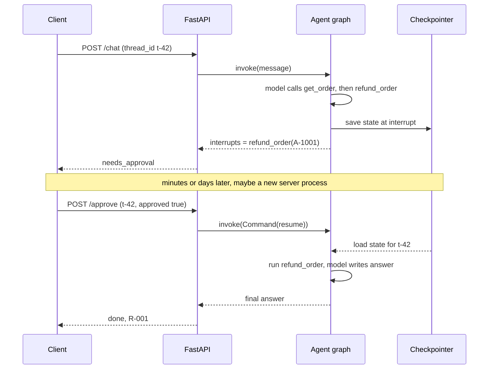
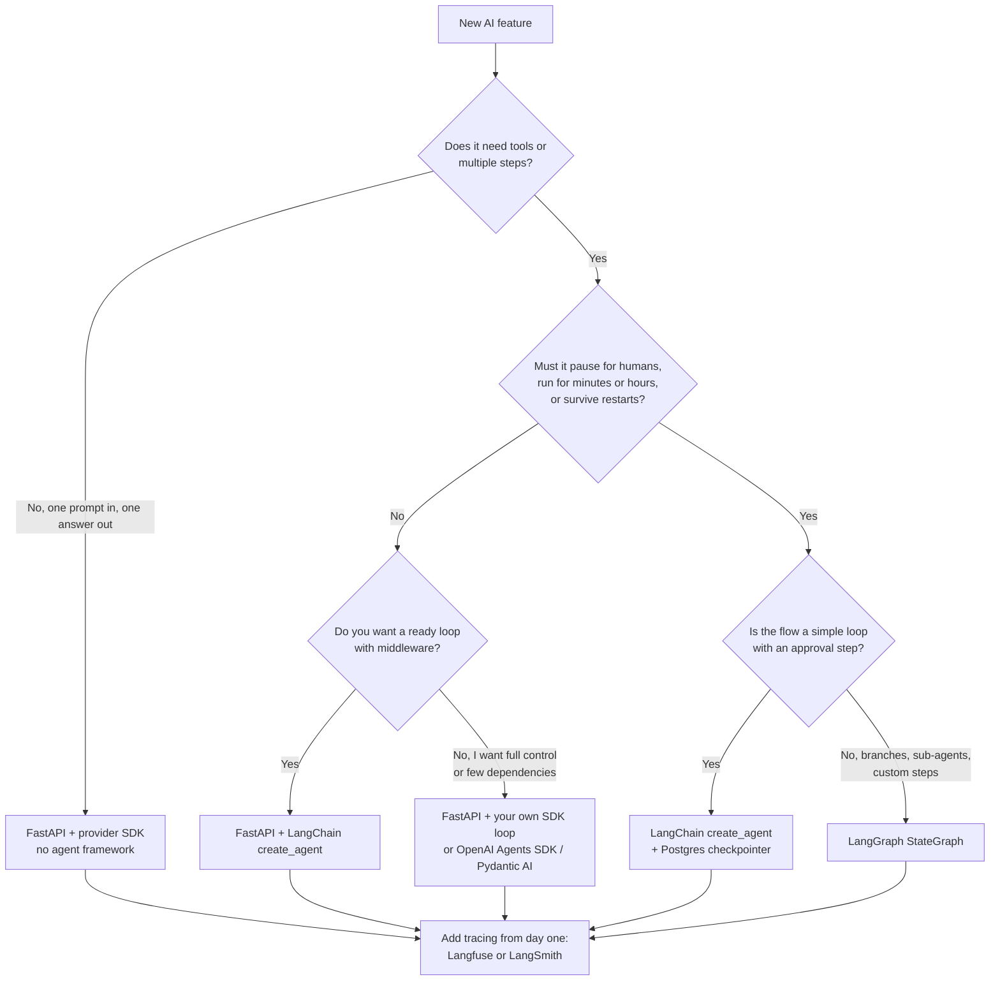

<div class="callout">
<p><strong>How to use this post</strong></p>
<ul>
<li>This is a <strong>build-along</strong>. We build one small agent three times, with numbered checkpoints. Each checkpoint has runnable code and the real output from my run.</li>
<li>Short answer first: <strong>FastAPI and LangChain are not competing for the same job.</strong> FastAPI serves your agent over HTTP. LangChain (and LangGraph under it) runs the agent logic. LangSmith and Langfuse watch what happened. So the real question is "who writes the agent loop?", and that is what this post answers.</li>
<li>All facts about versions, licences and pricing were checked against official docs in <strong>November 2026</strong>. Versions used: fastapi 0.165.0, openai 3.58.0, langchain 1.5.2, langgraph 1.2.24, langfuse SDK 5.2.0 (server 4.84.0), langsmith SDK 0.16.0.</li>
<li>If you only want the decision, jump to <a href="#checkpoint-7-use-this-when">Checkpoint 7: use this when</a>.</li>
</ul>
</div>

---

## Why people get confused

Most tutorials show a FastAPI app on one side and a LangChain agent on the other, and the question becomes "which one?". But they sit at different layers.


| Tool | What it actually is | What it is not |
| --- | --- | --- |
| **FastAPI** | A Python web framework for building APIs, based on type hints (built on Starlette and Pydantic) | Not an agent framework. It does not call the model or run tools for you |
| **LangChain** (1.x) | An agent framework. `create_agent` gives you a ready agent loop plus middleware (approval, summarization, retries, fallbacks, PII masking) | Not a web server. You still need FastAPI or similar to expose it |
| **LangGraph** | A low-level orchestration framework and runtime for long-running, stateful agents: checkpoints, pause and resume, streaming, memory | Not required to use LangChain to write it. LangGraph works without LangChain |
| **LangSmith** | LangChain's paid platform (with a free tier) for tracing, evals, prompt management and deployment | Not open source. Self-hosting is an Enterprise add-on |
| **Langfuse** | An open-source (MIT) platform for tracing, evals, prompts and cost. Built on OpenTelemetry. Self-host for free | Not tied to LangChain. Works with any framework or plain SDK code |

One more thing that confuses people: **LangChain agents are built on top of LangGraph.** When you call `create_agent`, you get a LangGraph graph back. So "LangChain vs LangGraph" is more like "ready-made agent vs drawing your own graph" on the same engine.

Earlier posts cover the ideas around this one. The [harness engineering post]({{ '/posts/ai-harness-engineering/' | relative_url }}) explains the "model + harness" idea. The [one API call to company assistant post]({{ '/posts/from-one-api-call-to-company-assistant/' | relative_url }}) walks the full growth path of an AI feature. This post is narrower: the same agent, three ways, so you can feel the difference in code.

---

## What we are building

A tiny shop support agent with two tools:

- `get_order(order_id)`: safe, read-only.
- `refund_order(order_id, reason)`: risky, it moves money. **A human must approve it first.**

The flow is the same in all three versions:

1. `POST /chat` with "Order A-1001 arrived broken. Please refund it."
2. The agent looks up the order, decides to refund, and **pauses**. The API returns `needs_approval`.
3. A human calls `POST /approve` with `approved: true` or `false`.
4. The agent continues and gives the final answer.


The approval pause is on purpose. A "hello world" chatbot hides the differences between these tools. A pause, a resume and a restart show them very clearly. If you want the human side of approvals (how to avoid approval fatigue), see the [human-in-the-loop post]({{ '/posts/human-in-the-loop-approval-fatigue/' | relative_url }}).

---

## Checkpoint 0: setup

```bash
uv venv --python 3.13 && source .venv/bin/activate
uv pip install fastapi uvicorn httpx openai langchain langchain-openai langgraph \
               langgraph-checkpoint-sqlite langfuse
```

To keep the output **repeatable**, the demo uses a small mock model server. It speaks the OpenAI chat completions format and follows a fixed script (look up order, then refund, then answer). All three versions talk to it the same way they would talk to a real provider. Later, at Checkpoint 5, I run the same code against a real free model.

The model location comes from three environment variables, so you can switch from the mock to a real provider without touching agent code:

```python
"""Where the model lives. Defaults to the local mock; set env vars for a real model."""
import os

BASE_URL = os.getenv("AGENT_BASE_URL", "http://127.0.0.1:8799/v1")
MODEL = os.getenv("AGENT_MODEL", "mock-tool-caller")
API_KEY = os.getenv("AGENT_API_KEY", "not-needed-for-mock")
```

The shared shop tools (`shop.py`) are plain Python functions that return JSON strings. Nothing in them is framework specific. `get_order` returns the order as JSON, and `refund_order` records a refund and returns its id, like `R-001`.

---

## Checkpoint 1: way 1, FastAPI + the provider SDK (you write the loop)

Here FastAPI serves two endpoints, and **we write the agent loop by hand**: call the model, run tool calls, stop when the model answers, and pause if the tool is risky.

```python
"""Way 1: FastAPI + the provider SDK. You write the agent loop yourself."""
import json, uuid
from fastapi import FastAPI
from pydantic import BaseModel
from openai import OpenAI          # with Langfuse: from langfuse.openai import OpenAI
from config import BASE_URL, MODEL, API_KEY
from shop import get_order, refund_order, SYSTEM_PROMPT, TOOL_SCHEMAS

client = OpenAI(base_url=BASE_URL, api_key=API_KEY)
TOOLS = {"get_order": get_order, "refund_order": refund_order}
NEEDS_APPROVAL = {"refund_order"}
THREADS = {}    # thread_id -> messages. In production: a database, not a dict.
app = FastAPI()


class ChatIn(BaseModel):
    message: str
    thread_id: str | None = None


class ApproveIn(BaseModel):
    thread_id: str
    approved: bool


def run_loop(thread_id, max_steps=6):
    messages = THREADS[thread_id]
    for _ in range(max_steps):
        reply = client.chat.completions.create(model=MODEL, messages=messages, tools=TOOL_SCHEMAS)
        msg = reply.choices[0].message
        messages.append(msg.model_dump(exclude_none=True))
        if not msg.tool_calls:
            return {"thread_id": thread_id, "status": "done", "answer": msg.content}
        for call in msg.tool_calls:
            if call.function.name in NEEDS_APPROVAL:
                return {"thread_id": thread_id, "status": "needs_approval",
                        "tool": call.function.name, "args": json.loads(call.function.arguments)}
            run_tool(messages, call.id, call.function.name, call.function.arguments)
    return {"thread_id": thread_id, "status": "gave_up"}


def run_tool(messages, call_id, name, arguments, approved=True):
    if approved:
        result = TOOLS[name](**json.loads(arguments))
    else:
        result = "Rejected by a human reviewer. Do not run this tool."
    messages.append({"role": "tool", "tool_call_id": call_id, "content": result})


@app.post("/chat")
def chat(body: ChatIn):
    thread_id = body.thread_id or str(uuid.uuid4())
    THREADS.setdefault(thread_id, [{"role": "system", "content": SYSTEM_PROMPT}])
    THREADS[thread_id].append({"role": "user", "content": body.message})
    return run_loop(thread_id)


@app.post("/approve")
def approve(body: ApproveIn):
    messages = THREADS[body.thread_id]
    pending = messages[-1]["tool_calls"][0]     # the call we paused on
    run_tool(messages, pending["id"], pending["function"]["name"],
             pending["function"]["arguments"], approved=body.approved)
    return run_loop(body.thread_id)
```

What to notice:

- The loop is about 15 lines. There is no magic. You can read every step.
- The pause is just `return` with a status. The paused conversation lives in `THREADS`, a Python dict.
- You own everything: retries, timeouts, tool errors, message format, saving state. That is the good part and the bad part.

---

## Checkpoint 2: way 2, FastAPI + LangChain `create_agent` (the loop is given)

Same endpoints. But now LangChain runs the loop, and approval is one line of middleware.

```python
"""Way 2: FastAPI + LangChain create_agent. The loop and the approval pause come built in."""
import uuid
from fastapi import FastAPI
from pydantic import BaseModel
from langchain.agents import create_agent
from langchain.agents.middleware import HumanInTheLoopMiddleware
from langchain_openai import ChatOpenAI
from langgraph.checkpoint.memory import InMemorySaver
from langgraph.types import Command
from config import BASE_URL, MODEL, API_KEY
from shop import get_order, refund_order, SYSTEM_PROMPT

agent = create_agent(
    model=ChatOpenAI(model=MODEL, base_url=BASE_URL, api_key=API_KEY),
    tools=[get_order, refund_order],
    system_prompt=SYSTEM_PROMPT,
    middleware=[HumanInTheLoopMiddleware(interrupt_on={"refund_order": True})],
    checkpointer=InMemorySaver(),   # In production: a Postgres checkpointer.
)
app = FastAPI()


class ChatIn(BaseModel):
    message: str
    thread_id: str | None = None


class ApproveIn(BaseModel):
    thread_id: str
    approved: bool


def to_response(thread_id, result):
    if result.interrupts:
        action = result.interrupts[0].value["action_requests"][0]
        return {"thread_id": thread_id, "status": "needs_approval",
                "tool": action["name"], "args": action["args"]}
    return {"thread_id": thread_id, "status": "done",
            "answer": result.value["messages"][-1].content}


@app.post("/chat")
def chat(body: ChatIn):
    thread_id = body.thread_id or str(uuid.uuid4())
    config = {"configurable": {"thread_id": thread_id}}
    result = agent.invoke({"messages": [{"role": "user", "content": body.message}]},
                          config=config, version="v2")
    return to_response(thread_id, result)


@app.post("/approve")
def approve(body: ApproveIn):
    config = {"configurable": {"thread_id": body.thread_id}}
    decision = {"type": "approve"} if body.approved else {"type": "reject", "message": "Not approved."}
    result = agent.invoke(Command(resume={"decisions": [decision]}), config=config, version="v2")
    return to_response(body.thread_id, result)
```

What to notice:

- No loop code. `create_agent` handles model call, tool call and repeat.
- `HumanInTheLoopMiddleware(interrupt_on={"refund_order": True})` does the pause. The docs are clear that **this needs a checkpointer**, because the paused state has to be saved somewhere.
- Resume is `Command(resume={"decisions": [...]})`. The decision types are `approve`, `edit`, `reject` and `respond`. With `version="v2"`, the result has a clean `.interrupts` field.
- Tools are plain functions. LangChain reads the docstring and type hints to build the tool schema, so we did not write `TOOL_SCHEMAS` here.

---

## Checkpoint 3: way 3, FastAPI + LangGraph (you draw the graph)

Same endpoints again. Now we draw the steps ourselves: a `model` node, an `approval` node, a `tools` node, and a router between them.

```python
"""Way 3: FastAPI + LangGraph. You draw the steps yourself: model, approval gate, tools."""
import os, sqlite3, uuid
from typing import Literal
from fastapi import FastAPI
from pydantic import BaseModel
from langchain_openai import ChatOpenAI
from langchain_core.messages import ToolMessage
from langgraph.graph import StateGraph, MessagesState, START, END
from langgraph.checkpoint.memory import InMemorySaver
from langgraph.types import interrupt, Command
from config import BASE_URL, MODEL, API_KEY
from shop import get_order, refund_order, SYSTEM_PROMPT

TOOLS = {"get_order": get_order, "refund_order": refund_order}
model = ChatOpenAI(model=MODEL, base_url=BASE_URL, api_key=API_KEY).bind_tools(list(TOOLS.values()))


def call_model(state: MessagesState):
    return {"messages": [model.invoke([{"role": "system", "content": SYSTEM_PROMPT}] + state["messages"])]}


def route(state: MessagesState) -> Literal["approval", "tools", "__end__"]:
    calls = state["messages"][-1].tool_calls
    if not calls:
        return END
    return "approval" if any(c["name"] == "refund_order" for c in calls) else "tools"


def approval(state: MessagesState) -> Command[Literal["tools", "model"]]:
    call = state["messages"][-1].tool_calls[0]
    approved = interrupt({"tool": call["name"], "args": call["args"]})   # pauses here
    if approved:
        return Command(goto="tools")
    rejected = ToolMessage("Rejected by a human reviewer. Do not run this tool.", tool_call_id=call["id"])
    return Command(goto="model", update={"messages": [rejected]})


def run_tools(state: MessagesState):
    out = []
    for call in state["messages"][-1].tool_calls:
        out.append(ToolMessage(TOOLS[call["name"]](**call["args"]), tool_call_id=call["id"]))
    return {"messages": out}


builder = StateGraph(MessagesState)
builder.add_node("model", call_model)
builder.add_node("approval", approval)
builder.add_node("tools", run_tools)
builder.add_edge(START, "model")
builder.add_conditional_edges("model", route)
builder.add_edge("tools", "model")
if os.getenv("CHECKPOINT_DB"):    # survives a restart
    from langgraph.checkpoint.sqlite import SqliteSaver
    saver = SqliteSaver(sqlite3.connect(os.environ["CHECKPOINT_DB"], check_same_thread=False))
else:
    saver = InMemorySaver()           # In production: a Postgres checkpointer.
graph = builder.compile(checkpointer=saver)
app = FastAPI()


class ChatIn(BaseModel):
    message: str
    thread_id: str | None = None


class ApproveIn(BaseModel):
    thread_id: str
    approved: bool


def to_response(thread_id, result):
    if result.interrupts:
        return {"thread_id": thread_id, "status": "needs_approval", **result.interrupts[0].value}
    return {"thread_id": thread_id, "status": "done", "answer": result.value["messages"][-1].content}


@app.post("/chat")
def chat(body: ChatIn):
    thread_id = body.thread_id or str(uuid.uuid4())
    config = {"configurable": {"thread_id": thread_id}}
    result = graph.invoke({"messages": [{"role": "user", "content": body.message}]},
                          config=config, version="v2")
    return to_response(thread_id, result)


@app.post("/approve")
def approve(body: ApproveIn):
    config = {"configurable": {"thread_id": body.thread_id}}
    result = graph.invoke(Command(resume=body.approved), config=config, version="v2")
    return to_response(body.thread_id, result)
```

What to notice:

- `interrupt(...)` inside the `approval` node pauses the graph. `Command(resume=True)` continues from **exactly that line**.
- Every step is saved by the checkpointer under the `thread_id`. Swap `InMemorySaver` for SQLite or Postgres and the pause survives a restart (Checkpoint 4 proves this).
- It is more code than way 2, but every edge is visible. When your flow grows (parallel branches, sub-agents, retries per step, "go back to step 2"), this is where LangGraph pays off.

The pause and resume works like this in ways 2 and 3:



---

## Checkpoint 4: run all three, then try a restart

`run_demo.py` sends the same conversation to all three apps, once with approval and once with rejection. It counts model calls and how many refunds really happened. Real output:

```text
--- way1_fastapi_sdk, human approves: True
  /chat    -> {"status": "needs_approval", "tool": "refund_order", "args": {"order_id": "A-1001", "reason": "arrived damaged"}}
  /approve -> {"status": "done", "answer": "Done. Refund R-001 of EUR 49.00 for order A-1001 has been issued."}
  model calls: 3, refunds actually made: 1
--- way1_fastapi_sdk, human approves: False
  /chat    -> {"status": "needs_approval", "tool": "refund_order", "args": {"order_id": "A-1001", "reason": "arrived damaged"}}
  /approve -> {"status": "done", "answer": "I have not refunded this order. A team member will contact you."}
  model calls: 3, refunds actually made: 0
--- way2_langchain, human approves: True
  /chat    -> {"status": "needs_approval", "tool": "refund_order", "args": {"order_id": "A-1001", "reason": "arrived damaged"}}
  /approve -> {"status": "done", "answer": "Done. Refund R-001 of EUR 49.00 for order A-1001 has been issued."}
  model calls: 3, refunds actually made: 1
--- way2_langchain, human approves: False
  /chat    -> {"status": "needs_approval", "tool": "refund_order", "args": {"order_id": "A-1001", "reason": "arrived damaged"}}
  /approve -> {"status": "done", "answer": "I have not refunded this order. A team member will contact you."}
  model calls: 3, refunds actually made: 0
--- way3_langgraph, human approves: True
  /chat    -> {"status": "needs_approval", "tool": "refund_order", "args": {"order_id": "A-1001", "reason": "arrived damaged"}}
  /approve -> {"status": "done", "answer": "Done. Refund R-001 of EUR 49.00 for order A-1001 has been issued."}
  model calls: 3, refunds actually made: 1
--- way3_langgraph, human approves: False
  /chat    -> {"status": "needs_approval", "tool": "refund_order", "args": {"order_id": "A-1001", "reason": "arrived damaged"}}
  /approve -> {"status": "done", "answer": "I have not refunded this order. A team member will contact you."}
  model calls: 3, refunds actually made: 0
```

All three behave the same. Same 3 model calls, same answer, and when the human says no, **zero refunds**. So for a small agent, all three ways work.

Now the restart test. Each step runs in a **new Python process**, like a server that was redeployed between the pause and the approval. Way 1 keeps state in a dict. Way 3 uses a SQLite checkpointer.

```text
--- way1_fastapi_sdk
  process 1 /chat: 200 {"status": "needs_approval"}
  process 2 /approve: KeyError: 't-42'
--- way3_langgraph
  process 1 /chat: 200 {"status": "needs_approval"}
  process 2 /approve: 200 {"status": "done", "answer": "Done. Refund R-001 of EUR 49.00 for order A-1001 has been issued."}
```


This is the real difference, and it does not show up in a hello world demo. With way 1, you **can** fix this: save `messages` to a database, add a status column, handle "approve arrived twice", and so on. That is fine to write. Just know you are writing a small version of what LangGraph checkpoints already give you.

---

## Checkpoint 5: same code, real free model

Same three apps, now pointing at a real free model through OpenRouter (`nvidia/nemotron-3.5-lightning:free`). The API key comes from the environment and is never printed. Real output below. I kept the `/chat` result and the refund count, and left out the long free-text `/approve` replies (summarised after the block):

```text
--- way1_fastapi_sdk (nvidia/nemotron-3.5-lightning:free)
  /chat    -> {"status": "needs_approval", "tool": "refund_order", "args": {"order_id": "A-1001", "reason": "damaged"}, "answer": null}
  refunds actually made: 1
--- way2_langchain (nvidia/nemotron-3.5-lightning:free)
  /chat    -> {"status": "needs_approval", "tool": "refund_order", "args": {"order_id": "A-1001", "reason": "Arrived broken"}, "answer": null}
  refunds actually made: 1
--- way3_langgraph (nvidia/nemotron-3.5-lightning:free)
  /chat    -> {"status": "needs_approval", "tool": "refund_order", "args": {"order_id": "A-1001", "reason": "damaged on arrival"}, "answer": null}
  refunds actually made: 1
```

All three paused on `refund_order` for A-1001 before any money moved. The real model chose its own words for `reason`, so each run is a little different. After approval, all three final answers confirmed the refund of 49 euros for A-1001, and two of them also quoted the refund id R-001. One refund was made in each run. This is why the mock is used for the repeatable numbers above, and the real model is only used to prove the code is not mock-only.

---

## Checkpoint 6: see inside it with a trace

When an agent gives a wrong answer, the first question is "what did it actually do?". That is what tracing tools answer. Langfuse and LangSmith use the same basic shape:

| Concept | Langfuse name | LangSmith name | In our refund agent |
| --- | --- | --- | --- |
| One request end to end | Trace | Trace | One `POST /chat` or `POST /approve` |
| One step inside it | Observation (span, generation, tool, chain) | Run | A model call, a tool call, a graph node |
| A model call with tokens and cost | Generation | LLM run | Each call to the model |
| A whole conversation | Session | Thread | `thread_id`, so `/chat` and `/approve` group together |
| A quality check on results | Score | Feedback / evaluator | "Did it refund only damaged, delivered orders?" |

I ran a **self-hosted Langfuse** (server 4.84.0, Docker Compose) on my box and sent the approved run from all three versions. How each one plugs in:

- **Way 1:** change one import, `from langfuse.openai import OpenAI`. Model calls are traced. Tools need `@observe(as_type="tool")` if you want to see them.
- **Ways 2 and 3:** pass `CallbackHandler()` from `langfuse.langchain` in the `callbacks` config. Every node, model call and tool call shows up.
- **LangSmith** for ways 2 and 3 is even simpler: set `LANGSMITH_TRACING=true` and an API key, no code change. For way 1 you wrap the client with the LangSmith SDK.

The trace trees, as read back from the Langfuse API after the run:

```text
=== way1_fastapi_sdk
  - [SPAN] POST /chat
    - [GENERATION] OpenAI-generation
    - [TOOL] get_order
    - [GENERATION] OpenAI-generation
  - [SPAN] POST /approve
    - [TOOL] refund_order
    - [GENERATION] OpenAI-generation
  observations: 7, session: trace-way1_fastapi_sdk
=== way2_langchain
  - [SPAN] POST /chat
    - [CHAIN] LangGraph
      - [CHAIN] model
        - [GENERATION] ChatOpenAI
      - [CHAIN] HumanInTheLoopMiddleware.after_model
      - [CHAIN] tools
        - [TOOL] get_order
      - [CHAIN] model
        - [GENERATION] ChatOpenAI
      - [CHAIN] HumanInTheLoopMiddleware.after_model
  - [SPAN] POST /approve
    - [CHAIN] LangGraph
      - [CHAIN] HumanInTheLoopMiddleware.after_model
      - [CHAIN] tools
        - [TOOL] refund_order
      - [CHAIN] model
        - [GENERATION] ChatOpenAI
      - [CHAIN] HumanInTheLoopMiddleware.after_model
  observations: 18, session: trace-way2_langchain
=== way3_langgraph
  - [SPAN] POST /chat
    - [CHAIN] LangGraph
      - [CHAIN] model
        - [GENERATION] ChatOpenAI
        - [CHAIN] route
      - [CHAIN] tools
      - [CHAIN] model
        - [GENERATION] ChatOpenAI
        - [CHAIN] route
      - [CHAIN] approval
  - [SPAN] POST /approve
    - [CHAIN] LangGraph
      - [CHAIN] approval
      - [CHAIN] tools
      - [CHAIN] model
        - [GENERATION] ChatOpenAI
        - [CHAIN] route
  observations: 17, session: trace-way3_langgraph
```


Two things I learned from this:

1. **Way 1 traces are short and you decide what is in them.** Only what you wrap shows up. Clean, but you must remember to wrap things.
2. **Ways 2 and 3 trace the graph for free**, including middleware steps like `HumanInTheLoopMiddleware.after_model`. More detail, more noise. In way 3, my `tools` node calls the Python function directly, so it shows as a chain step, not a separate tool observation. Small detail, but it matters when you build dashboards.

Also a small trap I hit: `langfuse.openai` patches the OpenAI client **globally**. When it was imported in the same process as the LangChain callback, every LangChain model call was traced twice. Use one integration per process.

Tracing is step one. The next step is evals on top of traces. The [golden examples and grader post]({{ '/posts/ai-agent-evals-golden-examples-grader/' | relative_url }}) covers that.

---

## What each way costs you

Measured on the demo code in this post:

```text
way1_fastapi_sdk.py     50 lines (no blanks, comments or docstrings)
way2_langchain.py       44 lines (no blanks, comments or docstrings)
way3_langgraph.py       68 lines (no blanks, comments or docstrings)
FastAPI + OpenAI SDK              20 packages
FastAPI + LangChain               50 packages
FastAPI + LangGraph               49 packages
FastAPI + OpenAI SDK + Langfuse   39 packages
```


- Way 2 has the **fewest lines** (44) but pulls the **most packages** (50). Fewer lines is not the same as less to learn. You now need to understand middleware, checkpointers, `Command`, and how LangChain message objects look.
- Way 1 has the **smallest install** (20 packages). Adding Langfuse took it to 39.
- Way 3 is the **longest** (68 lines) because you draw the graph by hand. That code is the price of control.

---

## Checkpoint 7: use this when



### By scenario

| Scenario | Use this | Why |
| --- | --- | --- |
| Summarize text, classify tickets, one prompt and one answer | **FastAPI + provider SDK** | No loop, no tools. A framework adds packages and nothing else |
| First agent with 2 to 5 tools, you want to learn how agents work | **FastAPI + your own loop** | You will understand every step. Easy to debug. Move up later if needed |
| Agent with tools, standard loop, you want approval, summarization, retries, fallbacks quickly | **FastAPI + LangChain `create_agent`** | All of these are ready middleware. Least code |
| Approval steps that may wait hours or days, or must survive deploys | **LangGraph** (directly, or under `create_agent`) with a Postgres checkpointer | Durable pause and resume is the core feature |
| Complex flow: branches, parallel steps, sub-agents, loops back to an earlier step | **LangGraph `StateGraph`** | You draw the flow. Each node is visible and testable |
| Want to deploy LangGraph without writing the server part | **LangSmith Agent Server** (earlier called LangGraph Platform, then LangSmith Deployment) | Gives you the HTTP API, task queue and persistence for LangGraph apps. On LangSmith cloud it needs the Plus plan (1 small serverless server included). Hybrid and self-hosted options exist on higher plans |
| Need tracing, data must stay in your network, small budget | **Langfuse self-hosted** | MIT licence, free to self-host. You run Postgres, ClickHouse, Redis and S3 storage |
| Already deep in LangChain/LangGraph, want least setup, fine with SaaS | **LangSmith** | Turn on with an env var. Free Developer tier for 1 seat and 5k traces a month |
| Mostly using OpenAI models, want a light agent library with handoffs and guardrails | **OpenAI Agents SDK** | Small, provider-focused, has its own tracing |
| Want typed, Pydantic-style agents and outputs, FastAPI-like feel | **Pydantic AI** | Built by the Pydantic team. Feels natural if you like FastAPI |

### By developer

- **Backend developer, new to AI:** start with way 1. FastAPI + SDK. Write the loop once so you know what frameworks hide. Add Langfuse or LangSmith on day one.
- **Developer shipping a feature this week:** way 2. `create_agent` with the middleware you need. Use a Postgres checkpointer, not `InMemorySaver`, before production.
- **Developer building long-running or multi-agent workflows:** way 3. LangGraph `StateGraph`. Plan your state and checkpoints first.
- **Team in a regulated company (health, finance, EU data rules):** keep traces inside your network. Langfuse self-hosted, or LangSmith only if you have the Enterprise plan with self-hosting.
- **Platform team supporting many teams with different frameworks:** an OpenTelemetry-based tool like Langfuse fits better, because traces from different stacks land in one place.

---

## Trade-offs, honestly

| Trade-off | Way 1 (SDK loop) | Way 2 (LangChain) | Way 3 (LangGraph) |
| --- | --- | --- | --- |
| Abstraction cost | None. What you see is what runs | High. Middleware and message classes to learn | Medium. Graph concepts, but each node is your code |
| Debugging | Easy. Plain stack traces | Harder without tracing. Errors can come from deep inside the framework | Medium. Node by node, and traces show the graph |
| Durable pause and resume | You build it | Built in (via LangGraph checkpointer) | Built in, and you control where it pauses |
| Lock-in | Low. Only your model provider's API shape | Medium. LangChain message and tool types | Medium. LangGraph state and checkpoint format |
| Version churn | Low. Provider SDK only | Higher. LangChain 1.x is more stable than 0.x, but the surrounding packages still move fast | Medium. LangGraph 1.x core is steadier than the LangChain layer |
| Dependencies | Smallest (20 packages here) | Largest (50) | Large (49) |

And for tracing:

| Trade-off | Langfuse | LangSmith |
| --- | --- | --- |
| Licence | MIT, except the `ee` folders in the repo | Proprietary SaaS |
| Self-host | Free. Docker Compose or Helm. You run Postgres, ClickHouse, Redis and S3/MinIO | Enterprise plan add-on only |
| Cloud pricing (Nov 2026) | Hobby free (50k units a month), Core USD 29, Pro USD 199 a month | Developer free (1 seat, 5k traces a month), Plus USD 39 per seat a month, Enterprise custom |
| Best with | Any framework, plain SDK code, OpenTelemetry, LiteLLM | LangChain and LangGraph (zero code), also works with others via SDK and OTel |
| Ownership | Acquired by ClickHouse in January 2026. Langfuse says no licence change is planned and self-hosting stays first class | LangChain, Inc. |
| Privacy | Traces stay in your network when self-hosted | Traces go to LangSmith cloud unless you are on Enterprise self-host |

Whatever you choose, remember that traces contain prompts, user messages and tool outputs. Mask personal data before it leaves your app, in both tools.

---

## Summary

<div class="callout">
<p><strong>The one-minute version</strong></p>
<ul>
<li><strong>FastAPI is not the alternative to LangChain.</strong> FastAPI serves your agent. In all three ways of this post, FastAPI was there.</li>
<li>The real choice is <strong>who writes the agent loop</strong>: you (SDK), LangChain (<code>create_agent</code>), or you with a graph engine (LangGraph).</li>
<li>For a first agent, <strong>FastAPI + SDK loop</strong> teaches you the most and has the fewest dependencies.</li>
<li>Move to <strong>LangChain create_agent</strong> when you want ready middleware like approvals, summarization and retries with little code.</li>
<li>Move to <strong>LangGraph</strong> when the agent must pause and resume across restarts, run for a long time, or follow a flow with branches. The restart test showed this clearly: the dict lost the run, the checkpoint kept it.</li>
<li><strong>LangSmith and Langfuse are not frameworks.</strong> They show you what the agent did. Add one from day one. Langfuse if you want open source and self-hosting, LangSmith if you are on LangChain and fine with SaaS.</li>
</ul>
</div>

### Sources (checked November 2026)

- <a href="https://fastapi.tiangolo.com/" target="_blank" rel="noopener">FastAPI documentation</a>
- <a href="https://docs.langchain.com/oss/python/langchain/overview" target="_blank" rel="noopener">LangChain overview</a> and <a href="https://docs.langchain.com/oss/python/langchain/human-in-the-loop" target="_blank" rel="noopener">LangChain human-in-the-loop middleware</a>
- <a href="https://docs.langchain.com/oss/python/langgraph/overview" target="_blank" rel="noopener">LangGraph overview</a>, <a href="https://docs.langchain.com/oss/python/langgraph/interrupts" target="_blank" rel="noopener">interrupts</a> and <a href="https://docs.langchain.com/oss/python/langgraph/durable-execution" target="_blank" rel="noopener">durable execution</a>
- <a href="https://docs.langchain.com/langsmith/home" target="_blank" rel="noopener">LangSmith docs</a>, <a href="https://docs.langchain.com/langsmith/agent-server" target="_blank" rel="noopener">LangSmith Agent Server</a>, <a href="https://docs.langchain.com/langsmith/self-hosted" target="_blank" rel="noopener">self-hosted LangSmith</a> and <a href="https://www.langchain.com/pricing" target="_blank" rel="noopener">LangSmith pricing</a>
- <a href="https://langfuse.com/docs" target="_blank" rel="noopener">Langfuse docs</a>, <a href="https://langfuse.com/self-hosting" target="_blank" rel="noopener">self-hosting</a>, <a href="https://langfuse.com/pricing" target="_blank" rel="noopener">pricing</a> and <a href="https://github.com/langfuse/langfuse/blob/main/LICENSE" target="_blank" rel="noopener">licence</a>
- <a href="https://langfuse.com/integrations/model-providers/openai-py" target="_blank" rel="noopener">Langfuse OpenAI integration</a> and <a href="https://langfuse.com/integrations/frameworks/langchain" target="_blank" rel="noopener">Langfuse LangChain integration</a>
- <a href="https://langfuse.com/blog/2025-06-04-open-sourcing-langfuse-product" target="_blank" rel="noopener">Langfuse: doubling down on open source (June 2025)</a> and <a href="https://langfuse.com/blog/joining-clickhouse" target="_blank" rel="noopener">Langfuse joins ClickHouse (January 2026)</a>
- <a href="https://openai.github.io/openai-agents-python/" target="_blank" rel="noopener">OpenAI Agents SDK</a> and <a href="https://ai.pydantic.dev/" target="_blank" rel="noopener">Pydantic AI</a>
