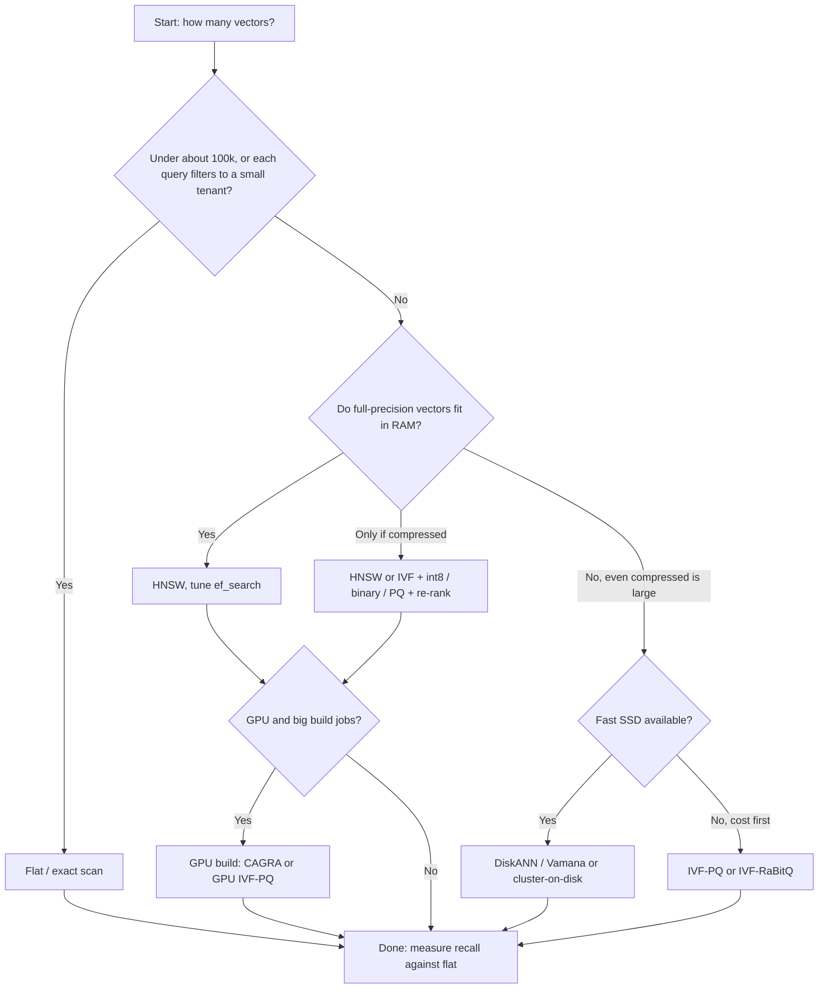

<div class="callout">
<p><strong>How to use this post</strong></p>
<ul>
<li>This is a <strong>cheat sheet</strong>. It is built around a few tables you can scan quickly: the database analogy, the algorithm catalogue, the scenario matrix (also as a tick sheet) and the engine matrix (also as a tick sheet). The text around them is short on purpose.</li>
<li>Every cell in the engine matrix was checked against the official docs or the project README in <strong>November 2026</strong>. Each row says which version I checked. Where a feature is not there, the cell says <strong>not supported</strong>. Where a managed service hides the index, it says <strong>managed, not exposed</strong>. I did not fill any cell from memory.</li>
<li>The only measured numbers come from one small FAISS script in this post. You can run it yourself. The output shown is the real output from my run.</li>
<li>If you want the "why" behind each algorithm, the <a href="{{ '/posts/vector-index-myths/' | relative_url }}">vector index myths post</a> goes deeper. If you are still picking the database, start with the <a href="{{ '/posts/choosing-vector-database-for-rag/' | relative_url }}">vector database decision guide</a>. This post does not repeat them. It is the quick lookup table you keep open next to them.</li>
</ul>
</div>

---

## The whole post in one screen

| If your situation is... | Start with | Why |
| --- | --- | --- |
| Under about 100k vectors, or every query filters down to one tenant | **Flat (exact scan)** | No recall loss, nothing to tune, often fast enough |
| Fits in RAM, needs low latency and high recall | **HNSW** | Best speed and recall trade-off in most engines |
| Fits in RAM only if you shrink it | **HNSW or IVF + quantization** (int8, binary, PQ, RaBitQ) with re-ranking | 4x to 32x less memory, re-rank gets recall back |
| Much bigger than RAM, you have fast SSD | **DiskANN / Vamana** or a **cluster-on-disk** index | Graph or lists live on SSD, small part in RAM |
| Billions of vectors, cost matters most | **IVF-PQ** or **IVF-RaBitQ**, or DiskANN | Small codes, cheap to store and scan |
| Heavy filters on metadata | **Filter-aware HNSW** (ACORN style, extra edges, iterative scan), or flat for very selective filters | Plain HNSW loses recall when most nodes are filtered out |
| You have a GPU and big build or batch jobs | **CAGRA** or **GPU IVF-PQ** | Builds and batch search are much faster on GPU |

The rest of the post explains each row and then shows which database actually ships what.

---

## 1. What "vector index" means, compared with Postgres and MongoDB

Most of us learned indexes from a relational database. So let me start there.

A normal database index answers an **exact** question. "Give me the row where `user_id = 61`." Or "give me rows where `created_at` is between two dates." The index is a sorted structure, usually a B-tree. Postgres walks from the root to the leaf and finds exactly the matching rows. If the row exists, it is found. There is no "almost".

A vector index answers a **similarity** question. "Give me the 5 rows whose embedding is closest to this query embedding." No row is equal to the query. We want the nearest ones. A sorted tree does not help here, because there is no single order for 768 numbers.


The simple way to find the nearest vectors is to compare the query with every stored vector. That is exact, and it is called **flat** or brute-force search. It is like a full table scan in Postgres. When the table grows, we want something faster. So vector indexes do **approximate nearest neighbour (ANN)** search. They look at only a promising part of the data. That is fast, but it can miss a true neighbour.

That miss rate is the new thing you do not have in Postgres or MongoDB. We measure it as **recall@k**: out of the true top k, how many did the index return. Recall 0.95 at k = 10 means on average 9.5 of the real top 10 came back.

| | Postgres B-tree | Postgres GIN | MongoDB index | Vector ANN index |
| --- | --- | --- | --- | --- |
| Question it answers | `=`, `<`, `>`, `BETWEEN`, `ORDER BY` | "does this array, JSON or text contain X" | `=`, ranges, sort on fields | "which vectors are closest to this one" |
| Structure | Sorted tree | Inverted lists: key to rows | B-tree | Graph, clusters, trees, hashes, compressed codes |
| Result | Exact | Exact | Exact | **Approximate**, unless you use flat |
| Wrong answers possible? | No | No | No | **Yes, it can miss neighbours** |
| What you tune | Mostly nothing | Mostly nothing | Mostly nothing | Recall vs latency vs memory (`ef_search`, `nprobe`, quantization) |
| How you check it | `EXPLAIN` | `EXPLAIN` | `explain()` | `EXPLAIN` **plus** a recall test against flat results |

A few facts from the official docs, so the analogy is correct:

- Postgres ships these index types: B-tree, Hash, GiST, SP-GiST, GIN and BRIN, plus extensions. B-tree is the default for `CREATE INDEX`.
- MongoDB's normal indexes use a B-tree data structure. Vector search in MongoDB is a separate index type (`vectorSearch`), served by the `mongot` process, and it is eventually consistent with the collection.
- pgvector says it directly: after you add an approximate index, "you will see different results for queries". That is the recall trade-off, written in the README.

One more useful analogy. **IVF is close to GIN in spirit.** GIN keeps a list of rows per key. IVF keeps a list of vectors per cluster centre. The difference is that GIN looks up the exact key, while IVF looks in the few closest clusters and hopes the neighbours are there.

### Three layers people mix up: metric, index, database

When people say "we use cosine" or "we use HNSW" or "we use Qdrant", they are talking about three different layers:

1. **Distance metric.** How we measure "close". Cosine, Euclidean (L2) or dot product.
2. **Index algorithm.** How we avoid comparing with every vector. Flat, IVF, HNSW, DiskANN and the rest.
3. **Database.** Where the vectors live, and which metrics and indexes it lets you pick.

The metric is not the algorithm. The same HNSW graph can be built for cosine, L2 or dot product. You pick both, and they must match: an index built for one metric does not serve queries in another.

| Metric | What it measures | pgvector operator | Elasticsearch `similarity` | Qdrant `distance` |
| --- | --- | --- | --- | --- |
| **Cosine** | Angle between vectors, ignores length | `<=>` | `cosine` (default for float) | `Cosine` |
| **Euclidean (L2)** | Straight-line distance | `<->` | `l2_norm` | `Euclid` |
| **Dot / inner product** | Sum of element-wise products, length matters | `<#>` (returns the negative, so `ORDER BY` ascending works) | `dot_product`, `max_inner_product` | `Dot` |

Two practical points from the docs:

- In pgvector you add **one index per distance function** you want to query with. An HNSW index built with `vector_l2_ops` does not speed up a `<=>` cosine query.
- If your embeddings are **normalized to length 1**, cosine and dot product give the same ranking. pgvector recommends inner product in that case for best performance.

---

## 2. The algorithm families, as a catalogue

There are many names, but they come from a few ideas: **scan everything**, **partition into clusters**, **build a neighbour graph**, **build trees or hashes**, and **compress the vectors**. Compression is not a separate index. It is a layer you add on top of flat, IVF or a graph.

### 2.1 Index families

| Family | How it works, in one line | Memory | Build cost | Inserts and deletes | Where you meet it |
| --- | --- | --- | --- | --- | --- |
| **Flat / exact** | Compare the query with every vector | Raw vectors only | None | Trivial | Every engine; FAISS `IndexFlat`, MongoDB `flat`, Weaviate `flat`, Elasticsearch `flat` |
| **IVF** (inverted file) | k-means into `nlist` clusters; search the `nprobe` closest | Raw vectors + small centroid table | Training (k-means) | Easy to add; lists drift if data changes a lot | FAISS, Milvus, LanceDB, OpenSearch Faiss |
| **HNSW** | Layered neighbour graph; greedy walk from top layer down | Vectors + graph links (about M x 2 links per vector at layer 0) | Higher; slowest of the in-memory options | Inserts fine; deletes need cleanup or re-build | Almost every engine |
| **Vamana / DiskANN** | Flat (single-layer) graph built to keep paths short, designed to sit on SSD | Compressed vectors in RAM, graph and full vectors on SSD | High | Fresh / streaming variants support updates | Milvus `DISKANN`, pgvectorscale, Redis `SVS-VAMANA`, FAISS SVS |
| **Cluster-on-disk** (SPANN family) | IVF-like posting lists on disk, small index over centroids in RAM | Centroids in RAM, lists on disk | Medium | Designed for in-place updates (SPFresh) | Weaviate HFresh, Chroma distributed (SPANN), Elasticsearch `bbq_disk` |
| **ScaNN** | Partitioning + anisotropic quantization (score-aware), later SOAR spilling | Small codes | Training | Re-train for big shifts | Google ScaNN library, Milvus `SCANN` |
| **CAGRA** | Graph built and searched on GPU, very parallel | GPU memory | Fast on GPU | Re-build oriented | Milvus `GPU_CAGRA`, FAISS via cuVS |
| **Trees** (Annoy) | Many random-projection trees, memory-mapped static files | Small, shared across processes | Low | **No adds after build** | Annoy library |
| **LSH** | Random hashes so close vectors share buckets or bits | Small | Very low | Easy | FAISS `IndexLSH`, Milvus `MINHASH_LSH` for set similarity |
| **Sparse inverted index** | Posting list per non-zero dimension, like BM25 | Depends on sparsity | Low | Easy | Milvus `SPARSE_INVERTED_INDEX`, Qdrant sparse index |

Here is IVF in motion. The query only looks inside the closest lists. With `nprobe = 1` it misses some true neighbours. With more lists, it finds them, but it does more work.


And here is HNSW. The search starts on a sparse top layer with long hops, finds the best node there, then drops one layer and keeps walking. Layer 0 has every vector. `efSearch` decides how many candidates it keeps while walking on layer 0.


### 2.2 Compression, the layer on top

| Compression | What is stored per dimension | Size vs float32 | Recall impact | Names in engines |
| --- | --- | --- | --- | --- |
| **float16 / bfloat16** | 16-bit float | 1/2 | Usually negligible | pgvector `halfvec`, Vespa `bfloat16`, Redis `FLOAT16`, `BFLOAT16` |
| **Scalar quantization (SQ), int8** | 1 byte | 1/4 | Small | Elasticsearch `int8_hnsw`, Qdrant scalar, Milvus `IVF_SQ8`, `HNSW_SQ`, MongoDB `scalar` |
| **int4** | Half a byte | 1/8 | Moderate | Elasticsearch `int4_hnsw`, OpenSearch 4-bit |
| **Binary / 1-bit** (BQ, BBQ, RaBitQ) | 1 bit | 1/32 | Large without re-rank, small with re-rank | Elasticsearch `bbq_*`, Qdrant binary, MongoDB `binary`, Weaviate BQ, Milvus `IVF_RABITQ`, LanceDB `IVF_RQ` |
| **Product quantization (PQ)** | A few bits per sub-vector | 1/16 to 1/64 typical | Moderate to large; re-rank helps | FAISS `IVFPQ`, Milvus `IVF_PQ`, `HNSW_PQ`, LanceDB `IVF_PQ`, Qdrant PQ, Weaviate PQ |
| **Rotation based** (RQ, TurboQuant, LVQ) | Rotate, then quantize | 1/4 to 1/32 | Usually better than plain SQ or BQ at the same size | Weaviate RQ, Qdrant TurboQuant, Redis LVQ / LeanVec (Intel builds) |


The pattern that almost every engine now uses is **search on compressed codes, then re-rank a shortlist with full vectors**. MongoDB calls it binary quantization with rescoring. Elasticsearch and OpenSearch call it oversampling and rescoring. In pgvector you write it yourself as a subquery, as the README shows.

### 2.3 Memory math you can do on a napkin

Take 10 million chunks with 1,536-dim embeddings. This is plain arithmetic, not a benchmark:

| Storage form | Bytes per vector | Total for 10M vectors |
| --- | --- | --- |
| float32 (raw) | 1,536 x 4 = 6,144 | 61.44 GB |
| float16 / bfloat16 | 3,072 | 30.72 GB |
| int8 (scalar quantization) | 1,536 | 15.36 GB |
| 1-bit (binary, BBQ, RaBitQ 1-bit) | 1,536 / 8 = 192 | 1.92 GB |
| PQ with 96 sub-vectors of 8 bits | 96 | 0.96 GB |
| HNSW graph links, M = 16 (on top of the vectors) | about 2 x 16 x 4 = 128 | about 1.28 GB extra |

The HNSW line uses the usual rule that layer 0 keeps up to 2 x M neighbour ids of 4 bytes each, plus a little for the upper layers. The demo in section 5 agrees: with M = 32 the rule predicts 256 extra bytes, and FAISS measured 272 (784 minus 512).

Notice what is **not** in this table: IVF-Flat. IVF-Flat stores the full vectors, plus an 8-byte id per vector and a small centroid table, so it uses about the same memory as flat (525 vs 512 bytes per vector in the demo). IVF saves **compute**, not memory. The memory saving comes only when you add PQ, SQ or binary codes on top.

---

## 3. Scenario to algorithm matrix

This is the table I would print and stick on the wall. Read across a row for your situation.

| Scenario | Data size | Memory budget | RAM or disk | Updates and deletes | Filtering | Latency | Recall | Good choice | Avoid |
| --- | --- | --- | --- | --- | --- | --- | --- | --- | --- |
| Prototype or small app | < 100k | Plenty | RAM | Any | Any | Fine | Exact | **Flat** | Tuning HNSW before you need it |
| Multi-tenant SaaS, each user searches own data | Any total, small per tenant | Any | RAM | Frequent | Very selective (tenant id) | Low | Exact | **Flat with prefilter**, or partition per tenant | One global HNSW that filters out 99% of nodes |
| Typical RAG over company docs | 100k to 10M | Fits RAM | RAM | Daily | Some | Low (ms) | 0.95+ | **HNSW** (+ int8) | IVF with tiny `nprobe` |
| Same, but RAM is the bill | 1M to 100M | Tight | RAM | Daily | Some | Low | 0.9+ after re-rank | **HNSW + binary or RaBitQ + re-rank**, or IVF-PQ + re-rank | float32 HNSW on a huge box |
| Larger than RAM | 100M to billions | Small RAM, big SSD | SSD | Moderate | Some | 5 to 20 ms OK | 0.9+ | **DiskANN / Vamana**, **cluster-on-disk** (HFresh, SPANN, DiskBBQ) | In-memory HNSW with swapping |
| Archive search, cost first | Billions | Very small | SSD or object storage | Rare | Light | 10s of ms OK | 0.8 to 0.9 | **IVF-PQ**, **IVF-RaBitQ** | Graph indexes on raw floats |
| Streaming writes (chat logs, events) | Growing | Medium | RAM or SSD | Constant | Some | Low | 0.9+ | **HNSW** with async indexing, or **streaming DiskANN** | Annoy (static), IVF trained once and never re-trained |
| Heavy metadata filters | Any | Any | RAM | Any | Strong, low correlation | Low | 0.9+ | **Filter-aware HNSW** (ACORN, extra edges, iterative scans), **Filtered-DiskANN labels** | Post-filtering a small top-k |
| GPU in the box | 10M+ | GPU memory | GPU | Batch | Light | Very low for batches | 0.95+ | **CAGRA**, **GPU IVF-PQ**, or GPU-built HNSW served on CPU | GPU for 10k vectors |
| Static read-only, many processes | Any | Small | Memory-mapped file | **None** | None | Low | 0.9 | **Annoy** | Anything that needs updates |
| Sparse or learned-sparse vectors | Any | Any | RAM | Any | Any | Low | Exact | **Sparse inverted index** | Dense ANN indexes |
| Near-duplicate detection on sets | Large | Small | RAM | Batch | None | Low | Approximate OK | **MinHash LSH** | Dense HNSW on shingles |



Two rules hold for every row:

- **Measure recall against flat on your own data.** The same index settings give different recall on different embeddings.
- **The best algorithm is the best one your database ships.** That is why the next table matters more than the one above.

### Tick matrix: scenario by algorithm

Same idea as a quick tick sheet. ✓ = good fit, ◐ = works with a trade-off, ✗ = usually a poor fit. These are tendencies, not benchmark results.

| Scenario | Flat | HNSW | IVF-Flat | IVF-PQ / RaBitQ | DiskANN / Vamana | Cluster-on-disk (SPANN, HFresh, DiskBBQ) | CAGRA (GPU) | LSH |
| --- | --- | --- | --- | --- | --- | --- | --- | --- |
| Under 100k vectors | ✓ | ◐ | ◐ | ✗ | ✗ | ✗ | ✗ | ✗ |
| 100k to 10M, fits in RAM | ◐ | ✓ | ✓ | ◐ | ◐ | ◐ | ◐ | ✗ |
| 100M and more | ✗ | ◐ | ◐ | ✓ | ✓ | ✓ | ◐ | ◐ |
| Exact results required | ✓ | ◐ | ◐ | ✗ | ◐ | ◐ | ◐ | ✗ |
| Lowest single-query latency, data in RAM | ✗ | ✓ | ✓ | ◐ | ◐ | ◐ | ◐ | ◐ |
| RAM is the limit | ◐ | ◐ | ✗ | ✓ | ✓ | ✓ | ✗ | ◐ |
| Data larger than RAM, SSD available | ✗ | ✗ | ◐ | ✓ | ✓ | ✓ | ✗ | ✗ |
| Frequent inserts | ✓ | ✓ | ◐ | ◐ | ◐ | ✓ | ✗ | ✓ |
| Frequent deletes and updates | ✓ | ◐ | ✓ | ✓ | ◐ | ✓ | ✗ | ✓ |
| Very selective metadata filters | ✓ | ◐ | ◐ | ◐ | ◐ | ◐ | ◐ | ◐ |
| GPU available, large batches | ◐ | ◐ | ✓ | ✓ | ✗ | ✗ | ✓ | ✗ |
| Few knobs, easy to run | ✓ | ✓ | ◐ | ✗ | ◐ | ◐ | ◐ | ◐ |

Why some cells are not what you may expect:

- **HNSW is only ◐ for "exact results".** With a high `ef_search` it gets very close, but only flat guarantees the true top k.
- **IVF-Flat is ✗ for "RAM is the limit".** It keeps the full vectors, as the memory math above shows.
- **HNSW is ◐ for deletes.** Deleted nodes stay in the graph until a cleanup or vacuum. Weaviate describes an async cleanup that rewires edges after deletes. pgvector warns that vacuuming can take a while for HNSW indexes.
- **DiskANN is ◐ for updates.** The original DiskANN index is built in one go. FreshDiskANN and pgvectorscale's StreamingDiskANN are the variants built for updates.
- **CAGRA is ✗ for updates.** It is a build-and-search GPU index. Engines often build on GPU and then search on CPU.

### What to measure before you decide

A filter changes the problem. If you have 5 million chunks but every query filters on `tenant_id`, `document_type` and `department`, you are really searching a small subset. That can change which index wins. So test with your real queries:

- **recall@5 and recall@10**, against a flat search on the same data
- **p50 and p95 latency**, not only the average
- **indexing throughput**, including a full rebuild
- **RAM and disk** after the index is built
- the same numbers **with your real filters** turned on
- the same numbers **while documents are being added and deleted**

For RAG, a fast search that misses the right chunk is worse than a slower one that finds it. Recall comes first.

---

## 4. Engine by index matrix (checked November 2026)

Legend: **Yes** = documented and usable. **Not supported** = not in the docs for that version. **Managed, not exposed** = the service builds an index for you and does not let you pick.

| Engine (version checked) | Exact / flat | Graph in RAM | Partition / IVF | Disk-first index | Compression | GPU |
| --- | --- | --- | --- | --- | --- | --- |
| **pgvector** (0.8.7) | Yes, no index = exact scan | **HNSW** | **IVFFlat** | Not supported (use pgvectorscale) | `halfvec` (16-bit), `binary_quantize()` expression index + manual re-rank | Not supported |
| **pgvectorscale** (0.9.1) | Yes, through Postgres | Not supported (uses pgvector HNSW if installed) | Not supported | **StreamingDiskANN** (`diskann`) | **SBQ** (statistical binary quantization) | Not supported |
| **MongoDB Vector Search** (Atlas and self-managed docs) | **`flat`** indexing method, or `exact: true` on HNSW | **HNSW** (default; `maxEdges` 16 to 64) | Not supported | Managed, not exposed | `scalar` (int8), `binary` with rescoring; ingest `int8` / `int1` binData | Not documented |
| **Elasticsearch** (9.x docs, 9.5 current) | **`flat`**, `int8_flat`, `int4_flat`, `bbq_flat` | **`hnsw`**, `int8_hnsw`, `int4_hnsw`, `bbq_hnsw` | **`bbq_disk`** (k-means clusters, DiskBBQ, since 9.2) | **`bbq_disk`** (Enterprise) | int8, int4, BBQ 1-bit; default `bbq_hnsw` for float with 384+ dims, `int8_hnsw` below | **GPU HNSW build** with cuVS (`hnsw`, `int8_hnsw`, Enterprise) |
| **OpenSearch** (3.10) | Exact via script score; **`flat`** method with 1/2/4-bit SQ (3.6+) | **HNSW** on Lucene or Faiss engine (NMSLIB deprecated) | **IVF** on Faiss engine (needs training) | **`on_disk` mode** (2.17+, 32x compression + rescoring); `disk_ann` via JVector plugin | Faiss SQ (fp16, bf16), Faiss PQ, Lucene SQ, binary quantization | **Remote GPU index build** for Faiss HNSW (3.0+) |
| **Milvus** (3.0.x) | **`FLAT`**, `BIN_FLAT` | **`HNSW`**, `HNSW_SQ`, `HNSW_PQ`, `HNSW_PRQ` | **`IVF_FLAT`**, `IVF_SQ8`, `IVF_PQ`, `IVF_RABITQ`, `SCANN`, `BIN_IVF_FLAT` | **`DISKANN`**, **`AISAQ`** (near-zero DRAM) | SQ8, PQ, PRQ, RaBitQ | **`GPU_CAGRA`**, `GPU_IVF_FLAT`, `GPU_IVF_PQ`, `GPU_BRUTE_FORCE` |
| **Qdrant** (1.20) | Full scan below `full_scan_threshold`, or exact search param | **HNSW** (only dense index), filterable, ACORN (1.16+) | Not supported | Vectors and HNSW can be `on_disk` (memmap) | Scalar int8, binary (1, 1.5, 2-bit), PQ, **TurboQuant** (1.18+) | **GPU HNSW build** (1.13+, NVIDIA and AMD) |
| **Weaviate** (1.40) | **`flat`** | **`hnsw`** (default), **`dynamic`** (flat to HNSW at 10,000 objects) | **HFresh** (1.36+, SPFresh-style clusters, HNSW over centroids) | **HFresh** keeps most data on disk | PQ, BQ, SQ, **RQ** (rotational) | Not documented |
| **Pinecone** (serverless) | Managed, not exposed | Managed, not exposed | Managed, not exposed (slabs with size-based indexing) | Managed (object storage + cache) | Managed, not exposed | Managed, not exposed |
| **Chroma** (docs, Nov 2026) | Not exposed as a type | **HNSW** in single-node Chroma | **SPANN** in distributed Chroma and Chroma Cloud | SPANN (cloud) | Not documented in collection config | Not documented |
| **LanceDB** (0.41, OSS and Cloud) | Yes, brute force without an index | Not exposed alone; **HNSW inside IVF partitions** (`IVF_HNSW_SQ`, `IVF_HNSW_PQ`, `IVF_HNSW_FLAT` embedded only) | **`IVF_FLAT`**, `IVF_SQ`, **`IVF_PQ`**, **`IVF_RQ`** (RaBitQ) | Lance files on disk or object storage | SQ, PQ, RaBitQ | **GPU `IVF_PQ` build** (`accelerator="cuda"` or `"mps"`, embedded sync SDK) |
| **Redis** (8.x, 8.12 current) | **`FLAT`** | **`HNSW`** | Not supported | Not supported (in-memory) | `FLOAT16`, `BFLOAT16`, `INT8`, `UINT8` (8.0+); **SVS-VAMANA** LVQ / LeanVec on Intel, 8-bit SQ fallback in Redis Open Source | Not supported |
| **FAISS** (1.16) | **`IndexFlatL2`**, `IndexFlatIP` | **HNSW**, NSG, SVS Vamana | **IVF** (Flat, SQ, PQ, RaBitQ, fast-scan) | On-disk inverted lists only; no DiskANN | SQ, PQ, OPQ, RaBitQ, LSH binary codes | **GPU** Flat, IVF-Flat, IVF-PQ, **CAGRA** via cuVS |
| **Vespa** (8.x) | `approximate:false` exact search | **HNSW** (mutable, per content node, ACORN-1 style filtering) | Not supported as an index type | Full vectors as **paged attributes** on disk, compact vectors in HNSW | `bfloat16`, `int8`, single-bit with hamming | Not documented |

### Tick view: engine by algorithm

The same facts as ticks, for a quick look. ✓ = supported, ◐ = partly (see the note), ✗ = not supported, M = managed, not exposed.

| Engine | Flat | HNSW | IVF-Flat | IVF-PQ | DiskANN / Vamana | SPANN-style clusters | ScaNN | GPU search (CAGRA etc.) | LSH |
| --- | --- | --- | --- | --- | --- | --- | --- | --- | --- |
| pgvector | ✓ | ✓ | ✓ | ✗ | ✗ | ✗ | ✗ | ✗ | ✗ |
| pgvectorscale | ✓ | ✗ | ✗ | ✗ | ✓ | ✗ | ✗ | ✗ | ✗ |
| MongoDB Vector Search | ✓ | ✓ | ✗ | ✗ | ✗ | ✗ | ✗ | ✗ | ✗ |
| Elasticsearch | ✓ | ✓ | ✗ | ✗ | ✗ | ✓ (`bbq_disk`) | ✗ | ✗ (GPU build only) | ✗ |
| OpenSearch | ✓ | ✓ | ✓ | ✓ | ◐ (JVector plugin) | ✗ | ✗ | ✗ (GPU build only) | ✗ |
| Milvus | ✓ | ✓ | ✓ | ✓ | ✓ | ✗ | ✓ | ✓ | ◐ (MinHash LSH) |
| Qdrant | ✓ | ✓ | ✗ | ✗ | ✗ | ✗ | ✗ | ✗ (GPU build only) | ✗ |
| Weaviate | ✓ | ✓ | ✗ | ✗ | ✗ | ✓ (HFresh) | ✗ | ✗ | ✗ |
| Pinecone | M | M | M | M | M | M | M | M | M |
| Chroma | ✗ | ✓ (single node) | ✗ | ✗ | ✗ | ✓ (distributed, cloud) | ✗ | ✗ | ✗ |
| LanceDB | ✓ | ◐ (inside IVF) | ✓ | ✓ | ✗ | ✗ | ✗ | ✗ (GPU build only) | ✗ |
| Redis | ✓ | ✓ | ✗ | ✗ | ◐ (SVS-VAMANA, in RAM) | ✗ | ✗ | ✗ | ✗ |
| FAISS | ✓ | ✓ | ✓ | ✓ | ◐ (SVS Vamana, in RAM) | ✗ | ✗ | ✓ | ✓ |
| Vespa | ✓ | ✓ | ✗ | ✗ | ✗ | ✗ | ✗ | ✗ | ✗ |

Two things this view hides, so read the detailed table above too. First, "✓ HNSW" in two engines does not mean the same speed or memory: filtering, quantization and storage differ. Second, Chroma's flat cell is ✗ because it is not offered as an index type, not because you cannot get exact results some other way.

### What the matrix tells me

- **HNSW is everywhere.** 11 of the 14 rows ship it directly. Pinecone hides it, pgvectorscale and LanceDB use something else as the main index. So "does it support HNSW" is not a useful question any more. "How does it filter, compress and re-rank on HNSW" is the useful question.
- **IVF is now the minority in databases.** pgvector, Milvus, OpenSearch (Faiss), LanceDB and FAISS have classic IVF. Elasticsearch and Weaviate have cluster-based indexes that are built for disk.
- **Disk-first is the new battleground.** Milvus DISKANN and AISAQ, pgvectorscale StreamingDiskANN, Elasticsearch `bbq_disk`, Weaviate HFresh, OpenSearch `on_disk`, Chroma SPANN. They all try to keep most of the data off RAM.
- **Binary and rotation-based quantization are the new default thinking.** Elasticsearch uses `bbq_hnsw` by default for float vectors with 384 or more dims. MongoDB recommends binary quantization with rescoring for most models. Qdrant added TurboQuant, Weaviate added RQ, Milvus and LanceDB added RaBitQ.
- **GPU is mostly for building, not serving.** Qdrant, Elasticsearch and OpenSearch use the GPU to build HNSW faster. Milvus and FAISS can also search on the GPU.

### Engine notes you need before you pick

- **pgvector.** `vector` indexes up to 2,000 dims, `halfvec` up to 4,000, `bit` up to 64,000, `sparsevec` up to 1,000 non-zero elements. `sparsevec` works only with HNSW, not IVFFlat. For filtered queries, turn on iterative index scans (added in 0.8.0), or the index may return fewer rows than `LIMIT`.
- **pgvectorscale.** Label-based filtering on the `diskann` index follows the Filtered-DiskANN paper. Other `WHERE` filters are applied after the vector search.
- **MongoDB.** The docs say to use `flat` when prefilters match less than 5% of documents, for example a `tenantId` filter. The index is eventually consistent because `mongot` follows change streams.
- **Elasticsearch.** `int4` needs an even number of dims. `bbq_disk` needs an Enterprise subscription. GPU indexing needs Enterprise, an NVIDIA Ampere or newer GPU, Linux x86_64, and works only for `hnsw` and `int8_hnsw` with float vectors.
- **OpenSearch.** IVF needs a training step with a model before you can index. `on_disk` mode defaults to the Faiss engine, HNSW and 32x compression, with rescoring turned on.
- **Milvus.** The widest menu. Binary vectors, sparse vectors and MinHash LSH each have their own index types. `AISAQ` is the "almost nothing in RAM" version of DiskANN.
- **Qdrant.** HNSW is the only dense index. Create payload indexes before loading data, so the extra filter edges are built into the graph. Sparse vectors use an exact inverted index.
- **Weaviate.** `dynamic` needs async indexing and only upgrades flat to HNSW, never back. ACORN is the default filter strategy since 1.34. Since 1.33 you can set a default quantization with `DEFAULT_QUANTIZATION`.
- **Pinecone.** You do not choose an index. The docs describe immutable "slabs" in object storage, with lighter indexing for small slabs and heavier indexing as they merge and grow.
- **Chroma.** Same API, two different indexes: HNSW on a single node, SPANN in distributed and cloud. Tuning knobs differ, so check which one you run.
- **LanceDB.** For filtered search, the docs suggest `IVF_RQ` or `IVF_PQ` over the HNSW-backed IVF variants. Cloud can build `IVF_PQ` automatically.
- **Redis.** `SVS-VAMANA` arrived in Redis 8.2. The LVQ and LeanVec compression are Intel optimizations and are not in Redis Open Source, which falls back to 8-bit scalar quantization.
- **Vespa.** Each content node keeps its own HNSW graph, which is mutable, so updates do not need a rebuild.

---

## 5. A small demo: same data, eleven index settings

To make the trade-off concrete, I ran FAISS on 100,000 synthetic 128-dim vectors with 1,000 queries. The ground truth is a flat scan. Everything runs on one CPU thread, so the rows are comparable to each other. The absolute milliseconds will be different on your machine. Recall and bytes per vector will not.

```python
"""Recall vs speed vs memory for common vector index types, using FAISS.

Synthetic clustered data so the numbers are reproducible on any laptop.
Single thread, so timing is comparable between rows. Timings change from
machine to machine; recall and bytes per vector do not.
"""
import time
import numpy as np
import faiss

faiss.omp_set_num_threads(1)
rng = np.random.default_rng(42)

N, D, NQ, K = 100_000, 128, 1_000, 10
centers = 0.2 * rng.normal(size=(200, D)).astype("float32")
labels = rng.integers(0, 200, size=N)
xb = centers[labels] + 0.3 * rng.normal(size=(N, D)).astype("float32")
q_labels = rng.integers(0, 200, size=NQ)
xq = centers[q_labels] + 0.3 * rng.normal(size=(NQ, D)).astype("float32")
xb, xq = xb.astype("float32"), xq.astype("float32")

# Ground truth from an exact scan
flat = faiss.IndexFlatL2(D)
flat.add(xb)
_, gt = flat.search(xq, K)

def recall(found):
    return np.mean([len(set(f) & set(g)) / K for f, g in zip(found, gt)])

def run(name, index, setup=None, train=True):
    t0 = time.perf_counter()
    if train and not index.is_trained:
        index.train(xb)
    index.add(xb)
    build = time.perf_counter() - t0
    if setup:
        setup(index)
    t0 = time.perf_counter()
    _, found = index.search(xq, K)
    ms = (time.perf_counter() - t0) * 1000 / NQ
    size = len(faiss.serialize_index(index)) / N
    print(f"{name:<28} recall@10={recall(found):.3f}  "
          f"{ms:6.3f} ms/query  build={build:5.1f}s  ~{size:6.1f} bytes/vector")

print(f"N={N:,} vectors, D={D}, {NQ} queries, k={K}, faiss {faiss.__version__}")
print(f"raw float32 size = {D * 4} bytes/vector\n")

run("Flat (exact)", faiss.IndexFlatL2(D))
for nprobe in (1, 8, 32):
    idx = faiss.index_factory(D, "IVF1024,Flat")
    run(f"IVF-Flat nlist=1024 nprobe={nprobe}", idx,
        setup=lambda i, p=nprobe: setattr(i, "nprobe", p))
for ef in (16, 64, 256):
    idx = faiss.IndexHNSWFlat(D, 32)
    idx.hnsw.efConstruction = 100
    run(f"HNSW M=32 efSearch={ef}", idx,
        setup=lambda i, e=ef: setattr(i.hnsw, "efSearch", e))
idx = faiss.index_factory(D, "IVF1024,PQ16")
run("IVF-PQ m=16 nprobe=32", idx, setup=lambda i: setattr(i, "nprobe", 32))
idx = faiss.index_factory(D, "IVF1024,PQ16,RFlat")
run("IVF-PQ m=16 + rerank x10", idx, setup=lambda i: (
    setattr(faiss.extract_index_ivf(i), "nprobe", 32), setattr(i, "k_factor", 10)))
run("SQ8 flat (int8 codes)", faiss.IndexScalarQuantizer(D, faiss.ScalarQuantizer.QT_8bit))
run("LSH 512 bits", faiss.IndexLSH(D, 512))
```

Output from my run (`faiss-cpu 1.16.0`, Python 3.13):

```text
N=100,000 vectors, D=128, 1000 queries, k=10, faiss 1.16.0
raw float32 size = 512 bytes/vector

Flat (exact)                 recall@10=1.000   0.695 ms/query  build=  0.0s  ~ 512.0 bytes/vector
IVF-Flat nlist=1024 nprobe=1 recall@10=0.407   0.016 ms/query  build=  7.9s  ~ 525.3 bytes/vector
IVF-Flat nlist=1024 nprobe=8 recall@10=0.984   0.035 ms/query  build=  8.0s  ~ 525.3 bytes/vector
IVF-Flat nlist=1024 nprobe=32 recall@10=0.992   0.106 ms/query  build=  8.2s  ~ 525.3 bytes/vector
HNSW M=32 efSearch=16        recall@10=0.896   0.031 ms/query  build= 14.0s  ~ 784.2 bytes/vector
HNSW M=32 efSearch=64        recall@10=0.990   0.079 ms/query  build= 13.8s  ~ 784.2 bytes/vector
HNSW M=32 efSearch=256       recall@10=0.998   0.289 ms/query  build= 13.8s  ~ 784.2 bytes/vector
IVF-PQ m=16 nprobe=32        recall@10=0.359   0.064 ms/query  build= 35.1s  ~  30.6 bytes/vector
IVF-PQ m=16 + rerank x10     recall@10=0.907   0.115 ms/query  build= 35.1s  ~ 542.6 bytes/vector
SQ8 flat (int8 codes)        recall@10=0.980   1.115 ms/query  build=  0.0s  ~ 128.0 bytes/vector
LSH 512 bits                 recall@10=0.315   0.250 ms/query  build=  0.8s  ~  66.6 bytes/vector
```


How I read it:

- **IVF with `nprobe = 1` is fast and wrong.** Recall is 0.407. Probing 8 of 1,024 lists already gives 0.984. One knob, huge difference.
- **HNSW `efSearch` is the same kind of knob.** 0.896 at 16, 0.990 at 64, 0.998 at 256. Latency grows with it.
- **HNSW costs memory.** About 784 bytes per vector versus 512 for the raw floats, because of the graph links (M = 32).
- **PQ alone is tiny and inaccurate.** About 31 bytes per vector, but recall is only 0.359. Add a re-rank on the full vectors and recall goes to 0.907, and the memory goes back up because the full vectors are kept for re-ranking. That is the exact trade the engines make with "quantize then rescore".
- **SQ8 keeps recall at 0.980 with a quarter of the memory.** In this run it is slower than flat, because FAISS's flat search uses a fast BLAS matrix multiply and SQ8 here does not. In a real engine, int8 is usually combined with a graph, as in `int8_hnsw` or `HNSW_SQ`.
- **LSH is the weakest here** at 0.315. This is one reason LSH today shows up mostly in special cases, like MinHash on sets, and not as the main dense index.
- **Flat is not slow at this size.** 0.695 ms per query for an exact answer over 100k vectors, averaged over a batch of 1,000 queries. For many small apps, this is the right answer.

---

## 6. Things I corrected while checking the docs

These are places where my starting assumption, or a common blog claim, was out of date in November 2026:

- **"MongoDB Vector Search is HNSW only."** Not any more. The index definition now has `indexingMethod: "flat" | "hnsw"`, and HNSW options `maxEdges` and `numEdgeCandidates`. Quantization for the `vector` type is `none` by default, with `scalar` or `binary`.
- **"Elasticsearch defaults to int8_hnsw."** Only for float vectors under 384 dims. At 384 dims or more, the default is `bbq_hnsw`. In 9.0 float vectors were always `int8_hnsw`.
- **"Qdrant has scalar, binary and product quantization."** It now also has TurboQuant (1.18+), with an 8-bit option added in 1.20. Binary quantization has 1.5-bit and 2-bit modes.
- **"Chroma uses HNSW."** Only on a single node. Distributed Chroma and Chroma Cloud use SPANN.
- **"LanceDB supports HNSW."** Not as a top-level index. HNSW lives inside IVF partitions as `IVF_HNSW_*`.
- **"Redis has FLAT and HNSW."** It also has `SVS-VAMANA` since 8.2, but the advanced compression is Intel-only and not in Open Source.
- **"OpenSearch uses NMSLIB."** NMSLIB is deprecated. Use the Lucene or Faiss engine.
- **"pgvector can index sparse vectors with IVFFlat."** No. `sparsevec` is HNSW only.
- **"Pinecone uses HNSW / uses PQ."** The docs do not say. They describe slabs with adaptive indexing. Any specific algorithm claim is a guess.

A few common claims about the algorithms themselves also need a fix:

- **"IVF-Flat is good when memory is limited."** No. It stores the full vectors, so it needs about the same RAM as flat. In the demo it is 525 bytes per vector against 512. Pick IVF-PQ, SQ or binary codes, or a disk index, when RAM is the limit.
- **"HNSW gives the highest accuracy."** Only flat gives exact results. HNSW gets close with a high `ef_search`, at a latency cost (0.998 recall at efSearch 256 in the demo).
- **"HNSW handles updates without any cost."** Inserts are fine. Deletes leave marked nodes in the graph until a cleanup or vacuum.
- **"DiskANN is as fast as in-memory HNSW."** It is designed for low latency from SSD, but each query still reads from disk. If the data fits in RAM, an in-memory graph is usually faster.
- **"Weaviate has no IVF-style index."** HFresh is a cluster index with posting lists, close in spirit to IVF, with HNSW over the centroids.

---

## Terms used in this post

| Term | Meaning |
| --- | --- |
| **ANN** | Approximate nearest neighbour search: faster or smaller, may miss a few |
| **recall@k** | Share of the true top k that the index returned |
| **Flat** | Compare with every vector. Exact. Same idea as a full table scan |
| **IVF, nlist, nprobe** | Cluster vectors into `nlist` lists, search the `nprobe` closest lists |
| **HNSW, M, efSearch** | Layered neighbour graph. M = links per node, efSearch = candidates kept while searching |
| **Vamana / DiskANN** | Single-layer graph built to work from SSD |
| **SPANN / SPFresh** | Cluster lists on disk with a small in-memory centroid index; SPFresh adds in-place updates |
| **SQ / PQ / BQ** | Scalar, product and binary quantization: store smaller codes instead of floats |
| **RaBitQ** | A 1-bit style quantization with a theoretical error bound, used in Milvus, LanceDB and FAISS |
| **ACORN** | A filtered-search method for HNSW that looks at neighbours of neighbours when filters remove nodes |
| **CAGRA** | A graph index designed for GPUs |
| **Re-rank / rescore** | Search on compressed codes, then re-score a shortlist with full vectors |

---

## Sources and further reading

Related posts on this blog:

- [Vector index myths: what actually speeds up neighbour search]({{ '/posts/vector-index-myths/' | relative_url }})
- [Choosing a vector database for RAG]({{ '/posts/choosing-vector-database-for-rag/' | relative_url }})
- [BM25 explained]({{ '/posts/bm25-explained/' | relative_url }}) for the keyword side of hybrid search

Papers:

- <a href="https://arxiv.org/abs/1603.09320" target="_blank" rel="noopener">Malkov and Yashunin: Efficient and robust approximate nearest neighbor search using Hierarchical Navigable Small World graphs (HNSW)</a>
- <a href="https://inria.hal.science/inria-00514462v2/document" target="_blank" rel="noopener">Jégou, Douze and Schmid: Product Quantization for Nearest Neighbor Search (IEEE TPAMI, 2011)</a>
- <a href="https://proceedings.neurips.cc/paper_files/paper/2019/file/09853c7fb1d3f8ee67a61b6bf4a7f8e6-Paper.pdf" target="_blank" rel="noopener">Subramanya et al.: DiskANN (NeurIPS 2019)</a>
- <a href="https://arxiv.org/abs/2105.09613" target="_blank" rel="noopener">Singh et al.: FreshDiskANN, a fast and accurate graph-based ANN index for streaming similarity search</a>
- <a href="https://dl.acm.org/doi/10.1145/3543507.3583552" target="_blank" rel="noopener">Gollapudi et al.: Filtered-DiskANN (WWW 2023)</a>
- <a href="https://arxiv.org/abs/2111.08566" target="_blank" rel="noopener">Chen et al.: SPANN, Highly-efficient Billion-scale Approximate Nearest Neighbor Search</a>
- <a href="https://arxiv.org/abs/2410.14452" target="_blank" rel="noopener">Xu et al.: SPFresh, Incremental In-Place Update for Billion-Scale Vector Search</a>
- <a href="https://arxiv.org/abs/1908.10396" target="_blank" rel="noopener">Guo et al.: Accelerating Large-Scale Inference with Anisotropic Vector Quantization (ScaNN)</a>
- <a href="https://arxiv.org/abs/2404.00774" target="_blank" rel="noopener">Sun et al.: SOAR, Improved Indexing for Approximate Nearest Neighbor Search</a>
- <a href="https://arxiv.org/abs/2308.15136" target="_blank" rel="noopener">Ootomo et al.: CAGRA, graph-based ANN search for GPUs</a>
- <a href="https://arxiv.org/abs/2405.12497" target="_blank" rel="noopener">Gao and Long: RaBitQ, quantizing high-dimensional vectors with a theoretical error bound</a>
- <a href="https://arxiv.org/abs/2403.04871" target="_blank" rel="noopener">Patel et al.: ACORN, predicate-agnostic search over vector embeddings and structured data</a>

Database index basics:

- <a href="https://www.postgresql.org/docs/current/indexes-types.html" target="_blank" rel="noopener">PostgreSQL: Index Types</a>
- <a href="https://www.mongodb.com/docs/manual/indexes/" target="_blank" rel="noopener">MongoDB: Indexes</a>

Engine docs (checked November 2026):

- <a href="https://github.com/pgvector/pgvector" target="_blank" rel="noopener">pgvector README and CHANGELOG</a>
- <a href="https://github.com/timescale/pgvectorscale" target="_blank" rel="noopener">pgvectorscale README</a>
- <a href="https://www.mongodb.com/docs/atlas/atlas-vector-search/vector-search-type/" target="_blank" rel="noopener">MongoDB: How to index fields for vector search</a>
- <a href="https://www.mongodb.com/docs/atlas/atlas-vector-search/vector-quantization/" target="_blank" rel="noopener">MongoDB: Vector quantization</a>
- <a href="https://www.elastic.co/docs/reference/elasticsearch/mapping-reference/dense-vector" target="_blank" rel="noopener">Elasticsearch: dense_vector field type</a>
- <a href="https://www.elastic.co/docs/solutions/search/vector/gpu-vector-indexing" target="_blank" rel="noopener">Elasticsearch: GPU vector indexing</a>
- <a href="https://docs.opensearch.org/latest/mappings/supported-field-types/knn-methods-engines/" target="_blank" rel="noopener">OpenSearch: Methods and engines</a>
- <a href="https://docs.opensearch.org/latest/vector-search/optimizing-storage/disk-based-vector-search/" target="_blank" rel="noopener">OpenSearch: Disk-based vector search</a>
- <a href="https://docs.opensearch.org/latest/vector-search/remote-index-build/" target="_blank" rel="noopener">OpenSearch: Building vector indexes remotely using GPUs</a>
- <a href="https://milvus.io/docs/index-explained.md" target="_blank" rel="noopener">Milvus: Index explained</a>
- <a href="https://milvus.io/docs/aisaq.md" target="_blank" rel="noopener">Milvus: AISAQ</a>
- <a href="https://qdrant.tech/documentation/concepts/indexing/" target="_blank" rel="noopener">Qdrant: Indexing</a>
- <a href="https://qdrant.tech/documentation/guides/quantization/" target="_blank" rel="noopener">Qdrant: Quantization</a>
- <a href="https://qdrant.tech/documentation/ops-configuration/running-with-gpu/" target="_blank" rel="noopener">Qdrant: Running with GPU</a>
- <a href="https://docs.weaviate.io/weaviate/concepts/vector-index" target="_blank" rel="noopener">Weaviate: Vector indexing</a>
- <a href="https://docs.weaviate.io/weaviate/concepts/vector-quantization" target="_blank" rel="noopener">Weaviate: Vector quantization</a>
- <a href="https://docs.pinecone.io/guides/get-started/database-architecture" target="_blank" rel="noopener">Pinecone: Architecture</a>
- <a href="https://docs.trychroma.com/docs/collections/configure" target="_blank" rel="noopener">Chroma: Configure collections</a>
- <a href="https://lancedb.com/docs/indexing/vector-index/" target="_blank" rel="noopener">LanceDB: Vector indexes</a>
- <a href="https://lancedb.com/docs/indexing/gpu-indexing/" target="_blank" rel="noopener">LanceDB: GPU indexing</a>
- <a href="https://redis.io/docs/latest/develop/ai/search-and-query/vectors/" target="_blank" rel="noopener">Redis: Vectors</a>
- <a href="https://redis.io/docs/latest/develop/ai/search-and-query/vectors/svs-compression/" target="_blank" rel="noopener">Redis: SVS compression</a>
- <a href="https://github.com/facebookresearch/faiss/wiki/Faiss-indexes" target="_blank" rel="noopener">FAISS: Faiss indexes</a>
- <a href="https://github.com/facebookresearch/faiss/blob/main/CHANGELOG.md" target="_blank" rel="noopener">FAISS: CHANGELOG (1.16.0)</a>
- <a href="https://docs.vespa.ai/en/querying/approximate-nn-hnsw.html" target="_blank" rel="noopener">Vespa: Approximate nearest neighbor search using HNSW</a>
- <a href="https://github.com/spotify/annoy" target="_blank" rel="noopener">Annoy README</a>
