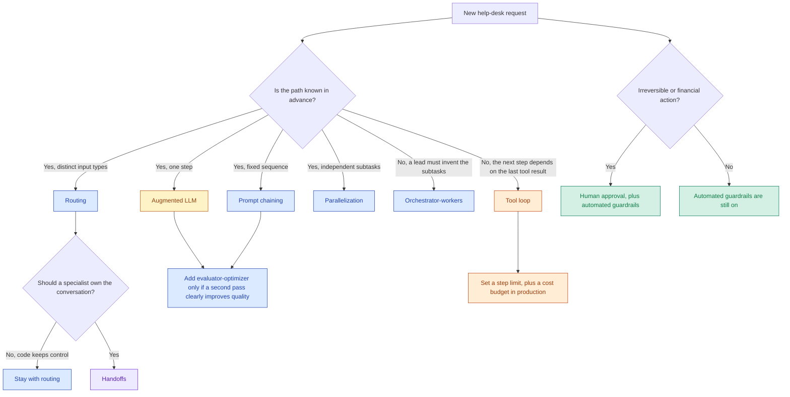
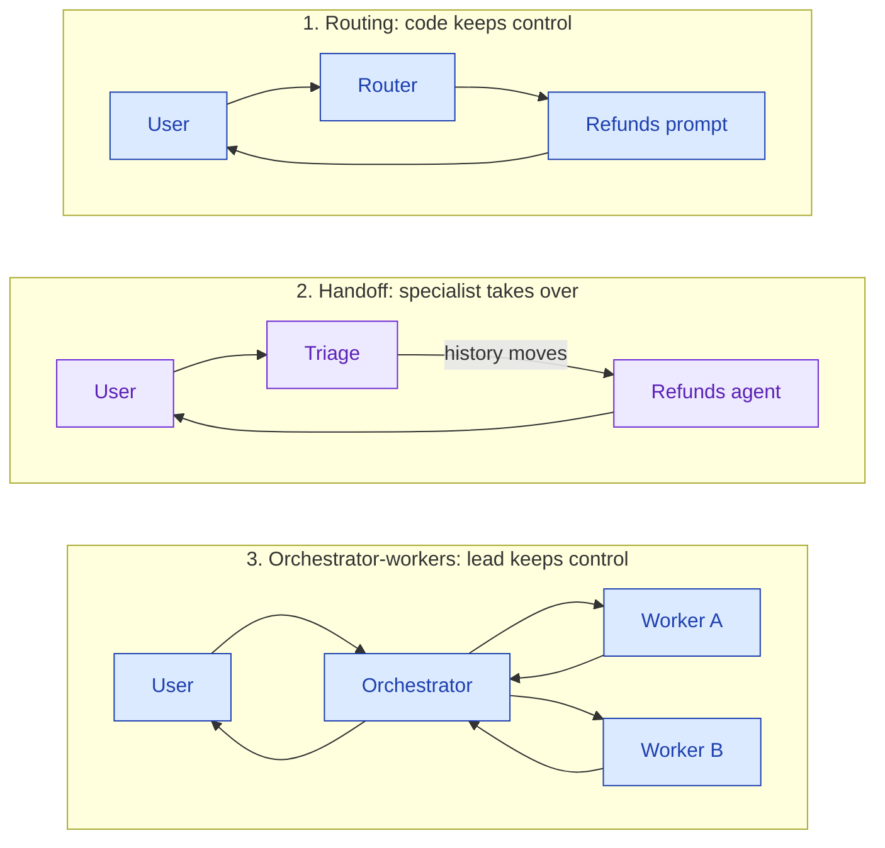

<div class="callout">
<p><strong>How to use this post</strong></p>
<ul>
<li>This is a <strong>myth versus fact</strong> post. A common list of eight names shows up in tutorials and interviews: Augmented LLM, prompt chaining, routing, parallelization, orchestrator-workers, the ReAct loop, handoffs, and human-in-the-loop. The names are useful. Treating them as eight kinds of agent is not.</li>
<li>The eight names are not one source's official taxonomy. They combine Anthropic's workflows and agent loop with handoffs and human-in-the-loop from OpenAI's Agents SDK.</li>
<li>The running example is <strong>FairCart</strong>, a made-up shop help desk. Password resets, refunds, and a short policy email are enough to show which pattern fits, and what breaks if you pick the wrong one.</li>
<li>I checked the claims against <a href="https://www.anthropic.com/research/building-effective-agents" target="_blank" rel="noopener">Anthropic's "Building effective agents"</a> (19 December 2024, page re-read in November 2026), the <a href="https://arxiv.org/abs/2210.03629" target="_blank" rel="noopener">ReAct paper by Yao and others (2022)</a>, and the <a href="https://openai.github.io/openai-agents-python/handoffs/" target="_blank" rel="noopener">OpenAI Agents SDK handoff docs</a>.</li>
<li>Numbers in the lab come from one run of <code>code/patterns_demo.py</code>. The "LLM" in that script is a small rule-based stand-in, so the control flow is repeatable. It is not a model benchmark.</li>
<li>Human approval is covered in more depth in <a href="https://blogs.theintelliwise.com/posts/human-in-the-loop-approval-fatigue/" target="_blank" rel="noopener">The Human in the Loop Can Get Tired</a>. Building the loop itself is in <a href="https://blogs.theintelliwise.com/posts/fastapi-or-langchain-for-ai-agents/" target="_blank" rel="noopener">FastAPI or LangChain for Your First AI Agent?</a>.</li>
</ul>
</div>

---

## The short answer first

People say "agent" for almost any LLM app that calls a tool. I use a simpler split, the one Anthropic uses for what they call agentic systems:

- <span style="background:#dbeafe;color:#1e40af;font-weight:600;padding:1px 7px;border-radius:4px">Workflow</span>: your code decides the path. The model fills in the steps.
- <span style="background:#ffedd5;color:#9a3b0a;font-weight:600;padding:1px 7px;border-radius:4px">Agent</span>: the model decides the next step, usually by calling tools in a loop.
- <span style="background:#d4f0e4;color:#0d7a45;font-weight:600;padding:1px 7px;border-radius:4px">Control</span>: a wrap around either of the above, such as a human approval or an automated guardrail.

Most FairCart questions should stay at an <span style="background:#fef3c7;color:#92400e;font-weight:600;padding:1px 7px;border-radius:4px">augmented LLM</span>: one model call, with retrieval, and maybe a tool. Add a pattern only when a simpler path is clearly not enough. That is also Anthropic's advice: start simple, and add complexity only when it measurably helps.


Here is a decision path I would actually use. You can combine more than one pattern. Every request also goes through the risk question on the right. A human approval is not a substitute for choosing the right pattern.



---

## A colour key

I use the same colours in every table, Mermaid diagram, and GIF.

| Colour | Kind | What it means |
| --- | --- | --- |
| <span style="background:#fef3c7;color:#92400e;font-weight:600;padding:1px 7px;border-radius:4px">Gold</span> | Building block | One model call, with retrieval, tools, or memory |
| <span style="background:#dbeafe;color:#1e40af;font-weight:600;padding:1px 7px;border-radius:4px">Blue</span> | Workflow | Your code owns the path |
| <span style="background:#ffedd5;color:#9a3b0a;font-weight:600;padding:1px 7px;border-radius:4px">Orange</span> | Agent loop | The model picks the next tool call |
| <span style="background:#ede9fe;color:#5b21b6;font-weight:600;padding:1px 7px;border-radius:4px">Purple</span> | Multi-agent | Another agent takes over the conversation |
| <span style="background:#d4f0e4;color:#0d7a45;font-weight:600;padding:1px 7px;border-radius:4px">Green</span> | Control | Guardrails and human approval |


---

## The eight patterns, in one table

| Pattern | Kind | Use when | Watch out |
| --- | --- | --- | --- |
| 1. Augmented LLM | <span style="background:#fef3c7;color:#92400e;font-weight:600;padding:1px 7px;border-radius:4px">Building block</span> | The task is well defined. Most help-desk work stops here. | Do not reach for a loop before you have tried this. Retrieval quality usually decides the result. |
| 2. Prompt chaining | <span style="background:#dbeafe;color:#1e40af;font-weight:600;padding:1px 7px;border-radius:4px">Workflow</span> | The work splits cleanly into known steps, such as outline, check, draft, translate. | Latency adds up. Errors flow downstream. You can add a programmatic gate. In practice a failed gate should stop or reroute the run. |
| 3. Routing | <span style="background:#dbeafe;color:#1e40af;font-weight:600;padding:1px 7px;border-radius:4px">Workflow</span> | Inputs fall into distinct types, or easy cases can go to a cheaper model. | A misroute can fail silently. Measure router accuracy and keep a fallback. |
| 4. Parallelization | <span style="background:#dbeafe;color:#1e40af;font-weight:600;padding:1px 7px;border-radius:4px">Workflow</span> | Subtasks do not depend on each other, or you want confidence through agreement. | Cost multiplies. Design the aggregator first. Anthropic splits this into sectioning and voting. |
| 5. Orchestrator-workers | <span style="background:#dbeafe;color:#1e40af;font-weight:600;padding:1px 7px;border-radius:4px">Workflow</span> | You cannot predict the subtasks in advance, such as a change across an unknown set of files. | Workers need precise specs or they duplicate work. The orchestrator can become a bottleneck. |
| 6. ReAct-shaped tool loop | <span style="background:#ffedd5;color:#9a3b0a;font-weight:600;padding:1px 7px;border-radius:4px">Agent loop</span> | Open-ended work where each step depends on what the last tool returned. | Runaway loops and cost. Anthropic recommends a step limit. A cost budget is production practice. Return clear tool errors. |
| 7. Handoffs | <span style="background:#ede9fe;color:#5b21b6;font-weight:600;padding:1px 7px;border-radius:4px">Multi-agent</span> | Distinct stages where a specialist should own the conversation, not just answer a sub-question. | Context gets lost. Agents can bounce the user. Write handoff rules, and filter history when you need to. |
| 8. Human-in-the-loop | <span style="background:#d4f0e4;color:#0d7a45;font-weight:600;padding:1px 7px;border-radius:4px">Control</span> | Irreversible or financial actions, such as a refund, a payment, or an external email. | Not the same as a guardrail, and not needed on every call. Too many approvals and people rubber-stamp. Risk-rating each tool is sound practice. |

One important workflow is often missing from that list: <strong>evaluator-optimizer</strong>. I cover it after the myths.

---

## Myth 1: If it uses an LLM, it is an agent

**Why people believe it.** "Agent" is a popular word. A chatbot that searches docs, or calls a refund tool once, gets the same label as a system that plans, calls tools for several turns, and decides when it is done.

**What is true.** Anthropic draws a clear line. A <strong>workflow</strong> is a system where LLMs and tools follow a path your code already defined. An <strong>agent</strong> is a system where the model directs its own process and tool use. Both are agentic systems. Only the second one is an agent in that sense.

A FairCart bot that answers "How do I reset my password?" from the help docs is a workflow, usually just an augmented LLM. It does not become an agent because someone added a search tool. The interesting question is not "is this an agent?". It is "who decides the next step?".

---

## Myth 2: Start with a multi-agent loop, then simplify later

**Why people believe it.** Demos start at the impressive end. A team of specialists, a ReAct loop, and a trace UI look like production. The simple version looks like a toy.

**What is true.** The cost and latency of a loop are easy to add and hard to take out. Anthropic's line is the one I would write on a design doc: find the simplest solution that works, and only increase complexity when you need to. For many apps, one model call with retrieval and a few in-context examples is enough.

If I were building FairCart, I would not start with a refunds agent, a billing agent, and a researcher. I would start with docs plus one model call. I would add routing when billing and technical tickets clearly need different prompts. I would add a loop only for questions where I cannot write the steps in advance.

---

## Myth 3: The augmented LLM is too basic to bother with

**Why people believe it.** "One model call" sounds like a chatbot from last year. People want to jump to agents.

**What is true.** Anthropic calls the augmented LLM the <strong>building block</strong> of agentic systems: a model with retrieval, tools, and memory. The rest of the patterns assume you already have this. A single tool call in one turn still belongs here. A tool loop starts only when the model may call tools again, after it has seen a result.

In the lab, the password-reset question is one retrieval and one call:

```text
calls=1
retrieved:
  - Open Settings, click Forgot password, and check your email.
answer: Open Settings, click Forgot password, and check your email.
```

If this answer is wrong, the first fix is the retrieval, not a multi-agent design.

---

## Myth 4: A prompt chain is just a short agent

**Why people believe it.** Both make more than one model call. From the outside, "outline, then draft, then translate" can look like a tiny agent.

**What is true.** In a chain, the steps are fixed. You can add programmatic gates between them. In practice, a failed gate should stop or reroute the run, so a bad outline does not become a bad draft. The model does not get to invent a new step. That is the point. You trade a bit of latency for a simpler, more accurate step at each stage. Anthropic's examples are the same shape: write marketing copy, then translate it; or write an outline, check it, then write the document.

The FairCart policy email uses four calls on the happy path: outline, gate, draft, translate. When I feed the gate a bad outline, the run stops after two calls. The draft and the translation never run.

```text
happy path calls=4 stopped_at=None
bad outline calls=2 stopped_at=gate
  [gate] FAIL missing: 30-day, usd 50, unused
```


If the steps are not actually known, a chain will hide that problem. The gate will keep failing, or you will start adding extra "just in case" steps. That is a sign you wanted a tool loop, or an orchestrator, not a longer chain.

---

## Myth 5: Routing and handoffs are the same thing

**Why people believe it.** Both send a ticket to a specialist. A diagram of "billing / technical / refunds" can describe either one. The words get used interchangeably.

**What is true.** They differ in <strong>who owns the conversation after the decision</strong>.

<strong>Routing</strong> is a workflow. You classify the input, then send it to a specialised prompt, tool, or model. Your code usually keeps control. This is the right tool when categories are distinct and you can measure the classifier. Anthropic also uses it to send easy questions to a smaller model and hard ones to a stronger model. The quiet failure mode is a misroute: the billing prompt answers a crash ticket, and nobody notices unless you track router accuracy and keep a fallback.

<strong>Handoffs</strong> are a multi-agent move. One agent transfers control, and usually the conversation history, to the next specialist. It is closer to a phone transfer than to a switch statement. The <a href="https://openai.github.io/openai-agents-python/handoffs/" target="_blank" rel="noopener">OpenAI Agents SDK</a> exposes a handoff as a tool, for example `transfer_to_refund_agent`. The receiving agent becomes the active agent for the rest of the turn. That is useful when the specialist should speak to the user with its own tools and instructions. The failure mode is different: context gets dropped, or two agents bounce the user back and forth, unless you define handoff rules and, when needed, filter the history.

A third shape, orchestrator-workers, is easy to mix in here. The lead keeps control and synthesizes the final answer. In practice, that usually means the workers do not talk to the user. OpenAI's manager pattern, agents as tools, shows this most clearly: the manager stays in control and calls specialists as helpers.

In the lab, the same ticket, "I want a refund.", takes two calls in both designs. The difference is the active agent at the end:

```text
Routing:   route=refunds  active=router
Handoffs:  active_agent=refunds
           triage: handoff to refunds
           refunds: I can start a refund once a person approves the amount.
```




If the specialist only needs a different prompt, use routing. If the specialist should own the rest of the chat, use a handoff. If a lead must invent subtasks and then combine the results, use orchestrator-workers. Do not build all three because the diagram looks complete.

---

## Myth 6: Orchestrator-workers is just parallelization with a manager

**Why people believe it.** Both have several workers. Both can run work at the same time. The picture looks similar.

**What is true.** Anthropic is direct about the difference. In <strong>parallelization</strong>, the subtasks are known in advance. There are two common flavours:

- <strong>Sectioning</strong>: split independent work, such as three checks on one pull request, or a second model that only screens for a policy problem.
- <strong>Voting</strong>: run the same task more than once and aggregate, for example several prompts reviewing one change for a security issue.

Cost multiplies, so you design the aggregator first. In the lab I ran three independent checks, each sleeping 50 milliseconds to stand in for a model call. One run took 150.5 ms in sequence and 51.3 ms in parallel. Both paths made three calls and returned the same three results. Five extra runs stayed close to that: about 150 ms versus 52 ms, a ratio of about 2.9, which is what you want from three independent 50 ms checks.

<strong>Orchestrator-workers</strong> looks similar on a whiteboard, but the lead LLM decides the subtasks at runtime, from the input. You use it when you cannot list the work in advance. A coding change that might touch two files or ten files is the usual example. The lead can bottleneck, and workers will overlap if the specs are vague.

In the lab, one request, "Update checkout and the email templates", produced two workers: `checkout.md` and `email-templates.md`, for four calls including the plan and the summary. A second request, "Update the refund policy only", produced one worker, `refund-policy.md`, for three calls. The lead kept control in both cases. The worker list was not hardcoded. That is the whole difference.

---

## Myth 7: Production agents work by parsing Thought and Action out of the model text

**Why people believe it.** The ReAct paper taught a very memorable format: the model writes a thought, then an action, then it sees an observation, and it repeats. Many tutorials still show that text loop. People take the format for the idea.

**What is true.** <a href="https://arxiv.org/abs/2210.03629" target="_blank" rel="noopener">ReAct (Yao and others, 2022)</a> is originally a free-form text prompting pattern. The model interleaves reasoning traces and actions, and that loop is the contribution. The original setup used few-shot text and a frozen model. It is still worth knowing, because "reason, act, observe, repeat" is the shape of almost every tool-using agent.

What I would not do in production, if the model already supports tool calling, is parse lines such as `Action: search[...]` out of free text. Today's APIs return a structured tool call: a name, an id, and JSON arguments. The harness runs the tool and sends the result back. The loop is the same. The interface is much less fragile.

The loop is for open-ended work, where you cannot hardcode the path. A research question such as "Why was my order delayed?" is a fair case: search, fetch a doc, then answer. It is a poor default for a password-reset FAQ.

Two things matter more than the format. Anthropic's agents guidance recommends a step limit, such as a maximum number of iterations. A cost budget is production practice. Return a clear error when a tool fails. In the lab, a step budget of 4 was enough: search, fetch, finish, in three calls. A budget of 1 stopped after search, and the answer was empty. That empty answer is a feature. A loop with no limit will keep calling tools until the bill surprises you.

```text
budget=4 calls=3 hit_budget=False
  step 1: tool:search query=order delay reason
  step 2: tool:fetch url=https://docs.faircart.example/shipping
  step 3: tool:finish answer=The order waited one extra day at the warehouse.

budget=1 calls=1 hit_budget=True
  step 1: tool:search query=order delay reason
  answer: None
```

---

## Myth 8: Human-in-the-loop means a person approves every action, and that is the same as guardrails

**Why people believe it.** "Keep a human in the loop" is said as if it were a finished safety feature. Lists often draw one diagram with an input guardrail, a human approval, and an output guardrail, and call the whole thing one pattern. "Always in production" is a tempting short version of that diagram.

**What is true.** Those are two different layers, and they should not fire on the same things.

<strong>Automated guardrails</strong> can check inputs and outputs on every request. A second model can screen a reply in parallel with the main call. That is sectioning, and it does not need a person.

<strong>Human approval</strong> is for irreversible or financial work: a refund, a payment, an email to a customer, a delete. It is not for every FAQ. If you ask a person to tick a box on every tool call, they will get tired and start rubber-stamping. I wrote about that fade in <a href="https://blogs.theintelliwise.com/posts/human-in-the-loop-approval-fatigue/" target="_blank" rel="noopener">The Human in the Loop Can Get Tired</a>. Risk-rating each tool is sound practice, not a named rule from one vendor. <a href="https://docs.langchain.com/oss/python/langgraph/interrupts" target="_blank" rel="noopener">LangGraph interrupts</a> do cover pausing before a financial action such as a refund. I used that pause in the <a href="https://blogs.theintelliwise.com/posts/fastapi-or-langchain-for-ai-agents/" target="_blank" rel="noopener">FastAPI or LangChain post</a>.

FairCart in the lab uses a simple rule: refunds above USD 50 need a person. A leak is blocked automatically, and a person is not asked.

```text
action='answer_faq'          guardrail=passed   human=not asked     ran answer_faq
action='refund' USD 20       guardrail=passed   human=not asked     ran refund of USD 20
action='refund' USD 80       guardrail=passed   human=pending       paused: refund of USD 80 needs a person
action='... card number ...' guardrail=blocked  human=not asked     blocked by output guardrail
```


"Always in production" is the wrong slogan. Automated guardrails can be always on. A human should be in the path of the risky tools, with enough time and context to actually notice a bad request.

---

## The pattern the usual list leaves out: evaluator-optimizer

Anthropic's workflow list has one more item: a generator and an evaluator in a loop. One call writes a draft. Another call scores it against a clear checklist. The first call then revises. <a href="https://platform.claude.com/cookbook/patterns-agents-evaluator-optimizer" target="_blank" rel="noopener">Anthropic's cookbook</a> loops until the evaluator returns PASS. A max-round cap is a production addition, so the loop cannot run forever if the evaluator never passes.

Use it when you have measurable criteria, and when a second pass actually improves the result. Literary translation and a careful search that may need another query are Anthropic's examples. Skip it when the first draft is already good enough, when a deterministic check such as a linter would do, or when you cannot write the criteria clearly enough for a model to apply them. In production, cap the rounds.

In the lab, a thin refund draft failed the checklist, then passed on the second round, in two calls:

```text
round 1: FAIL add the order-number request and the 30-day rule
round 2: PASS tone is clear and the policy is complete
```

This is not a ReAct loop. The path is fixed: generate, evaluate, maybe revise. It is a chain that can repeat, with a stop condition.

---

## What breaks if you pick the wrong one

| If you use | When the job was actually | What tends to break |
| --- | --- | --- |
| A tool loop | A known, fixed sequence | Extra latency, less predictable traces, a real risk of a runaway bill |
| Handoffs | A simple route to a different prompt | More prompts to maintain, lost context, users bounced between agents |
| Orchestrator-workers | Independent checks you could name in advance | A planning step you did not need, duplicate worker output, a busy lead |
| Parallel voting | Steps that depend on each other | A merge of half-finished work, and three times the cost |
| Human approval on every tool | Mostly low-risk FAQs | Approval fatigue, and a rubber stamp on the one dangerous action |
| Only an augmented LLM | Open-ended research that needs several tool results | Confident answers with no intermediate evidence |

The failure is usually not "the model is weak". It is that the control flow does not match the work.

---

## A short lab you can run

The script at `code/patterns_demo.py` walks through every pattern above on the FairCart help desk. It does not call a hosted model. I saved the full output in `code/demo.out`. The figures in this post are from that file, except the five extra timing runs, which I did to check that 150.5 ms versus 51.3 ms was not a one-off.

```bash
python3 code/patterns_demo.py
```

You should see the same control-flow results on any quiet machine: one call for the password reset, four calls versus two for the email chain, `active=router` versus `active_agent=refunds` on the same ticket, three workers decided at runtime, a tool loop that finishes in three steps or stops at a budget of 1, and a USD 80 refund that pauses. The wall-clock times for the parallel checks will move a little, because they depend on a 50 ms sleep and on the machine.

If you want the same refund flow with a real model, a pause, and a restart after approval, that build is already in the <a href="https://blogs.theintelliwise.com/posts/fastapi-or-langchain-for-ai-agents/" target="_blank" rel="noopener">FastAPI or LangChain post</a>.

---

## How I would actually build FairCart

Start with an augmented LLM over the help docs. That will clear the password and tracking questions.

Add routing when billing, technical, and refund tickets clearly need different prompts or tools. Send easy questions to a smaller model only after you can measure that the router is accurate enough.

For refunds, use a risk rule, not a blanket human checkbox. In this post the line is USD 50. Automated guardrails stay on for every reply.

Use a prompt chain for a policy email that must pass a checklist before it is translated. Use parallel sectioning for independent checks on a change. Use orchestrator-workers when a request might touch an unknown set of files. Use a tool loop, with a tight budget, only for investigations you cannot pre-plan. Add a handoff only if a specialist must own the rest of the chat, not just answer one question. Add evaluator-optimizer only if a second pass, against a written checklist, clearly improves the reply.

You will not need all of these on day one. That is the point.

---

## Sources and further reading

- <a href="https://www.anthropic.com/research/building-effective-agents" target="_blank" rel="noopener">Anthropic: Building effective agents (19 December 2024). Workflows versus agents, the augmented LLM, chaining, routing, parallelization, orchestrator-workers, and evaluator-optimizer. Re-read in November 2026.</a>
- <a href="https://arxiv.org/abs/2210.03629" target="_blank" rel="noopener">Yao, Zhao, Yu, Du, Shafran, Narasimhan and Cao: ReAct, Synergizing Reasoning and Acting in Language Models (2022)</a>
- <a href="https://openai.github.io/openai-agents-python/handoffs/" target="_blank" rel="noopener">OpenAI Agents SDK: Handoffs</a>
- <a href="https://openai.github.io/openai-agents-python/multi_agent/" target="_blank" rel="noopener">OpenAI Agents SDK: Agent orchestration, including handoffs versus agents as tools</a>
- <a href="https://developers.openai.com/api/docs/guides/agents/orchestration" target="_blank" rel="noopener">OpenAI: Orchestration and handoffs</a>
- <a href="https://platform.claude.com/cookbook/patterns-agents-evaluator-optimizer" target="_blank" rel="noopener">Anthropic cookbook: Evaluator-optimizer (the sample loop continues until PASS)</a>
- <a href="https://docs.langchain.com/oss/python/langgraph/interrupts" target="_blank" rel="noopener">LangGraph: Interrupts (pause before a tool or a human decision)</a>

Related Intelliwise posts: <a href="https://blogs.theintelliwise.com/posts/fastapi-or-langchain-for-ai-agents/" target="_blank" rel="noopener">FastAPI or LangChain for Your First AI Agent?</a>, <a href="https://blogs.theintelliwise.com/posts/human-in-the-loop-approval-fatigue/" target="_blank" rel="noopener">The Human in the Loop Can Get Tired</a>, <a href="https://blogs.theintelliwise.com/posts/from-one-api-call-to-company-assistant/" target="_blank" rel="noopener">From One API Call to a Company Assistant</a>, and <a href="https://blogs.theintelliwise.com/posts/ai-agent-evals-golden-examples-grader/" target="_blank" rel="noopener">AI Agent Evals: Golden Examples and the Grader</a>.
